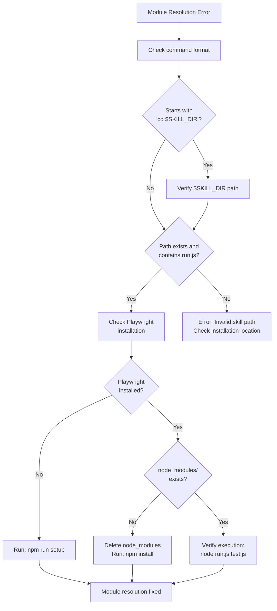
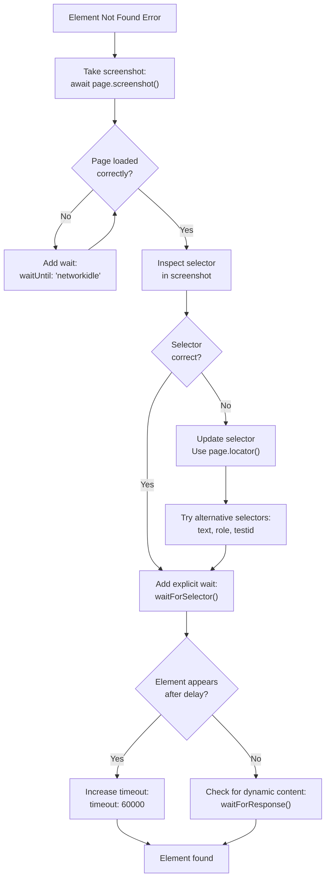
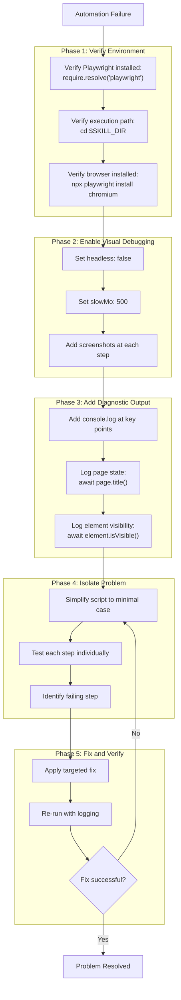
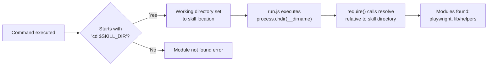

<!-- source: DeepWiki mcp.deepwiki.com · repo lackeyjb/playwright-skill · page 5.4 Debugging and Troubleshooting · fetched 2026-10-26 -->

# Debugging and Troubleshooting

<details>
<summary>Relevant source files</summary>

The following files were used as context for generating this wiki page:

- [README.md](README.md)
- [skills/playwright-skill/SKILL.md](skills/playwright-skill/SKILL.md)
- [skills/playwright-skill/run.js](skills/playwright-skill/run.js)

</details>


This page provides practical guidance for debugging browser automation scripts executed through the playwright-skill. It covers visual debugging features, diagnostic tools, common errors and their solutions, and systematic troubleshooting workflows.

For writing automation scripts, see [Writing Automation Scripts](#5.1). For testing workflows and organization, see [Testing Workflows](#5.3).

---

## Visual Debugging Features

The playwright-skill prioritizes debuggability by making browser automation visible and observable by default.

### Default Visual Configuration

The skill uses visibility-first defaults that make debugging straightforward:

| Configuration | Default Value | Purpose |
|--------------|---------------|---------|
| `headless` | `false` | Browser window visible during execution |
| `slowMo` | `100` (ms) | 100ms delay between actions for visibility |
| `timeout` | `30000` (ms) | 30 seconds for operations to complete |
| `viewport` | `1280x720` | Standard desktop viewport size |

These defaults ensure that automation is observable in real-time without requiring explicit debug flags.

**Headless Mode Override**

Only use `headless: true` when explicitly requested:

```javascript
// Default: visible browser
const browser = await chromium.launch({ headless: false });

// Only when user requests "headless" or "background"
const browser = await chromium.launch({ headless: true });
```

**Slow Motion Adjustment**

Increase `slowMo` for better observation of fast-executing scripts:

```javascript
// Standard debugging speed
const browser = await chromium.launch({ 
  headless: false, 
  slowMo: 100 
});

// Slower for complex interactions
const browser = await chromium.launch({ 
  headless: false, 
  slowMo: 500 
});
```

Sources: [skills/playwright-skill/SKILL.md:103-116](), [skills/playwright-skill/SKILL.md:339-349](), [README.md:160-165]()

---

## Diagnostic Output Strategies

### Console Logging Patterns

Use `console.log()` extensively to track automation progress and report results:

```javascript
// Progress tracking
console.log('📄 Navigating to:', TARGET_URL);
await page.goto(TARGET_URL);
console.log('✅ Page loaded:', await page.title());

// Action reporting
console.log('🔍 Filling login form...');
await page.fill('input[name="email"]', 'test@example.com');
console.log('✅ Form filled');

// Result reporting
console.log('📸 Screenshot saved to /tmp/screenshot.png');

// Error context
console.error('❌ Failed to find element: .submit-button');
```

### Screenshot-Based Debugging

Screenshots provide visual verification at key points:

```javascript
// Before critical action
await page.screenshot({ 
  path: '/tmp/before-click.png', 
  fullPage: true 
});

// After action
await page.click('button.submit');
await page.screenshot({ 
  path: '/tmp/after-click.png', 
  fullPage: true 
});

// Element-specific screenshot
const element = await page.locator('.error-message');
await element.screenshot({ path: '/tmp/error-element.png' });
```

All screenshots are automatically saved to `/tmp/` for OS-managed cleanup.

### Error Message Structure

The `run.js` executor provides structured error output:

```javascript
// run.js wraps code with error handling
try {
  ${code}
} catch (error) {
  console.error('❌ Automation error:', error.message);
  if (error.stack) {
    console.error(error.stack);
  }
  process.exit(1);
}
```

Sources: [skills/playwright-skill/SKILL.md:209-235](), [skills/playwright-skill/run.js:126-136](), [skills/playwright-skill/SKILL.md:349]()

---

## Common Errors and Solutions

### Module Resolution Errors

**Error Message:**
```
Error: Cannot find module 'playwright'
Error: Cannot find module './lib/helpers'
```

**Root Cause:**
Code executed from wrong directory, breaking module resolution.

**Solution:**
Always execute through `run.js` from the skill directory using `cd $SKILL_DIR`:

```bash
# Correct execution pattern
cd $SKILL_DIR && node run.js /tmp/playwright-test-script.js

# Incorrect (will fail)
node /path/to/run.js /tmp/playwright-test-script.js
```

The `run.js` executor changes to the skill directory for proper module resolution:

```javascript
// run.js ensures correct working directory
process.chdir(__dirname);  // Line 18
```

### Module Resolution Debugging Flowchart



Sources: [skills/playwright-skill/run.js:17-18](), [skills/playwright-skill/SKILL.md:9-15](), [skills/playwright-skill/SKILL.md:358-359](), [README.md:201-202]()

---

### Playwright Not Installed

**Error Message:**
```
📦 Playwright not found. Installing...
Error: Failed to install Playwright
```

**Automatic Installation:**

The `run.js` executor attempts automatic installation when Playwright is missing:

```javascript
// run.js checks and installs if needed
function checkPlaywrightInstalled() {
  try {
    require.resolve('playwright');
    return true;
  } catch (e) {
    return false;
  }
}

function installPlaywright() {
  console.log('📦 Playwright not found. Installing...');
  execSync('npm install', { stdio: 'inherit', cwd: __dirname });
  execSync('npx playwright install chromium', { stdio: 'inherit', cwd: __dirname });
  console.log('✅ Playwright installed successfully');
}
```

**Manual Installation:**

If automatic installation fails, run setup manually:

```bash
cd $SKILL_DIR
npm run setup
```

This executes the setup script defined in `package.json`:

```json
"scripts": {
  "setup": "npm install && npx playwright install chromium"
}
```

Sources: [skills/playwright-skill/run.js:23-47](), [skills/playwright-skill/SKILL.md:353-356](), [README.md:197-199]()

---

### Browser Launch Failures

**Error Message:**
```
Error: browserType.launch: Executable doesn't exist
Error: Failed to launch browser
```

**Cause: Browser Binaries Not Installed**

Playwright requires browser binaries to be downloaded separately:

```bash
# Install Chromium only (default)
npx playwright install chromium

# Install all browsers
cd $SKILL_DIR
npm run install-all-browsers
```

**Cause: Display Not Available (Headless Required)**

In CI/CD or headless environments, the browser cannot open visibly:

```javascript
// Solution: Use headless mode
const browser = await chromium.launch({ 
  headless: true  // Required when no display available
});
```

**Cause: Permissions Issues**

Browser binary may lack execute permissions:

```bash
# Fix permissions on browser binary
chmod +x ~/.cache/ms-playwright/*/chromium-*/chrome-linux/chrome
```

Sources: [README.md:203-208](), [skills/playwright-skill/SKILL.md:361-362](), [skills/playwright-skill/run.js:39]()

---

### Element Not Found

**Error Message:**
```
TimeoutError: Waiting for selector ".submit-button" failed: Timeout 30000ms exceeded
Error: Element not found: button[type="submit"]
```

**Debugging Strategy:**

1. **Take a screenshot to verify page state:**
```javascript
await page.screenshot({ path: '/tmp/before-selector.png', fullPage: true });
```

2. **Add explicit wait with increased timeout:**
```javascript
await page.waitForSelector('.submit-button', { 
  timeout: 10000,
  state: 'visible'  // Ensure element is visible, not just in DOM
});
```

3. **Use flexible locator strategies:**
```javascript
// Try multiple selectors
const button = page.locator('button:has-text("Submit")')
  .or(page.locator('button[type="submit"]'))
  .or(page.locator('[data-testid="submit-btn"]'));
```

4. **Wait for page load before selecting:**
```javascript
await page.goto(TARGET_URL, { waitUntil: 'networkidle' });
await page.waitForLoadState('domcontentloaded');
```

### Element Selection Debugging Workflow



Sources: [skills/playwright-skill/SKILL.md:363-365](), [skills/playwright-skill/SKILL.md:217-234]()

---

### Timeout Errors

**Error Message:**
```
TimeoutError: page.goto: Timeout 30000ms exceeded
TimeoutError: Navigation timeout of 30000ms exceeded
```

**Solution 1: Increase Timeout**

```javascript
await page.goto(TARGET_URL, {
  timeout: 60000,  // 60 seconds instead of default 30
  waitUntil: 'networkidle'
});
```

**Solution 2: Wait for Specific Conditions**

```javascript
// Wait for specific element instead of full page load
await page.goto(TARGET_URL, { waitUntil: 'domcontentloaded' });
await page.waitForSelector('.main-content', { timeout: 10000 });
```

**Solution 3: Handle Slow Networks**

```javascript
// Set global timeout
const context = await browser.newContext({
  timeout: 60000  // Apply to all operations in this context
});
```

Sources: [README.md:163](), [skills/playwright-skill/SKILL.md:218-221]()

---

## Systematic Debugging Workflow

### Step-by-Step Troubleshooting Process



### Debugging Template Script

Use this template to systematically debug issues:

```javascript
// /tmp/playwright-debug-template.js
const { chromium } = require('playwright');

const TARGET_URL = 'http://localhost:3001';

(async () => {
  console.log('🔍 Starting debug session');
  
  // Step 1: Launch with full visibility
  const browser = await chromium.launch({ 
    headless: false,
    slowMo: 500,  // Very slow for observation
    devtools: true  // Open DevTools
  });
  
  console.log('✅ Browser launched');
  
  const page = await browser.newPage();
  
  // Step 2: Enable console event logging
  page.on('console', msg => console.log('PAGE LOG:', msg.text()));
  page.on('pageerror', err => console.error('PAGE ERROR:', err));
  
  try {
    // Step 3: Navigate with detailed logging
    console.log('🌐 Navigating to:', TARGET_URL);
    await page.goto(TARGET_URL, { 
      waitUntil: 'networkidle',
      timeout: 60000
    });
    console.log('✅ Page loaded:', await page.title());
    
    // Step 4: Screenshot initial state
    await page.screenshot({ 
      path: '/tmp/debug-01-initial.png', 
      fullPage: true 
    });
    console.log('📸 Initial screenshot saved');
    
    // Step 5: Test your problematic step here
    console.log('🔍 Testing problematic operation...');
    
    // Add your failing code here with extra logging
    
    // Step 6: Screenshot final state
    await page.screenshot({ 
      path: '/tmp/debug-02-final.png', 
      fullPage: true 
    });
    console.log('📸 Final screenshot saved');
    
    console.log('✅ Debug session completed');
    
  } catch (error) {
    console.error('❌ Error occurred:', error.message);
    console.error('Stack:', error.stack);
    
    // Screenshot error state
    await page.screenshot({ 
      path: '/tmp/debug-error.png', 
      fullPage: true 
    });
    console.log('📸 Error screenshot saved');
    
    throw error;
  } finally {
    await browser.close();
  }
})();
```

Sources: [skills/playwright-skill/SKILL.md:209-235](), [skills/playwright-skill/run.js:126-136]()

---

## run.js Error Handling

### Automatic Error Context

The `run.js` executor provides automatic error handling and context:

```javascript
// Wraps all code in try-catch
try {
  ${code}
} catch (error) {
  console.error('❌ Automation error:', error.message);
  if (error.stack) {
    console.error(error.stack);
  }
  process.exit(1);
}
```

### Execution Modes and Error Reporting

| Mode | Command | Error Behavior |
|------|---------|----------------|
| File | `node run.js script.js` | Reports file path and line numbers |
| Inline | `node run.js 'code'` | Reports inline code context |
| Stdin | `cat script.js \| node run.js` | Reports execution context |

### Temporary File Cleanup

The executor manages temporary files to prevent race conditions:

```javascript
// Cleanup happens on NEXT run, not during execution
function cleanupOldTempFiles() {
  const tempFiles = files.filter(f => 
    f.startsWith('.temp-execution-') && f.endsWith('.js')
  );
  tempFiles.forEach(file => {
    try {
      fs.unlinkSync(filePath);
    } catch (e) {
      // Ignore errors - file might be in use
    }
  });
}
```

This prevents deleting temp files while async operations are still running.

Sources: [skills/playwright-skill/run.js:86-104](), [skills/playwright-skill/run.js:107-157](), [skills/playwright-skill/run.js:180-201]()

---

## Advanced Debugging Techniques

### Network Activity Monitoring

Track network requests to debug API calls and resource loading:

```javascript
// Log all requests
page.on('request', request => {
  console.log('🌐 Request:', request.method(), request.url());
});

// Log responses with status
page.on('response', response => {
  console.log('📥 Response:', response.status(), response.url());
});

// Wait for specific API call
await page.goto(TARGET_URL);
const response = await page.waitForResponse(
  resp => resp.url().includes('/api/data') && resp.status() === 200
);
console.log('API Response:', await response.json());
```

### Browser Console Access

Capture console messages from the page itself:

```javascript
page.on('console', msg => {
  const type = msg.type();
  const text = msg.text();
  console.log(`[${type.toUpperCase()}] ${text}`);
});

page.on('pageerror', error => {
  console.error('❌ Page Error:', error.message);
});
```

### DevTools Integration

Open DevTools automatically for interactive debugging:

```javascript
const browser = await chromium.launch({ 
  headless: false,
  devtools: true  // Opens DevTools on browser launch
});
```

### Tracing for Full Debugging Context

Enable Playwright tracing to capture all actions:

```javascript
const context = await browser.newContext();

// Start tracing
await context.tracing.start({ 
  screenshots: true, 
  snapshots: true 
});

const page = await context.newPage();

try {
  // Your automation here
  await page.goto(TARGET_URL);
} finally {
  // Save trace
  await context.tracing.stop({ 
    path: '/tmp/trace.zip' 
  });
}

// View trace: npx playwright show-trace /tmp/trace.zip
```

Sources: [skills/playwright-skill/SKILL.md:217-234]()

---

## Troubleshooting Quick Reference

### Error Type Resolution Matrix

| Error Type | Quick Check | Solution | Reference |
|-----------|-------------|----------|-----------|
| Module not found | Command starts with `cd $SKILL_DIR`? | Use full command pattern | [run.js:18]() |
| Playwright not installed | `node_modules/` exists? | Run `npm run setup` | [run.js:35-46]() |
| Browser launch failed | Chromium installed? | Run `npx playwright install chromium` | [SKILL.md:361-362]() |
| Element not found | Screenshot shows element? | Add `waitForSelector()` | [SKILL.md:363-365]() |
| Timeout exceeded | Network slow? | Increase timeout or use `networkidle` | [SKILL.md:218-221]() |
| Script not executing | Temp file in `/tmp/`? | Check file permissions | [run.js:184-185]() |

### Common Command Patterns

```bash
# Correct execution pattern
cd $SKILL_DIR && node run.js /tmp/playwright-test-*.js

# Setup and installation
cd $SKILL_DIR && npm run setup
cd $SKILL_DIR && npm run install-all-browsers

# Server detection
cd $SKILL_DIR && node -e "require('./lib/helpers').detectDevServers().then(s => console.log(JSON.stringify(s)))"

# Manual Playwright check
cd $SKILL_DIR && node -e "require('playwright')"
```

### Helper Function Debugging

The `lib/helpers.js` utility functions include built-in retry logic and error handling:

```javascript
const helpers = require('./lib/helpers');

// Safe click with automatic retry
await helpers.safeClick(page, 'button.submit', { 
  retries: 3,
  delay: 1000 
});

// Safe type with clear
await helpers.safeType(page, '#username', 'testuser');

// Timestamped screenshots
await helpers.takeScreenshot(page, 'debug-state');
// Saves to: /tmp/screenshot-debug-state-<timestamp>.png
```

Sources: [skills/playwright-skill/SKILL.md:297-324](), [README.md:196-208]()

---

## Path Resolution Reference

### $SKILL_DIR Resolution Table

| Installation Method | $SKILL_DIR Path |
|-------------------|----------------|
| Plugin system | `~/.claude/plugins/marketplaces/playwright-skill/skills/playwright-skill` |
| Manual global | `~/.claude/skills/playwright-skill` |
| Project-specific | `<project>/.claude/skills/playwright-skill` |

### Verification Commands

```bash
# Verify skill directory contains required files
ls $SKILL_DIR
# Expected: SKILL.md, run.js, package.json, lib/

# Verify Playwright installation
cd $SKILL_DIR && node -e "console.log(require.resolve('playwright'))"

# Verify helpers available
cd $SKILL_DIR && node -e "console.log(require('./lib/helpers'))"
```

### Module Resolution Flow



Sources: [skills/playwright-skill/SKILL.md:9-15](), [skills/playwright-skill/run.js:17-18](), [README.md:48-50]()

---

