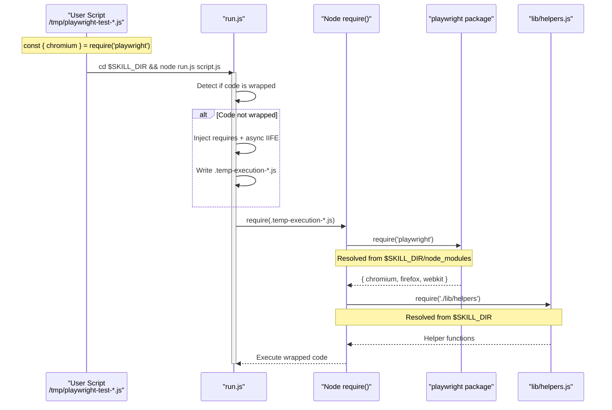
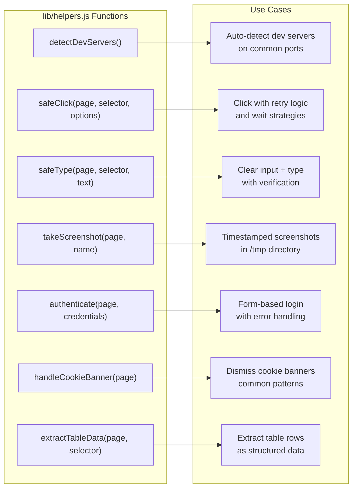

<!-- source: DeepWiki mcp.deepwiki.com · repo lackeyjb/playwright-skill · page 6 API Reference · fetched 2026-10-26 -->

# API Reference

<details>
<summary>Relevant source files</summary>

The following files were used as context for generating this wiki page:

- [API_REFERENCE.md](API_REFERENCE.md)
- [skills/playwright-skill/SKILL.md](skills/playwright-skill/SKILL.md)

</details>


This document provides a comprehensive overview of all APIs available in the playwright-skill system. It serves as the entry point for understanding the complete API surface, including the Playwright Core API, custom helper functions, selector strategies, and network testing capabilities.

For practical usage examples and automation patterns, see [Usage Guide](#5). For specific implementation details, refer to the sub-sections of this page covering individual API domains.

## API Structure and Organization

The playwright-skill exposes two primary API layers that work together to provide browser automation capabilities.

```mermaid
graph TB
    subgraph "API Surface"
        SKILL_MD["SKILL.md<br/>(314 lines - Quick Reference)"]
        API_REF["API_REFERENCE.md<br/>(630 lines - Comprehensive)"]
    end
    
    subgraph "Core Playwright API"
        CHROMIUM["chromium.launch()"]
        FIREFOX["firefox.launch()"]
        WEBKIT["webkit.launch()"]
        CONTEXT["browser.newContext()"]
        PAGE["context.newPage()"]
        LOCATOR["page.locator()"]
        ACTIONS["click/fill/check/select"]
        WAIT["waitFor/waitForURL/waitForSelector"]
        ASSERT["expect() assertions"]
    end
    
    subgraph "Helper Functions API"
        DETECT["detectDevServers()"]
        SAFE_CLICK["safeClick()"]
        SAFE_TYPE["safeType()"]
        SCREENSHOT["takeScreenshot()"]
        AUTH["authenticate()"]
        COOKIE["handleCookieBanner()"]
        TABLE["extractTableData()"]
    end
    
    subgraph "Execution Environment"
        RUN["run.js<br/>Universal Executor"]
        HELPERS["lib/helpers.js"]
        PW_PACKAGE["node_modules/playwright"]
    end
    
    SKILL_MD -.->|"references"| API_REF
    
    API_REF --> CHROMIUM
    API_REF --> CONTEXT
    API_REF --> PAGE
    API_REF --> LOCATOR
    API_REF --> ACTIONS
    API_REF --> WAIT
    API_REF --> ASSERT
    
    SKILL_MD --> DETECT
    SKILL_MD --> SAFE_CLICK
    SKILL_MD --> SCREENSHOT
    
    RUN --> PW_PACKAGE
    RUN --> HELPERS
    
    PW_PACKAGE --> CHROMIUM
    PW_PACKAGE --> FIREFOX
    PW_PACKAGE --> WEBKIT
    
    HELPERS --> DETECT
    HELPERS --> SAFE_CLICK
    HELPERS --> SAFE_TYPE
    HELPERS --> SCREENSHOT
    HELPERS --> AUTH
    HELPERS --> COOKIE
    HELPERS --> TABLE
```



**Sources:** [skills/playwright-skill/SKILL.md:1-407](), [API_REFERENCE.md:1-631]()

## Progressive Documentation Model

The API documentation follows a two-tier progressive disclosure pattern where complexity is revealed only when needed.

| Documentation Level | File | Lines | Purpose | When Loaded |
|---------------------|------|-------|---------|-------------|
| Quick Reference | `SKILL.md` | 314 | Concise instructions, common patterns, critical workflow | Always (Claude reads first) |
| Comprehensive API | `API_REFERENCE.md` | 630 | Complete API reference, advanced patterns, all features | On-demand (for complex scenarios) |

The quick reference provides immediate access to the most common automation patterns, while the comprehensive API documentation is loaded only when Claude identifies a need for advanced features like network interception, visual testing, or mobile emulation.

**Sources:** [skills/playwright-skill/SKILL.md:327-337]()

## Module Resolution and Imports

All API access in playwright-skill requires proper module resolution through the universal executor, which ensures that Playwright and helper functions are available regardless of installation location.



### Standard Import Pattern

All scripts executed through `run.js` use standard Node.js `require()` syntax:

```javascript
// Playwright core API
const { chromium } = require('playwright');

// Helper functions (optional)
const helpers = require('./lib/helpers');
```

The executor ensures these imports resolve correctly by executing from `$SKILL_DIR`, which contains both the `node_modules/playwright` directory and the `lib/helpers.js` file.

**Sources:** [skills/playwright-skill/SKILL.md:9-16](), [skills/playwright-skill/SKILL.md:56-90]()

## API Categories Overview

The complete API surface is organized into distinct categories, each serving specific automation needs.

### Core Browser Control

The foundational APIs for browser lifecycle management and page navigation.

| API | Purpose | Primary Methods | Documentation |
|-----|---------|-----------------|---------------|
| Browser Launch | Launch browser instances | `chromium.launch()`, `firefox.launch()`, `webkit.launch()` | [Playwright Core API](#6.1) |
| Context Management | Isolated browser contexts | `browser.newContext()`, `context.newPage()` | [Playwright Core API](#6.1) |
| Navigation | Page navigation and loading | `page.goto()`, `page.waitForLoadState()`, `page.reload()` | [Playwright Core API](#6.1) |

**Sources:** [API_REFERENCE.md:79-107]()

### Element Interaction

APIs for locating and interacting with page elements.

| API Category | Primary Functions | Documentation |
|--------------|-------------------|---------------|
| Locators | `page.locator()`, `page.getByRole()`, `page.getByText()`, `page.getByLabel()` | [Selectors and Locators](#6.3) |
| Actions | `click()`, `fill()`, `check()`, `selectOption()`, `hover()`, `dragAndDrop()` | [Playwright Core API](#6.1) |
| Assertions | `expect().toBeVisible()`, `expect().toHaveText()`, `expect().toHaveValue()` | [Playwright Core API](#6.1) |
| Waiting | `waitFor()`, `waitForSelector()`, `waitForURL()`, `waitForLoadState()` | [Playwright Core API](#6.1) |

**Sources:** [API_REFERENCE.md:133-181](), [API_REFERENCE.md:183-256]()

### Helper Function Library

Custom utility functions that provide common automation patterns with built-in error handling and retry logic.



All helper functions are accessed via:
```javascript
const helpers = require('./lib/helpers');
```

For detailed API signatures and usage examples, see [Helper Functions API](#6.2).

**Sources:** [skills/playwright-skill/SKILL.md:297-324]()

### Network and API Testing

APIs for intercepting network requests, mocking responses, and testing API interactions.

| Feature | Core API | Use Case |
|---------|----------|----------|
| Request Interception | `page.route()` | Mock API responses, modify headers |
| Request Waiting | `page.waitForRequest()`, `page.waitForResponse()` | Wait for specific network activity |
| Response Modification | `route.fulfill()`, `route.continue()` | Control response data |
| Request Blocking | `route.abort()` | Block images, analytics, etc. |

For comprehensive network testing patterns, see [Network and API Testing](#6.4).

**Sources:** [API_REFERENCE.md:381-409]()

## API Access Patterns

### Pattern 1: Direct Playwright API

Standard Playwright automation using core APIs directly.

```javascript
// /tmp/playwright-test-example.js
const { chromium } = require('playwright');

(async () => {
  const browser = await chromium.launch({ headless: false });
  const page = await browser.newPage();
  
  await page.goto('http://localhost:3000');
  await page.locator('[data-testid="submit"]').click();
  await page.waitForURL('**/success');
  
  await browser.close();
})();
```

**Execution:** `cd $SKILL_DIR && node run.js /tmp/playwright-test-example.js`

**Sources:** [skills/playwright-skill/SKILL.md:65-90]()

### Pattern 2: Helper Functions Integration

Combining Playwright API with helper utilities for robust automation.

```javascript
// /tmp/playwright-test-with-helpers.js
const { chromium } = require('playwright');
const helpers = require('./lib/helpers');

(async () => {
  const browser = await chromium.launch({ headless: false });
  const page = await browser.newPage();
  
  // Use helper for safe interaction with retry
  await page.goto('http://localhost:3000');
  await helpers.safeClick(page, 'button.submit', { retries: 3 });
  await helpers.takeScreenshot(page, 'after-submit');
  
  await browser.close();
})();
```

**Sources:** [skills/playwright-skill/SKILL.md:297-324]()

### Pattern 3: Inline Execution

Quick one-off tasks without creating files, using the inline execution mode of `run.js`.

```bash
cd $SKILL_DIR && node run.js "
const browser = await chromium.launch({ headless: false });
const page = await browser.newPage();
await page.goto('http://localhost:3000');
await page.screenshot({ path: '/tmp/quick.png', fullPage: true });
await browser.close();
"
```

**Sources:** [skills/playwright-skill/SKILL.md:277-296]()

## API Version and Dependencies

The skill uses Playwright version `^1.48.0` as declared in the package manifest.

| Dependency | Version | Purpose |
|------------|---------|---------|
| `playwright` | `^1.48.0` | Core browser automation library |
| Node.js | `>=14.0.0` | Runtime environment (implied) |
| Chromium | Auto-installed | Default browser engine |

The caret (`^`) in the version specifier allows minor and patch updates while maintaining API compatibility.

**Sources:** [skills/playwright-skill/SKILL.md:1-407]()

## API Documentation Navigation

The API reference is organized into focused sub-sections for efficient navigation:

- **[Playwright Core API](#6.1)** - Browser launch, contexts, pages, locators, actions, assertions, and waiting strategies
- **[Helper Functions API](#6.2)** - Detailed signatures and examples for all functions in `lib/helpers.js`
- **[Selectors and Locators](#6.3)** - Complete selector strategy guide, best practices, and locator patterns
- **[Network and API Testing](#6.4)** - Request interception, response mocking, and API testing patterns

For practical application of these APIs, see [Usage Guide](#5) for common automation workflows and [Advanced Topics](#7) for complex scenarios.

**Sources:** [skills/playwright-skill/SKILL.md:1-407](), [API_REFERENCE.md:1-631]()

---

