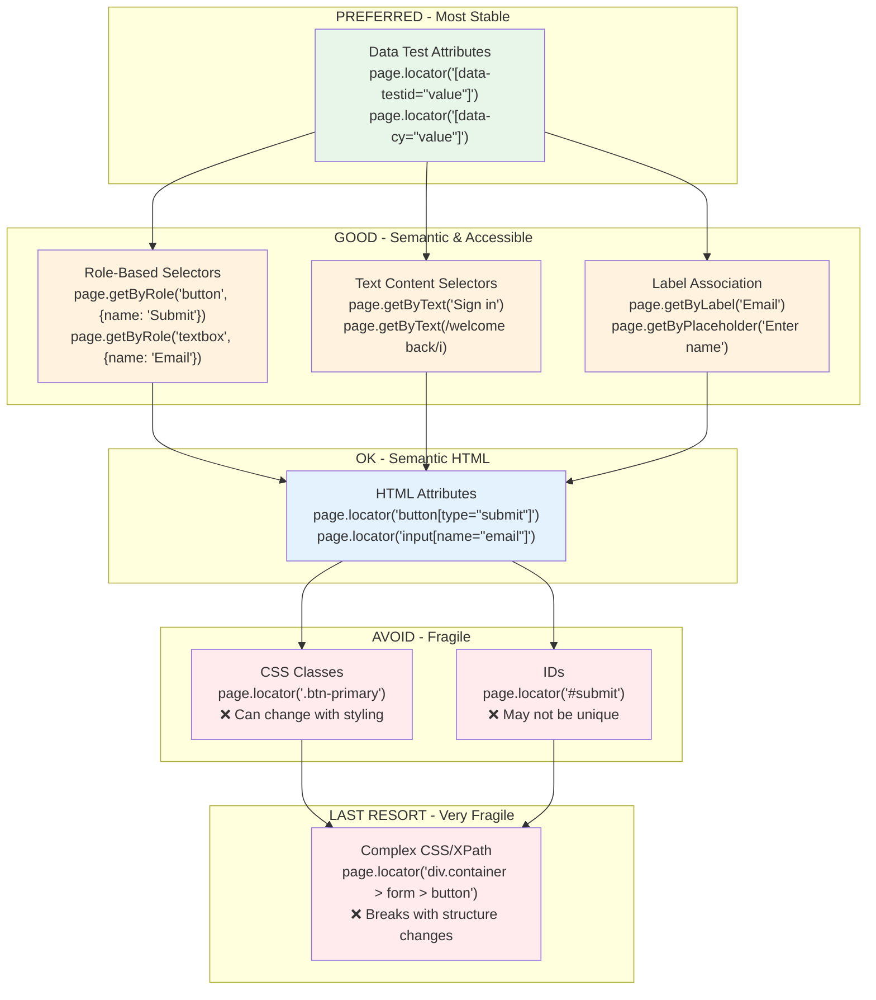
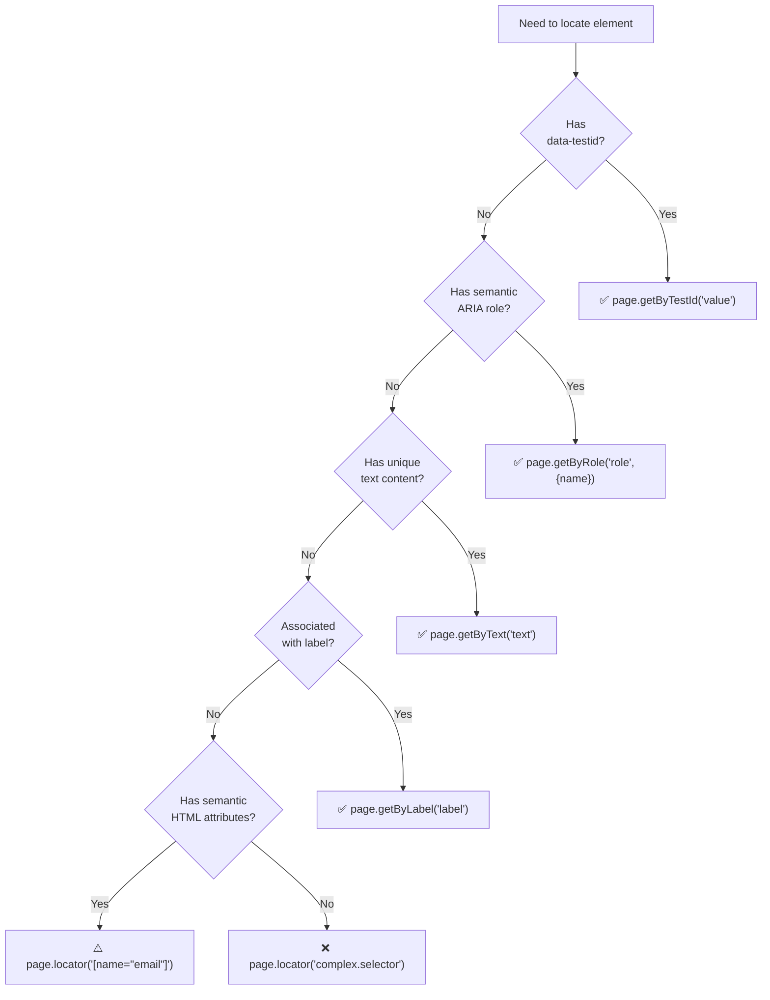
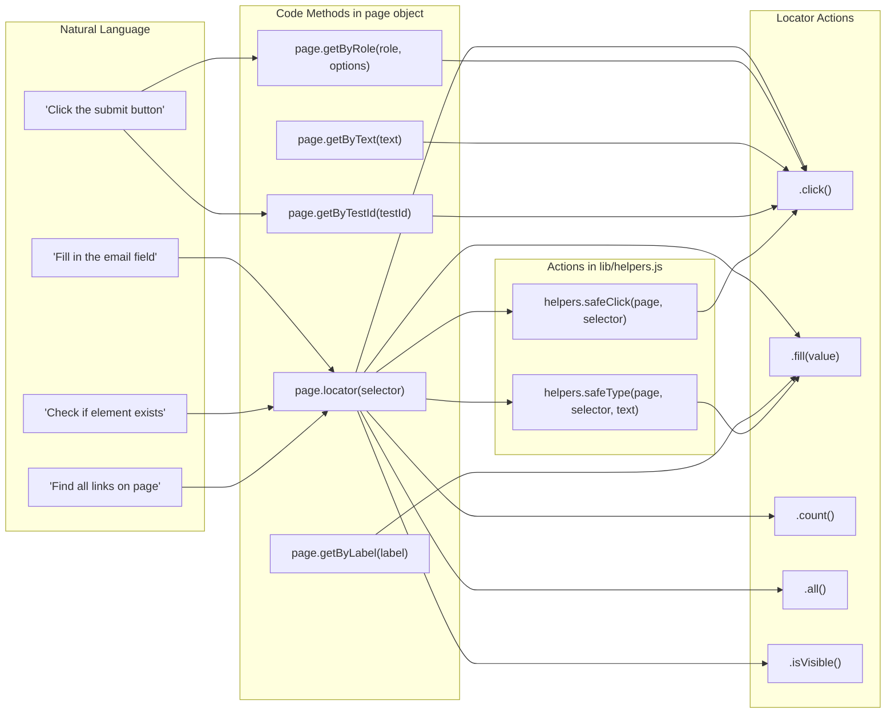

<!-- source: DeepWiki mcp.deepwiki.com · repo lackeyjb/playwright-skill · page 6.3 Selectors and Locators · fetched 2026-10-26 -->

# Selectors and Locators

<details>
<summary>Relevant source files</summary>

The following files were used as context for generating this wiki page:

- [API_REFERENCE.md](API_REFERENCE.md)
- [skills/playwright-skill/SKILL.md](skills/playwright-skill/SKILL.md)

</details>


## Purpose and Scope

This page provides comprehensive documentation on selector strategies and locator patterns for browser automation in the playwright-skill system. It covers the complete hierarchy of selector preferences, locator API methods, advanced filtering patterns, and best practices for writing stable, maintainable automation scripts.

For general Playwright API usage, see [Playwright Core API](#6.1). For helper functions that wrap locator functionality, see [Helper Functions API](#6.2). For practical examples in automation scripts, see [Writing Automation Scripts](#5.1).

---

## Selector Fundamentals

Selectors are the patterns used to identify elements on a web page. Playwright provides multiple selector strategies with varying levels of stability, accessibility, and maintainability. The skill emphasizes a clear preference hierarchy to ensure automation scripts remain robust across application changes.

### Locators vs Selectors

**Locators** are Playwright objects that represent a query for elements. They are lazy and auto-wait, meaning they don't perform the query until an action is requested.

**Selectors** are the string patterns or strategies passed to create locators (e.g., `'button[type="submit"]'`, `'data-testid=login'`).

```javascript
// Locator creation
const submitButton = page.locator('button[type="submit"]');  // CSS selector
const loginButton = page.getByRole('button', { name: 'Login' });  // Role-based locator

// Lazy evaluation - query happens on action
await submitButton.click();  // Element queried and clicked here
```

**Sources:** [API_REFERENCE.md:133-181](), [skills/playwright-skill/SKILL.md:92-206]()

---

## Selector Preference Hierarchy

The following diagram shows the recommended selector strategy hierarchy, ordered from most stable (top) to least stable (bottom):



**Sources:** [API_REFERENCE.md:136-161]()

---

## Playwright Locator Methods

Playwright provides multiple methods for creating locators, each suited to different scenarios.

### Primary Locator Methods

| Method | Syntax | Use Case | Example |
|--------|--------|----------|---------|
| `page.locator()` | CSS/XPath selector | Custom selectors | `page.locator('[data-testid="submit"]')` |
| `page.getByRole()` | ARIA role + options | Accessible elements | `page.getByRole('button', { name: 'Submit' })` |
| `page.getByText()` | Text or regex | Unique text content | `page.getByText('Sign in')` |
| `page.getByLabel()` | Associated label | Form inputs | `page.getByLabel('Email')` |
| `page.getByPlaceholder()` | Placeholder text | Form inputs | `page.getByPlaceholder('Enter your name')` |
| `page.getByTestId()` | data-testid attribute | Elements with test IDs | `page.getByTestId('submit-button')` |

### Locator Method Decision Flow



**Sources:** [API_REFERENCE.md:136-161](), [skills/playwright-skill/SKILL.md:120-171]()

---

## Data Test Attributes (Preferred)

Data attributes like `data-testid` and `data-cy` are the most stable selector strategy because they:
- Are explicitly added for testing purposes
- Don't change with styling or structure refactors
- Are ignored by browsers (no functional impact)
- Provide clear intention for testing

### Usage Pattern

```javascript
// HTML markup
<button data-testid="submit-button" class="btn btn-primary">Submit</button>
<input data-testid="email-input" name="email" type="email" />

// Playwright automation - using page.locator()
await page.locator('[data-testid="submit-button"]').click();
await page.locator('[data-testid="email-input"]').fill('user@example.com');

// Using page.getByTestId() helper
await page.getByTestId('submit-button').click();
await page.getByTestId('email-input').fill('user@example.com');
```

Examples in skill automation scripts use this pattern extensively:

```javascript
// From typical automation pattern
await page.fill('input[name="email"]', 'test@example.com');  // Semantic fallback
// Better with data-testid:
await page.fill('[data-testid="email-field"]', 'test@example.com');
```

**Sources:** [API_REFERENCE.md:138-140](), [skills/playwright-skill/SKILL.md:132-143]()

---

## Role-Based Selectors (Accessible)

Role-based selectors query elements by their ARIA role and optional accessible name. This approach aligns with accessibility best practices and produces stable selectors.

### Common ARIA Roles

```javascript
// Buttons
await page.getByRole('button', { name: 'Submit' }).click();
await page.getByRole('button', { name: /sign in/i }).click();  // Regex match

// Form controls
await page.getByRole('textbox', { name: 'Email' }).fill('user@example.com');
await page.getByRole('checkbox', { name: 'I agree' }).check();
await page.getByRole('combobox', { name: 'Country' }).selectOption('USA');

// Headings
await page.getByRole('heading', { level: 1 }).textContent();
await page.getByRole('heading', { name: 'Dashboard' }).isVisible();

// Links
await page.getByRole('link', { name: 'Learn more' }).click();

// Lists
await page.getByRole('listitem').filter({ hasText: 'Active' }).click();
```

### Role Options

| Option | Type | Description |
|--------|------|-------------|
| `name` | string/regex | Accessible name (label, aria-label, or content) |
| `level` | number | Heading level (1-6) |
| `checked` | boolean | Checkbox/radio checked state |
| `pressed` | boolean | Button pressed state |
| `expanded` | boolean | Expandable element state |

**Sources:** [API_REFERENCE.md:143-145]()

---

## Text-Based Selectors

Text content selectors are useful when elements have unique, stable text that identifies them.

```javascript
// Exact text match
await page.getByText('Sign in').click();
await page.getByText('Welcome, User').isVisible();

// Case-insensitive regex
await page.getByText(/welcome back/i).click();
await page.getByText(/error.*occurred/i).textContent();

// Partial match with locator filter
await page.locator('button').filter({ hasText: 'Submit' }).click();
```

**Caution:** Text-based selectors can be fragile if:
- Text is localized or changes frequently
- Multiple elements share the same text
- Text contains dynamic data (timestamps, usernames)

**Sources:** [API_REFERENCE.md:148-149](), [skills/playwright-skill/SKILL.md:147-170]()

---

## Semantic HTML Attributes

When data-testid attributes aren't available, semantic HTML attributes provide reasonable stability:

```javascript
// Form element attributes
await page.locator('input[name="email"]').fill('test@example.com');
await page.locator('input[type="password"]').fill('secret');
await page.locator('button[type="submit"]').click();
await page.locator('textarea[name="message"]').fill('Hello');

// Link attributes
await page.locator('a[href="/dashboard"]').click();

// Form control attributes
await page.locator('select[name="country"]').selectOption('USA');
```

These selectors are shown in the form filling patterns:

[skills/playwright-skill/SKILL.md:132-136]()
[skills/playwright-skill/SKILL.md:158-163]()

**Sources:** [API_REFERENCE.md:151-153](), [skills/playwright-skill/SKILL.md:132-171]()

---

## Advanced Locator Patterns

### Chaining and Filtering

Locators can be combined to narrow down element queries:

```javascript
// Filter by text content
const row = page.locator('tr').filter({ hasText: 'John Doe' });
await row.locator('button').click();

// Filter by another locator
const disabledButtons = page.locator('button').and(page.locator('[disabled]'));
const count = await disabledButtons.count();

// Nth element
await page.locator('button').nth(2).click();  // Click 3rd button (0-indexed)
await page.locator('.item').first().click();
await page.locator('.item').last().click();
```

**Sources:** [API_REFERENCE.md:163-180]()

### Parent-Child Navigation

Navigate DOM hierarchy from a located element:

```javascript
// Find parent of a cell
const cell = page.locator('td').filter({ hasText: 'Active' });
const row = cell.locator('..');  // Parent row
await row.locator('button.edit').click();

// Find within context
const form = page.locator('form#login');
await form.locator('input[name="email"]').fill('user@example.com');
await form.locator('button[type="submit"]').click();
```

**Sources:** [API_REFERENCE.md:176-180]()

### Multiple Elements

```javascript
// Get all matching elements
const links = await page.locator('a[href^="http"]').all();
for (const link of links) {
  const href = await link.getAttribute('href');
  console.log(href);
}

// Count elements
const itemCount = await page.locator('.item').count();
console.log(`Found ${itemCount} items`);

// Check if any exist
const hasErrors = await page.locator('.error').count() > 0;
```

Example from broken link checker pattern:
[skills/playwright-skill/SKILL.md:184-205]()

**Sources:** [API_REFERENCE.md:163-180](), [skills/playwright-skill/SKILL.md:184-205]()

---

## Code Entity Mapping

The following diagram maps natural language concepts to actual code methods and patterns used in the skill:



**Sources:** [skills/playwright-skill/SKILL.md:299-323](), [API_REFERENCE.md:133-180]()

---

## Helper Functions with Selectors

The skill provides helper functions that wrap locator functionality with retry logic and error handling:

### safeClick(page, selector, options)

Wrapper around `page.locator(selector).click()` with retry logic:

```javascript
const helpers = require('./lib/helpers');

// Retry clicking up to 3 times
await helpers.safeClick(page, 'button[type="submit"]', { retries: 3 });

// Equivalent to:
await page.locator('button[type="submit"]').click();
```

### safeType(page, selector, text, options)

Wrapper that clears field before typing:

```javascript
// Clear and type with helper
await helpers.safeType(page, '#username', 'testuser');

// Equivalent to:
await page.locator('#username').clear();
await page.locator('#username').fill('testuser');
```

**Sources:** [skills/playwright-skill/SKILL.md:299-323]()

---

## Best Practices

### 1. Prefer Stability Over Convenience

```javascript
// ❌ Fragile - breaks with CSS changes
await page.locator('.btn-primary').click();

// ✅ Stable - explicit test attribute
await page.locator('[data-testid="submit-button"]').click();
```

### 2. Make Locators Readable

```javascript
// ❌ Hard to maintain
await page.locator('div.container > div:nth-child(2) > form > button').click();

// ✅ Clear intent
await page.getByRole('button', { name: 'Submit Form' }).click();
```

### 3. Avoid Dynamic Selectors

```javascript
// ❌ Fragile - ID might change
await page.locator('#user-123').click();

// ✅ Stable - semantic attribute
await page.locator('[data-user-id="123"]').click();
```

### 4. Use Filters for Context

```javascript
// ❌ Ambiguous - which button?
await page.locator('button').click();

// ✅ Specific - button within context
await page.locator('form#login').locator('button[type="submit"]').click();
```

### 5. Parameterize Selectors

From the skill's automation patterns, URLs and selectors should be parameterized at the top of scripts:

```javascript
// From SKILL.md examples
const TARGET_URL = 'http://localhost:3001';  // Parameterized
const SUBMIT_SELECTOR = 'button[type="submit"]';  // Reusable

await page.goto(TARGET_URL);
await page.locator(SUBMIT_SELECTOR).click();
```

**Sources:** [API_REFERENCE.md:554-559](), [skills/playwright-skill/SKILL.md:339-350](), [skills/playwright-skill/SKILL.md:65-84]()

---

## Common Pitfalls

### 1. Using Classes for Functionality

CSS classes are meant for styling and often change:

```javascript
// ❌ Breaks when styling changes
await page.locator('.blue-button').click();

// ✅ Use semantic or test attributes
await page.locator('button[type="submit"]').click();
```

### 2. Not Waiting for Elements

Playwright auto-waits, but complex selectors may need explicit waits:

```javascript
// May fail if element loads slowly
await page.locator('.dynamic-content').click();

// Better - explicit wait
await page.locator('.dynamic-content').waitFor({ state: 'visible' });
await page.locator('.dynamic-content').click();
```

**Sources:** [API_REFERENCE.md:259-299]()

### 3. Ignoring Accessibility

Role-based selectors improve both test stability and accessibility:

```javascript
// ❌ Misses accessibility
await page.locator('div[onclick="submit()"]').click();

// ✅ Semantic and accessible
await page.getByRole('button', { name: 'Submit' }).click();
```

### 4. Complex XPath/CSS Selectors

Long selector chains break with structure changes:

```javascript
// ❌ Very fragile
await page.locator('html > body > div#app > div.main > section:nth-child(2) > form > button:nth-child(5)').click();

// ✅ Semantic and maintainable
await page.getByRole('button', { name: 'Submit Application' }).click();
```

**Sources:** [API_REFERENCE.md:160-161](), [API_REFERENCE.md:600-606]()

---

## Selector Examples from Skill Patterns

The skill's automation patterns demonstrate practical selector usage:

### Login Flow
[skills/playwright-skill/SKILL.md:120-143]()

```javascript
// Uses semantic HTML attributes
await page.fill('input[name="email"]', 'test@example.com');
await page.fill('input[name="password"]', 'password123');
await page.click('button[type="submit"]');
```

### Form Submission
[skills/playwright-skill/SKILL.md:146-171]()

```javascript
// Combination of name and type attributes
await page.fill('input[name="name"]', 'John Doe');
await page.fill('textarea[name="message"]', 'Test message');
await page.click('button[type="submit"]');
await page.waitForSelector('.success-message');
```

### Link Checking
[skills/playwright-skill/SKILL.md:184-199]()

```javascript
// Attribute-based locator with all()
const links = await page.locator('a[href^="http"]').all();
for (const link of links) {
  const href = await link.getAttribute('href');
  // Process each link
}
```

**Sources:** [skills/playwright-skill/SKILL.md:120-206]()

---

## Summary: Selector Strategy Table

| Priority | Strategy | Code Method | Stability | Use When |
|----------|----------|-------------|-----------|----------|
| 1 | Data test attributes | `page.locator('[data-testid="x"]')` | Highest | Always preferred |
| 2 | ARIA roles | `page.getByRole('button', {name: 'X'})` | High | Semantic elements |
| 3 | Text content | `page.getByText('Sign in')` | Medium | Unique, stable text |
| 4 | Label association | `page.getByLabel('Email')` | Medium | Form inputs with labels |
| 5 | Semantic HTML | `page.locator('button[type="submit"]')` | Medium | Standard HTML attributes |
| 6 | CSS classes | `page.locator('.btn-primary')` | Low | Avoid if possible |
| 7 | IDs | `page.locator('#submit')` | Low | Avoid if possible |
| 8 | Complex CSS/XPath | `page.locator('div > form > button')` | Very Low | Last resort only |

**Sources:** [API_REFERENCE.md:136-161]()

---

