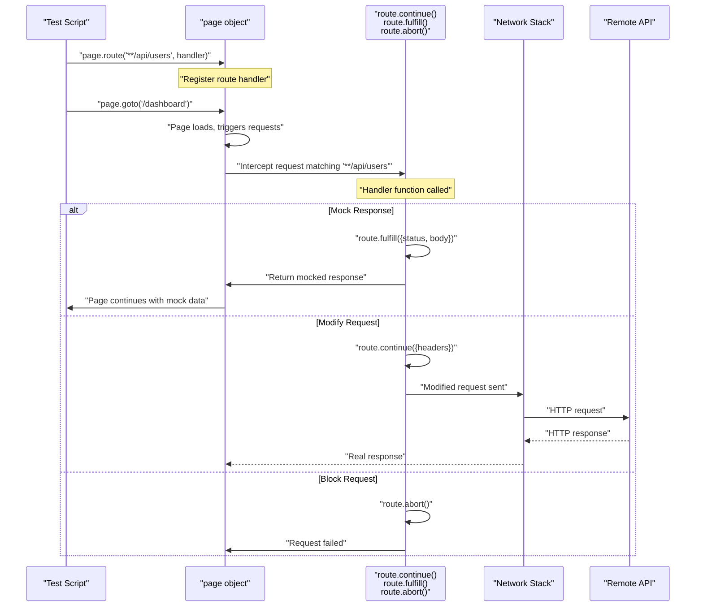
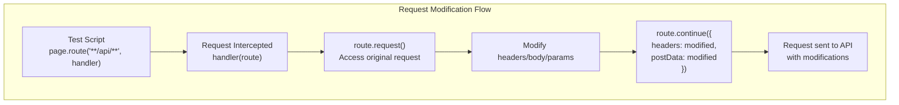
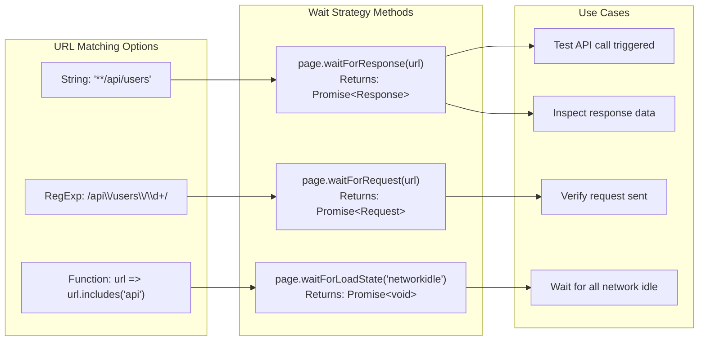
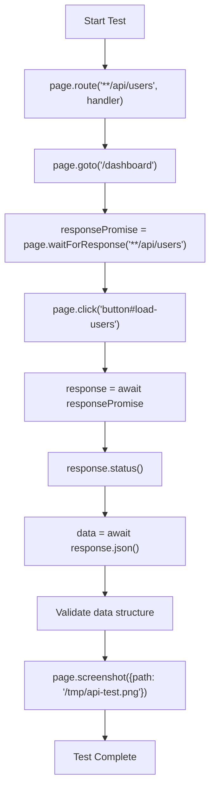

<!-- source: DeepWiki mcp.deepwiki.com · repo lackeyjb/playwright-skill · page 6.4 Network and API Testing · fetched 2026-10-26 -->

# Network and API Testing

<details>
<summary>Relevant source files</summary>

The following files were used as context for generating this wiki page:

- [API_REFERENCE.md](API_REFERENCE.md)
- [skills/playwright-skill/SKILL.md](skills/playwright-skill/SKILL.md)

</details>


## Purpose and Scope

This page documents network interception, API mocking, and request/response testing capabilities in the playwright-skill. It covers using `page.route()` for request interception, `route.fulfill()` for mocking responses, `page.waitForResponse()` and `page.waitForRequest()` for synchronization, and patterns for testing API-driven applications.

For general automation patterns, see [Common Automation Patterns](#5.2). For selector strategies and DOM interaction, see [Selectors and Locators](#6.3). For authentication flows that involve API calls, see [Authentication Patterns](#7.3).

**Sources:** [API_REFERENCE.md:381-409](), [SKILL.md:285-298]()

---

## Request Interception Architecture

Playwright provides `page.route()` to intercept and control network requests. The interception occurs before requests leave the browser, allowing modification, mocking, or blocking of any HTTP request.



**Key Methods:**

| Method | Purpose | Returns |
|--------|---------|---------|
| `page.route(url, handler)` | Register request interceptor | `Promise<void>` |
| `route.fulfill(response)` | Return mocked response | `Promise<void>` |
| `route.continue(overrides)` | Proceed with modified request | `Promise<void>` |
| `route.abort(errorCode)` | Cancel request | `Promise<void>` |
| `route.request()` | Access request details | `Request` object |

**Sources:** [API_REFERENCE.md:383-409]()

---

## API Response Mocking

The `route.fulfill()` method allows complete control over API responses. Mocked responses are returned immediately without network calls.

### Basic Response Mocking

```javascript
// Mock successful API response
await page.route('**/api/users', route => {
  route.fulfill({
    status: 200,
    contentType: 'application/json',
    body: JSON.stringify([
      { id: 1, name: 'John' },
      { id: 2, name: 'Jane' }
    ])
  });
});

await page.goto('/users');
// Page receives mocked data
```

### Error Response Mocking

```javascript
// Simulate API error
await page.route('**/api/users', route => {
  route.fulfill({
    status: 500,
    contentType: 'application/json',
    body: JSON.stringify({
      error: 'Internal Server Error',
      message: 'Database connection failed'
    })
  });
});

// Test error handling
await page.goto('/users');
await expect(page.locator('.error-message')).toBeVisible();
```

### Conditional Mocking

```javascript
// Mock based on request method or parameters
await page.route('**/api/users/**', route => {
  const request = route.request();
  
  if (request.method() === 'POST') {
    // Mock user creation
    route.fulfill({
      status: 201,
      body: JSON.stringify({ id: 3, name: 'New User' })
    });
  } else if (request.method() === 'DELETE') {
    // Mock deletion
    route.fulfill({ status: 204 });
  } else {
    // Let other requests through
    route.continue();
  }
});
```

**Response Object Structure:**

| Property | Type | Description |
|----------|------|-------------|
| `status` | `number` | HTTP status code (200, 404, 500, etc.) |
| `statusText` | `string` | Status text ("OK", "Not Found", etc.) |
| `contentType` | `string` | Content-Type header |
| `headers` | `object` | Additional response headers |
| `body` | `string\|Buffer` | Response body |
| `path` | `string` | Path to file to serve |

**Sources:** [API_REFERENCE.md:386-396]()

---

## Request Modification

Use `route.continue()` to modify requests before they reach the server. Common use cases include adding authentication headers, modifying parameters, or changing request bodies.



### Adding Headers

```javascript
// Add authentication header to all API requests
await page.route('**/api/**', route => {
  const headers = {
    ...route.request().headers(),
    'Authorization': 'Bearer fake-token-123',
    'X-Custom-Header': 'test-value'
  };
  route.continue({ headers });
});
```

### Modifying Request Body

```javascript
// Modify POST request data
await page.route('**/api/users', route => {
  if (route.request().method() === 'POST') {
    const postData = JSON.parse(route.request().postData());
    postData.testFlag = true;  // Add test marker
    
    route.continue({
      postData: JSON.stringify(postData)
    });
  } else {
    route.continue();
  }
});
```

### Changing Request URL

```javascript
// Redirect API calls to staging environment
await page.route('https://api.production.com/**', route => {
  const url = route.request().url().replace(
    'api.production.com',
    'api.staging.com'
  );
  route.continue({ url });
});
```

**Sources:** [API_REFERENCE.md:398-406]()

---

## Network Waiting Strategies

Playwright provides `page.waitForResponse()` and `page.waitForRequest()` to synchronize test execution with network activity. These methods are critical for testing API-driven applications.



### waitForResponse Pattern

```javascript
// Wait for specific API response before proceeding
const responsePromise = page.waitForResponse('**/api/users');
await page.click('button#load-users');
const response = await responsePromise;

// Inspect response
console.log('Status:', response.status());
const data = await response.json();
console.log('Users loaded:', data.length);
```

### waitForRequest Pattern

```javascript
// Verify request was sent with correct method
await page.waitForRequest(request => 
  request.url().includes('/api/users') && 
  request.method() === 'POST'
);

console.log('POST request sent successfully');
```

### Using Predicates

```javascript
// Wait for response matching complex conditions
const response = await page.waitForResponse(response => {
  return response.url().includes('/api/') &&
         response.status() === 200 &&
         response.request().method() === 'GET';
});

console.log('Valid GET response received');
```

### Timeout Configuration

```javascript
// Custom timeout for slow APIs
const response = await page.waitForResponse(
  '**/api/slow-endpoint',
  { timeout: 30000 }  // 30 seconds
);
```

**Method Signatures:**

| Method | Parameters | Return Type |
|--------|------------|-------------|
| `waitForResponse(urlOrPredicate, options)` | `string\|RegExp\|Function`, `{timeout?}` | `Promise<Response>` |
| `waitForRequest(urlOrPredicate, options)` | `string\|RegExp\|Function`, `{timeout?}` | `Promise<Request>` |

**Sources:** [API_REFERENCE.md:285-298](), [SKILL.md:285-292]()

---

## Request and Response Inspection

Playwright's `Request` and `Response` objects provide detailed inspection capabilities for testing API interactions.

### Request Object Methods

```javascript
await page.route('**/api/**', route => {
  const request = route.request();
  
  console.log('Method:', request.method());           // GET, POST, etc.
  console.log('URL:', request.url());                 // Full URL
  console.log('Headers:', request.headers());         // All headers
  console.log('Post Data:', request.postData());      // Request body
  console.log('Resource Type:', request.resourceType()); // xhr, fetch, etc.
  
  route.continue();
});
```

### Response Object Methods

```javascript
const response = await page.waitForResponse('**/api/users');

console.log('Status:', response.status());          // 200, 404, etc.
console.log('Status Text:', response.statusText()); // "OK", "Not Found"
console.log('Headers:', response.headers());        // Response headers
console.log('OK:', response.ok());                  // true if 200-299

// Extract body
const jsonData = await response.json();
const textData = await response.text();
const buffer = await response.body();
```

### Testing Response Data

```javascript
// Test API response structure
const response = await page.waitForResponse('**/api/users');
const users = await response.json();

// Verify data structure
console.log('User count:', users.length);
console.log('First user:', users[0].name);

// Use in assertions
if (users.length === 0) {
  console.error('❌ No users returned');
} else {
  console.log('✅ Users loaded successfully');
}
```

**Sources:** [API_REFERENCE.md:285-298]()

---

## Resource Blocking

Block unnecessary resources to speed up tests or test error handling when resources fail to load.

```javascript
// Block images, fonts, and stylesheets
await page.route('**/*.{png,jpg,jpeg,gif,svg,woff,woff2,css}', route => {
  route.abort();
});

// Block third-party analytics
await page.route('**/google-analytics.com/**', route => route.abort());
await page.route('**/facebook.com/tr/**', route => route.abort());

// Block specific domains
await page.route('**/*.ads.example.com/**', route => route.abort());
```

### Abort Error Codes

```javascript
// Simulate different network failures
await page.route('**/api/flaky', route => {
  route.abort('failed');           // Generic failure
  route.abort('connectionrefused'); // Connection refused
  route.abort('timedout');         // Timeout
  route.abort('accessdenied');     // Access denied
});
```

**Sources:** [API_REFERENCE.md:408-409]()

---

## Complete API Testing Workflow

This diagram shows a complete API testing workflow using network interception, mocking, and waiting strategies.



### Complete Example

```javascript
// /tmp/playwright-test-api.js
const { chromium } = require('playwright');

const TARGET_URL = 'http://localhost:3001';

(async () => {
  const browser = await chromium.launch({ headless: false });
  const page = await browser.newPage();

  // Setup: Mock API responses
  await page.route('**/api/users', route => {
    route.fulfill({
      status: 200,
      contentType: 'application/json',
      body: JSON.stringify([
        { id: 1, name: 'Alice', email: 'alice@example.com' },
        { id: 2, name: 'Bob', email: 'bob@example.com' }
      ])
    });
  });

  // Navigate to page
  await page.goto(TARGET_URL);

  // Wait for API call
  const responsePromise = page.waitForResponse('**/api/users');
  await page.click('button#load-users');
  const response = await responsePromise;

  // Verify response
  console.log('Status:', response.status());
  console.log('OK:', response.ok());

  // Validate data
  const users = await response.json();
  console.log('Users loaded:', users.length);
  console.log('First user:', users[0].name);

  // Verify UI updated
  await page.waitForSelector('.user-list .user-item');
  const userCount = await page.locator('.user-item').count();
  console.log('Users displayed:', userCount);

  if (userCount === users.length) {
    console.log('✅ API test passed');
  } else {
    console.error('❌ User count mismatch');
  }

  await page.screenshot({ path: '/tmp/api-test.png', fullPage: true });
  await browser.close();
})();
```

**Execution:**

```bash
cd $SKILL_DIR && node run.js /tmp/playwright-test-api.js
```

**Sources:** [SKILL.md:66-90](), [API_REFERENCE.md:383-409]()

---

## Common API Testing Patterns

### Pattern 1: Test Loading States

```javascript
// Verify loading indicator appears during API call
await page.goto(TARGET_URL);

const responsePromise = page.waitForResponse('**/api/products');
await page.click('button#load-products');

// Loading indicator should appear immediately
await expect(page.locator('.spinner')).toBeVisible();

// Wait for response
await responsePromise;

// Loading indicator should disappear
await expect(page.locator('.spinner')).toBeHidden();
console.log('✅ Loading state handled correctly');
```

### Pattern 2: Test Error Handling

```javascript
// Mock API error
await page.route('**/api/users', route => {
  route.fulfill({
    status: 500,
    body: JSON.stringify({ error: 'Database error' })
  });
});

await page.goto(TARGET_URL);
await page.click('button#load-users');

// Verify error message displayed
await expect(page.locator('.error-message')).toBeVisible();
await expect(page.locator('.error-message')).toContainText('error');
console.log('✅ Error handling works');
```

### Pattern 3: Test Pagination

```javascript
// Mock paginated responses
let currentPage = 1;

await page.route('**/api/users?page=*', route => {
  const url = new URL(route.request().url());
  const page = parseInt(url.searchParams.get('page'));
  
  route.fulfill({
    status: 200,
    body: JSON.stringify({
      page: page,
      data: Array.from({ length: 10 }, (_, i) => ({
        id: (page - 1) * 10 + i + 1,
        name: `User ${(page - 1) * 10 + i + 1}`
      })),
      hasMore: page < 5
    })
  });
});

await page.goto(TARGET_URL);

// Load multiple pages
for (let i = 1; i <= 3; i++) {
  await page.waitForResponse(`**/api/users?page=${i}`);
  await page.click('button.next-page');
  console.log(`✅ Page ${i} loaded`);
}
```

### Pattern 4: Test Request Retry Logic

```javascript
// Simulate intermittent failures
let attemptCount = 0;

await page.route('**/api/unstable', route => {
  attemptCount++;
  
  if (attemptCount < 3) {
    // Fail first 2 attempts
    route.fulfill({ status: 503 });
  } else {
    // Succeed on 3rd attempt
    route.fulfill({
      status: 200,
      body: JSON.stringify({ success: true })
    });
  }
});

await page.goto(TARGET_URL);
await page.click('button#retry-request');

// Should eventually succeed after retries
await page.waitForSelector('.success-message');
console.log(`✅ Succeeded after ${attemptCount} attempts`);
```

### Pattern 5: Test Multiple Concurrent Requests

```javascript
// Track all API calls
const apiCalls = [];

await page.route('**/api/**', route => {
  apiCalls.push({
    url: route.request().url(),
    method: route.request().method(),
    timestamp: Date.now()
  });
  route.continue();
});

await page.goto(TARGET_URL);

// Trigger action that makes multiple API calls
await page.click('button#load-dashboard');

// Wait for all requests to complete
await page.waitForLoadState('networkidle');

console.log('API calls made:', apiCalls.length);
apiCalls.forEach(call => {
  console.log(`  ${call.method} ${call.url}`);
});
```

**Sources:** [API_REFERENCE.md:383-409](), [SKILL.md:285-298]()

---

## Integration with Helper Functions

The skill's helper functions in `lib/helpers.js` can be combined with network testing for common patterns.

### Using safeClick with API Waiting

```javascript
const helpers = require('./lib/helpers');

// Safe click that waits for API response
const responsePromise = page.waitForResponse('**/api/submit');
await helpers.safeClick(page, 'button#submit', { retries: 3 });
const response = await responsePromise;

console.log('Form submitted, response:', response.status());
```

### Screenshot After API Call

```javascript
const helpers = require('./lib/helpers');

// Wait for API response, then capture result
const response = await page.waitForResponse('**/api/data');
await response.json();  // Ensure data loaded

// Take timestamped screenshot
await helpers.takeScreenshot(page, 'api-result');
console.log('📸 Screenshot saved to /tmp/');
```

**Sources:** [SKILL.md:298-324](), [skills/playwright-skill/lib/helpers.js]()

---

## Best Practices

| Practice | Description | Example |
|----------|-------------|---------|
| **Mock External APIs** | Always mock third-party APIs to avoid flaky tests | Mock Stripe, Google APIs, etc. |
| **Use Predicates for Complex Matching** | Use functions instead of strings for flexible matching | `response => response.ok() && response.url().includes('api')` |
| **Wait Before Asserting** | Always wait for API responses before checking UI | Use `waitForResponse()` before checking data display |
| **Test Error States** | Mock 4xx/5xx responses to verify error handling | Test 401, 404, 500 scenarios |
| **Verify Request Data** | Inspect `request.postData()` to ensure correct data sent | Check form data, JSON payloads |
| **Use Timestamps** | Add timestamps to mock data for debugging | Include `Date.now()` in mocked responses |
| **Block Unnecessary Resources** | Speed up tests by blocking images, fonts, ads | Use `route.abort()` for non-critical resources |
| **Combine with Screenshots** | Capture UI state after API interactions | Screenshot after data loads or errors occur |

**Sources:** [API_REFERENCE.md:554-559](), [SKILL.md:340-350]()

---

## Troubleshooting Network Tests

### Route Not Matching

```javascript
// Problem: Route not intercepting requests
await page.route('**/api/users', handler);  // May not match

// Solution: Use broader patterns or log URLs
await page.route('**/*', route => {
  console.log('Request:', route.request().url());
  route.continue();
});

// Then use specific pattern after identifying exact URL
```

### Race Conditions

```javascript
// Problem: waitForResponse timing issues
await page.click('button');
await page.waitForResponse('**/api/data');  // May miss request

// Solution: Set up wait BEFORE triggering action
const responsePromise = page.waitForResponse('**/api/data');
await page.click('button');
await responsePromise;  // Guaranteed to catch request
```

### Multiple Routes Conflict

```javascript
// Problem: Multiple route handlers interfere
await page.route('**/api/**', handler1);
await page.route('**/api/users', handler2);  // Which one applies?

// Solution: Use route.fallback or order carefully
// More specific routes should be registered first
await page.route('**/api/users', specificHandler);
await page.route('**/api/**', generalHandler);
```

### Response Body Already Consumed

```javascript
// Problem: Can't read response.json() twice
const response = await page.waitForResponse('**/api/users');
const data1 = await response.json();
const data2 = await response.json();  // Error: body already consumed

// Solution: Store result in variable
const response = await page.waitForResponse('**/api/users');
const data = await response.json();
// Use 'data' multiple times
console.log(data);
validateData(data);
```

**Sources:** [API_REFERENCE.md:599-606](), [SKILL.md:352-366]()

---

## Summary

Network and API testing in playwright-skill centers on three core capabilities:

1. **Request Interception**: `page.route(url, handler)` intercepts outgoing requests
2. **Response Mocking**: `route.fulfill(response)` returns fake data without network calls
3. **Network Synchronization**: `page.waitForResponse()` and `page.waitForRequest()` coordinate test execution with API activity

These primitives enable testing of API-driven applications, error handling, loading states, retry logic, and complex network interactions. All scripts are executed via [run.js](#4.2) from `/tmp` directory to maintain clean project structure.

**Sources:** [API_REFERENCE.md:381-409](), [SKILL.md:1-407]()

---

