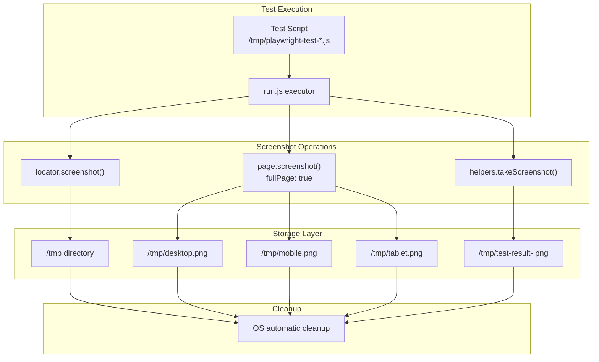
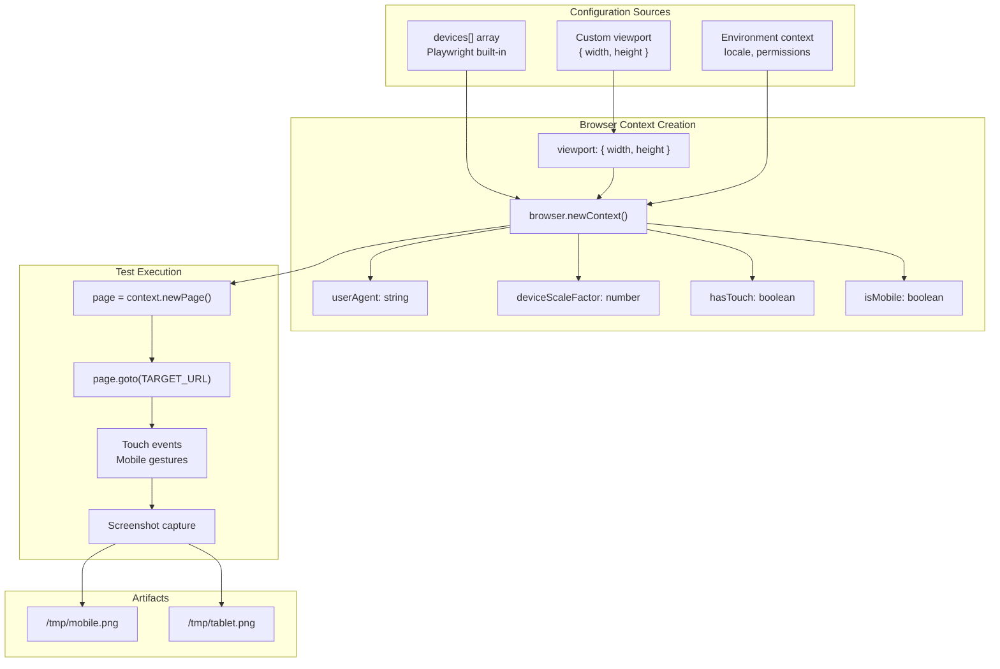
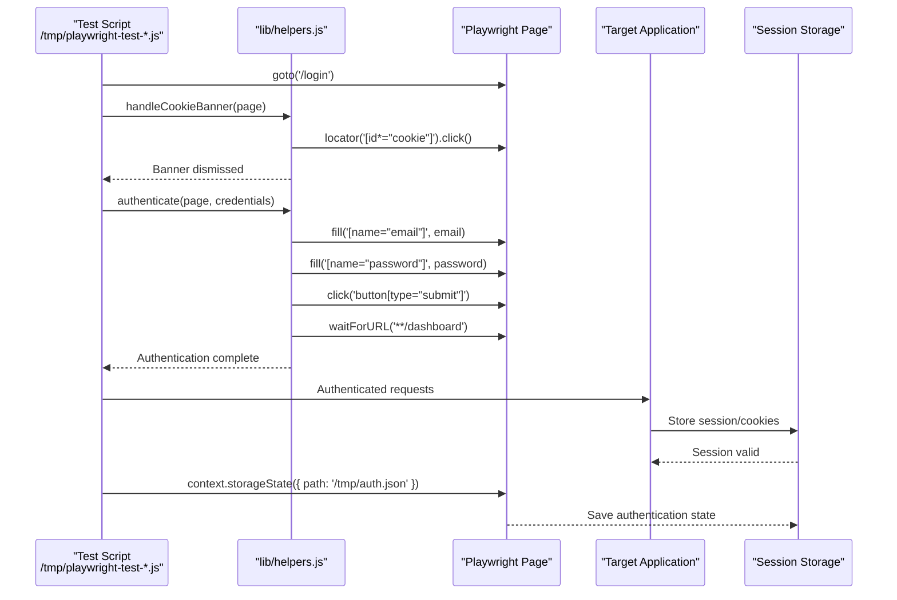
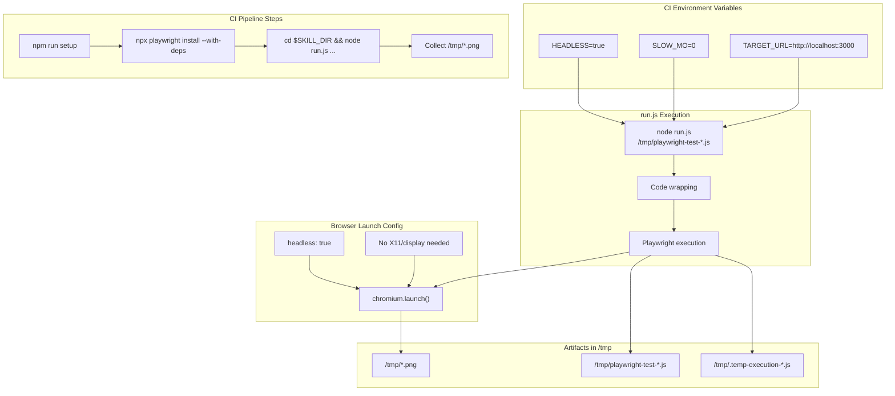
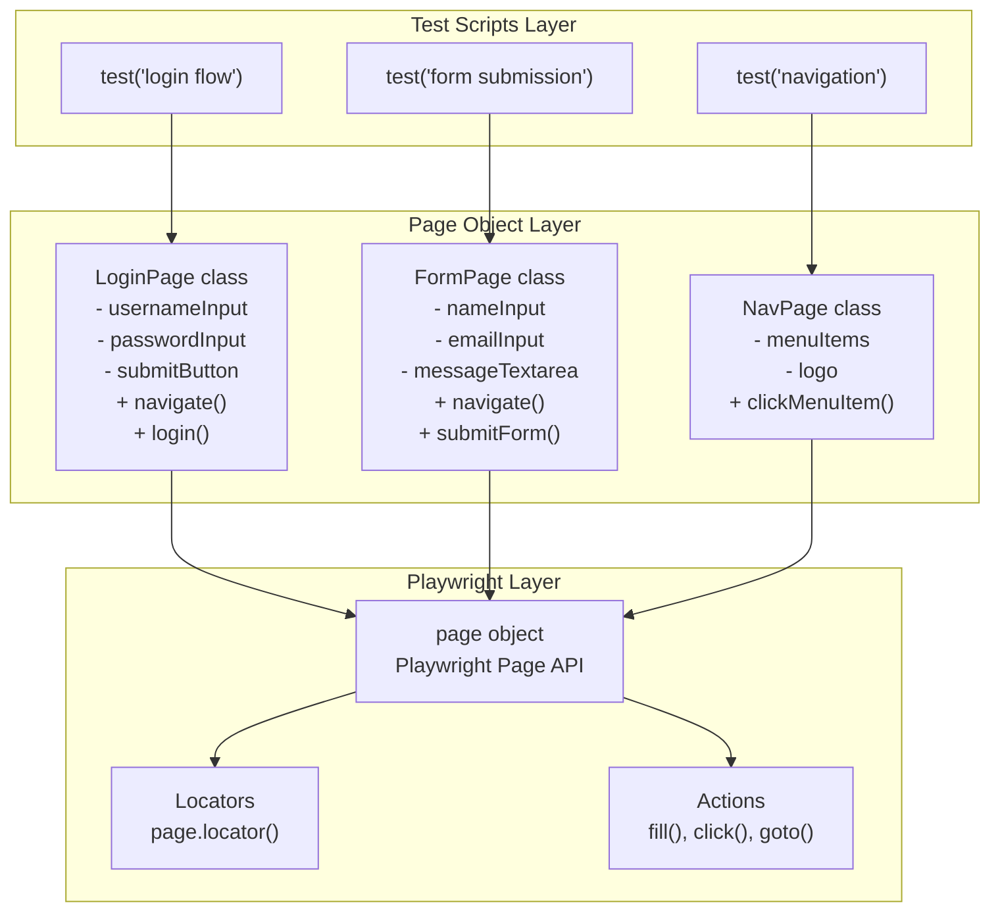

<!-- source: DeepWiki mcp.deepwiki.com · repo lackeyjb/playwright-skill · page 7 Advanced Topics · fetched 2026-10-26 -->

# Advanced Topics

<details>
<summary>Relevant source files</summary>

The following files were used as context for generating this wiki page:

- [API_REFERENCE.md](API_REFERENCE.md)
- [skills/playwright-skill/SKILL.md](skills/playwright-skill/SKILL.md)

</details>


This document covers advanced use cases and patterns for power users of the playwright-skill. Topics include visual testing strategies, mobile/responsive design validation, authentication handling, CI/CD integration, and code organization patterns. 

For basic automation patterns and common workflows, see [Usage Guide](#5). For comprehensive API documentation, see [API Reference](#6).

## Visual Testing and Screenshots

Visual testing in playwright-skill leverages Playwright's screenshot capabilities combined with strategic artifact management in `/tmp`. The skill provides both built-in patterns and a helper function for automated screenshot capture.

### Screenshot Capture Strategies

The skill supports three screenshot approaches:

| Strategy | Use Case | File Location | Code Pattern |
|----------|----------|---------------|--------------|
| Full page | Responsive testing, visual regression | `/tmp/*.png` | `page.screenshot({ fullPage: true })` |
| Element-specific | Component testing, widget validation | `/tmp/*.png` | `locator.screenshot()` |
| Helper function | Timestamped captures | `/tmp/*.png` | `helpers.takeScreenshot()` |

The helper function in `lib/helpers.js` provides automatic timestamping and consistent naming:

```javascript
// From lib/helpers.js
await helpers.takeScreenshot(page, 'test-result');
// Generates: /tmp/test-result-<timestamp>.png
```

### Visual Testing Workflow



**Sources:** [skills/playwright-skill/SKILL.md:238-275](), [skills/playwright-skill/SKILL.md:314-316]()

### Responsive Design Testing Pattern

The skill's responsive testing pattern uses viewport manipulation to capture multiple device sizes in a single execution:

```javascript
// Pattern from SKILL.md
const viewports = [
  { name: 'Desktop', width: 1920, height: 1080 },
  { name: 'Tablet', width: 768, height: 1024 },
  { name: 'Mobile', width: 375, height: 667 }
];

for (const viewport of viewports) {
  await page.setViewportSize({ width: viewport.width, height: viewport.height });
  await page.goto(TARGET_URL);
  await page.screenshot({ 
    path: `/tmp/${viewport.name.toLowerCase()}.png`,
    fullPage: true 
  });
}
```

This pattern generates three artifacts (`/tmp/desktop.png`, `/tmp/tablet.png`, `/tmp/mobile.png`) in a single execution, all automatically cleaned by the OS.

**Sources:** [skills/playwright-skill/SKILL.md:238-275](), [skills/playwright-skill/SKILL.md:94-118]()

### Handling Dynamic Content

For pages with animations or dynamic content, use wait strategies before capturing:

```javascript
// Wait for network idle before screenshot
await page.goto(TARGET_URL, { waitUntil: 'networkidle' });
await page.screenshot({ path: '/tmp/screenshot.png', fullPage: true });

// Wait for specific element state
await page.locator('.loader').waitFor({ state: 'hidden' });
await page.screenshot({ path: '/tmp/loaded.png' });
```

**Sources:** [API_REFERENCE.md:413-429](), [skills/playwright-skill/SKILL.md:208-235]()

## Mobile and Responsive Testing

Mobile testing in playwright-skill uses Playwright's device emulation capabilities combined with the skill's viewport testing patterns. The system supports both predefined device configurations and custom viewport specifications.

### Device Emulation Architecture



**Sources:** [API_REFERENCE.md:432-444](), [skills/playwright-skill/SKILL.md:238-275]()

### Device Configuration Matrix

| Device Type | Width | Height | deviceScaleFactor | hasTouch | isMobile |
|------------|-------|--------|-------------------|----------|----------|
| Desktop | 1920 | 1080 | 1 | false | false |
| Tablet | 768 | 1024 | 2 | true | true |
| Mobile | 375 | 667 | 2 | true | true |
| iPhone 12 | 390 | 844 | 3 | true | true |
| iPad Pro | 1024 | 1366 | 2 | true | true |

### Using Playwright Device Descriptors

For realistic device emulation, use Playwright's built-in device descriptors:

```javascript
const { devices } = require('playwright');
const iPhone = devices['iPhone 12'];

const context = await browser.newContext({
  ...iPhone,  // Includes viewport, userAgent, deviceScaleFactor, hasTouch, isMobile
  locale: 'en-US',
  permissions: ['geolocation'],
  geolocation: { latitude: 37.7749, longitude: -122.4194 }
});
```

This pattern spreads the entire device configuration, including user agent strings and touch capabilities.

**Sources:** [API_REFERENCE.md:432-444]()

### Touch Event Handling

Mobile devices require touch-specific interactions:

```javascript
// Tap (touch equivalent of click)
await page.tap('button.mobile-menu');

// Swipe gestures
await page.touchscreen.tap(100, 100);
await page.touchscreen.swipe({ x: 100, y: 100 }, { x: 300, y: 100 });

// Scroll with touch
await page.evaluate(() => {
  window.scrollTo({ top: document.body.scrollHeight, behavior: 'smooth' });
});
```

**Sources:** [API_REFERENCE.md:432-444]()

### Viewport Testing Pattern from SKILL.md

The responsive testing pattern in SKILL.md demonstrates multi-viewport testing:

```javascript
const viewports = [
  { name: 'Desktop', width: 1920, height: 1080 },
  { name: 'Tablet', width: 768, height: 1024 },
  { name: 'Mobile', width: 375, height: 667 }
];

for (const viewport of viewports) {
  console.log(`Testing ${viewport.name} (${viewport.width}x${viewport.height})`);
  await page.setViewportSize({ width: viewport.width, height: viewport.height });
  await page.goto(TARGET_URL);
  await page.waitForTimeout(1000);  // Allow layout to stabilize
  await page.screenshot({
    path: `/tmp/${viewport.name.toLowerCase()}.png`,
    fullPage: true
  });
}
```

This generates viewport-specific screenshots in `/tmp`, allowing visual comparison across device sizes.

**Sources:** [skills/playwright-skill/SKILL.md:238-275]()

## Authentication Patterns

Authentication in playwright-skill uses the `authenticate` helper function combined with cookie banner handling and session management patterns. The skill emphasizes clean, reusable authentication flows that can be incorporated into test scripts.

### Authentication Flow Architecture



**Sources:** [skills/playwright-skill/SKILL.md:299-322](), [API_REFERENCE.md:382-444]()

### Helper Functions for Authentication

The `lib/helpers.js` file provides two key authentication helpers:

| Function | Purpose | Parameters | Return Value |
|----------|---------|------------|--------------|
| `authenticate(page, credentials)` | Complete login flow | `page`, `{ email, password }` | Promise\<void\> |
| `handleCookieBanner(page)` | Dismiss cookie consent | `page` | Promise\<void\> |

Usage pattern:

```javascript
const helpers = require('./lib/helpers');

// Dismiss cookie banner first (if present)
await helpers.handleCookieBanner(page);

// Perform authentication
await helpers.authenticate(page, {
  email: 'test@example.com',
  password: 'password123'
});
```

**Sources:** [skills/playwright-skill/SKILL.md:299-322]()

### Form-Based Login Pattern

The basic login pattern from SKILL.md demonstrates direct form interaction:

```javascript
await page.goto(`${TARGET_URL}/login`);

// Fill credentials
await page.fill('input[name="email"]', 'test@example.com');
await page.fill('input[name="password"]', 'password123');
await page.click('button[type="submit"]');

// Wait for redirect
await page.waitForURL('**/dashboard');
console.log('✅ Login successful, redirected to dashboard');
```

This pattern uses selector strategies that prioritize `name` attributes for form fields and `type="submit"` for buttons.

**Sources:** [skills/playwright-skill/SKILL.md:120-144]()

### Session State Preservation

For tests requiring authentication, save and reuse session state:

```javascript
// First test: Login and save state
const context = await browser.newContext();
const page = await context.newPage();

await page.goto(`${TARGET_URL}/login`);
await page.fill('input[name="email"]', 'test@example.com');
await page.fill('input[name="password"]', 'password123');
await page.click('button[type="submit"]');
await page.waitForURL('**/dashboard');

// Save authentication state
await context.storageState({ path: '/tmp/auth.json' });
await context.close();

// Subsequent tests: Reuse state
const authenticatedContext = await browser.newContext({
  storageState: '/tmp/auth.json'
});
const authenticatedPage = await authenticatedContext.newPage();
await authenticatedPage.goto(`${TARGET_URL}/dashboard`);
// Already logged in
```

This pattern stores cookies, localStorage, and sessionStorage in `/tmp/auth.json` for reuse across test executions.

**Sources:** [API_REFERENCE.md:382-444]()

### Cookie Banner Handling

The `handleCookieBanner` helper automatically dismisses common cookie consent patterns:

```javascript
// Automatically handles common selectors:
// - [id*="cookie"]
// - [class*="cookie"]
// - text containing "accept", "agree", "consent"
await helpers.handleCookieBanner(page);
```

This should be called immediately after navigation and before authentication to prevent modal overlays from blocking form elements.

**Sources:** [skills/playwright-skill/SKILL.md:318-319]()

## CI/CD Integration

CI/CD integration in playwright-skill relies on headless mode configuration, environment variable overrides, and the `/tmp` artifact strategy. The skill is designed for CI environments where displays are unavailable and cleanup is essential.

### CI Environment Configuration



**Sources:** [skills/playwright-skill/SKILL.md:9-16](), [skills/playwright-skill/SKILL.md:343-346](), [API_REFERENCE.md:529-550]()

### Environment Variable Configuration

| Variable | Default (Local) | CI Override | Purpose |
|----------|----------------|-------------|---------|
| `HEADLESS` | `false` | `true` | Browser visibility mode |
| `SLOW_MO` | `100` | `0` | Action delay in milliseconds |
| `TARGET_URL` | Auto-detected | Explicit | Test target URL |

Configuration precedence: **Inline code settings** > **Environment variables** > **Default values**

### Headless Mode Pattern

The skill defaults to visible browsers for debugging but supports headless mode for CI:

```javascript
// Local development (default)
const browser = await chromium.launch({ 
  headless: false,  // Visible browser
  slowMo: 100       // Slow motion for observability
});

// CI environment
const browser = await chromium.launch({
  headless: true,   // No display required
  slowMo: 0         // Maximum speed
});

// Environment-driven configuration
const browser = await chromium.launch({
  headless: process.env.HEADLESS === 'true',
  slowMo: parseInt(process.env.SLOW_MO || '100')
});
```

**Sources:** [skills/playwright-skill/SKILL.md:343-346](), [API_REFERENCE.md:79-106]()

### GitHub Actions Integration

Example workflow for playwright-skill in CI:

```yaml
name: Browser Automation Tests
on: [push, pull_request]

jobs:
  test:
    runs-on: ubuntu-latest
    steps:
      - uses: actions/checkout@v3
      
      - uses: actions/setup-node@v3
        with:
          node-version: '18'
      
      # Install skill dependencies
      - name: Setup Playwright Skill
        run: |
          cd ~/.claude/skills/playwright-skill
          npm run setup
          npx playwright install --with-deps chromium
      
      # Run tests
      - name: Execute Automation
        env:
          HEADLESS: true
          SLOW_MO: 0
          TARGET_URL: http://localhost:3000
        run: |
          cd ~/.claude/skills/playwright-skill
          node run.js /tmp/playwright-test-suite.js
      
      # Collect artifacts
      - uses: actions/upload-artifact@v3
        if: always()
        with:
          name: screenshots
          path: /tmp/*.png
```

**Sources:** [API_REFERENCE.md:529-550]()

### Artifact Collection Strategy

The `/tmp` directory strategy simplifies CI artifact collection:

1. **Test execution** writes screenshots to `/tmp/*.png`
2. **CI pipeline** collects all `/tmp/*.png` files
3. **OS cleanup** handles temporary file removal
4. **No repository pollution** - artifacts never committed

This eliminates the need for `.gitignore` rules or cleanup scripts in the project repository.

**Sources:** [skills/playwright-skill/SKILL.md:31-44]()

### Installation in CI

The skill requires `npm run setup` on first CI execution:

```bash
# One-time setup in CI
cd ~/.claude/skills/playwright-skill
npm run setup  # Installs playwright ^1.48.0
npx playwright install --with-deps chromium  # Installs browser + OS dependencies
```

The `--with-deps` flag installs system libraries required for browser execution in Ubuntu/Debian environments.

**Sources:** [skills/playwright-skill/SKILL.md:46-53](), [API_REFERENCE.md:529-550]()

## Page Object Model

The Page Object Model (POM) in playwright-skill provides encapsulation of page-specific logic into reusable classes. This pattern is documented in API_REFERENCE.md and follows standard Playwright conventions.

### Page Object Architecture



**Sources:** [API_REFERENCE.md:342-379]()

### Basic Page Object Pattern

The LoginPage example from API_REFERENCE.md demonstrates the fundamental structure:

```javascript
// pages/LoginPage.js
class LoginPage {
  constructor(page) {
    this.page = page;
    // Locators as instance properties
    this.usernameInput = page.locator('input[name="username"]');
    this.passwordInput = page.locator('input[name="password"]');
    this.submitButton = page.locator('button[type="submit"]');
    this.errorMessage = page.locator('.error-message');
  }

  async navigate() {
    await this.page.goto('/login');
  }

  async login(username, password) {
    await this.usernameInput.fill(username);
    await this.passwordInput.fill(password);
    await this.submitButton.click();
  }

  async getErrorMessage() {
    return await this.errorMessage.textContent();
  }
}

module.exports = LoginPage;
```

**Sources:** [API_REFERENCE.md:346-370]()

### Page Object Usage in Tests

Page objects are instantiated in test scripts written to `/tmp`:

```javascript
// /tmp/playwright-test-login.js
const { chromium } = require('playwright');
const LoginPage = require('./pages/LoginPage');

const TARGET_URL = 'http://localhost:3001';

(async () => {
  const browser = await chromium.launch({ headless: false });
  const page = await browser.newPage();
  
  const loginPage = new LoginPage(page);
  await loginPage.navigate();
  await loginPage.login('test@example.com', 'password123');
  
  await page.waitForURL('**/dashboard');
  console.log('✅ Login successful');
  
  await browser.close();
})();
```

**Sources:** [API_REFERENCE.md:372-379](), [skills/playwright-skill/SKILL.md:120-144]()

### Locator Strategy in Page Objects

Page objects should use the selector hierarchy prioritized by the skill:

| Priority | Selector Type | Example | Rationale |
|----------|--------------|---------|-----------|
| 1 | `data-testid` | `[data-testid="submit"]` | Most stable, explicit test identifiers |
| 2 | Role-based | `getByRole('button', { name: 'Submit' })` | Accessible, semantic |
| 3 | Text content | `getByText('Sign in')` | Human-readable, stable for unique text |
| 4 | Semantic HTML | `input[name="email"]`, `button[type="submit"]` | Standard attributes |
| 5 | CSS classes | `.btn-primary` | Avoid - implementation detail |

```javascript
class FormPage {
  constructor(page) {
    this.page = page;
    // PREFERRED: data-testid
    this.submitButton = page.locator('[data-testid="submit-button"]');
    // GOOD: Role-based
    this.emailInput = page.getByRole('textbox', { name: 'Email' });
    // OK: Semantic HTML
    this.passwordInput = page.locator('input[name="password"]');
  }
}
```

**Sources:** [API_REFERENCE.md:133-161]()

### Component Composition

Complex pages can be composed from smaller component objects:

```javascript
class HeaderComponent {
  constructor(page) {
    this.page = page;
    this.logo = page.locator('header .logo');
    this.navMenu = page.locator('nav.main-menu');
  }
  
  async clickMenuItem(name) {
    await this.navMenu.getByRole('link', { name }).click();
  }
}

class DashboardPage {
  constructor(page) {
    this.page = page;
    this.header = new HeaderComponent(page);
    this.userProfile = page.locator('.user-profile');
  }
  
  async navigate() {
    await this.page.goto('/dashboard');
  }
  
  async goToSettings() {
    await this.header.clickMenuItem('Settings');
  }
}
```

This composition pattern promotes reusability across multiple page objects that share common components.

**Sources:** [API_REFERENCE.md:342-379]()

### Error Handling in Page Objects

Page objects should encapsulate error handling for robustness:

```javascript
class LoginPage {
  constructor(page) {
    this.page = page;
    this.usernameInput = page.locator('input[name="username"]');
    this.passwordInput = page.locator('input[name="password"]');
    this.submitButton = page.locator('button[type="submit"]');
    this.errorMessage = page.locator('.error-message');
  }

  async login(username, password) {
    try {
      await this.usernameInput.fill(username);
      await this.passwordInput.fill(password);
      await this.submitButton.click();
      
      // Wait for either success or error
      await Promise.race([
        this.page.waitForURL('**/dashboard'),
        this.errorMessage.waitFor({ state: 'visible', timeout: 5000 })
      ]);
      
      // Check if error is visible
      if (await this.errorMessage.isVisible()) {
        const error = await this.errorMessage.textContent();
        throw new Error(`Login failed: ${error}`);
      }
    } catch (error) {
      console.error('❌ Login error:', error.message);
      await this.page.screenshot({ path: '/tmp/login-error.png' });
      throw error;
    }
  }
}
```

This pattern captures screenshots on failure and provides detailed error messages.

**Sources:** [API_REFERENCE.md:342-379](), [skills/playwright-skill/SKILL.md:208-235]()

---

