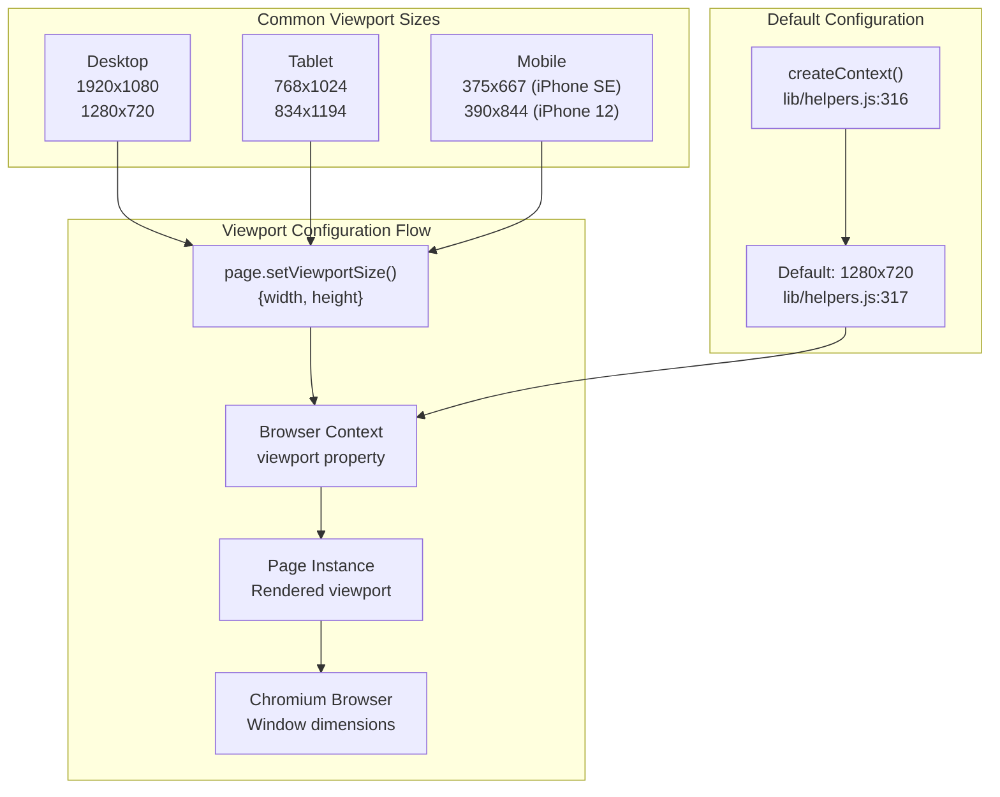
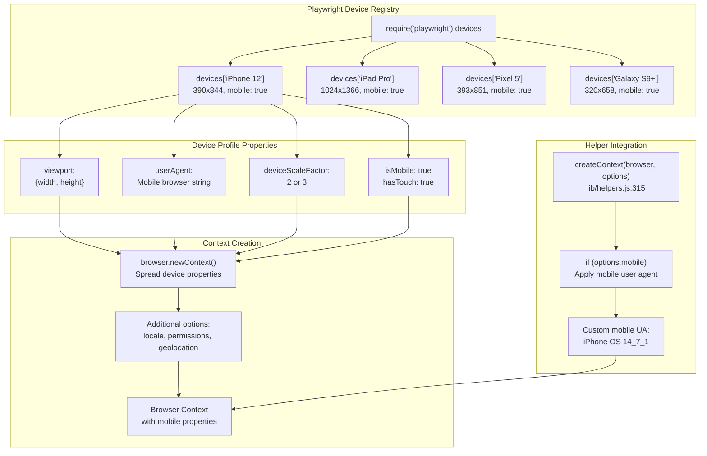
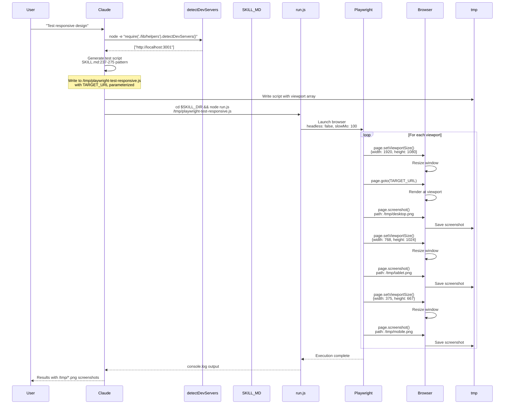

<!-- source: DeepWiki mcp.deepwiki.com · repo lackeyjb/playwright-skill · page 7.2 Mobile and Responsive Testing · fetched 2026-10-26 -->

# Mobile and Responsive Testing

<details>
<summary>Relevant source files</summary>

The following files were used as context for generating this wiki page:

- [API_REFERENCE.md](API_REFERENCE.md)
- [skills/playwright-skill/SKILL.md](skills/playwright-skill/SKILL.md)
- [skills/playwright-skill/lib/helpers.js](skills/playwright-skill/lib/helpers.js)

</details>


## Purpose and Scope

This document covers mobile device emulation and responsive design testing using playwright-skill. It explains viewport configuration, device emulation with `devices[]` API, touch interactions, and multi-viewport testing patterns. For general visual testing and screenshots, see [Visual Testing and Screenshots](#7.1). For browser configuration options, see [Configuration Options](#9.1).

---

## Viewport Configuration

The fundamental approach to responsive testing is viewport manipulation through `page.setViewportSize()`. Playwright allows dynamic viewport changes during test execution without creating new browser contexts.

### Basic Viewport Settings



**Sources:** [skills/playwright-skill/lib/helpers.js:315-328](), [skills/playwright-skill/SKILL.md:94-118]()

### Viewport Configuration Methods

| Method | Usage | Context |
|--------|-------|---------|
| `page.setViewportSize({width, height})` | Dynamic viewport changes during test | After page creation |
| `browser.newContext({viewport: {width, height}})` | Fixed viewport for entire context | At context creation |
| `createContext(browser, {viewport})` | Helper with defaults (1280x720) | Uses helper function |

The `createContext()` helper in [lib/helpers.js:315-328]() provides a default viewport of 1280x720 and optional mobile user agent configuration.

**Sources:** [skills/playwright-skill/lib/helpers.js:315-328](), [API_REFERENCE.md:432-444]()

### Multi-Viewport Testing Pattern

The standard pattern for responsive testing iterates through viewport configurations, as shown in [SKILL.md:237-275]():

```javascript
const viewports = [
  { name: 'Desktop', width: 1920, height: 1080 },
  { name: 'Tablet', width: 768, height: 1024 },
  { name: 'Mobile', width: 375, height: 667 }
];

for (const viewport of viewports) {
  await page.setViewportSize({
    width: viewport.width,
    height: viewport.height
  });
  await page.goto(TARGET_URL);
  await page.screenshot({
    path: `/tmp/${viewport.name.toLowerCase()}.png`,
    fullPage: true
  });
}
```

This pattern allows testing the same page across different screen sizes with a single browser context, reducing overhead compared to creating separate contexts.

**Sources:** [skills/playwright-skill/SKILL.md:237-275]()

---

## Device Emulation

Playwright provides a `devices[]` registry with pre-configured device profiles including viewport, user agent, device scale factor, and mobile capabilities.

### Device Emulation Architecture



**Sources:** [API_REFERENCE.md:432-444](), [skills/playwright-skill/lib/helpers.js:315-328]()

### Using Device Profiles

Device emulation is configured at context creation by spreading device properties from the `devices[]` registry:

```javascript
const { devices } = require('playwright');
const iPhone12 = devices['iPhone 12'];

const context = await browser.newContext({
  ...iPhone12,
  locale: 'en-US',
  permissions: ['geolocation'],
  geolocation: { latitude: 37.7749, longitude: -122.4194 }
});
```

**Device Configuration Properties:**

| Property | Purpose | Example |
|----------|---------|---------|
| `viewport` | Screen dimensions | `{width: 390, height: 844}` |
| `userAgent` | Browser identification string | `"Mozilla/5.0 ... Mobile Safari/604.1"` |
| `deviceScaleFactor` | Pixel density | `2` or `3` for Retina displays |
| `isMobile` | Enables mobile-specific behavior | `true` |
| `hasTouch` | Touch event support | `true` |

**Sources:** [API_REFERENCE.md:432-444]()

### createContext() Helper with Mobile Support

The `createContext()` helper at [lib/helpers.js:315-328]() provides mobile configuration through an `options.mobile` flag:

```javascript
async function createContext(browser, options = {}) {
  const defaultOptions = {
    viewport: { width: 1280, height: 720 },
    userAgent: options.mobile
      ? 'Mozilla/5.0 (iPhone; CPU iPhone OS 14_7_1 like Mac OS X) AppleWebKit/605.1.15 (KHTML, like Gecko) Version/14.1.2 Mobile/15E148 Safari/604.1'
      : undefined,
    permissions: options.permissions || [],
    geolocation: options.geolocation,
    locale: options.locale || 'en-US',
    timezoneId: options.timezoneId || 'America/New_York'
  };

  return await browser.newContext({ ...defaultOptions, ...options });
}
```

When `options.mobile` is `true`, the helper applies a mobile user agent string for iPhone OS 14.7.1.

**Sources:** [skills/playwright-skill/lib/helpers.js:315-328]()

---

## Common Device Profiles

### Popular Mobile Devices

| Device | Resolution | Device Scale | User Agent |
|--------|------------|--------------|------------|
| `iPhone 12` | 390x844 | 3 | iOS Safari Mobile |
| `iPhone SE` | 375x667 | 2 | iOS Safari Mobile |
| `Pixel 5` | 393x851 | 2.75 | Android Chrome Mobile |
| `Galaxy S9+` | 320x658 | 4.5 | Android Chrome Mobile |

### Tablet Devices

| Device | Resolution | Device Scale | Orientation |
|--------|------------|--------------|-------------|
| `iPad Pro` | 1024x1366 | 2 | Portrait |
| `iPad Mini` | 768x1024 | 2 | Portrait |
| `Galaxy Tab S4` | 712x1138 | 2.25 | Portrait |

These device profiles are accessed via `require('playwright').devices['Device Name']` and contain all necessary properties for accurate emulation.

**Sources:** [API_REFERENCE.md:432-444]()

---

## Responsive Testing Workflow

The complete workflow for testing responsive layouts combines device detection, URL parameterization, viewport iteration, and screenshot capture.

### End-to-End Responsive Testing Flow



**Sources:** [skills/playwright-skill/SKILL.md:237-275](), [skills/playwright-skill/SKILL.md:21-44]()

### Responsive Test Script Pattern

The standard pattern from [SKILL.md:237-275]() demonstrates the complete responsive testing workflow:

```javascript
// /tmp/playwright-test-responsive-full.js
const { chromium } = require('playwright');

const TARGET_URL = 'http://localhost:3001'; // Auto-detected

(async () => {
  const browser = await chromium.launch({ headless: false });
  const page = await browser.newPage();

  const viewports = [
    { name: 'Desktop', width: 1920, height: 1080 },
    { name: 'Tablet', width: 768, height: 1024 },
    { name: 'Mobile', width: 375, height: 667 }
  ];

  for (const viewport of viewports) {
    console.log(`Testing ${viewport.name} (${viewport.width}x${viewport.height})`);

    await page.setViewportSize({
      width: viewport.width,
      height: viewport.height
    });

    await page.goto(TARGET_URL);
    await page.waitForTimeout(1000);

    await page.screenshot({
      path: `/tmp/${viewport.name.toLowerCase()}.png`,
      fullPage: true
    });
  }

  console.log('✅ All viewports tested');
  await browser.close();
})();
```

**Key Elements:**
- **URL Parameterization:** `TARGET_URL` constant for flexibility (line 4)
- **Viewport Array:** Structured configuration for iteration (lines 8-12)
- **Sequential Testing:** Single page instance resized for each viewport (line 15-16)
- **Full-page Screenshots:** `fullPage: true` captures entire layout (line 24)
- **Artifact Location:** `/tmp` directory for automatic cleanup (line 23)

**Sources:** [skills/playwright-skill/SKILL.md:237-275]()

---

## Mobile-Specific Testing Patterns

### Touch Event Emulation

When `isMobile: true` or `hasTouch: true` is set in the device profile, Playwright automatically enables touch event handling. Touch interactions are performed using the same API methods that work for mouse interactions:

```javascript
// Touch tap (equivalent to click on mobile)
await page.locator('button').tap();

// Long press
await page.locator('.menu-item').tap({ delay: 1000 });

// Swipe gesture (manual)
await page.touchscreen.tap(100, 200);  // Start point
await page.touchscreen.move(100, 400); // End point
```

The `page.click()` method automatically uses touch events when the context has `hasTouch: true` enabled.

**Sources:** [API_REFERENCE.md:432-444]()

### Mobile User Agent Testing

The `createContext()` helper at [lib/helpers.js:318-320]() applies a mobile user agent when `options.mobile` is true:

```javascript
userAgent: options.mobile
  ? 'Mozilla/5.0 (iPhone; CPU iPhone OS 14_7_1 like Mac OS X) AppleWebKit/605.1.15 (KHTML, like Gecko) Version/14.1.2 Mobile/15E148 Safari/604.1'
  : undefined
```

This user agent string identifies as:
- **Device:** iPhone
- **OS:** iOS 14.7.1
- **Browser:** Safari Mobile 14.1.2

Servers can use this to deliver mobile-optimized content or trigger responsive behavior.

**Sources:** [skills/playwright-skill/lib/helpers.js:318-320]()

### Geolocation and Permissions

Mobile device testing often requires location services and permissions:

```javascript
const context = await browser.newContext({
  ...devices['iPhone 12'],
  permissions: ['geolocation'],
  geolocation: { latitude: 37.7749, longitude: -122.4194 }
});
```

The `createContext()` helper supports these through `options.permissions` and `options.geolocation` parameters at [lib/helpers.js:322-323]().

**Sources:** [API_REFERENCE.md:438-443](), [skills/playwright-skill/lib/helpers.js:322-323]()

---

## Testing Strategy

### Viewport Selection Guidelines

| Screen Category | Primary Viewport | Secondary Viewport | Use Case |
|-----------------|------------------|-------------------|----------|
| **Desktop** | 1920x1080 (Full HD) | 1280x720 (HD) | Standard desktop displays |
| **Tablet** | 768x1024 (iPad) | 834x1194 (iPad Pro 11") | Portrait tablet layout |
| **Mobile** | 375x667 (iPhone SE) | 390x844 (iPhone 12) | Compact mobile devices |
| **Large Mobile** | 414x896 (iPhone XR) | 428x926 (iPhone Pro Max) | Large phone screens |

The default viewport in `createContext()` is 1280x720, suitable for standard desktop testing without configuration.

**Sources:** [skills/playwright-skill/lib/helpers.js:317](), [skills/playwright-skill/SKILL.md:249-253]()

### Visible Browser Mode for Mobile Testing

The skill defaults to `headless: false` per [SKILL.md:33]() and [SKILL.md:103](), which is particularly valuable for mobile testing because:

1. **Layout Verification:** Visual observation of responsive breakpoints
2. **Animation Review:** See CSS transitions and mobile interactions in real-time
3. **Touch Feedback:** Observe touch event behavior visually
4. **Debugging:** Identify layout issues immediately during viewport changes

The `slowMo: 100` option at [SKILL.md:103]() further aids visibility by slowing down actions by 100ms.

**Sources:** [skills/playwright-skill/SKILL.md:33](), [skills/playwright-skill/SKILL.md:103]()

### Screenshot Comparison Strategy

Responsive testing generates multiple screenshots saved to `/tmp` with descriptive names:

```javascript
await page.screenshot({
  path: `/tmp/${viewport.name.toLowerCase()}.png`,
  fullPage: true
});
```

This creates:
- `/tmp/desktop.png` (1920x1080)
- `/tmp/tablet.png` (768x1024)
- `/tmp/mobile.png` (375x667)

The `fullPage: true` option captures the entire scrollable page height, essential for detecting layout overflow or responsive design issues beyond the viewport fold.

**Sources:** [skills/playwright-skill/SKILL.md:266-269]()

### Artifact Cleanup

Screenshots and test scripts are written to `/tmp` per the critical workflow at [SKILL.md:31]():

> **Write scripts to /tmp** - NEVER write test files to skill directory; always use `/tmp/playwright-test-*.js`

The operating system automatically cleans `/tmp` on reboot or through scheduled cleanup tasks, preventing project directory pollution from accumulated test artifacts.

**Sources:** [skills/playwright-skill/SKILL.md:31](), [skills/playwright-skill/SKILL.md:404]()

---

## Integration with Helper Functions

### takeScreenshot() Helper

The `takeScreenshot()` helper at [lib/helpers.js:148-165]() provides timestamped screenshot capture:

```javascript
async function takeScreenshot(page, name, options = {}) {
  const timestamp = new Date().toISOString().replace(/[:.]/g, '-');
  const filename = `${name}-${timestamp}.png`;
  
  await page.screenshot({
    path: filename,
    fullPage: options.fullPage !== false,
    ...options
  });
  
  console.log(`Screenshot saved: ${filename}`);
  return filename;
}
```

This helper automatically enables `fullPage: true` unless explicitly disabled, making it suitable for responsive testing where full layout capture is desired.

**Usage in responsive tests:**
```javascript
await helpers.takeScreenshot(page, `responsive-${viewport.name}`);
// Creates: responsive-Desktop-2024-01-15T10-30-45-123Z.png
```

**Sources:** [skills/playwright-skill/lib/helpers.js:148-165]()

### scrollPage() for Responsive Content

The `scrollPage()` helper at [lib/helpers.js:195-217]() supports testing long-form responsive content:

```javascript
// Test mobile infinite scroll
await page.setViewportSize({ width: 375, height: 667 });
await helpers.scrollPage(page, 'bottom');
await page.waitForTimeout(500);
await page.screenshot({ path: '/tmp/mobile-scrolled.png' });
```

This is particularly useful for mobile layouts where content extends significantly beyond the viewport.

**Sources:** [skills/playwright-skill/lib/helpers.js:195-217]()

---

## Advanced Mobile Testing

### Network Throttling

While not explicitly implemented in the helpers, Playwright supports network throttling for realistic mobile testing:

```javascript
const context = await browser.newContext({
  ...devices['iPhone 12'],
  offline: false,
  downloadThroughput: (500 * 1024) / 8,  // 500 Kbps download
  uploadThroughput: (500 * 1024) / 8     // 500 Kbps upload
});
```

This simulates slower mobile network conditions (3G/4G) for performance testing.

**Sources:** [API_REFERENCE.md:432-444]()

### Orientation Testing

Device orientation can be changed dynamically:

```javascript
const context = await browser.newContext({
  ...devices['iPad Pro'],
  viewport: { width: 1024, height: 1366 }  // Portrait
});

// Later, switch to landscape
await page.setViewportSize({ width: 1366, height: 1024 });
```

This tests responsive behavior during orientation changes without creating new contexts.

**Sources:** [API_REFERENCE.md:432-444]()

---

## Summary

Mobile and responsive testing in playwright-skill is achieved through:

1. **Viewport Configuration:** Dynamic `page.setViewportSize()` for testing multiple screen sizes
2. **Device Emulation:** Playwright's `devices[]` registry for accurate mobile simulation
3. **Helper Integration:** `createContext()` with mobile user agent and `takeScreenshot()` for artifacts
4. **Standard Pattern:** Viewport array iteration with full-page screenshot capture to `/tmp`
5. **Visible Testing:** Default `headless: false` and `slowMo: 100` for observability

The workflow emphasizes URL parameterization via `TARGET_URL`, automatic artifact cleanup via `/tmp` storage, and sequential viewport testing with a single page instance for efficiency.

**Sources:** [skills/playwright-skill/SKILL.md:237-275](), [skills/playwright-skill/lib/helpers.js:315-328](), [API_REFERENCE.md:432-444]()

---

