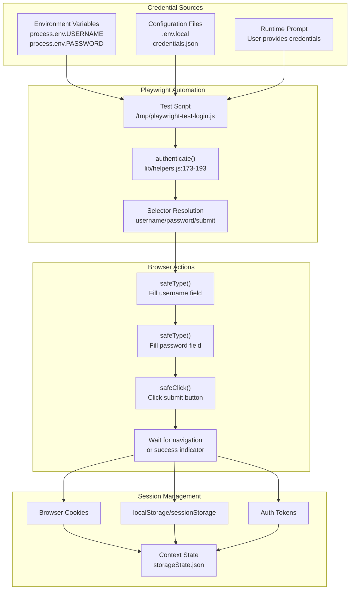
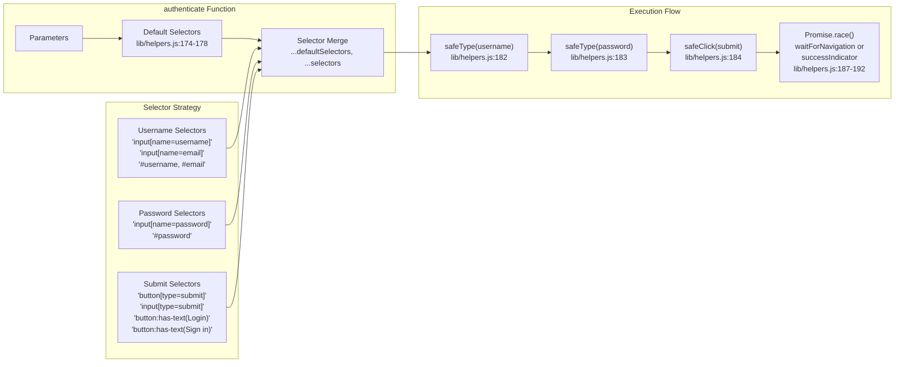
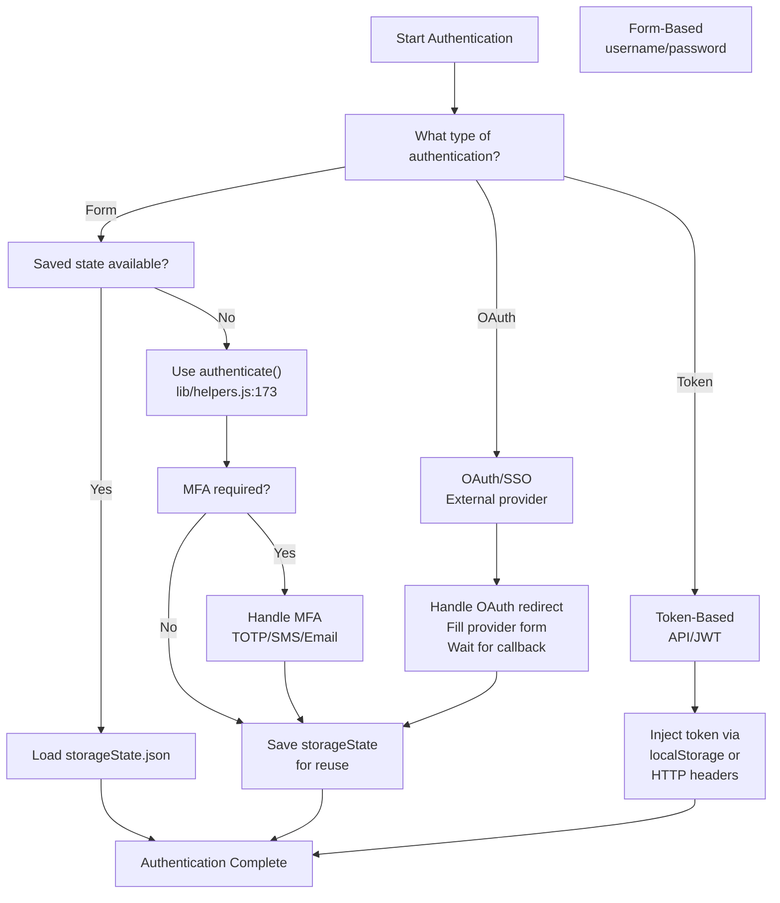

<!-- source: DeepWiki mcp.deepwiki.com · repo lackeyjb/playwright-skill · page 7.3 Authentication Patterns · fetched 2026-10-26 -->

# Authentication Patterns

<details>
<summary>Relevant source files</summary>

The following files were used as context for generating this wiki page:

- [API_REFERENCE.md](API_REFERENCE.md)
- [skills/playwright-skill/SKILL.md](skills/playwright-skill/SKILL.md)
- [skills/playwright-skill/lib/helpers.js](skills/playwright-skill/lib/helpers.js)

</details>


## Purpose and Scope

This document covers authentication handling in browser automation scenarios using the playwright-skill. It details form-based login, session management, credential handling, SSO/OAuth flows, and state persistence patterns. For general form filling patterns, see [Common Automation Patterns](#5.2). For specific testing workflows with authenticated users, see [Testing Workflows](#5.3).

## Overview

Authentication in browser automation requires handling several challenges:

- Secure credential management without hardcoding
- Session state preservation across test runs
- Authentication flow testing and validation
- Token/cookie handling for API-authenticated apps
- Multi-step authentication (2FA, SSO, OAuth)

The skill provides the `authenticate` helper function and patterns for common authentication scenarios while keeping credentials secure.

**Sources:** [skills/playwright-skill/SKILL.md:120-144](), [skills/playwright-skill/lib/helpers.js:168-193]()

## Authentication Flow Architecture



**Sources:** [skills/playwright-skill/lib/helpers.js:168-193](), [skills/playwright-skill/SKILL.md:120-144]()

## Form-Based Authentication

### Basic Login Pattern

The most common authentication pattern involves filling username/password fields and submitting a login form:

```javascript
// /tmp/playwright-test-login.js
const { chromium } = require('playwright');

const TARGET_URL = 'http://localhost:3001';

(async () => {
  const browser = await chromium.launch({ headless: false });
  const page = await browser.newPage();

  await page.goto(`${TARGET_URL}/login`);

  // Fill credentials
  await page.fill('input[name="email"]', 'test@example.com');
  await page.fill('input[name="password"]', 'password123');
  await page.click('button[type="submit"]');

  // Wait for redirect
  await page.waitForURL('**/dashboard');
  console.log('✅ Login successful, redirected to dashboard');

  await browser.close();
})();
```

This pattern is demonstrated in [skills/playwright-skill/SKILL.md:120-144]().

### Using the authenticate Helper

The `authenticate` function in `lib/helpers.js` provides intelligent selector resolution and retry logic:

```javascript
const helpers = require('./lib/helpers');

await helpers.authenticate(page, {
  username: 'user@example.com',
  password: 'securepassword'
}, {
  // Optional custom selectors
  username: 'input[name="email"]',
  password: 'input[name="password"]',
  submit: 'button[type="submit"]',
  successIndicator: '.dashboard'
});
```

**Sources:** [skills/playwright-skill/lib/helpers.js:168-193]()

## The authenticate Function

### Function Signature and Default Selectors



The function defines default selectors that handle most common login form patterns:

| Selector Type | Default Values | Purpose |
|--------------|----------------|---------|
| `username` | `input[name="username"], input[name="email"], #username, #email` | Covers common username/email field patterns |
| `password` | `input[name="password"], #password` | Covers common password field patterns |
| `submit` | `button[type="submit"], input[type="submit"], button:has-text("Login"), button:has-text("Sign in")` | Covers common submit button patterns |
| `successIndicator` | `.dashboard, .user-menu, .logout` | Default success verification elements |

**Sources:** [skills/playwright-skill/lib/helpers.js:173-193]()

### Verification Strategy

The authentication verification uses `Promise.race()` to handle different navigation patterns:

```javascript
await Promise.race([
  page.waitForNavigation({ waitUntil: 'networkidle' }),
  page.waitForSelector(selectors.successIndicator || '.dashboard, .user-menu, .logout', 
    { timeout: 10000 })
]).catch(() => {
  console.log('Login might have completed without navigation');
});
```

This handles three scenarios:
1. **Full page navigation** (traditional form submission)
2. **Single-page apps** (success indicator appears without navigation)
3. **No clear indication** (timeout with warning, continues execution)

**Sources:** [skills/playwright-skill/lib/helpers.js:186-193]()

## Session State Management

### Saving Authentication State

Playwright can persist authentication state (cookies, localStorage, sessionStorage) to reuse across test runs:

```javascript
// First login - save state
const { chromium } = require('playwright');

(async () => {
  const browser = await chromium.launch({ headless: false });
  const context = await browser.newContext();
  const page = await context.newPage();

  // Perform login
  await page.goto('http://localhost:3001/login');
  await page.fill('input[name="email"]', 'test@example.com');
  await page.fill('input[name="password"]', 'password123');
  await page.click('button[type="submit"]');
  await page.waitForURL('**/dashboard');

  // Save authenticated state
  await context.storageState({ path: '/tmp/auth-state.json' });
  console.log('✅ Authentication state saved');

  await browser.close();
})();
```

### Reusing Authentication State

Subsequent tests can skip the login process by loading saved state:

```javascript
// Reuse saved state
const browser = await chromium.launch({ headless: false });
const context = await browser.newContext({
  storageState: '/tmp/auth-state.json'  // Load saved state
});
const page = await context.newPage();

// Already authenticated - go directly to protected page
await page.goto('http://localhost:3001/dashboard');
console.log('✅ Loaded dashboard with saved authentication');
```

**Storage State Contents:**

The `storageState.json` file contains:
- HTTP cookies with domains and expiration
- localStorage key-value pairs
- sessionStorage key-value pairs
- Origin-specific data

**Sources:** [API_REFERENCE.md:1-630]()

## Credential Management

### Environment Variables

Store credentials in environment variables to avoid hardcoding:

```javascript
const credentials = {
  username: process.env.TEST_USERNAME || 'test@example.com',
  password: process.env.TEST_PASSWORD || 'fallback-password'
};

await page.fill('input[name="email"]', credentials.username);
await page.fill('input[name="password"]', credentials.password);
```

Execute with credentials:

```bash
TEST_USERNAME=user@example.com TEST_PASSWORD=secret123 \
  cd $SKILL_DIR && node run.js /tmp/playwright-test-login.js
```

### Configuration Files

Use `.env` files or JSON configs (ensure they're in `.gitignore`):

```javascript
// Load from .env file
require('dotenv').config({ path: '/tmp/test-credentials.env' });

const credentials = {
  username: process.env.TEST_USERNAME,
  password: process.env.TEST_PASSWORD
};
```

**Security Note:** Never commit credentials to version control. Always use environment variables or secure credential stores.

**Sources:** [skills/playwright-skill/SKILL.md:120-144]()

## OAuth and SSO Patterns

### OAuth Flow Automation

OAuth flows typically involve redirects to external identity providers. Handle these by:

1. **Detecting the OAuth redirect**
2. **Filling provider's login form**
3. **Waiting for callback redirect**

```javascript
const { chromium } = require('playwright');

(async () => {
  const browser = await chromium.launch({ headless: false });
  const page = await browser.newPage();

  // Navigate to app
  await page.goto('http://localhost:3001');
  
  // Click OAuth login button
  await page.click('button:has-text("Sign in with Google")');
  
  // Wait for OAuth provider redirect
  await page.waitForURL('**/accounts.google.com/**');
  
  // Fill OAuth provider form
  await page.fill('input[type="email"]', process.env.OAUTH_EMAIL);
  await page.click('button:has-text("Next")');
  await page.fill('input[type="password"]', process.env.OAUTH_PASSWORD);
  await page.click('button:has-text("Next")');
  
  // Wait for callback redirect back to app
  await page.waitForURL('**/localhost:3001/**');
  await page.waitForSelector('.user-menu');
  
  console.log('✅ OAuth authentication successful');
  
  await browser.close();
})();
```

### SSO with SAML

SAML flows follow similar patterns with additional redirects:

```javascript
// Click SSO login
await page.click('button[data-testid="sso-login"]');

// Wait for IdP redirect
await page.waitForURL('**/sso.company.com/**');

// Fill IdP credentials
await page.fill('#username', process.env.SSO_USERNAME);
await page.fill('#password', process.env.SSO_PASSWORD);
await page.click('#submit');

// Handle MFA if present
const mfaVisible = await page.locator('#mfa-code').isVisible({ timeout: 2000 })
  .catch(() => false);
  
if (mfaVisible) {
  await page.fill('#mfa-code', process.env.MFA_CODE);
  await page.click('#verify-mfa');
}

// Wait for callback
await page.waitForURL('**/localhost:3001/**');
```

**Sources:** [API_REFERENCE.md:1-630]()

## Token-Based Authentication

### API Token Injection

For apps using bearer tokens or API keys:

```javascript
const { chromium } = require('playwright');

(async () => {
  const browser = await chromium.launch({ headless: false });
  const context = await browser.newContext();
  const page = await context.newPage();

  // Set authorization header for API requests
  await context.setExtraHTTPHeaders({
    'Authorization': `Bearer ${process.env.API_TOKEN}`
  });

  // Or inject token into localStorage
  await page.goto('http://localhost:3001');
  await page.evaluate(token => {
    localStorage.setItem('auth_token', token);
  }, process.env.API_TOKEN);

  // Reload to apply token
  await page.reload();
  await page.waitForSelector('.user-menu');
  
  console.log('✅ Token authentication successful');
  
  await browser.close();
})();
```

### JWT Token Handling

```javascript
// Decode JWT to check expiration
await page.evaluate(() => {
  const token = localStorage.getItem('jwt_token');
  if (token) {
    const payload = JSON.parse(atob(token.split('.')[1]));
    const expiresAt = new Date(payload.exp * 1000);
    console.log('Token expires:', expiresAt);
    return payload.exp * 1000 > Date.now();
  }
  return false;
});
```

**Sources:** [API_REFERENCE.md:382-409]()

## Multi-Factor Authentication

### TOTP/2FA Code Handling

```javascript
// After initial login, wait for 2FA prompt
await page.waitForSelector('input[name="otp"]');

// Generate or retrieve TOTP code
const totp = process.env.TOTP_SECRET
  ? generateTOTP(process.env.TOTP_SECRET)
  : process.env.TEST_OTP_CODE;

await page.fill('input[name="otp"]', totp);
await page.click('button:has-text("Verify")');

await page.waitForURL('**/dashboard');
console.log('✅ 2FA verification successful');
```

### SMS/Email Code Verification

For SMS or email-based 2FA, consider:

1. **Test mode bypass:** Most apps have test mode that accepts fixed codes
2. **API integration:** Use email/SMS API to retrieve codes programmatically
3. **Mock service:** Intercept verification requests in test environment

```javascript
// Mock 2FA verification endpoint
await page.route('**/api/verify-2fa', route => {
  route.fulfill({
    status: 200,
    contentType: 'application/json',
    body: JSON.stringify({ verified: true })
  });
});
```

**Sources:** [skills/playwright-skill/lib/helpers.js:168-193]()

## Authentication Pattern Decision Tree



**Sources:** [skills/playwright-skill/lib/helpers.js:168-193](), [skills/playwright-skill/SKILL.md:120-144]()

## Testing Authenticated User Flows

### Testing with Pre-Authenticated Context

Efficient testing of authenticated-only features:

```javascript
const { chromium } = require('playwright');

(async () => {
  const browser = await chromium.launch({ headless: false });
  
  // Load authenticated state
  const context = await browser.newContext({
    storageState: '/tmp/auth-state.json'
  });
  
  const page = await context.newPage();
  
  // Test authenticated features
  await page.goto('http://localhost:3001/account/settings');
  await page.fill('input[name="display_name"]', 'New Name');
  await page.click('button[type="submit"]');
  
  await page.waitForSelector('.success-message');
  console.log('✅ Profile updated successfully');
  
  await browser.close();
})();
```

### Testing Permission Levels

```javascript
// Test different user roles
const roles = ['admin', 'editor', 'viewer'];

for (const role of roles) {
  const context = await browser.newContext({
    storageState: `/tmp/auth-state-${role}.json`
  });
  
  const page = await context.newPage();
  await page.goto('http://localhost:3001/admin');
  
  if (role === 'admin') {
    await expect(page.locator('.admin-panel')).toBeVisible();
  } else {
    await expect(page.locator('.access-denied')).toBeVisible();
  }
  
  await context.close();
}
```

**Sources:** [skills/playwright-skill/SKILL.md:120-144](), [API_REFERENCE.md:1-630]()

## Best Practices

### Security Best Practices

| Practice | Implementation | Rationale |
|----------|---------------|-----------|
| **Never hardcode credentials** | Use environment variables or secure vaults | Prevents credential leaks in version control |
| **Use test accounts** | Create dedicated test users with limited permissions | Isolates test data from production |
| **Rotate credentials** | Update test credentials regularly | Reduces impact of potential exposure |
| **Cleanup sessions** | Delete storage state files after tests | Prevents unauthorized reuse |
| **Separate environments** | Use different credentials for dev/staging/prod | Prevents accidental production access |

### Performance Optimizations

```javascript
// Setup: Login once, save state
test.beforeAll(async ({ browser }) => {
  const context = await browser.newContext();
  const page = await context.newPage();
  
  // Perform login
  await page.goto('http://localhost:3001/login');
  await helpers.authenticate(page, {
    username: process.env.TEST_USER,
    password: process.env.TEST_PASSWORD
  });
  
  // Save state for all tests
  await context.storageState({ path: '/tmp/auth-state.json' });
  await context.close();
});

// All tests use saved state
test.use({ storageState: '/tmp/auth-state.json' });
```

### Error Handling

```javascript
const helpers = require('./lib/helpers');

try {
  await helpers.authenticate(page, credentials, {
    successIndicator: '.dashboard'
  });
  console.log('✅ Authentication successful');
} catch (error) {
  // Take screenshot on failure
  await page.screenshot({ path: '/tmp/auth-failure.png', fullPage: true });
  console.error('❌ Authentication failed:', error.message);
  
  // Check for error messages
  const errorMsg = await page.locator('.error-message').textContent()
    .catch(() => 'No error message found');
  console.error('Error message:', errorMsg);
  
  throw error;
}
```

**Sources:** [skills/playwright-skill/lib/helpers.js:168-193](), [skills/playwright-skill/lib/helpers.js:85-109]()

## Common Authentication Scenarios

### Scenario Matrix

| Scenario | Pattern | Helper Usage | State Persistence |
|----------|---------|--------------|-------------------|
| Simple login form | Form-based | `authenticate()` | Recommended |
| OAuth (Google, GitHub) | OAuth redirect | Manual navigation | Recommended |
| SSO/SAML | Multi-step redirect | Manual navigation | Recommended |
| API token | Token injection | Manual | Not needed |
| 2FA/MFA | Form + verification | `authenticate()` + manual MFA | Recommended |
| Session cookies only | Form-based | `authenticate()` | Recommended |
| JWT in localStorage | Token injection | Manual | Recommended |
| HTTP Basic Auth | Request interception | Manual | Not needed |

### HTTP Basic Authentication

```javascript
// Set basic auth credentials
const context = await browser.newContext({
  httpCredentials: {
    username: 'testuser',
    password: 'testpass'
  }
});

const page = await context.newPage();
await page.goto('http://localhost:3001/protected');
```

### Cookie-Based Session Management

```javascript
// Set cookies manually
await context.addCookies([
  {
    name: 'session_id',
    value: 'abc123xyz',
    domain: 'localhost',
    path: '/',
    httpOnly: true,
    secure: false,
    sameSite: 'Lax'
  }
]);

await page.goto('http://localhost:3001/dashboard');
```

**Sources:** [API_REFERENCE.md:382-409](), [skills/playwright-skill/lib/helpers.js:168-193]()

## Troubleshooting Authentication Issues

### Common Issues and Solutions

**Problem:** Login appears successful but redirect doesn't happen

```javascript
// Solution: Use both navigation and selector checks
await Promise.race([
  page.waitForNavigation({ waitUntil: 'networkidle', timeout: 10000 }),
  page.waitForSelector('.user-menu', { timeout: 10000 })
]);
```

**Problem:** Credentials work manually but fail in automation

```javascript
// Solution: Add delays to mimic human behavior
await page.fill('input[name="email"]', credentials.username);
await page.waitForTimeout(500);
await page.fill('input[name="password"]', credentials.password);
await page.waitForTimeout(500);
await page.click('button[type="submit"]');
```

**Problem:** Session expires during test execution

```javascript
// Solution: Check token expiration and re-authenticate
async function ensureAuthenticated(page) {
  const isAuth = await page.locator('.user-menu').isVisible({ timeout: 2000 })
    .catch(() => false);
  
  if (!isAuth) {
    console.log('Session expired, re-authenticating...');
    await page.goto('http://localhost:3001/login');
    await helpers.authenticate(page, credentials);
  }
}
```

**Problem:** Cookie domain mismatch

```javascript
// Solution: Verify cookie domain matches page origin
const cookies = await context.cookies();
console.log('Current cookies:', cookies);

// Ensure cookie domain is correct
await context.addCookies([{
  ...cookie,
  domain: new URL(page.url()).hostname
}]);
```

**Sources:** [skills/playwright-skill/lib/helpers.js:186-193](), [skills/playwright-skill/lib/helpers.js:85-109]()

---

