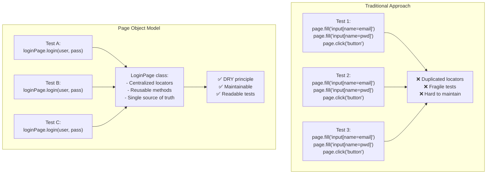
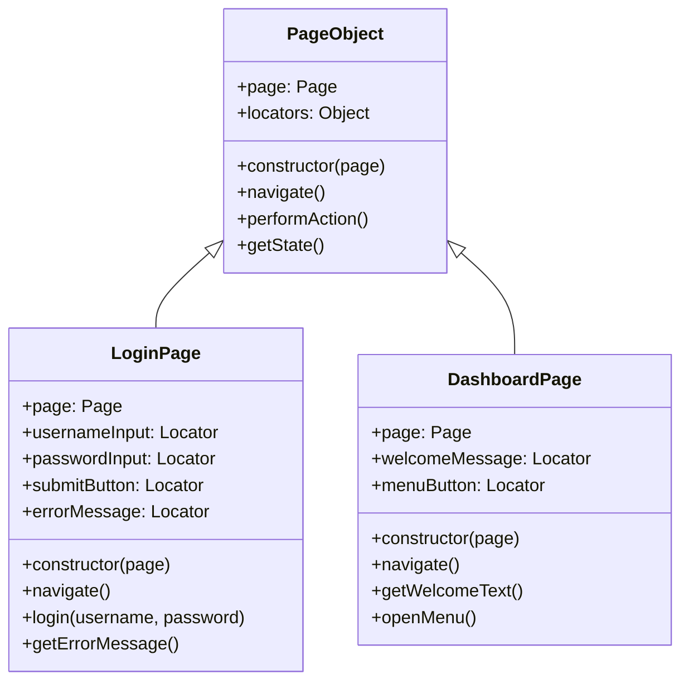
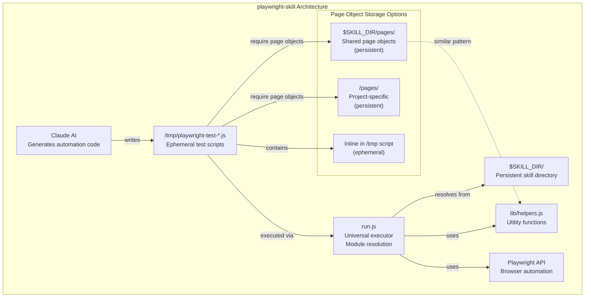
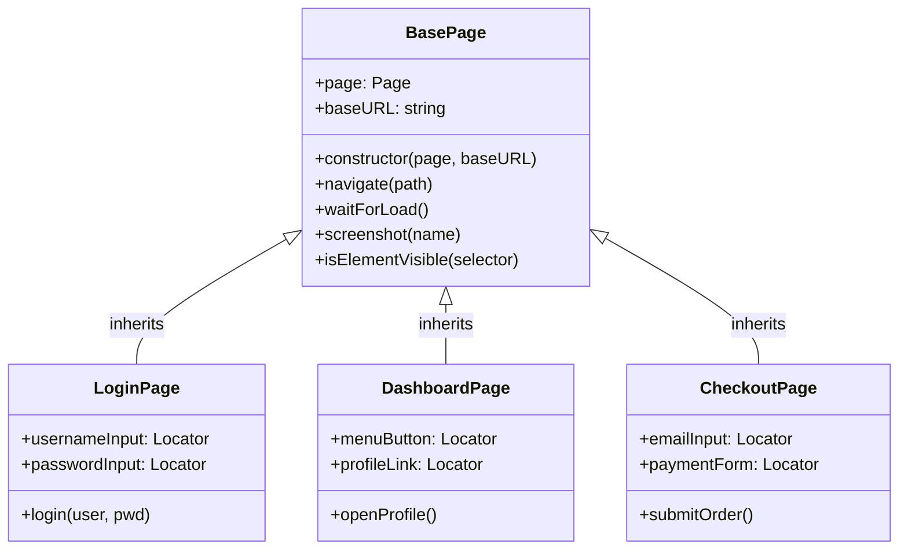
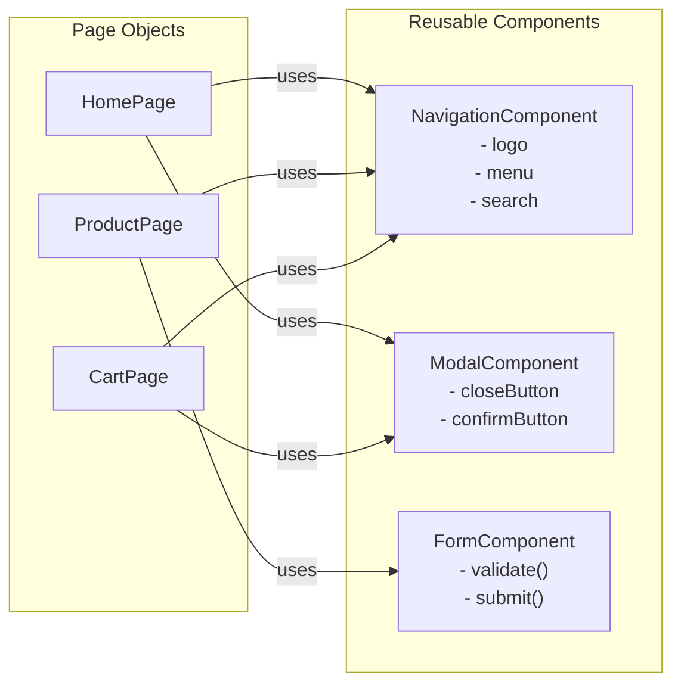
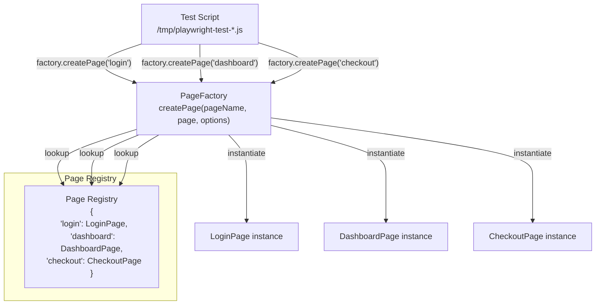
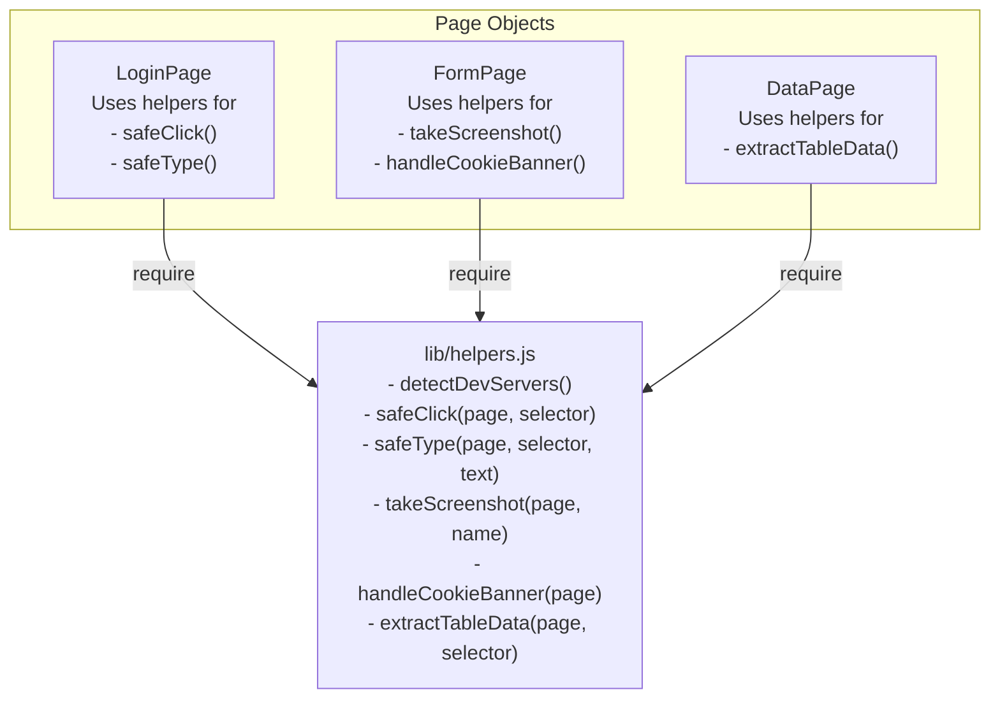
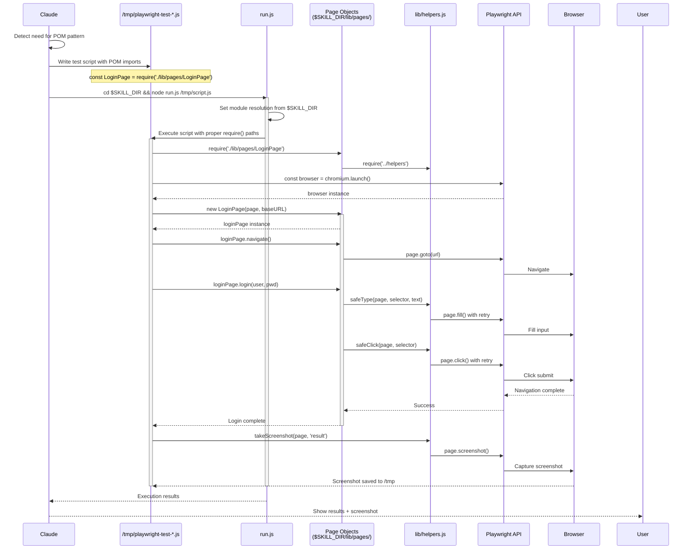

<!-- source: DeepWiki mcp.deepwiki.com · repo lackeyjb/playwright-skill · page 7.5 Page Object Model · fetched 2026-10-26 -->

# Page Object Model

<details>
<summary>Relevant source files</summary>

The following files were used as context for generating this wiki page:

- [API_REFERENCE.md](API_REFERENCE.md)
- [skills/playwright-skill/SKILL.md](skills/playwright-skill/SKILL.md)

</details>


## Purpose and Scope

This document explains how to organize browser automation code using the Page Object Model (POM) pattern within the playwright-skill system. It covers structuring page-specific logic into reusable classes, organizing components, and adapting POM patterns to work with the skill's ephemeral script execution model.

For basic automation script patterns, see [Writing Automation Scripts](#5.1). For general test organization, see [Testing Workflows](#5.3). For the underlying execution mechanism, see [run.js: The Universal Executor](#4.2).

## What is Page Object Model

The Page Object Model is a design pattern that encapsulates web page structure and behavior into reusable classes. Instead of scattering locators and interactions throughout test code, POM centralizes them into page-specific objects that represent the UI elements and actions available on each page.

**Core Concept**: Each page or component in the application has a corresponding class that:
- Defines all locators for elements on that page
- Provides methods for user actions on those elements
- Hides implementation details from test code
- Makes tests more maintainable and readable

### Traditional Test Code vs Page Object Model



**Sources**: [API_REFERENCE.md:342-379]()

## Basic Page Object Structure

A page object class encapsulates all interactions with a specific page or component. The pattern follows these principles:



### Example: Basic Login Page Object

The following structure demonstrates a typical page object implementation as shown in [API_REFERENCE.md:347-370]():

```javascript
// pages/LoginPage.js
class LoginPage {
  constructor(page) {
    this.page = page;
    // Define all locators in constructor
    this.usernameInput = page.locator('input[name="username"]');
    this.passwordInput = page.locator('input[name="password"]');
    this.submitButton = page.locator('button[type="submit"]');
    this.errorMessage = page.locator('.error-message');
  }

  // Navigation method
  async navigate() {
    await this.page.goto('/login');
  }

  // Action methods encapsulate user interactions
  async login(username, password) {
    await this.usernameInput.fill(username);
    await this.passwordInput.fill(password);
    await this.submitButton.click();
  }

  // Getter methods for state verification
  async getErrorMessage() {
    return await this.errorMessage.textContent();
  }
}
```

### Key Components

| Component | Purpose | Example |
|-----------|---------|---------|
| **Constructor** | Accepts `page` object, initializes locators | `constructor(page) { this.page = page; }` |
| **Locators** | Define element selectors as class properties | `this.submitButton = page.locator('button')` |
| **Navigation** | Methods to navigate to the page | `async navigate() { await this.page.goto('/login'); }` |
| **Actions** | Methods that perform user interactions | `async login(u, p) { await this.fill(...); }` |
| **Getters** | Methods to retrieve page state | `async getTitle() { return await this.page.title(); }` |

**Sources**: [API_REFERENCE.md:342-379]()

## Page Objects in playwright-skill Context

The playwright-skill system writes ephemeral scripts to `/tmp` and executes them via `run.js`. This creates unique considerations for organizing page objects:



### Three Approaches to Page Objects

| Approach | Location | Persistence | Use Case |
|----------|----------|-------------|----------|
| **Shared Page Objects** | `$SKILL_DIR/pages/` | Permanent | Common patterns used across many tests |
| **Project Page Objects** | `<project>/pages/` | Permanent | Application-specific pages for a single project |
| **Inline Page Objects** | Inside `/tmp` script | Temporary | One-off tests, rapid prototyping |

**Sources**: [SKILL.md:9-16](), [SKILL.md:41-44]()

## Creating Reusable Page Objects

### Approach 1: Shared Page Objects in Skill Directory

For commonly reused patterns, create page objects within the skill directory structure:

```
skills/playwright-skill/
├── lib/
│   ├── helpers.js          # Utility functions
│   └── pages/              # Shared page objects
│       ├── BasePage.js     # Base class
│       ├── LoginPage.js    # Login pattern
│       └── FormPage.js     # Form interaction pattern
├── run.js
└── SKILL.md
```

**Example: Creating a Shared Login Page Object**

```javascript
// $SKILL_DIR/lib/pages/LoginPage.js
class LoginPage {
  constructor(page, options = {}) {
    this.page = page;
    this.baseURL = options.baseURL || 'http://localhost:3000';
    
    // Flexible locators via options
    this.selectors = {
      username: options.usernameSelector || 'input[name="username"]',
      password: options.passwordSelector || 'input[name="password"]',
      submit: options.submitSelector || 'button[type="submit"]',
      error: options.errorSelector || '.error-message'
    };
    
    // Initialize locators
    this.usernameInput = page.locator(this.selectors.username);
    this.passwordInput = page.locator(this.selectors.password);
    this.submitButton = page.locator(this.selectors.submit);
    this.errorMessage = page.locator(this.selectors.error);
  }

  async navigate(path = '/login') {
    await this.page.goto(`${this.baseURL}${path}`);
  }

  async login(username, password) {
    await this.usernameInput.fill(username);
    await this.passwordInput.fill(password);
    await this.submitButton.click();
  }

  async loginAndWait(username, password, expectedURL) {
    await this.login(username, password);
    await this.page.waitForURL(expectedURL || '**/dashboard');
  }

  async hasError() {
    return await this.errorMessage.isVisible();
  }

  async getErrorText() {
    return await this.errorMessage.textContent();
  }
}

module.exports = LoginPage;
```

**Using in /tmp Script**

```javascript
// /tmp/playwright-test-login.js
const { chromium } = require('playwright');
const LoginPage = require('./lib/pages/LoginPage');

const TARGET_URL = 'http://localhost:3001';

(async () => {
  const browser = await chromium.launch({ headless: false });
  const page = await browser.newPage();
  
  const loginPage = new LoginPage(page, { baseURL: TARGET_URL });
  await loginPage.navigate();
  await loginPage.loginAndWait('test@example.com', 'password123');
  
  console.log('✅ Login successful');
  await browser.close();
})();
```

**Sources**: [API_REFERENCE.md:347-379](), [SKILL.md:86-90]()

### Approach 2: Inline Page Objects

For one-off tests or rapid prototyping, define page objects directly in the `/tmp` script:

```javascript
// /tmp/playwright-test-checkout.js
const { chromium } = require('playwright');

// Inline page object for one-time use
class CheckoutPage {
  constructor(page) {
    this.page = page;
    this.emailInput = page.locator('[data-testid="email"]');
    this.addressInput = page.locator('[data-testid="address"]');
    this.submitButton = page.getByRole('button', { name: 'Complete Order' });
  }

  async fillShippingInfo(email, address) {
    await this.emailInput.fill(email);
    await this.addressInput.fill(address);
  }

  async submitOrder() {
    await this.submitButton.click();
    await this.page.waitForURL('**/confirmation');
  }
}

// Use immediately in same script
(async () => {
  const browser = await chromium.launch({ headless: false });
  const page = await browser.newPage();
  
  const checkout = new CheckoutPage(page);
  await page.goto('http://localhost:3001/checkout');
  await checkout.fillShippingInfo('user@test.com', '123 Main St');
  await checkout.submitOrder();
  
  await browser.close();
})();
```

**Sources**: [SKILL.md:64-84](), [SKILL.md:277-291]()

## Component Organization Patterns

### Base Page Pattern

Create a base page class that provides common functionality for all page objects:



**Example: Base Page Implementation**

```javascript
// $SKILL_DIR/lib/pages/BasePage.js
class BasePage {
  constructor(page, baseURL = 'http://localhost:3000') {
    this.page = page;
    this.baseURL = baseURL;
  }

  async navigate(path = '') {
    await this.page.goto(`${this.baseURL}${path}`, {
      waitUntil: 'networkidle'
    });
  }

  async waitForLoad() {
    await this.page.waitForLoadState('networkidle');
  }

  async screenshot(name) {
    await this.page.screenshot({
      path: `/tmp/${name}-${Date.now()}.png`,
      fullPage: true
    });
  }

  async isElementVisible(selector) {
    try {
      return await this.page.locator(selector).isVisible();
    } catch {
      return false;
    }
  }

  async getText(selector) {
    return await this.page.locator(selector).textContent();
  }

  async waitForNavigation(urlPattern) {
    await this.page.waitForURL(urlPattern, { timeout: 10000 });
  }
}

module.exports = BasePage;
```

**Sources**: [API_REFERENCE.md:342-379]()

### Component Pattern

For reusable UI components (navigation bars, modals, forms), create component classes:



**Example: Navigation Component**

```javascript
// $SKILL_DIR/lib/components/NavigationComponent.js
class NavigationComponent {
  constructor(page) {
    this.page = page;
    this.logo = page.locator('[data-testid="logo"]');
    this.searchInput = page.locator('input[type="search"]');
    this.cartButton = page.locator('[data-testid="cart-button"]');
    this.menuButton = page.locator('[data-testid="menu-button"]');
  }

  async search(query) {
    await this.searchInput.fill(query);
    await this.searchInput.press('Enter');
    await this.page.waitForLoadState('networkidle');
  }

  async openCart() {
    await this.cartButton.click();
    await this.page.waitForURL('**/cart');
  }

  async navigateHome() {
    await this.logo.click();
    await this.page.waitForURL(/.*\/$/);
  }

  async isLoggedIn() {
    return await this.page.locator('[data-testid="logout-button"]').isVisible();
  }
}

module.exports = NavigationComponent;
```

**Using Components in Page Objects**

```javascript
// $SKILL_DIR/lib/pages/ProductPage.js
const BasePage = require('./BasePage');
const NavigationComponent = require('../components/NavigationComponent');

class ProductPage extends BasePage {
  constructor(page, baseURL) {
    super(page, baseURL);
    
    // Compose with navigation component
    this.nav = new NavigationComponent(page);
    
    // Page-specific locators
    this.addToCartButton = page.getByRole('button', { name: 'Add to Cart' });
    this.priceLabel = page.locator('[data-testid="price"]');
    this.quantitySelector = page.locator('select[name="quantity"]');
  }

  async addToCart(quantity = 1) {
    if (quantity > 1) {
      await this.quantitySelector.selectOption(String(quantity));
    }
    await this.addToCartButton.click();
    await this.page.waitForSelector('.cart-notification');
  }

  async getPrice() {
    return await this.priceLabel.textContent();
  }

  // Delegate to navigation component
  async goToCart() {
    await this.nav.openCart();
  }
}

module.exports = ProductPage;
```

**Sources**: [API_REFERENCE.md:163-180]()

## Advanced Page Object Patterns

### Page Factory Pattern



**Example: Page Factory Implementation**

```javascript
// $SKILL_DIR/lib/pages/PageFactory.js
const LoginPage = require('./LoginPage');
const DashboardPage = require('./DashboardPage');
const CheckoutPage = require('./CheckoutPage');

class PageFactory {
  constructor(page, baseURL) {
    this.page = page;
    this.baseURL = baseURL;
    
    // Registry of available page objects
    this.registry = {
      'login': LoginPage,
      'dashboard': DashboardPage,
      'checkout': CheckoutPage
    };
  }

  createPage(pageName, options = {}) {
    const PageClass = this.registry[pageName.toLowerCase()];
    if (!PageClass) {
      throw new Error(`Page '${pageName}' not found in registry`);
    }
    return new PageClass(this.page, this.baseURL, options);
  }

  registerPage(name, PageClass) {
    this.registry[name.toLowerCase()] = PageClass;
  }
}

module.exports = PageFactory;
```

**Using the Factory**

```javascript
// /tmp/playwright-test-flow.js
const { chromium } = require('playwright');
const PageFactory = require('./lib/pages/PageFactory');

(async () => {
  const browser = await chromium.launch({ headless: false });
  const page = await browser.newPage();
  const factory = new PageFactory(page, 'http://localhost:3001');

  // Create pages dynamically
  const loginPage = factory.createPage('login');
  await loginPage.navigate();
  await loginPage.login('user@test.com', 'password');

  const dashboardPage = factory.createPage('dashboard');
  const welcomeText = await dashboardPage.getWelcomeMessage();
  console.log(welcomeText);

  await browser.close();
})();
```

**Sources**: [SKILL.md:41-44]()

### Action Pattern

Encapsulate complex multi-step actions into reusable methods:

```javascript
// $SKILL_DIR/lib/pages/EcommercePage.js
class EcommercePage {
  constructor(page, baseURL) {
    this.page = page;
    this.baseURL = baseURL;
    this.searchInput = page.locator('[data-testid="search"]');
    this.firstProduct = page.locator('[data-testid="product"]').first();
    this.addToCartButton = page.locator('[data-testid="add-to-cart"]');
    this.cartIcon = page.locator('[data-testid="cart-icon"]');
    this.checkoutButton = page.locator('[data-testid="checkout"]');
  }

  // Complex action combining multiple steps
  async searchAndAddToCart(searchTerm) {
    await this.searchInput.fill(searchTerm);
    await this.searchInput.press('Enter');
    await this.page.waitForLoadState('networkidle');
    
    await this.firstProduct.click();
    await this.page.waitForSelector('[data-testid="add-to-cart"]');
    
    await this.addToCartButton.click();
    await this.page.waitForSelector('.cart-notification');
    
    console.log(`Added "${searchTerm}" to cart`);
  }

  // Complete checkout flow
  async completeCheckout(shippingInfo, paymentInfo) {
    await this.cartIcon.click();
    await this.checkoutButton.click();
    
    // Fill shipping
    await this.fillShippingForm(shippingInfo);
    await this.page.getByRole('button', { name: 'Continue' }).click();
    
    // Fill payment
    await this.fillPaymentForm(paymentInfo);
    await this.page.getByRole('button', { name: 'Place Order' }).click();
    
    await this.page.waitForURL('**/confirmation');
    console.log('✅ Order placed successfully');
  }

  async fillShippingForm(info) {
    await this.page.fill('[name="address"]', info.address);
    await this.page.fill('[name="city"]', info.city);
    await this.page.fill('[name="zip"]', info.zip);
  }

  async fillPaymentForm(info) {
    await this.page.fill('[name="cardNumber"]', info.cardNumber);
    await this.page.fill('[name="expiry"]', info.expiry);
    await this.page.fill('[name="cvv"]', info.cvv);
  }
}

module.exports = EcommercePage;
```

**Sources**: [SKILL.md:146-171](), [API_REFERENCE.md:184-216]()

## Integration with Helper Functions

The playwright-skill provides utility functions in [lib/helpers.js](). Page objects can leverage these helpers:



**Example: Page Object Using Helpers**

```javascript
// $SKILL_DIR/lib/pages/FormPage.js
const helpers = require('../helpers');

class FormPage {
  constructor(page, baseURL) {
    this.page = page;
    this.baseURL = baseURL;
  }

  async navigate(path = '/form') {
    await this.page.goto(`${this.baseURL}${path}`);
    
    // Use helper to dismiss cookie banner
    await helpers.handleCookieBanner(this.page);
  }

  async fillForm(data) {
    // Use safeType for reliable input
    await helpers.safeType(this.page, '#name', data.name);
    await helpers.safeType(this.page, '#email', data.email);
    await helpers.safeType(this.page, '#message', data.message);
  }

  async submit() {
    // Use safeClick with retry logic
    await helpers.safeClick(this.page, 'button[type="submit"]', { 
      retries: 3,
      timeout: 5000 
    });
    
    // Capture result
    await helpers.takeScreenshot(this.page, 'form-submitted');
  }

  async getConfirmationMessage() {
    await this.page.waitForSelector('.success-message');
    return await this.page.locator('.success-message').textContent();
  }
}

module.exports = FormPage;
```

**Sources**: [SKILL.md:299-323](), [lib/helpers.js]()

## Execution Flow with Page Objects



**Sources**: [SKILL.md:21-44](), [SKILL.md:86-90]()

## Best Practices

### 1. Selector Strategy

Use the most stable selectors in page objects, as recommended in [Selectors and Locators](#6.3):

| Priority | Selector Type | Example | Rationale |
|----------|--------------|---------|-----------|
| 1 | Data attributes | `[data-testid="submit"]` | Most stable, designed for testing |
| 2 | Role-based | `getByRole('button', { name: 'Submit' })` | Accessible, semantic |
| 3 | Text content | `getByText('Sign in')` | User-facing, readable |
| 4 | Semantic HTML | `button[type="submit"]` | Standard, less likely to change |
| 5 | Classes/IDs | `.btn-primary`, `#submit` | Avoid - frequently change |

**Sources**: [API_REFERENCE.md:134-161]()

### 2. Method Naming Conventions

| Method Prefix | Purpose | Example |
|---------------|---------|---------|
| `navigate()` | Page navigation | `await page.navigate()` |
| `fill*()` | Form filling | `await page.fillLoginForm()` |
| `submit*()` | Form submission | `await page.submitForm()` |
| `get*()` | Retrieve state | `await page.getErrorMessage()` |
| `is*()` | Boolean checks | `await page.isLoggedIn()` |
| `has*()` | Boolean checks | `await page.hasError()` |
| `wait*()` | Explicit waits | `await page.waitForSuccess()` |

### 3. Error Handling

Always include error handling in page object methods:

```javascript
class RobustPage {
  async safeNavigate(path) {
    try {
      await this.page.goto(`${this.baseURL}${path}`, {
        waitUntil: 'networkidle',
        timeout: 10000
      });
      return true;
    } catch (error) {
      console.error(`Failed to navigate to ${path}: ${error.message}`);
      await this.screenshot('navigation-error');
      return false;
    }
  }

  async screenshot(name) {
    try {
      await this.page.screenshot({
        path: `/tmp/${name}-${Date.now()}.png`,
        fullPage: true
      });
    } catch (error) {
      console.error(`Screenshot failed: ${error.message}`);
    }
  }
}
```

**Sources**: [SKILL.md:209-235](), [API_REFERENCE.md:599-606]()

### 4. Waiting Strategies

Use Playwright's built-in waiting mechanisms instead of arbitrary timeouts:

```javascript
class SmartPage {
  async waitForElement(selector, options = {}) {
    await this.page.locator(selector).waitFor({
      state: options.state || 'visible',
      timeout: options.timeout || 10000
    });
  }

  async waitForNavigation(urlPattern) {
    await this.page.waitForURL(urlPattern, { timeout: 10000 });
  }

  async waitForNetworkIdle() {
    await this.page.waitForLoadState('networkidle');
  }
}
```

**Sources**: [API_REFERENCE.md:259-299](), [SKILL.md:341-350]()

### 5. Documentation

Document page objects with JSDoc comments:

```javascript
/**
 * Represents the login page and provides methods to interact with it.
 * @class
 * @example
 * const loginPage = new LoginPage(page, 'http://localhost:3000');
 * await loginPage.navigate();
 * await loginPage.login('user@example.com', 'password123');
 */
class LoginPage {
  /**
   * Create a LoginPage instance.
   * @param {Page} page - Playwright page object
   * @param {string} baseURL - Base URL of the application
   */
  constructor(page, baseURL) {
    this.page = page;
    this.baseURL = baseURL;
  }

  /**
   * Login with provided credentials and wait for redirect.
   * @param {string} username - User's email or username
   * @param {string} password - User's password
   * @param {string} [expectedURL='**/dashboard'] - URL pattern to wait for
   * @returns {Promise<void>}
   * @throws {Error} If login fails or timeout occurs
   */
  async loginAndWait(username, password, expectedURL = '**/dashboard') {
    await this.usernameInput.fill(username);
    await this.passwordInput.fill(password);
    await this.submitButton.click();
    await this.page.waitForURL(expectedURL);
  }
}
```

**Sources**: [CONTRIBUTING.md]()

### 6. Storage Location Decision Matrix

| Scenario | Storage Location | Rationale |
|----------|------------------|-----------|
| Common login pattern used in multiple projects | `$SKILL_DIR/lib/pages/` | Shared across all projects |
| Application-specific pages for one project | `<project>/pages/` | Project-specific, version controlled with app |
| Quick one-off test | Inline in `/tmp` script | Ephemeral, no reuse needed |
| Experimentation/prototyping | Inline in `/tmp` script | Fast iteration, not yet stabilized |
| Proven pattern ready for reuse | Move to `$SKILL_DIR/lib/pages/` or `<project>/pages/` | Graduate from prototype to library |

**Sources**: [SKILL.md:9-16](), [SKILL.md:41-44]()

---

**Sources for this document**: [API_REFERENCE.md:13](), [API_REFERENCE.md:342-379](), [SKILL.md:1-407]()

---

