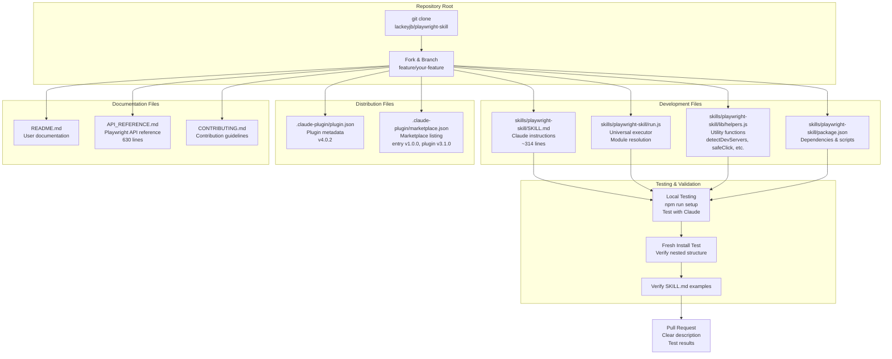
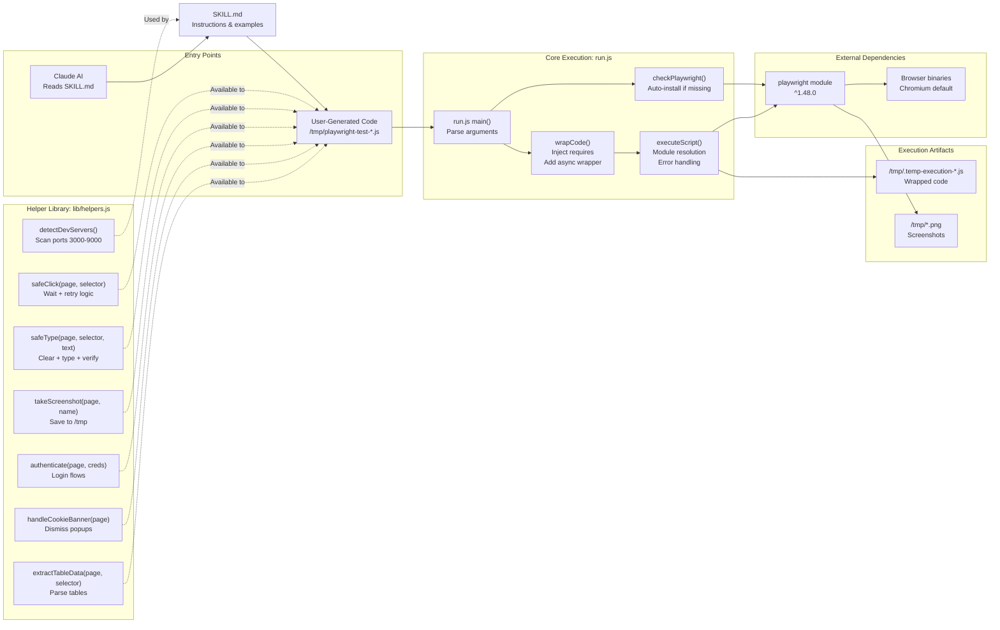
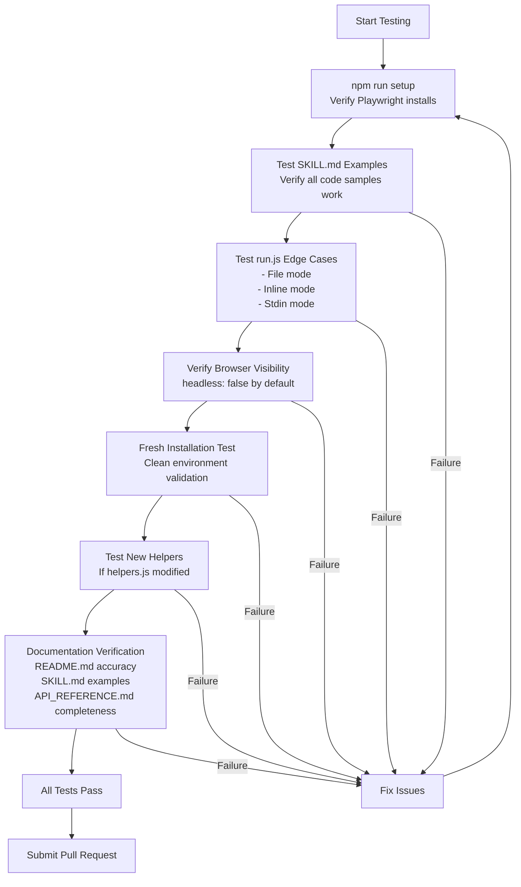

<!-- source: DeepWiki mcp.deepwiki.com · repo lackeyjb/playwright-skill · page 8 Development and Contributing · fetched 2026-10-26 -->

# Development and Contributing

<details>
<summary>Relevant source files</summary>

The following files were used as context for generating this wiki page:

- [CONTRIBUTING.md](CONTRIBUTING.md)
- [README.md](README.md)

</details>


## Purpose and Scope

This page provides an overview of the development environment, architecture, and contribution process for the playwright-skill codebase. It covers the technical setup required to develop and extend the skill, key architectural patterns developers should understand, and the workflow for contributing changes.

For specific details on:
- Contributing guidelines and pull request process, see [Contributing Guidelines](#8.1)
- Repository organization and file structure, see [Project Structure](#8.2)
- Local development and testing procedures, see [Development Workflow](#8.3)
- Adding new helper functions and updating documentation, see [Extending the Skill](#8.4)

## Development Environment Overview

The playwright-skill repository uses a **nested plugin structure** that affects the development workflow. The repository root contains plugin metadata in [.claude-plugin/](), while the actual skill implementation resides in [skills/playwright-skill/](). This structure enables dual distribution as both a Claude Code Plugin and a standalone skill.

**Key Development Directories:**

| Directory | Purpose | Key Files |
|-----------|---------|-----------|
| `.claude-plugin/` | Plugin metadata for distribution | `plugin.json`, `marketplace.json` |
| `skills/playwright-skill/` | Actual skill implementation | `SKILL.md`, `run.js`, `package.json` |
| `skills/playwright-skill/lib/` | Helper function library | `helpers.js` |
| Root directory | Repository-level documentation | `README.md`, `CONTRIBUTING.md`, `API_REFERENCE.md` |

**Development Dependencies:**

The skill requires Node.js >=14.0.0 and Playwright ^1.48.0. The [package.json:7-15]() defines these dependencies and provides setup scripts:

- `npm run setup` - Installs Playwright and Chromium browser
- `npm run install-all-browsers` - Installs Firefox and WebKit in addition to Chromium

Sources: [README.md:166-184](), [CONTRIBUTING.md:99-110]()

## Developer Architecture Overview



**Developer Architecture: Fork to Pull Request**

This diagram shows the complete development lifecycle from forking the repository to submitting a pull request. Developers work with five categories of files: development files (the core skill implementation), distribution files (plugin metadata), documentation files (user and API reference), testing validation (local and fresh install testing), and the contribution workflow. Changes typically focus on `SKILL.md`, `run.js`, or `helpers.js`, with corresponding updates to documentation.

Sources: [CONTRIBUTING.md:1-136](), [README.md:216-218]()

## Component Dependencies and Extension Points



**Component Dependencies: Code Entity Map**

This diagram maps the actual code entities and their dependencies. The `run.js` file contains four main functions: `main()` for argument parsing, `wrapCode()` for injecting imports and async wrappers, `executeScript()` for running the wrapped code, and `checkPlaywright()` for dependency validation. The `lib/helpers.js` module exports seven utility functions: `detectDevServers()`, `safeClick()`, `safeType()`, `takeScreenshot()`, `authenticate()`, `handleCookieBanner()`, and `extractTableData()`. These helpers are available for use in user-generated code but are optional. All execution artifacts flow to `/tmp/` for clean separation from the codebase.

Sources: [README.md:166-184](), [CONTRIBUTING.md:99-136]()

## Contribution Workflow

The contribution process follows a standard fork-and-pull-request model with specific requirements for this repository:

**1. Setup Local Development**

```bash
# Fork repository on GitHub, then clone
git clone https://github.com/YOUR_USERNAME/playwright-skill.git
cd playwright-skill

# Create feature branch
git checkout -b feature/your-feature-name

# Install dependencies (from skill directory)
cd skills/playwright-skill
npm run setup
```

**2. Make Changes**

Focus changes on specific components based on the enhancement type:

| Change Type | Primary Files | Secondary Files |
|-------------|---------------|-----------------|
| New helper function | `lib/helpers.js` | `SKILL.md` (add example) |
| Fix execution bug | `run.js` | `SKILL.md` (update if needed) |
| Add documentation | `SKILL.md`, `API_REFERENCE.md` | `README.md` |
| Update plugin metadata | `.claude-plugin/plugin.json` | `.claude-plugin/marketplace.json` |

**3. Follow Code Style**

Per [CONTRIBUTING.md:66-72]():
- Use clear, descriptive variable names
- Add comments for complex logic
- Keep functions focused on single responsibility
- Follow existing patterns in codebase

**4. Update Documentation**

When modifying `SKILL.md` per [CONTRIBUTING.md:73-79]():
- Keep examples concise (8-15 lines)
- Always show `headless: false` by default
- Include error handling in examples
- Add `console.log` statements for visibility
- Reference `README.md` for advanced topics

**5. Commit with Conventional Format**

Per [CONTRIBUTING.md:82-96](), use these prefixes:

```bash
git commit -m "feat: add mobile device emulation helper"
git commit -m "fix: resolve module resolution issue in run.js"
git commit -m "docs: update installation instructions"
git commit -m "refactor: simplify code wrapping logic"
git commit -m "test: add validation for helper functions"
git commit -m "chore: update dependencies"
```

Sources: [CONTRIBUTING.md:25-63](), [CONTRIBUTING.md:82-96]()

## Testing and Validation

Before submitting changes, developers must validate across multiple dimensions:

### Local Testing Checklist



**Testing Validation Flow**

Per [CONTRIBUTING.md:122-127](), before submitting:
1. Test with fresh installation
2. Verify examples in `SKILL.md` work
3. Check that `run.js` handles edge cases
4. Ensure browser opens in visible mode by default

### Fresh Installation Testing

To validate the nested structure extraction requirement:

```bash
# Test plugin installation path
mkdir -p ~/.claude/plugins/marketplaces/test-install/skills
cp -r skills/playwright-skill ~/.claude/plugins/marketplaces/test-install/skills/
cd ~/.claude/plugins/marketplaces/test-install/skills/playwright-skill
npm run setup

# Test standalone installation path
mkdir -p ~/.claude/skills/test-standalone
cp -r skills/playwright-skill/* ~/.claude/skills/test-standalone/
cd ~/.claude/skills/test-standalone
npm run setup

# Test project-specific installation
mkdir -p /tmp/test-project/.claude/skills
cp -r skills/playwright-skill /tmp/test-project/.claude/skills/
cd /tmp/test-project/.claude/skills/playwright-skill
npm run setup
```

Sources: [CONTRIBUTING.md:122-128](), [README.md:18-116]()

## Key Extension Points

### Adding Helper Functions

When adding functions to [lib/helpers.js](), follow this pattern from [CONTRIBUTING.md:113-119]():

1. **Add clear JSDoc comments** - Document parameters, return values, and usage
2. **Include error handling** - Use try-catch blocks and meaningful error messages
3. **Export the function** - Add to module.exports
4. **Update SKILL.md** - Add example usage showing the new helper
5. **Test thoroughly** - Verify the helper works in actual automation scenarios

### Modifying run.js

The [run.js]() universal executor is critical for proper module resolution. When modifying:

- Maintain the three execution modes: file, inline, and stdin
- Preserve the `cd $SKILL_DIR` context for module resolution
- Keep the code wrapping logic that injects `require()` statements
- Ensure temporary files use timestamped names to avoid conflicts
- Test with scripts that import from `lib/helpers.js`

### Updating SKILL.md

The [SKILL.md]() file provides instructions to Claude AI. Guidelines from [CONTRIBUTING.md:73-79]():

- **Keep it concise** - Target ~314 lines total
- **Show working examples** - 8-15 lines per example
- **Default to visible browser** - Always show `headless: false`
- **Include error handling** - Demonstrate robust patterns
- **Add console.log** - Make automation progress visible
- **Reference API_REFERENCE.md** - For advanced topics, point to comprehensive docs

### Version Management

The repository maintains three version numbers across different manifests:

| File | Version | Purpose |
|------|---------|---------|
| `.claude-plugin/plugin.json` | v4.0.2 | Plugin distribution version |
| `.claude-plugin/marketplace.json` | entry: v1.0.0<br/>plugin: v3.1.0 | Marketplace listing versions |
| `skills/playwright-skill/package.json` | v4.0.2 | npm package version |

When releasing new versions, update all three files to maintain consistency.

Sources: [CONTRIBUTING.md:113-119](), [README.md:166-184]()

## Pull Request Requirements

Before submitting a pull request per [CONTRIBUTING.md:57-62]():

**Required Information:**
- Clear description of changes
- Motivation for the changes
- Test results demonstrating the changes work
- Screenshots if UI/browser behavior is affected
- Links to relevant issues if applicable

**Code Quality:**
- All examples in `SKILL.md` must execute successfully
- Changes must work with both plugin and standalone installation methods
- Nested structure must be preserved for plugin distribution
- No hardcoded paths - use `$SKILL_DIR` for skill directory references
- Browser must default to visible mode (`headless: false`)

**Documentation:**
- Update `README.md` if user-facing functionality changes
- Update `API_REFERENCE.md` if Playwright API coverage changes
- Update `CONTRIBUTING.md` if development workflow changes
- Keep documentation concise and focused on technical details

Sources: [CONTRIBUTING.md:57-63](), [CONTRIBUTING.md:1-136]()

---

