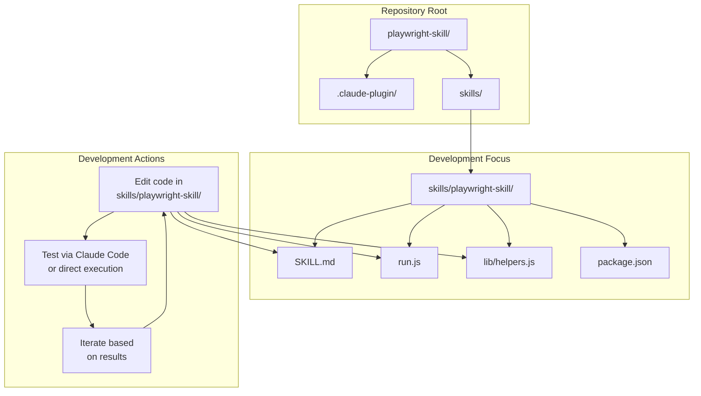
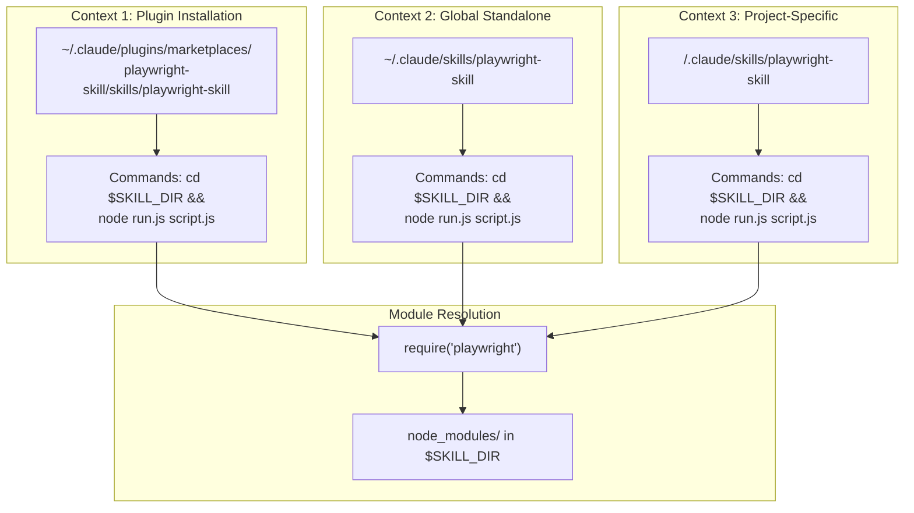
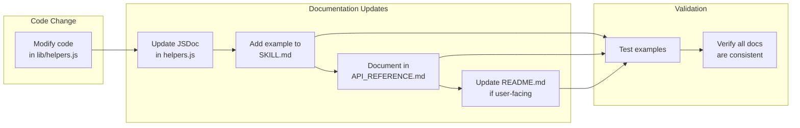
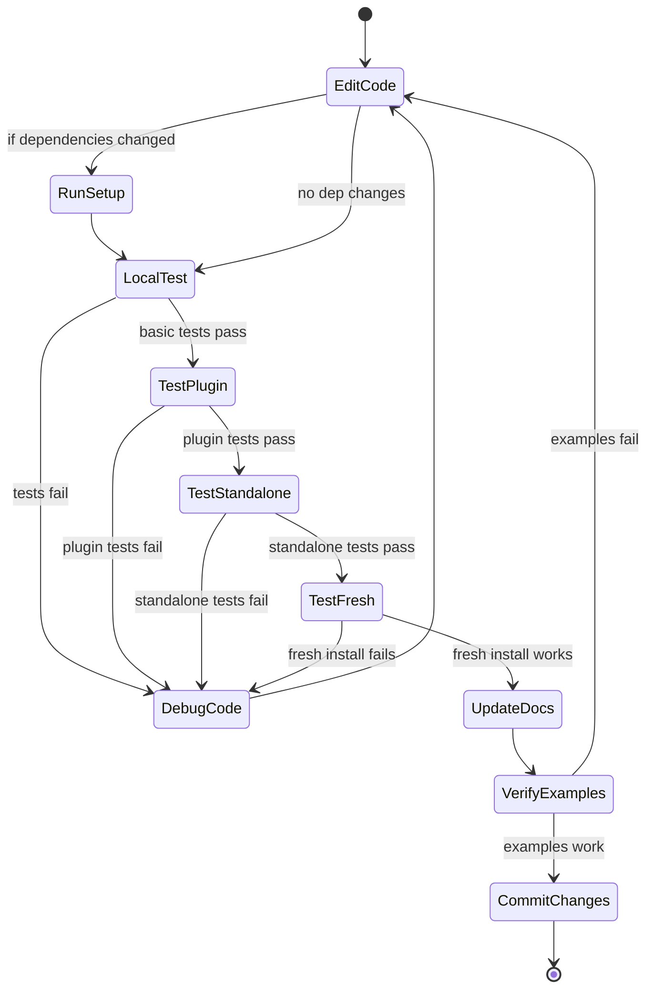

<!-- source: DeepWiki mcp.deepwiki.com · repo lackeyjb/playwright-skill · page 8.3 Development Workflow · fetched 2026-10-26 -->

# Development Workflow

<details>
<summary>Relevant source files</summary>

The following files were used as context for generating this wiki page:

- [CONTRIBUTING.md](CONTRIBUTING.md)
- [README.md](README.md)
- [skills/playwright-skill/package.json](skills/playwright-skill/package.json)

</details>


## Purpose and Scope

This page describes the local development workflow for contributors working on the playwright-skill codebase. It covers setting up a development environment, testing changes, iterating on features, and validating installations. For contribution guidelines including code style and commit conventions, see [Contributing Guidelines](#8.1). For understanding the repository structure, see [Project Structure](#8.2). For adding new features and helper functions, see [Extending the Skill](#8.4).

---

## Local Development Setup

### Forking and Cloning

Begin by forking the repository and cloning your fork:

```bash
# Fork via GitHub UI, then clone your fork
git clone https://github.com/YOUR_USERNAME/playwright-skill.git
cd playwright-skill
```

The repository uses a nested structure where the actual skill resides in `skills/playwright-skill/`. Navigate to this directory for development work:

```bash
cd skills/playwright-skill
```

### Installing Dependencies

Run the setup script to install Playwright and browser binaries:

```bash
npm run setup
```

This executes two commands as defined in [skills/playwright-skill/package.json:8]():
1. `npm install` - Installs Playwright ^1.48.0
2. `npx playwright install chromium` - Downloads Chromium browser binary

For multi-browser testing, install all browsers:

```bash
npm run install-all-browsers
```

### Development Environment Structure



**Development Environment Setup Workflow**

Sources: [README.md:166-184](), [CONTRIBUTING.md:26-45]()

---

## Development Cycle

### Making Changes

All development work occurs in `skills/playwright-skill/`. Common modification targets:

| File | Purpose | Update Frequency |
|------|---------|------------------|
| `SKILL.md` | Claude's instructions | When adding patterns or examples |
| `run.js` | Universal executor | Rarely (core infrastructure) |
| `lib/helpers.js` | Utility functions | When adding new helpers |
| `package.json` | Dependencies and scripts | When updating Playwright version |
| `API_REFERENCE.md` | Comprehensive API docs | When Playwright API changes |

### Branch Strategy

Create a feature branch from `main`:

```bash
git checkout -b feature/your-feature-name
```

Follow conventional commit format as specified in [CONTRIBUTING.md:81-96]():
- `feat:` for new features
- `fix:` for bug fixes
- `docs:` for documentation changes
- `refactor:` for code refactoring
- `test:` for adding tests
- `chore:` for maintenance tasks

### Testing Locally

Test changes through Claude Code or direct execution:

**Via Claude Code:**
1. Ensure the skill is installed (plugin or standalone)
2. Ask Claude to perform a browser automation task
3. Claude reads `SKILL.md` and executes via `run.js`
4. Observe results and verify behavior

**Direct Execution:**
```bash
# From skills/playwright-skill/ directory
node run.js /path/to/test-script.js
```

Sources: [CONTRIBUTING.md:42-45](), [README.md:150-157]()

---

## Testing in Different Installation Contexts

### Installation Context Matrix

The skill can be installed in three contexts, each with different `$SKILL_DIR` resolution:



**Testing Strategy for Each Context**

### Simulating Plugin Installation

Test the nested structure that plugin installation creates:

```bash
# Create test plugin directory structure
mkdir -p /tmp/test-plugin/skills
cp -r skills/playwright-skill /tmp/test-plugin/skills/

# Install dependencies
cd /tmp/test-plugin/skills/playwright-skill
npm run setup

# Test execution with proper path
cd /tmp/test-plugin/skills/playwright-skill
node run.js 'console.log("Plugin context test")'
```

### Simulating Standalone Installation

Test the extracted standalone structure:

```bash
# Create test standalone directory
mkdir -p /tmp/test-standalone
cp -r skills/playwright-skill /tmp/test-standalone/

# Install dependencies
cd /tmp/test-standalone/playwright-skill
npm run setup

# Test execution
cd /tmp/test-standalone/playwright-skill
node run.js 'console.log("Standalone context test")'
```

### Verifying Module Resolution

Critical test: Ensure `require('playwright')` works from `run.js`:

```bash
# From skills/playwright-skill/ directory
node -e "console.log(require.resolve('playwright'))"
```

This should resolve to `./node_modules/playwright/...` relative to the skill directory.

Sources: [README.md:36-96](), [CONTRIBUTING.md:123-128]()

---

## Common Development Tasks

### Testing the Setup Script

The `npm run setup` script is critical for first-time installation. Test it thoroughly:

```bash
# Clean test: Remove node_modules and test fresh install
rm -rf node_modules package-lock.json
npm run setup

# Verify Playwright installed
node -e "console.log(require('playwright').version)"

# Verify Chromium installed
npx playwright list-browsers | grep chromium
```

### Testing run.js Modifications

If modifying `run.js`, test all three execution modes:

**File Mode:**
```bash
echo "console.log('test')" > /tmp/test.js
node run.js /tmp/test.js
```

**Inline Mode:**
```bash
node run.js 'console.log("inline test")'
```

**Stdin Mode:**
```bash
echo "console.log('stdin test')" | node run.js
```

### Testing Helper Function Changes

When modifying `lib/helpers.js`, test directly and via Claude:

```bash
# Direct test
node -e "const h = require('./lib/helpers'); console.log(h.detectDevServers())"

# Create test script using the helper
cat > /tmp/test-helper.js << 'EOF'
const { detectDevServers } = require('./lib/helpers');
(async () => {
  const servers = await detectDevServers();
  console.log('Detected servers:', servers);
})();
EOF

node run.js /tmp/test-helper.js
```

### Updating SKILL.md

When adding examples to `SKILL.md`, follow these guidelines from [CONTRIBUTING.md:73-80]():
- Keep examples concise (8-15 lines)
- Always show `headless: false` by default
- Include error handling
- Add `console.log` statements for visibility
- Reference advanced topics rather than duplicating content

Test that examples work:

```bash
# Extract example from SKILL.md
# Execute via run.js
# Verify output and artifacts
```

Sources: [skills/playwright-skill/package.json:7-9](), [CONTRIBUTING.md:73-80](), [CONTRIBUTING.md:113-120]()

---

## File Modification Impact Map

Understanding what needs updating when you change different components:

```mermaid
graph TB
    subgraph "Change: Add Helper Function"
        HELPER_CHANGE["Add function to<br/>lib/helpers.js"]
        HELPER_DOC["Update JSDoc comments"]
        HELPER_EXPORT["Add to module.exports"]
        SKILL_MENTION["Mention in SKILL.md"]
        API_DOC["Document in API_REFERENCE.md"]
    end
    
    subgraph "Change: Update Playwright Version"
        PW_VERSION["Update package.json<br/>dependencies"]
        PW_TEST["Test npm run setup"]
        PW_API["Review API_REFERENCE.md<br/>for changes"]
        PW_EXAMPLES["Update SKILL.md examples<br/>if needed"]
    end
    
    subgraph "Change: Modify run.js"
        RUNJS_CHANGE["Edit run.js logic"]
        RUNJS_TEST["Test all 3 modes:<br/>file, inline, stdin"]
        RUNJS_CONTEXT["Test all install contexts:<br/>plugin, global, project"]
        RUNJS_MODULE["Verify module resolution"]
    end
    
    subgraph "Change: Update Documentation"
        DOC_SKILL["Update SKILL.md"]
        DOC_API["Update API_REFERENCE.md"]
        DOC_README["Update README.md"]
        DOC_CONTRIB["Update CONTRIBUTING.md"]
    end
    
    HELPER_CHANGE --> HELPER_DOC
    HELPER_DOC --> HELPER_EXPORT
    HELPER_EXPORT --> SKILL_MENTION
    SKILL_MENTION --> API_DOC
    
    PW_VERSION --> PW_TEST
    PW_TEST --> PW_API
    PW_API --> PW_EXAMPLES
    
    RUNJS_CHANGE --> RUNJS_TEST
    RUNJS_TEST --> RUNJS_CONTEXT
    RUNJS_CONTEXT --> RUNJS_MODULE
    
    DOC_SKILL --> DOC_API
    DOC_API --> DOC_README
    DOC_README --> DOC_CONTRIB
```



**Impact Analysis for Common Changes**

Sources: [CONTRIBUTING.md:113-120]()

---

## Testing Fresh Installations

Before submitting changes, test fresh installations to catch dependency or setup issues.

### Fresh Plugin Installation Test

```bash
# Simulate fresh plugin install
TEST_DIR="/tmp/fresh-plugin-test"
rm -rf "$TEST_DIR"
mkdir -p "$TEST_DIR/skills"

# Copy current working directory
cp -r . "$TEST_DIR/skills/playwright-skill"

# Test setup from scratch
cd "$TEST_DIR/skills/playwright-skill"
npm run setup

# Verify functionality
node run.js 'console.log("Fresh install test")'
```

### Fresh Standalone Installation Test

```bash
# Simulate fresh standalone install
TEST_DIR="/tmp/fresh-standalone-test"
rm -rf "$TEST_DIR"
mkdir -p "$TEST_DIR"

# Copy skill directory only (simulating extraction)
cp -r skills/playwright-skill "$TEST_DIR/"

# Test setup from scratch
cd "$TEST_DIR/playwright-skill"
npm run setup

# Verify functionality
node run.js 'console.log("Fresh standalone test")'
```

### Automated Fresh Install Verification Script

Create a test script to automate verification:

```bash
#!/bin/bash
# test-fresh-install.sh

set -e

echo "Testing fresh plugin installation..."
PLUGIN_TEST="/tmp/plugin-test-$$"
mkdir -p "$PLUGIN_TEST/skills"
cp -r . "$PLUGIN_TEST/skills/playwright-skill"
cd "$PLUGIN_TEST/skills/playwright-skill"
npm run setup
node run.js 'console.log("Plugin test: OK")'

echo "Testing fresh standalone installation..."
STANDALONE_TEST="/tmp/standalone-test-$$"
mkdir -p "$STANDALONE_TEST"
cp -r skills/playwright-skill "$STANDALONE_TEST/"
cd "$STANDALONE_TEST/playwright-skill"
npm run setup
node run.js 'console.log("Standalone test: OK")'

echo "All fresh installation tests passed!"
```

Sources: [README.md:36-96](), [CONTRIBUTING.md:123-128]()

---

## Documentation Workflow

### Documentation Hierarchy

The skill uses progressive disclosure for documentation:

| File | Lines | Purpose | Audience |
|------|-------|---------|----------|
| `SKILL.md` | ~314 | Concise instructions for Claude | Claude AI |
| `API_REFERENCE.md` | ~630 | Comprehensive API reference | Claude AI (on-demand) |
| `README.md` | ~232 | User documentation | End users |
| `CONTRIBUTING.md` | ~136 | Development guidelines | Contributors |

### Keeping SKILL.md Concise

Guidelines from [CONTRIBUTING.md:73-80]():
- Target ~300 lines total
- Use concise examples (8-15 lines)
- Reference `API_REFERENCE.md` for advanced topics
- Show common patterns, not exhaustive coverage
- Always include error handling in examples
- Default to `headless: false` for visibility

### Documentation Update Workflow



**Documentation Synchronization Workflow**

### Example-Driven Documentation

When adding a new helper function:

1. **Write JSDoc in `lib/helpers.js`:**
```javascript
/**
 * Extracts table data from a page
 * @param {Page} page - Playwright page object
 * @param {string} selector - Table selector
 * @returns {Promise<Array>} Array of row objects
 */
async function extractTableData(page, selector) {
  // implementation
}
```

2. **Add concise example to `SKILL.md`:**
```javascript
// Extract table data
const tableData = await helpers.extractTableData(page, 'table.data-table');
console.log('Table rows:', tableData.length);
```

3. **Add comprehensive documentation to `API_REFERENCE.md`:**
- Full parameter descriptions
- Return value details
- Multiple usage examples
- Error handling scenarios
- Edge cases

4. **Update `README.md` if user-facing:**
- Add to feature list if significant
- Update usage examples if applicable

Sources: [CONTRIBUTING.md:73-80](), [CONTRIBUTING.md:113-120]()

---

## Pre-Submission Checklist

Before creating a pull request, verify:

### Code Quality
- [ ] Code follows existing style and patterns
- [ ] Functions have clear, descriptive names
- [ ] Complex logic includes explanatory comments
- [ ] Error handling is comprehensive

### Functionality
- [ ] Changes tested via Claude Code
- [ ] Direct execution via `node run.js` works
- [ ] All three execution modes work (file, inline, stdin)
- [ ] Module resolution succeeds in all contexts

### Installation Testing
- [ ] Fresh plugin installation tested
- [ ] Fresh standalone installation tested
- [ ] `npm run setup` completes successfully
- [ ] Browser launches in visible mode by default

### Documentation
- [ ] JSDoc comments added/updated
- [ ] `SKILL.md` examples added (if applicable)
- [ ] `API_REFERENCE.md` updated (if applicable)
- [ ] `README.md` updated (if user-facing)
- [ ] All examples tested and working

### Git Hygiene
- [ ] Commits follow conventional format
- [ ] Commit messages are descriptive
- [ ] Branch name follows `feature/` or `fix/` convention
- [ ] No unnecessary files committed

### Examples Validation
- [ ] Examples in `SKILL.md` are 8-15 lines
- [ ] Examples show `headless: false` by default
- [ ] Examples include error handling
- [ ] Examples include `console.log` statements

Sources: [CONTRIBUTING.md:64-96](), [CONTRIBUTING.md:123-128]()

---

## Iterative Development Pattern

The typical development cycle follows this pattern:



**Iterative Development State Machine**

### Development Time Savers

**Quick Verification Script:**
```bash
# verify.sh - Quick sanity check
cd skills/playwright-skill
node -e "console.log(require('playwright').version)" && \
node run.js 'console.log("OK")' && \
node -e "require('./lib/helpers'); console.log('Helpers OK')" && \
echo "✓ All basic checks passed"
```

**Watch Mode for Documentation:**
```bash
# Monitor SKILL.md changes and test examples
# (Manual process - extract and test examples as you edit)
```

**Local Testing with Different URLs:**
```bash
# Test with local dev server
node run.js 'const { chromium } = require("playwright");
(async () => {
  const browser = await chromium.launch({ headless: false });
  const page = await browser.newPage();
  await page.goto("http://localhost:3000");
  console.log("Title:", await page.title());
  await browser.close();
})();'
```

Sources: [CONTRIBUTING.md:42-45](), [skills/playwright-skill/package.json:7-9]()

---

## Troubleshooting Development Issues

### Module Resolution Errors

If `require('playwright')` fails:

1. Verify you're in `skills/playwright-skill/` directory
2. Check `node_modules/` exists
3. Run `npm run setup` again
4. Test with `node -e "console.log(require.resolve('playwright'))"`

### Setup Script Failures

If `npm run setup` fails:

1. Check Node.js version: `node --version` (requires >=14.0.0)
2. Clear npm cache: `npm cache clean --force`
3. Remove lock file: `rm package-lock.json`
4. Try again: `npm run setup`

### Browser Launch Issues

If browser doesn't launch during testing:

1. Verify Chromium installed: `npx playwright list-browsers`
2. Reinstall browsers: `npm run install-all-browsers`
3. Check system dependencies (Linux may need additional packages)
4. Test manually: `npx playwright open`

### Path Resolution Issues

If `$SKILL_DIR` resolution fails:

1. Verify installation context (plugin vs standalone)
2. Check actual path: `pwd` when executing
3. Test relative requires: `node -e "console.log(require('./lib/helpers'))"`
4. Ensure `cd $SKILL_DIR &&` prefix is used

Sources: [README.md:197-209](), [CONTRIBUTING.md:42-45]()

---

