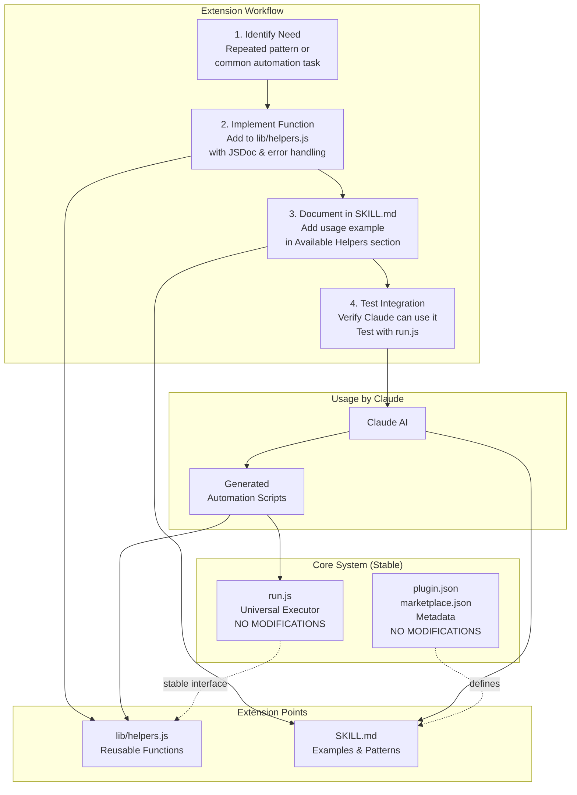
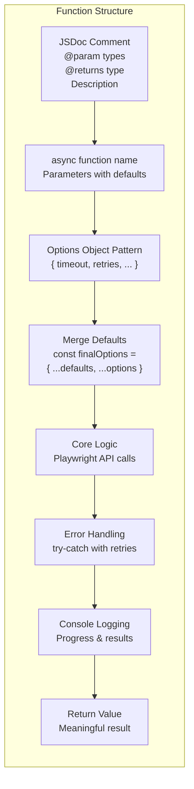
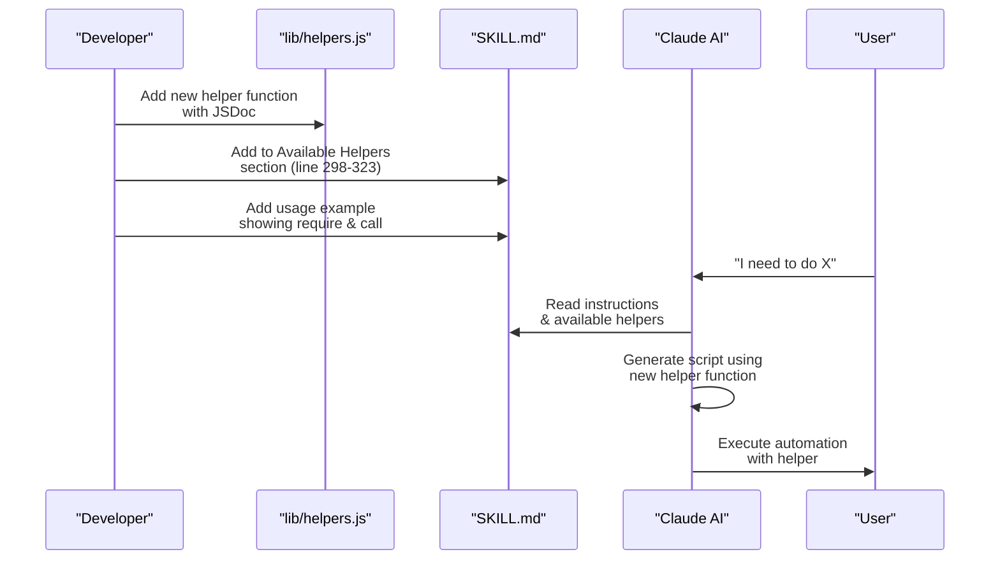
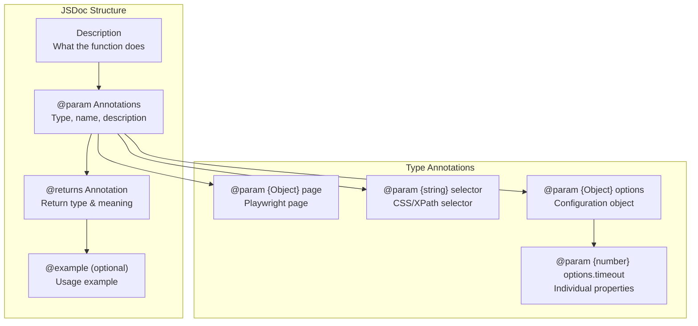
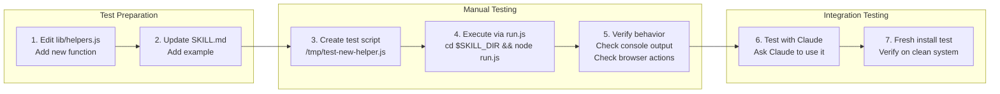

<!-- source: DeepWiki mcp.deepwiki.com · repo lackeyjb/playwright-skill · page 8.4 Extending the Skill · fetched 2026-10-26 -->

# Extending the Skill

<details>
<summary>Relevant source files</summary>

The following files were used as context for generating this wiki page:

- [CONTRIBUTING.md](CONTRIBUTING.md)
- [skills/playwright-skill/SKILL.md](skills/playwright-skill/SKILL.md)
- [skills/playwright-skill/lib/helpers.js](skills/playwright-skill/lib/helpers.js)

</details>


This document explains how to extend the playwright-skill with new functionality. It covers adding helper functions to `lib/helpers.js`, updating `SKILL.md` documentation, maintaining JSDoc standards, and implementing proper error handling patterns. For general contribution guidelines and setup, see [Contributing Guidelines](#8.1). For understanding the existing helper functions API, see [Helper Functions Library](#4.3).

## Scope and Extension Points

The playwright-skill is designed to be extended through two primary mechanisms:

1. **Helper Functions** in [lib/helpers.js]() - Reusable utility functions that encapsulate common automation patterns
2. **Example Patterns** in [SKILL.md]() - Code examples that demonstrate how to use Playwright for specific tasks

Extension does not involve modifying the core execution engine ([run.js]()) or distribution metadata files, which should remain stable. All extensions happen at the utility and documentation layers.

---

## Extension Architecture



**Sources:** [lib/helpers.js](), [SKILL.md:299-323](), [CONTRIBUTING.md:113-120]()

---

## Adding New Helper Functions

### Helper Function Anatomy

All helper functions in `lib/helpers.js` follow a consistent structure:



**Sources:** [lib/helpers.js:6-26](), [lib/helpers.js:79-109](), [lib/helpers.js:111-133]()

### Implementation Checklist

| Requirement | Location | Purpose |
|------------|----------|---------|
| JSDoc comment | Above function | Type safety and autocomplete |
| Async/await | Function signature | Handle Playwright promises |
| Options object | Last parameter | Flexible configuration |
| Default values | Inside function | Sensible defaults |
| Error handling | try-catch blocks | Graceful failure |
| Retry logic | For flaky operations | Reliability |
| Console logging | Throughout | User feedback |
| Export | module.exports | Public API |

**Sources:** [CONTRIBUTING.md:113-120]()

### Step-by-Step: Adding a Helper Function

#### Step 1: Define the Function with JSDoc

Add your function to [lib/helpers.js]() following this pattern:

```javascript
/**
 * Brief description of what the function does
 * @param {Object} page - Playwright page object
 * @param {string} selector - Element selector
 * @param {Object} options - Optional configuration
 * @param {number} options.timeout - Wait timeout in ms
 * @param {boolean} options.scroll - Scroll to element
 * @returns {Promise<boolean>} Success status
 */
async function yourHelperFunction(page, selector, options = {}) {
```

**Pattern Reference:** [lib/helpers.js:79-84]() (`safeClick` function)

**Sources:** [lib/helpers.js:6-10](), [lib/helpers.js:148-152]()

#### Step 2: Implement Default Options

Merge user options with sensible defaults:

```javascript
async function yourHelperFunction(page, selector, options = {}) {
  const defaultOptions = {
    timeout: 30000,
    retries: 3,
    scroll: true
  };
  
  const finalOptions = { ...defaultOptions, ...options };
```

**Pattern Reference:** [lib/helpers.js:11-16]() (`launchBrowser` defaults), [lib/helpers.js:316-325]() (`createContext` defaults)

**Sources:** [lib/helpers.js:85-87]()

#### Step 3: Implement Core Logic with Error Handling

Wrap Playwright operations in try-catch with meaningful error messages:

```javascript
  try {
    await page.waitForSelector(selector, { 
      state: 'visible',
      timeout: finalOptions.timeout 
    });
    
    // Your core logic here
    const result = await page.evaluate(/* ... */);
    
    console.log(`✅ Operation successful for ${selector}`);
    return result;
    
  } catch (error) {
    console.error(`❌ Failed to perform operation on ${selector}: ${error.message}`);
    throw error;
  }
}
```

**Pattern Reference:** [lib/helpers.js:217-234]() (screenshot error handling), [lib/helpers.js:89-108]() (`safeClick` retry logic)

**Sources:** [lib/helpers.js:100-108]()

#### Step 4: Add Retry Logic for Flaky Operations

For operations that may fail temporarily, implement retry with backoff:

```javascript
async function safeOperation(page, selector, options = {}) {
  const maxRetries = options.retries || 3;
  const retryDelay = options.retryDelay || 1000;
  
  for (let i = 0; i < maxRetries; i++) {
    try {
      await page.waitForSelector(selector, { timeout: 5000 });
      // Perform operation
      return true;
    } catch (e) {
      if (i === maxRetries - 1) {
        console.error(`Failed after ${maxRetries} attempts`);
        throw e;
      }
      console.log(`Retry ${i + 1}/${maxRetries}...`);
      await page.waitForTimeout(retryDelay);
    }
  }
}
```

**Pattern Reference:** [lib/helpers.js:85-109]() (`safeClick` retry implementation), [lib/helpers.js:287-308]() (`retryWithBackoff`)

**Sources:** [lib/helpers.js:85-109]()

#### Step 5: Export the Function

Add your function to the module.exports at the end of [lib/helpers.js:383-398]():

```javascript
module.exports = {
  launchBrowser,
  createPage,
  // ... existing exports ...
  yourHelperFunction  // Add your new function here
};
```

**Sources:** [lib/helpers.js:383-398]()

---

## Updating SKILL.md Documentation

### Documentation Integration Flow



**Sources:** [SKILL.md:297-323](), [SKILL.md:1-7]()

### Adding Helper Documentation

Update the "Available Helpers" section in [SKILL.md:297-323]():

```javascript
## Available Helpers

Optional utility functions in `lib/helpers.js`:

```javascript
const helpers = require('./lib/helpers');

// Your new helper - describe its purpose
await helpers.yourHelperFunction(page, 'selector', {
  timeout: 10000,
  retries: 3
});
```
```

**Guidelines:**
- Keep examples 3-5 lines maximum
- Show actual function call with realistic parameters
- Include brief comment explaining purpose
- Use destructuring if importing single function

**Sources:** [SKILL.md:299-323](), [CONTRIBUTING.md:73-79]()

### Adding Complete Usage Examples

If your helper enables a new pattern, add a complete example in the "Common Patterns" section [SKILL.md:92-275]():

```javascript
### [Your Pattern Name]

```javascript
// /tmp/playwright-test-[pattern-name].js
const { chromium } = require('playwright');
const helpers = require('./lib/helpers');

const TARGET_URL = 'http://localhost:3001'; // Auto-detected

(async () => {
  const browser = await chromium.launch({ headless: false });
  const page = await browser.newPage();
  
  await page.goto(TARGET_URL);
  
  // Use your helper
  await helpers.yourHelperFunction(page, 'selector');
  console.log('✅ Operation completed');
  
  await browser.close();
})();
```
```

**Requirements:**
- Always write to `/tmp/playwright-test-*.js` [SKILL.md:31-32]()
- Always parameterize URL with `TARGET_URL` constant [SKILL.md:34-35]()
- Always use `headless: false` by default [SKILL.md:33]()
- Include console.log for progress feedback [SKILL.md:349]()
- Wrap in async IIFE [SKILL.md:72-83]()

**Sources:** [SKILL.md:92-118](), [SKILL.md:120-144](), [CONTRIBUTING.md:73-79]()

---

## JSDoc Documentation Standards

### Required JSDoc Elements

All helper functions must include comprehensive JSDoc comments:



**Sources:** [lib/helpers.js:6-10](), [lib/helpers.js:79-84]()

### JSDoc Template

```javascript
/**
 * [Brief one-line description of the function]
 * @param {Object} page - Playwright page object
 * @param {string} selector - CSS selector or XPath
 * @param {Object} options - Configuration options
 * @param {number} [options.timeout=30000] - Maximum wait time in milliseconds
 * @param {number} [options.retries=3] - Number of retry attempts
 * @param {boolean} [options.visible=true] - Wait for element visibility
 * @returns {Promise<boolean|Object>} Success status or result data
 */
```

**Key Points:**
- Use `[paramName=default]` notation for optional parameters with defaults
- Always specify parameter types (`Object`, `string`, `number`, `boolean`, etc.)
- Describe what each option does, not just its type
- Specify return type and what the value represents
- Use `Promise<Type>` for async functions

**Sources:** [lib/helpers.js:6-10](), [lib/helpers.js:28-32](), [lib/helpers.js:111-117]()

### Type Annotations for Complex Options

For functions with many options, document each property:

```javascript
/**
 * Create browser context with common settings
 * @param {Object} browser - Browser instance
 * @param {Object} options - Context options
 * @param {Object} [options.viewport] - Viewport dimensions
 * @param {number} [options.viewport.width] - Viewport width
 * @param {number} [options.viewport.height] - Viewport height
 * @param {string} [options.userAgent] - Custom user agent string
 * @param {Array<string>} [options.permissions] - Browser permissions
 * @param {Object} [options.geolocation] - Geolocation coordinates
 * @param {string} [options.locale='en-US'] - Locale string
 * @returns {Promise<Object>} Browser context
 */
```

**Reference:** [lib/helpers.js:310-328]() (`createContext` function)

**Sources:** [lib/helpers.js:310-314]()

---

## Error Handling Patterns

### Pattern Matrix

| Operation Type | Error Handling | Retry Logic | Example |
|---------------|----------------|-------------|---------|
| Element interaction | Try-catch with timeout | Yes, with backoff | `safeClick` [lib/helpers.js:85-109]() |
| Page navigation | Try-catch with fallback | Optional | `waitForPageReady` [lib/helpers.js:57-77]() |
| Data extraction | Try-catch, return null | No | `extractTableData` [lib/helpers.js:224-249]() |
| Screenshot capture | Try-catch, log error | No | `takeScreenshot` [lib/helpers.js:153-165]() |
| Browser launch | Throw immediately | No | `launchBrowser` [lib/helpers.js:11-26]() |

**Sources:** [lib/helpers.js:85-109](), [lib/helpers.js:57-77](), [lib/helpers.js:224-249]()

### Retry with Exponential Backoff

For network operations or flaky interactions:

```javascript
async function reliableOperation(page, selector, options = {}) {
  const maxRetries = options.retries || 3;
  const initialDelay = options.initialDelay || 1000;
  
  for (let i = 0; i < maxRetries; i++) {
    try {
      return await page.click(selector);
    } catch (error) {
      if (i === maxRetries - 1) {
        throw error; // Final attempt failed
      }
      const delay = initialDelay * Math.pow(2, i); // Exponential backoff
      console.log(`Attempt ${i + 1} failed, retrying in ${delay}ms...`);
      await new Promise(resolve => setTimeout(resolve, delay));
    }
  }
}
```

**Reference Implementation:** [lib/helpers.js:287-308]() (`retryWithBackoff`)

**Sources:** [lib/helpers.js:287-308]()

### Graceful Degradation

For optional operations that shouldn't fail the entire script:

```javascript
async function handleCookieBanner(page, timeout = 3000) {
  const commonSelectors = [
    'button:has-text("Accept")',
    'button:has-text("OK")',
    // ... more selectors
  ];
  
  for (const selector of commonSelectors) {
    try {
      const element = await page.waitForSelector(selector, { 
        timeout: timeout / commonSelectors.length,
        state: 'visible'
      });
      if (element) {
        await element.click();
        console.log('Cookie banner dismissed');
        return true;
      }
    } catch (e) {
      // Continue to next selector, don't throw
    }
  }
  
  return false; // No banner found, not an error
}
```

**Reference Implementation:** [lib/helpers.js:251-285]() (`handleCookieBanner`)

**Sources:** [lib/helpers.js:251-285]()

### Error Message Best Practices

- Include the selector or element that failed: `Failed to click ${selector}`
- Include the operation attempted: `Failed to authenticate user`
- Include the error context: `After ${maxRetries} attempts`
- Use emojis for visibility: `❌ Error:`, `✅ Success:`
- Log to console for user feedback

**Pattern Reference:** [lib/helpers.js:102](), [lib/helpers.js:358]()

**Sources:** [lib/helpers.js:100-108](), [SKILL.md:349]()

---

## Testing Extensions

### Local Testing Workflow



**Sources:** [CONTRIBUTING.md:41-45](), [CONTRIBUTING.md:123-128]()

### Test Script Template

Create a test script in `/tmp` to verify your helper:

```javascript
// /tmp/test-new-helper.js
const { chromium } = require('playwright');
const helpers = require('./lib/helpers');

(async () => {
  console.log('Testing new helper function...');
  
  const browser = await chromium.launch({ headless: false });
  const page = await browser.newPage();
  
  try {
    await page.goto('http://localhost:3000');
    
    // Test your new helper
    const result = await helpers.yourHelperFunction(page, 'selector', {
      timeout: 10000
    });
    
    console.log('✅ Test result:', result);
    
  } catch (error) {
    console.error('❌ Test failed:', error.message);
  } finally {
    await browser.close();
  }
})();
```

Run from skill directory: `cd ~/.claude/skills/playwright-skill && node run.js /tmp/test-new-helper.js`

**Sources:** [SKILL.md:66-90](), [run.js]()

### Verification Checklist

- [ ] Function executes without errors
- [ ] Error handling works (test with invalid inputs)
- [ ] Retry logic activates on failures (if applicable)
- [ ] Console logs provide useful feedback
- [ ] Browser actions are visible and correct
- [ ] Return values match documentation
- [ ] Works with both file and inline execution modes
- [ ] Module resolution works from skill directory

**Sources:** [CONTRIBUTING.md:123-128]()

---

## Complete Extension Example

### Example: Adding `waitForAnimation` Helper

#### 1. Identify the Need

Users frequently need to wait for CSS animations to complete before taking screenshots or performing actions.

#### 2. Implement in lib/helpers.js

```javascript
/**
 * Wait for CSS animations to complete on an element
 * @param {Object} page - Playwright page object
 * @param {string} selector - Element selector
 * @param {Object} options - Wait options
 * @param {number} [options.timeout=5000] - Maximum wait time
 * @param {number} [options.pollInterval=100] - Check interval in ms
 * @returns {Promise<boolean>} True when animation completes
 */
async function waitForAnimation(page, selector, options = {}) {
  const timeout = options.timeout || 5000;
  const pollInterval = options.pollInterval || 100;
  const startTime = Date.now();
  
  await page.waitForSelector(selector, { 
    state: 'visible', 
    timeout 
  });
  
  while (Date.now() - startTime < timeout) {
    const isAnimating = await page.evaluate((sel) => {
      const element = document.querySelector(sel);
      if (!element) return false;
      
      const styles = window.getComputedStyle(element);
      return styles.animationName !== 'none' || 
             styles.transitionProperty !== 'none';
    }, selector);
    
    if (!isAnimating) {
      console.log(`✅ Animation completed for ${selector}`);
      return true;
    }
    
    await page.waitForTimeout(pollInterval);
  }
  
  console.warn(`⚠️  Animation timeout for ${selector}`);
  return false;
}

// Add to module.exports
module.exports = {
  // ... existing exports ...
  waitForAnimation
};
```

#### 3. Document in SKILL.md

Add to Available Helpers section [SKILL.md:299-323]():

```javascript
// Wait for CSS animation to complete
await helpers.waitForAnimation(page, '.loading-spinner', {
  timeout: 5000
});
```

Add complete example pattern:

```javascript
### Take Screenshot After Animation

```javascript
// /tmp/playwright-test-animated-screenshot.js
const { chromium } = require('playwright');
const helpers = require('./lib/helpers');

const TARGET_URL = 'http://localhost:3001';

(async () => {
  const browser = await chromium.launch({ headless: false });
  const page = await browser.newPage();
  
  await page.goto(TARGET_URL);
  
  // Wait for hero animation to complete
  await helpers.waitForAnimation(page, '.hero-section');
  
  // Take screenshot after animation
  await page.screenshot({ 
    path: '/tmp/hero-final.png', 
    fullPage: true 
  });
  console.log('📸 Screenshot captured after animation');
  
  await browser.close();
})();
```
```

#### 4. Test the Implementation

```bash
# From skill directory
cd ~/.claude/skills/playwright-skill
node run.js /tmp/test-animation-helper.js
```

Verify:
- Animation detection works correctly
- Timeout handling is appropriate
- Console feedback is clear
- Return value is meaningful

**Sources:** [lib/helpers.js](), [SKILL.md:299-323](), [CONTRIBUTING.md:113-120]()

---

## Extension Guidelines Summary

### Do's

- ✅ Add comprehensive JSDoc comments with types
- ✅ Implement retry logic for flaky operations
- ✅ Use try-catch with meaningful error messages
- ✅ Accept options object for flexibility
- ✅ Provide sensible defaults
- ✅ Log progress with console.log
- ✅ Export all public functions
- ✅ Update SKILL.md with usage examples
- ✅ Test with fresh installation
- ✅ Follow existing code patterns

### Don'ts

- ❌ Don't modify run.js or plugin metadata
- ❌ Don't break existing helper function signatures
- ❌ Don't use synchronous operations
- ❌ Don't hardcode timeouts without options
- ❌ Don't suppress errors silently
- ❌ Don't add dependencies to package.json without discussion
- ❌ Don't write overly complex functions (keep focused)
- ❌ Don't forget to export new functions
- ❌ Don't add examples without URL parameterization
- ❌ Don't use headless: true in SKILL.md examples

**Sources:** [CONTRIBUTING.md:64-79](), [SKILL.md:340-349]()

---

## Version Control and Release

When your extension is ready:

1. **Commit with conventional format**: `feat: add waitForAnimation helper`
2. **Update version** if making public release (see [Metadata and Versioning](#9.5))
3. **Test with fresh installation** to verify module resolution
4. **Submit pull request** with clear description of functionality

See [Contributing Guidelines](#8.1) for the complete contribution workflow.

**Sources:** [CONTRIBUTING.md:81-96](), [CONTRIBUTING.md:1-63]()

---

