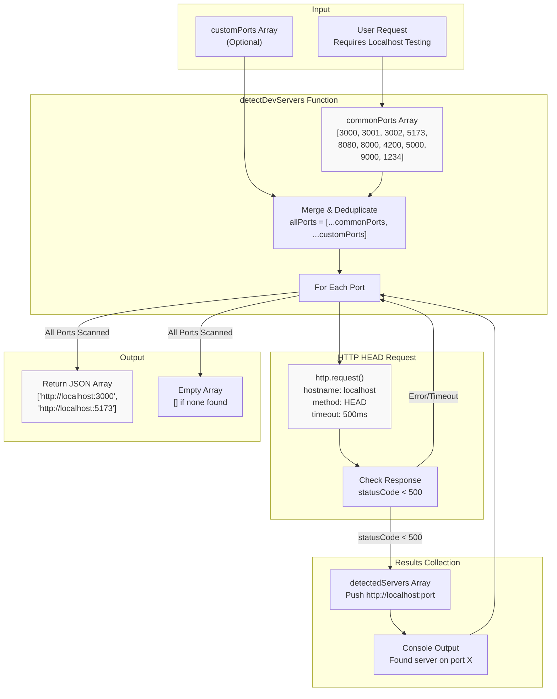
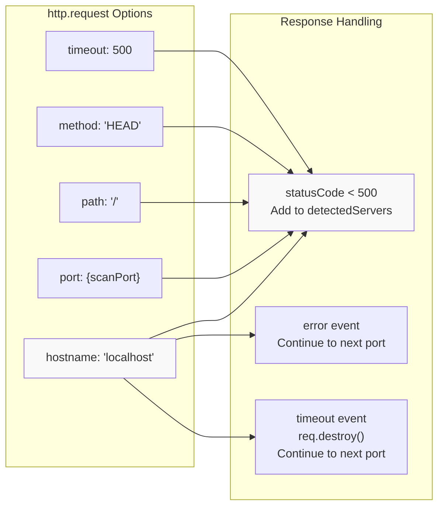
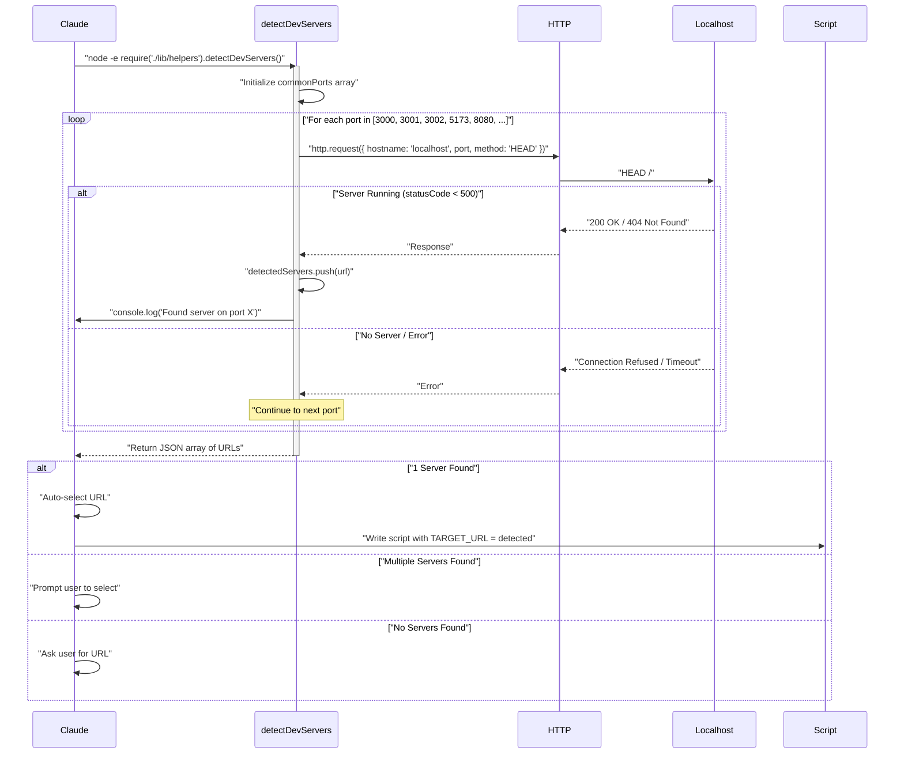
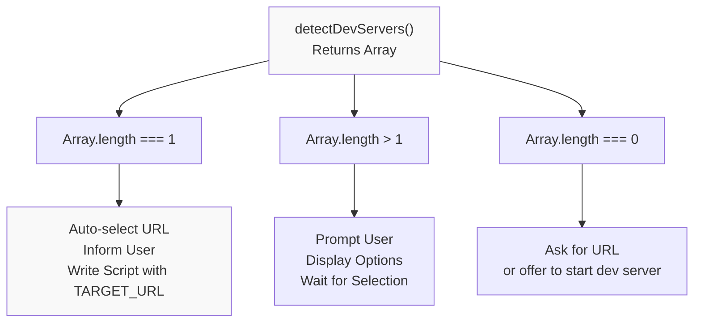

<!-- source: DeepWiki mcp.deepwiki.com · repo lackeyjb/playwright-skill · page 9.3 Common Ports and Dev Servers · fetched 2026-10-26 -->

# Common Ports and Dev Servers

<details>
<summary>Relevant source files</summary>

The following files were used as context for generating this wiki page:

- [skills/playwright-skill/SKILL.md](skills/playwright-skill/SKILL.md)
- [skills/playwright-skill/lib/helpers.js](skills/playwright-skill/lib/helpers.js)

</details>


This page provides a reference for the development server ports automatically detected by the `detectDevServers()` helper function. This auto-detection mechanism eliminates the need for hardcoded URLs in test scripts and enables the skill to discover locally running applications across multiple frameworks and build tools.

For information about configuring URL parameterization in test scripts, see [Dev Server Detection](#3.3). For details about the helper function implementation, see [Helper Functions Library](#4.3).

## Purpose and Scope

The playwright-skill includes a port scanning mechanism that automatically detects running development servers on localhost. This reference documents:

- The complete list of default ports scanned by `detectDevServers()`
- The frameworks and tools associated with each port
- How the detection mechanism operates
- How to extend detection to custom ports
- The JSON output format returned by detection

## Default Port List

The following ports are scanned by default when `detectDevServers()` is invoked. These represent the most common development server configurations across popular web frameworks and build tools.

| Port | Primary Framework/Tool | Common Alternative Uses |
|------|------------------------|-------------------------|
| 3000 | Create React App, Next.js | Express.js default, general Node.js servers |
| 3001 | Alternative React/Next.js port | Secondary Express instance |
| 3002 | Alternative React/Next.js port | Tertiary Express instance |
| 5173 | Vite (default) | Modern build tool for Vue, React, Svelte |
| 8080 | Vue CLI (default), Webpack Dev Server | Generic HTTP servers, Spring Boot |
| 8000 | Django, Python HTTP server | Alternative general-purpose port |
| 4200 | Angular CLI (`ng serve`) | Angular development server |
| 5000 | Flask (default), Create React App (alternate) | General Python web frameworks |
| 9000 | Various build tools | Gatsby, PHP built-in server |
| 1234 | Parcel bundler (default) | Zero-config bundler |

**Sources:** [skills/playwright-skill/lib/helpers.js:339]()

## Port Detection Architecture

The following diagram illustrates how the `detectDevServers()` function scans ports and returns detected server URLs.



**Sources:** [skills/playwright-skill/lib/helpers.js:335-381]()

## Detection Mechanism

### Function Signature

The `detectDevServers()` function is exported from `lib/helpers.js` and can be invoked directly from Claude or from within test scripts.

```javascript
async function detectDevServers(customPorts = [])
```

**Parameters:**
- `customPorts` (Array\<number\>): Optional array of additional ports to scan beyond the default list

**Returns:**
- Promise\<Array\<string\>\>: Array of detected server URLs in the format `http://localhost:{port}`

**Sources:** [skills/playwright-skill/lib/helpers.js:335]()

### Scanning Process

The detection mechanism performs the following steps for each port:

1. **HTTP HEAD Request**: Issues a HEAD request to `http://localhost:{port}/` with a 500ms timeout
2. **Status Code Validation**: Accepts responses with status codes less than 500 (includes 2xx, 3xx, 4xx)
3. **Error Handling**: Silently continues to the next port on connection errors or timeouts
4. **Result Collection**: Adds successfully responding servers to the `detectedServers` array
5. **Console Logging**: Outputs progress with checkmarks for found servers

**Sources:** [skills/playwright-skill/lib/helpers.js:346-374]()

### HTTP Request Configuration



**Sources:** [skills/playwright-skill/lib/helpers.js:348-369]()

## Custom Port Configuration

The `detectDevServers()` function accepts an optional `customPorts` parameter to scan additional ports beyond the default list.

### Usage Example

```javascript
const helpers = require('./lib/helpers');

// Scan default ports plus custom ones
const servers = await helpers.detectDevServers([3003, 3004, 7000]);

// Returns: ['http://localhost:3000', 'http://localhost:3003', ...]
```

### Port Deduplication

The function automatically deduplicates ports using a Set, ensuring each port is only scanned once even if it appears in both the default and custom lists.

```javascript
const allPorts = [...new Set([...commonPorts, ...customPorts])];
```

**Sources:** [skills/playwright-skill/lib/helpers.js:340]()

## Detection Output Format

### JSON Response Structure

The function returns a JSON array of URL strings:

```json
[
  "http://localhost:3000",
  "http://localhost:5173"
]
```

### Console Output

During detection, the function prints progress to the console:

```
🔍 Checking for running dev servers...
  ✅ Found server on port 3000
  ✅ Found server on port 5173
```

If no servers are found:

```
🔍 Checking for running dev servers...
  ❌ No dev servers detected
```

**Sources:** [skills/playwright-skill/lib/helpers.js:344, 358, 377]()

## Integration with Skill Workflow

The following diagram shows how port detection integrates with the overall skill execution workflow.



**Sources:** [skills/playwright-skill/SKILL.md:23-29](), [skills/playwright-skill/lib/helpers.js:335-381]()

## Command-Line Invocation

Claude invokes the detection function using a Node.js one-liner executed from the skill directory:

```bash
cd $SKILL_DIR && node -e "require('./lib/helpers').detectDevServers().then(servers => console.log(JSON.stringify(servers)))"
```

This command:
1. Changes to the skill directory for proper module resolution
2. Requires the helpers module
3. Calls `detectDevServers()` which returns a Promise
4. Outputs the result as JSON to stdout for Claude to parse

**Sources:** [skills/playwright-skill/SKILL.md:24-25](), [skills/playwright-skill/SKILL.md:60]()

## Framework-Specific Port Conventions

### React Ecosystem

| Tool | Default Port | Configuration |
|------|--------------|---------------|
| Create React App | 3000 | `PORT` environment variable |
| Next.js | 3000 | `-p` flag or `package.json` script |
| Vite (React) | 5173 | `vite.config.js` `server.port` |

### Vue.js Ecosystem

| Tool | Default Port | Configuration |
|------|--------------|---------------|
| Vue CLI | 8080 | `vue.config.js` `devServer.port` |
| Vite (Vue) | 5173 | `vite.config.js` `server.port` |

### Angular

| Tool | Default Port | Configuration |
|------|--------------|---------------|
| Angular CLI | 4200 | `angular.json` or `--port` flag |

### Backend Frameworks

| Framework | Default Port | Configuration |
|-----------|--------------|---------------|
| Express.js | 3000 | `app.listen()` parameter |
| Flask | 5000 | `--port` flag or `app.run(port=)` |
| Django | 8000 | `runserver` command argument |

## Port Selection Logic in SKILL.md

The skill implements a three-tier selection strategy based on the number of detected servers:



**Sources:** [skills/playwright-skill/SKILL.md:27-29]()

## Best Practices

### Always Detect First

The skill documentation emphasizes that server detection should always occur before writing test scripts:

```
CRITICAL WORKFLOW - Follow these steps in order:
1. Auto-detect dev servers - For localhost testing, ALWAYS run server detection FIRST
```

This prevents hardcoded URLs and makes scripts more portable across different development environments.

**Sources:** [skills/playwright-skill/SKILL.md:21-29]()

### URL Parameterization

Once a URL is detected or provided, it should be parameterized at the top of test scripts:

```javascript
// Parameterized URL (detected or user-provided)
const TARGET_URL = 'http://localhost:3001'; // <-- Auto-detected or from user
```

This pattern appears consistently throughout the example scripts in `SKILL.md`.

**Sources:** [skills/playwright-skill/SKILL.md:70]()

## Limitations and Considerations

### Timeout Configuration

The HTTP HEAD request uses a 500ms timeout per port. For slow-starting servers or high-latency environments, this may result in false negatives.

**Sources:** [skills/playwright-skill/lib/helpers.js:354]()

### Status Code Acceptance

The detection mechanism accepts any status code less than 500, meaning:
- ✅ 200 OK (server responding normally)
- ✅ 404 Not Found (server running, root path not found)
- ✅ 401/403 (authentication required)
- ❌ 500+ server errors (considered non-functional)

This liberal acceptance ensures detection works even if the root path requires authentication or doesn't exist.

**Sources:** [skills/playwright-skill/lib/helpers.js:356]()

### IPv6 and Non-Localhost

The current implementation only checks `localhost` (127.0.0.1) and does not:
- Scan IPv6 addresses (::1)
- Check other network interfaces
- Detect servers on 0.0.0.0

**Sources:** [skills/playwright-skill/lib/helpers.js:350]()

## Summary

The `detectDevServers()` function provides automatic discovery of local development servers by scanning 10 common ports used across major web frameworks. This auto-detection mechanism enables the playwright-skill to work seamlessly with user projects without requiring manual URL configuration, supporting frameworks including React, Vue, Angular, Vite, Flask, Django, and more.

**Sources:** [skills/playwright-skill/lib/helpers.js:335-381](), [skills/playwright-skill/SKILL.md:23-29]()

---

