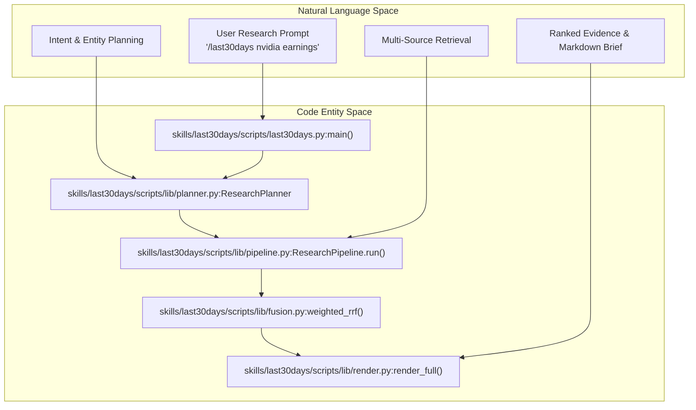
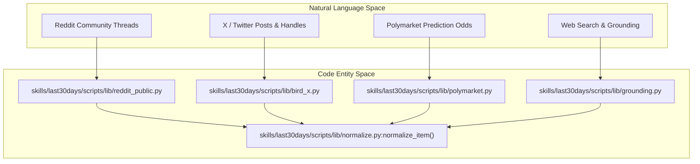

<!-- source: DeepWiki mcp.deepwiki.com · repo mvanhorn/last30days-skill · page 1 Overview · fetched 2026-10-26 -->

# Overview

Relevant source files

The following files were used as context for generating this wiki page:

- [.claude-plugin/marketplace.json](.claude-plugin/marketplace.json)
- [.claude-plugin/plugin.json](.claude-plugin/plugin.json)
- [CHANGELOG.md](CHANGELOG.md)
- [CONCEPTS.md](CONCEPTS.md)
- [CONFIGURATION.md](CONFIGURATION.md)
- [README.md](README.md)
- [docs/solutions/architecture-patterns/discovery-checkpoint-protocol-design-conventions.md](docs/solutions/architecture-patterns/discovery-checkpoint-protocol-design-conventions.md)
- [docs/solutions/architecture-patterns/discovery-topic-queue-design-conventions.md](docs/solutions/architecture-patterns/discovery-topic-queue-design-conventions.md)
- [docs/solutions/conventions/argparse-optional-value-flag-dispatch-truthiness.md](docs/solutions/conventions/argparse-optional-value-flag-dispatch-truthiness.md)
- [docs/solutions/design-patterns/ranked-output-confidence-floor-honest-empty-state.md](docs/solutions/design-patterns/ranked-output-confidence-floor-honest-empty-state.md)
- [docs/solutions/logic-errors/fusion-source-item-dedupe-by-stream-local-id-drops-enrichment.md](docs/solutions/logic-errors/fusion-source-item-dedupe-by-stream-local-id-drops-enrichment.md)
- [docs/solutions/logic-errors/non-daemon-executor-threads-defeat-wall-clock-budget.md](docs/solutions/logic-errors/non-daemon-executor-threads-defeat-wall-clock-budget.md)
- [gemini-extension.json](gemini-extension.json)
- [skills/last30days/SKILL.md](skills/last30days/SKILL.md)
- [skills/last30days/scripts/lib/env.py](skills/last30days/scripts/lib/env.py)

## Purpose and Scope

The `/last30days` skill is an agent-led multi-source social research engine designed to aggregate, normalize, score, and synthesize real-time community sentiment and data from the last 30 days [README.md:1-25](). Rather than relying on traditional SEO-prioritized web scraping, the engine queries platforms where real people vote with their attention, engagement, and money (Reddit, X/Twitter, YouTube, TikTok, Hacker News, Polymarket, GitHub, and more) [README.md:23-49]().

This page serves as a high-level overview of the engine's purpose, supported sources, and host integrations. For detailed technical specifications, refer to the child pages:
- For the instruction contract, the eleven output LAWs, preflight checks, and stale-clone self-checks, see [SKILL.md Contract and Output LAWs](#1.1).
- For domain concepts and user-facing query modes (general, comparison, discovery, drill, deep research, confidence floor), see [Key Concepts and Query Modes](#1.2).

Sources: [SKILL.md:1-6](), [README.md:1-49]()

---

## Supported Sources and Host Integrations

The engine bridges disparate walled gardens by utilizing specialized connectors and transport mechanisms, allowing multiple AI agent harnesses to invoke the research pipeline seamlessly.

### Supported Sources
| Source | Signal Type | Transport / Implementation |
| :--- | :--- | :--- |
| **Reddit** | Unfiltered community debates & upvotes | `reddit_public.py`, `reddit_keyless.py`, `reddit_arctic.py` [README.md:71]() |
| **X / Twitter** | Breaking reactions, expert threads | `bird_x.py`, `xai_x.py`, `xapi` backend chain [README.md:72](), [CHANGELOG.md:16-20]() |
| **YouTube** | Deep dives and transcript segments | `youtube.py` (`yt-dlp` integration) [README.md:73](), [CHANGELOG.md:57]() |
| **TikTok / Instagram** | Creator reach & visual culture | `tiktok.py`, `instagram.py` (via ScrapeCreators) [README.md:74-75]() |
| **Hacker News** | Technical developer consensus | `hackernews.py` (Algolia API) [README.md:76]() |
| **Polymarket** | Real-money prediction odds | `polymarket.py` (Gamma API) [README.md:77]() |
| **GitHub** | PR velocity, repo stats, issues | `github.py` search qualifier engine [README.md:78]() |
| **Web & Perplexity** | Editorial coverage & deep search | `grounding.py`, `perplexity.py`, `brave.py` [README.md:88-89]() |

### Host Integrations
The skill is packaged for multi-harness distribution, supporting automatic loading and execution across diverse environments:
*   **Claude Code**: Native plugin marketplace integration via `.claude-plugin/plugin.json` and `.claude-plugin/marketplace.json` [.claude-plugin/plugin.json:1-30](), [.claude-plugin/marketplace.json:1-24]().
*   **Codex, Cursor, Copilot, and Agent Skills Ecosystem**: Global installation via `npx skills add mvanhorn/last30days-skill -g` [README.md:33-37]().
*   **Gemini CLI**: Configured via `gemini-extension.json` supporting environment variable injection [gemini-extension.json:1-67]().
*   **Grok / OpenClaw**: Supported via execution metadata and platform-specific hooks [SKILL.md:13-68]().
*   **Model Context Protocol (MCP)**: Bundled as a `.mcpb` package utilizing the Go MCP server located in `mcp/`.

Sources: [README.md:33-90](), [.claude-plugin/plugin.json:1-30](), [gemini-extension.json:1-67](), [SKILL.md:13-68]()

---

## Natural Language Space to Code Entity Space Mappings

To bridge high-level user intents with the underlying codebase, the following diagrams associate natural-language concepts and system workflows with exact Python modules, classes, and entry points.

### Diagram 1: Research Execution Pipeline Mapping

Title: "Natural Language to Code Entity Mapping: Research Workflow"

Sources: [README.md:35-41](), [CONCEPTS.md:13-18]()

### Diagram 2: Connector and Source Architecture Mapping

Title: "Natural Language to Code Entity Mapping: Source Connectors"

Sources: [README.md:67-90](), [CHANGELOG.md:16-20]()

---

