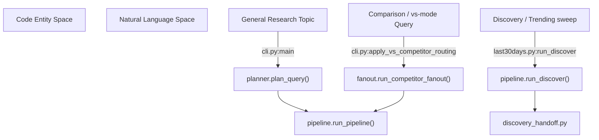
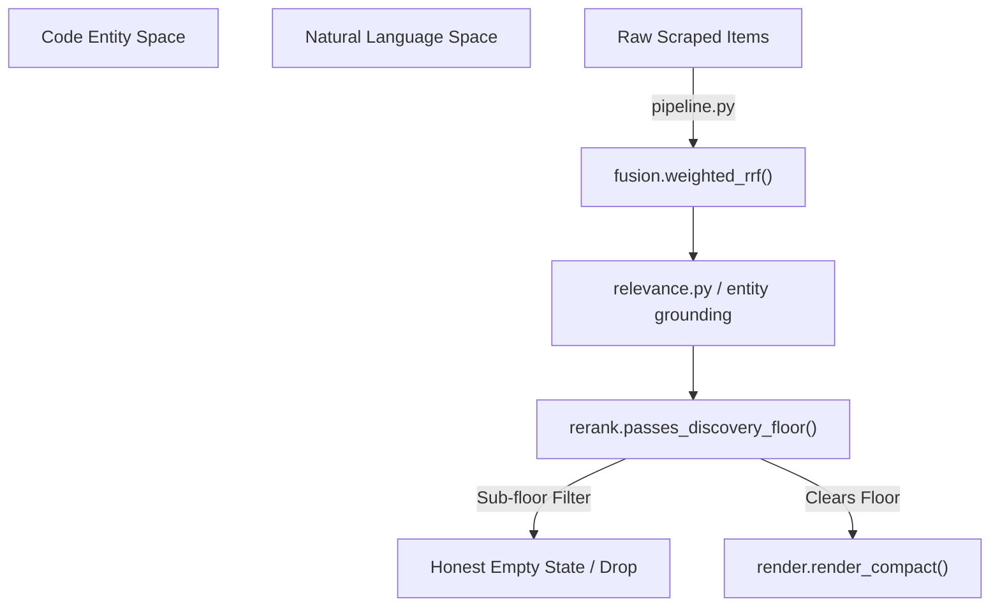

<!-- source: DeepWiki mcp.deepwiki.com · repo mvanhorn/last30days-skill · page 1.2 Key Concepts and Query Modes · fetched 2026-10-26 -->

# Key Concepts and Query Modes

<details>
<summary>Relevant source files</summary>

The following files were used as context for generating this wiki page:

- [CONCEPTS.md](CONCEPTS.md)
- [docs/how-search-works.md](docs/how-search-works.md)
- [docs/solutions/architecture-patterns/discovery-checkpoint-protocol-design-conventions.md](docs/solutions/architecture-patterns/discovery-checkpoint-protocol-design-conventions.md)
- [docs/solutions/architecture-patterns/discovery-topic-queue-design-conventions.md](docs/solutions/architecture-patterns/discovery-topic-queue-design-conventions.md)
- [docs/solutions/conventions/argparse-optional-value-flag-dispatch-truthiness.md](docs/solutions/conventions/argparse-optional-value-flag-dispatch-truthiness.md)
- [docs/solutions/design-patterns/ranked-output-confidence-floor-honest-empty-state.md](docs/solutions/design-patterns/ranked-output-confidence-floor-honest-empty-state.md)
- [docs/solutions/logic-errors/fusion-source-item-dedupe-by-stream-local-id-drops-enrichment.md](docs/solutions/logic-errors/fusion-source-item-dedupe-by-stream-local-id-drops-enrichment.md)
- [docs/solutions/logic-errors/non-daemon-executor-threads-defeat-wall-clock-budget.md](docs/solutions/logic-errors/non-daemon-executor-threads-defeat-wall-clock-budget.md)
- [docs/v2.1-launch-copy.md](docs/v2.1-launch-copy.md)
- [skills/last30days/scripts/lib/competitors.py](skills/last30days/scripts/lib/competitors.py)
- [skills/last30days/scripts/lib/fanout.py](skills/last30days/scripts/lib/fanout.py)
- [tests/test_adversarial_v3.py](tests/test_adversarial_v3.py)
- [tests/test_competitor_fanout.py](tests/test_competitor_fanout.py)
- [tests/test_competitors_routing.py](tests/test_competitors_routing.py)
- [tests/test_registers.py](tests/test_registers.py)

</details>


## Purpose and Scope

This document explains the core domain vocabulary, user-facing query modes, ranking boundaries, and audience customization features implemented in the `last30days-skill` codebase. It details how natural language user intents are classified, routed through specialized execution paths, filtered by absolute confidence thresholds, and rendered for different consumer registers.

Sources: `CONCEPTS.md:1-20`, `skills/last30days/SKILL.md:1-50`

---

## User-Facing Query Modes

The engine supports distinct execution modes mapped from the user's prompt or CLI arguments. These modes dictate query planning, fan-out limits, parallel execution structures, and output schemas.


*Figure 1: Natural Language Space to Code Entity Space mapping for user-facing query modes.*

Sources: `CONCEPTS.md:1-20`, `skills/last30days/scripts/last30days.py:1-100`, `skills/last30days/scripts/lib/planner.py:1-50`, `skills/last30days/scripts/lib/fanout.py:30-49`

### General Queries
General queries target a single primary entity or topical phrase. The engine extracts the **Primary entity** and **Intent modifier**, building a structured `QueryPlan` containing multiple subquery streams executed in parallel via a `ThreadPoolExecutor` [docs/how-search-works.md:26-27, CONCEPTS.md:21-28].

Sources: `CONCEPTS.md:21-38`, `docs/how-search-works.md:26-27`, `skills/last30days/scripts/lib/planner.py:1-40`

### Comparison, Competitors, and VS Mode
Comparison queries detect side-by-side evaluations (e.g., `"React vs Vue"` or slash-separated expressions like `"React/Vue/Svelte"`) or accept explicit peer specifications via `--competitors <N>` or `--competitors-list` [skills/last30days/scripts/lib/competitors.py:1-11, tests/test_adversarial_v3.py:13-39, tests/test_competitors_routing.py:1-10].

The routing logic is managed by `cli.apply_vs_competitor_routing` and executed concurrently by `fanout.run_competitor_fanout()` [skills/last30days/scripts/lib/fanout.py:30-88, tests/test_competitors_routing.py:22-34]. Peer entities are capped between `COMPETITORS_MIN` (1) and `COMPETITORS_MAX` (6), restricting total entities under comparison to `COMPARISON_ENTITY_MAX` (7) to prevent rate-limiting downstream APIs [skills/last30days/scripts/lib/competitors.py:22-29, tests/test_competitors_routing.py:110-120].

Sources: `skills/last30days/scripts/lib/competitors.py:1-30`, `skills/last30days/scripts/lib/fanout.py:30-88`, `tests/test_competitors_routing.py:1-40`

### Discovery Queries (`--discover`)
Discovery mode operates topic-lessly or domain-scoped to surface what is worth researching. On reasoning-model hosts, it executes as a three-leg host-judged protocol (`--discover --nominate-only`, `--judgments`, `--finalize`), persisting intermediate bundles through `lib/discovery_handoff.py`. Headless executions run a deterministic distill sweep [CONCEPTS.md:56-64, docs/solutions/architecture-patterns/discovery-checkpoint-protocol-design-conventions.md:37-66].

Sources: `CONCEPTS.md:56-64`, `docs/solutions/architecture-patterns/discovery-checkpoint-protocol-design-conventions.md:37-66`, `skills/last30days/scripts/lib/discovery_handoff.py:1-30`

### Drill Mode and Deep Research
Execution depth is governed by depth flags (`--quick`, default, `--deep`), which scale thread fetch allocations, HTTP timeouts, and comment-enrichment budgets [docs/how-search-works.md:84-91, CONCEPTS.md:46-54]. For example, comment-enrichment slots allocate 4, 8, or 12 slots per subquery depending on the selected depth [CONCEPTS.md:46-49].

Sources: `CONCEPTS.md:45-54`, `docs/how-search-works.md:83-91`

---

## Domain Concepts and Data Structures

### Primary Entity and Intent Modifier
* **Primary Entity**: The brand, proper noun, or central core of a research topic with intent modifiers stripped [CONCEPTS.md:21-24].
* **Intent Modifier**: Trailing phrases expressing user intent rather than core subject identity (e.g., "review", "pricing", "use cases") [CONCEPTS.md:25-28].

Sources: `CONCEPTS.md:21-28`

### Corpus, Subquery Streams, and Candidates
* **Corpus**: The aggregated collection of raw `SourceItem` objects gathered across all configured source connectors (`reddit`, `x`, `youtube`, `grounding`, etc.) [tests/test_registers.py:29-56, docs/v2.1-launch-copy.md:13-16].
* **Subquery Stream**: A single source's ranked result list for one planner subquery [CONCEPTS.md:35-38].
* **Candidate**: The fused unit of evidence merged across subquery streams by normalized URL (`fusion.candidate_key`), combining engagement metrics, snippets, and richer metadata structures [CONCEPTS.md:39-44, docs/solutions/logic-errors/fusion-source-item-dedupe-by-stream-local-id-drops-enrichment.md:43-50].

Sources: `CONCEPTS.md:35-44`, `docs/solutions/logic-errors/fusion-source-item-dedupe-by-stream-local-id-drops-enrichment.md:40-55`, `tests/test_registers.py:29-88`

---

## Scoring, Grounding, and Quality Control


*Figure 2: Evidence processing pipeline from raw ingestion to absolute confidence floor gating.*

Sources: `docs/solutions/design-patterns/ranked-output-confidence-floor-honest-empty-state.md:45-80`, `skills/last30days/scripts/lib/fusion.py:40-70`

### Entity Grounding
Entity grounding validates that a candidate item plausibly mentions the primary entity before final ranking. It keys on the head token (first word) of the primary entity to prevent trailing descriptors from triggering false-positive demotions [CONCEPTS.md:29-34]. Items failing grounding receive a decisive entity-miss penalty that engagement metrics cannot override [CONCEPTS.md:29-34].

Sources: `CONCEPTS.md:29-34`

### Confidence Floor
To prevent relative rankers from surfacing noise in thin or over-broad query domains, candidates must clear an absolute confidence floor implemented in `rerank.passes_discovery_floor` (`skills/last30days/scripts/lib/rerank.py`) [docs/solutions/design-patterns/ranked-output-confidence-floor-honest-empty-state.md:45-80]:

```python
FLOOR_MIN_ENGAGEMENT = 25.0
FLOOR_MIN_SOURCES = 2
FLOOR_SINGLE_SOURCE_ENGAGEMENT = 200.0
```

The gate uses composite criteria: either cross-source corroboration across $\ge 2$ independent seed sources or a strong single-source engagement spike ($\ge 200.0$) [docs/solutions/design-patterns/ranked-output-confidence-floor-honest-empty-state.md:82-90]. Junk-shaped topics (help posts or beginner queries) are barred from single-source bypasses and must satisfy corroboration exclusively via seed source counts [docs/solutions/design-patterns/ranked-output-confidence-floor-honest-empty-state.md:92-105].

Sources: `docs/solutions/design-patterns/ranked-output-confidence-floor-honest-empty-state.md:45-110`

### Engagement Keepers and Best Takes
* **Engagement Keeper**: High-engagement threads (clearing relevance and entity grounding floors) that bypass stream truncation limits to ensure viral discussions reach final output [CONCEPTS.md:50-54].
* **Best Takes**: High-signal community insights extracted and scored (`fun_score`) for distinct consumer perspectives [CONCEPTS.md:39-44, tests/test_registers.py:75-77].

Sources: `CONCEPTS.md:50-54`, `tests/test_registers.py:29-88`

---

## Audience Registers

The engine supports customizable output presentation via audience registers (`exec`, `dev`, `creator`), which alter section ordering, cluster budgets, and source emphasis within `render.render_compact()` and `html_render.render_html()` [tests/test_registers.py:139-197].

| Register | Section Ordering Priority | Cluster Budget | Comment Budget | Primary Emphasis |
|---|---|---|---|---|
| `exec` | Stats, Ranked Evidence Clusters, Source Coverage, Best Takes, Top Community Comments | 5 | 3 | High-level metrics & executive synthesis |
| `dev` | Ranked Evidence Clusters, Source Coverage, Stats, Top Community Comments, Best Takes | 10 | 4 | Technical depth & code/developer repositories |
| `creator` | Best Takes, Top Community Comments, Stats, Ranked Evidence Clusters, Source Coverage | 6 | 8 | Narrative quotes, social sentiment & viral takes |

Sources: `tests/test_registers.py:139-197`

---

