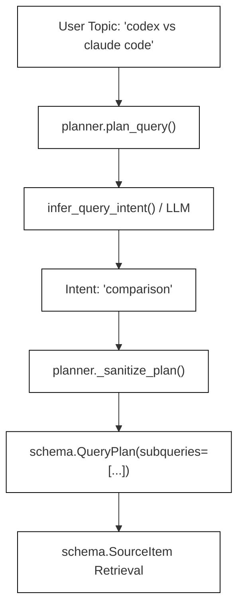
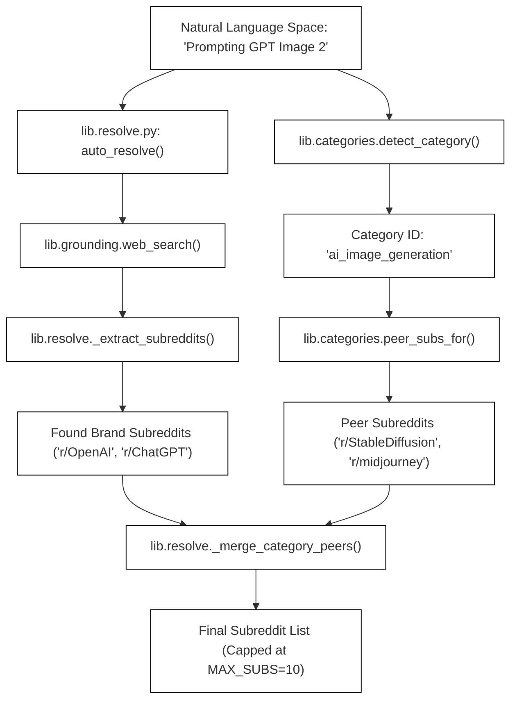

<!-- source: DeepWiki mcp.deepwiki.com · repo mvanhorn/last30days-skill · page 2.1 Two-Phase Search Strategy · fetched 2026-10-26 -->

# Two-Phase Search Strategy

<details>
<summary>Relevant source files</summary>

The following files were used as context for generating this wiki page:

- [skills/last30days/scripts/lib/planner.py](skills/last30days/scripts/lib/planner.py)
- [skills/last30days/scripts/lib/query.py](skills/last30days/scripts/lib/query.py)
- [skills/last30days/scripts/lib/resolve.py](skills/last30days/scripts/lib/resolve.py)
- [tests/fixtures/prompting-gpt-image-2-resolved-block.md](tests/fixtures/prompting-gpt-image-2-resolved-block.md)
- [tests/test_categories.py](tests/test_categories.py)
- [tests/test_category_integration.py](tests/test_category_integration.py)
- [tests/test_external_plan_source_contract.py](tests/test_external_plan_source_contract.py)
- [tests/test_internals_v3.py](tests/test_internals_v3.py)
- [tests/test_planner_v3.py](tests/test_planner_v3.py)
- [tests/test_query.py](tests/test_query.py)
- [tests/test_relevance.py](tests/test_relevance.py)
- [tests/test_resolve.py](tests/test_resolve.py)

</details>


## Purpose and Scope

This page details query planning and pre-research orchestration within the `/last30days` research engine. The system implements an LLM-first query planning phase (`lib.planner.py`), an auto-resolve pre-research phase (`lib.resolve.py`), and query preprocessing utilities (`lib.query.py`). These components bridge broad natural language topics to specific community-driven data silos and structured search queries.

For orchestration details, see **2.2. Orchestration Pipeline**. For source-specific implementations, see **3. Data Sources**.

---

## Phase 0: Query Planning and Intent Classification

The search strategy begins in `skills/last30days/scripts/lib/planner.py`, which uses a reasoning LLM or deterministic fallback to generate a structured `QueryPlan` [skills/last30days/scripts/lib/planner.py:1-11]()].

### Intent Classification and Source Priority Tables
The planner classifies user topics into one of eight `ALLOWED_INTENTS` [skills/last30days/scripts/lib/planner.py:85-94]():

```python
ALLOWED_INTENTS = {
    "factual", "product", "concept", "opinion",
    "how_to", "comparison", "breaking_news", "prediction",
}
```

This classification dictates source selection via `QUICK_SOURCE_PRIORITY` and `SOURCE_PRIORITY` maps, along with latency source limits and capability filters [skills/last30days/scripts/lib/planner.py:97-161]().

| Intent | Primary Sources (Default Depth) | Typical Cluster Mode |
| :--- | :--- | :--- |
| `factual` | `hackernews`, `reddit`, `x`, `youtube` | `none` |
| `product` | `jobs`, `youtube`, `reddit`, `x`, `tiktok`, `hackernews` | `story` |
| `concept` | `hackernews`, `reddit`, `x`, `youtube` | `story` |
| `opinion` | `reddit`, `x`, `stocktwits`, `dripstack`, `youtube`, `hackernews` | `debate` |
| `how_to` | `youtube`, `reddit`, `x`, `hackernews` | `workflow` |
| `comparison` | `reddit`, `x`, `hackernews`, `youtube` | `debate` |
| `breaking_news` | `x`, `stocktwits`, `reddit`, `hackernews`, `youtube`, `polymarket` | `story` |
| `prediction` | `polymarket`, `stocktwits`, `dripstack`, `x`, `hackernews`, `reddit`, `youtube` | `market` |

Sources: [skills/last30days/scripts/lib/planner.py:85-161](), [tests/test_planner_v3.py:88-104]()

### Query Expansion and Capability Routing
The planner expands the topic into multiple `subqueries`. Each `subquery` contains a `search_query` (optimized for keyword retrieval) and a `ranking_query` (optimized for semantic reranking) [tests/test_planner_v3.py:11-27](). Sources are filtered against `SOURCE_CAPABILITIES` (e.g., matching `how_to` queries to sources providing `video` or `discussion`) [skills/last30days/scripts/lib/planner.py:136-161]().

Diagram: Planning and Intent Routing to Code Entities

Sources: [skills/last30days/scripts/lib/planner.py:1-11](), [skills/last30days/scripts/lib/query.py:130-162](), [tests/test_planner_v3.py:88-119]()

---

## Phase 0.5: Auto-Resolve Pre-Research

Before broad discovery, `skills/last30days/scripts/lib/resolve.py` executes an auto-resolve phase using web search backends (Brave, Exa, Serper, Perplexity) to discover relevant communities and entities [skills/last30days/scripts/lib/resolve.py:1-16]().

### Entity Discovery and Category Peering
`auto_resolve()` runs targeted web queries to extract:
1. **Subreddits:** Extracted via regex `r"r/([A-Za-z0-9_]{2,21})"` from search titles, snippets, and URLs [skills/last30days/scripts/lib/resolve.py:83-95]().
2. **X Handles:** Extracted via `@handle` and `x.com/handle` patterns [skills/last30days/scripts/lib/resolve.py:98-118]().
3. **GitHub Repositories:** Extracted via `github.com/owner/repo` patterns [skills/last30days/scripts/lib/resolve.py:121-140]().
4. **Category Peers:** Topics matching known categories (`categories.detect_category()`) are augmented with curated peer subreddits (`categories.peer_subs_for()`) up to `MAX_SUBS = 10`, ensuring deep domain coverage [skills/last30days/scripts/lib/resolve.py:24-68]().

Diagram: Natural Language Space to Code Entity Space (Resolve)

Sources: [skills/last30days/scripts/lib/resolve.py:24-95](), [skills/last30days/scripts/lib/categories.py:12-40](), [tests/test_category_integration.py:53-84]()

---

## Query Preprocessing and Normalization (`query.py`)

Shared query cleaning utilities in `skills/last30days/scripts/lib/query.py` strip noise words, extract core subjects, and detect compound terms before sending queries to adapters [skills/last30days/scripts/lib/query.py:1-6]().

### Noise Stripping and Core Subject Extraction
`extract_core_subject()` processes queries in three phases [skills/last30days/scripts/lib/query.py:79-128]():
1. **Prefix Stripping:** Removes common question/meta prefixes (e.g., `'what are the best'`, `'how to use'`, and Hebrew equivalents) [skills/last30days/scripts/lib/query.py:8-17]().
2. **Suffix Stripping:** Optionally strips trailing multi-word suffixes (e.g., `'best practices'`) [skills/last30days/scripts/lib/query.py:20-23]().
3. **Noise Word Filtering:** Filters out stopwords, question words, and research meta-descriptors using `NOISE_WORDS` (or platform-specific sets like `SOCIAL_NOISE` and `VIRAL_NOISE`) [skills/last30days/scripts/lib/query.py:26-76]().

### Compound Term Detection
`extract_compound_terms()` identifies hyphenated terms (e.g., `multi-agent`) and title-cased multi-word sequences (e.g., `Claude Code`, `React Native`) to ensure they are properly quoted in downstream search adapters [skills/last30days/scripts/lib/query.py:164-183]().

Sources: [skills/last30days/scripts/lib/query.py:1-183](), [tests/test_query.py:15-181]()

---

## Summary of Two-Phase Architecture Flow


Sources: [skills/last30days/scripts/lib/query.py:79-128](), [skills/last30days/scripts/lib/planner.py:85-118](), [skills/last30days/scripts/lib/resolve.py:24-68]()

---

