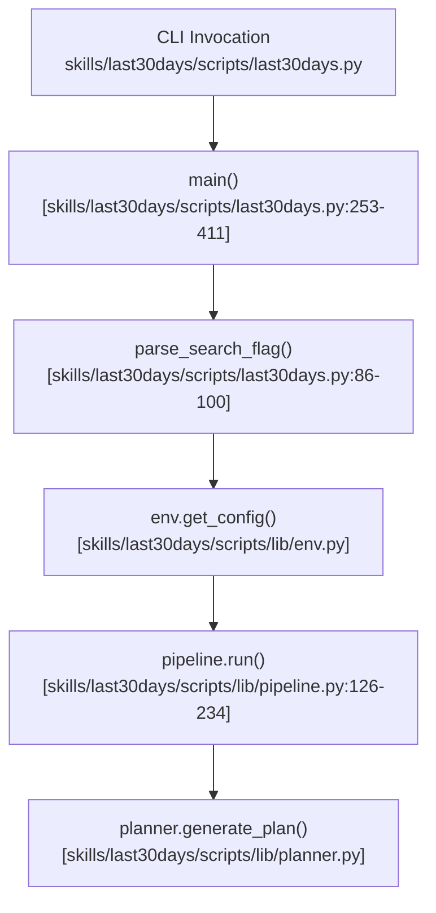
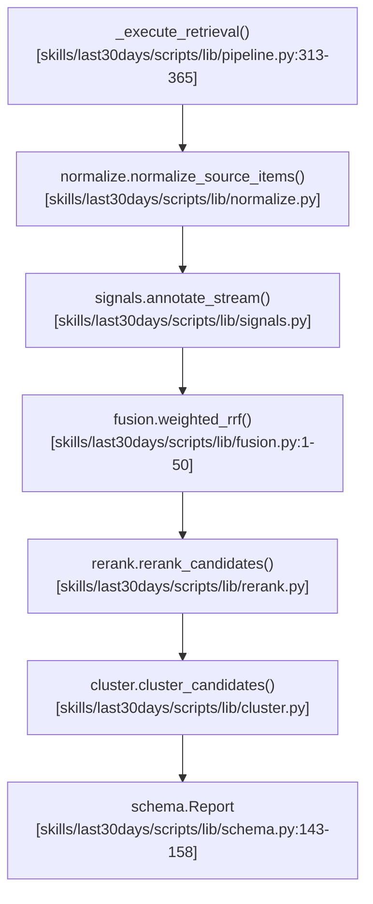

<!-- source: DeepWiki mcp.deepwiki.com · repo mvanhorn/last30days-skill · page 2.2 Orchestration Pipeline · fetched 2026-10-26 -->

# Orchestration Pipeline

Relevant source files

The following files were used as context for generating this wiki page:

- [docs/reference/json-export.md](docs/reference/json-export.md)
- [skills/last30days/scripts/last30days.py](skills/last30days/scripts/last30days.py)
- [skills/last30days/scripts/lib/cluster.py](skills/last30days/scripts/lib/cluster.py)
- [skills/last30days/scripts/lib/fusion.py](skills/last30days/scripts/lib/fusion.py)
- [skills/last30days/scripts/lib/http.py](skills/last30days/scripts/lib/http.py)
- [skills/last30days/scripts/lib/pipeline.py](skills/last30days/scripts/lib/pipeline.py)
- [skills/last30days/scripts/lib/schema.py](skills/last30days/scripts/lib/schema.py)
- [skills/last30days/scripts/lib/subproc.py](skills/last30days/scripts/lib/subproc.py)
- [tests/test_cli_v3.py](tests/test_cli_v3.py)
- [tests/test_cluster_v3.py](tests/test_cluster_v3.py)
- [tests/test_discover_nominate_topics.py](tests/test_discover_nominate_topics.py)
- [tests/test_fusion_v3.py](tests/test_fusion_v3.py)
- [tests/test_http_v3.py](tests/test_http_v3.py)
- [tests/test_pipeline_v3.py](tests/test_pipeline_v3.py)
- [tests/test_render_footer.py](tests/test_render_footer.py)
- [tests/test_subproc.py](tests/test_subproc.py)

## Purpose and Scope

This page documents the end-to-end execution pipeline managed by `skills/last30days/scripts/last30days.py` and `skills/last30days/scripts/lib/pipeline.py`. The orchestration engine coordinates command-line parsing, query planning, parallel multi-source data retrieval via thread pools, rate-limit tracking, thin-source retries, weighted Reciprocal Rank Fusion (RRF), LLM-based reranking, narrative clustering, strict exit codes, and aggregate `Report` assembly.

For details on the two-phase search strategy, see [Two-Phase Search Strategy](2.1). For configuration and authentication precedence, see [Configuration and Authentication](2.3).

---

## CLI Invocation and Pipeline Initialization

The CLI entry point in `skills/last30days/scripts/last30days.py` handles argument parsing, python version validation (`MIN_PYTHON = (3, 12)`), environment configuration loading, and process-group signal management (`atexit.register(_cleanup_children)`) [skills/last30days/scripts/last30days.py:1-84](). Once options such as `--quick`, `--deep`, `--search`, and `--emit` are processed, execution delegates to `pipeline.run()` [skills/last30days/scripts/lib/pipeline.py:126-234]().

**Diagram: CLI to Pipeline Entry Mapping**

**Sources:** [skills/last30days/scripts/last30days.py:1-100](), [skills/last30days/scripts/lib/pipeline.py:126-234]()

---

## ThreadPoolExecutor Fan-Out and Fetch Caps

The retrieval phase executes subqueries concurrently across multiple sources using a `ThreadPoolExecutor` within `_execute_retrieval()` [skills/last30days/scripts/lib/pipeline.py:313-365](). To prevent API exhaustion and manage budgets, fetches are governed by per-source caps (`MAX_SOURCE_FETCHES`) and command-wide paid budget trackers (`PaidSourceBudget`) [skills/last30days/scripts/lib/pipeline.py:112-160]().

- **Depth Settings:** Configured via depth profiles (`quick`, `default`, `deep`), which dictate per-stream limits, pool limits, and rerank limits (`_resolve_depth_settings`) [skills/last30days/scripts/lib/pipeline.py:91-182]().
- **Source Caps:** Sources like `trustpilot`, `amazon`, and `telegram` are capped at 1 fetch per run to prevent redundant queries and WAF-cookie Chrome harvests [skills/last30days/scripts/lib/pipeline.py:112-115]().

**Sources:** [skills/last30days/scripts/lib/pipeline.py:91-182](), [skills/last30days/scripts/lib/pipeline.py:313-365]()

---

## Rate-Limit Tracking and Thin-Source Retries

During retrieval, HTTP requests handle rate-limiting (`HTTP 429`) and connection retries via `lib/http.py` [skills/last30days/scripts/lib/http.py:33-83](). 

- **Header Parsing:** `retry_delay_from_headers()` reads both standard `Retry-After` headers and platform-specific headers like `x-ratelimit-reset` (such as Reddit's anonymous rate-limit window resets) to calculate precise backoff wait times [skills/last30days/scripts/lib/http.py:47-83]().
- **Outcome Tracking:** Observed retrieval outcomes for each source are recorded into `SourceOutcome` dataclasses (`health.OK`, `health.RATE_LIMITED`, `schema.NO_RESULTS`, `schema.PARTIAL`, etc.), preserving failure telemetry for downstream synthesis without breaking the primary report [skills/last30days/scripts/lib/schema.py:181-222]().

**Sources:** [skills/last30days/scripts/lib/http.py:33-83](), [skills/last30days/scripts/lib/schema.py:181-222]()

---

## Fusion, Reranking, and Clustering

Once parallel retrieval and normalization complete, evidence items flow through a deterministic data processing pipeline.

**Diagram: Data Processing Pipeline Flow**

- **Weighted RRF Fusion:** `weighted_rrf()` combines rankings from multi-source subqueries using Reciprocal Rank Fusion, incorporating subquery weights and duplicate URL collapse (`collapse_duplicate_urls`) [skills/last30days/scripts/lib/fusion.py:1-108]().
- **LLM Reranking:** `rerank_candidates()` uses reasoning providers to score candidates from 0-100 based on entity grounding and relevance.
- **Clustering:** `cluster_candidates()` groups related items into narrative clusters, picking representative candidates for headline presentation [skills/last30days/scripts/lib/cluster.py]().

**Sources:** [skills/last30days/scripts/lib/fusion.py:1-108](), [skills/last30days/scripts/lib/cluster.py](), [skills/last30days/scripts/lib/schema.py:143-158]()

---

## Strict Exit Codes and Report Assembly

The pipeline aggregates all findings into a strongly-typed `schema.Report` object [skills/last30days/scripts/lib/schema.py:143-158](). 

- **Exit Codes:** The CLI enforces strict exit codes. For example, malformed `--plan` JSON or invalid plan schemas exit immediately with status `2` to prevent fallback to internal planners that would consume paid API runs [tests/test_cli_v3.py:73-115](). Successful runs exit with status `0`.
- **Output Emission:** Renderers format the report into compact, full, brief, or JSON structures, saved atomically via `save_output()` under directories like `~/Documents/Last30Days/` [skills/last30days/scripts/last30days.py:118-175]().

**Sources:** [skills/last30days/scripts/last30days.py:118-175](), [tests/test_cli_v3.py:73-115](), [skills/last30days/scripts/lib/schema.py:143-158]()

---

