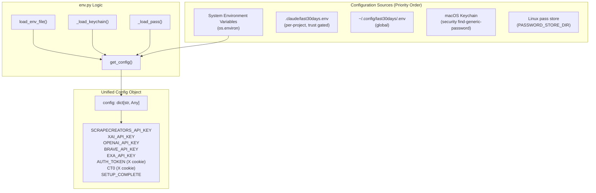
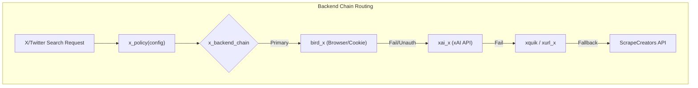
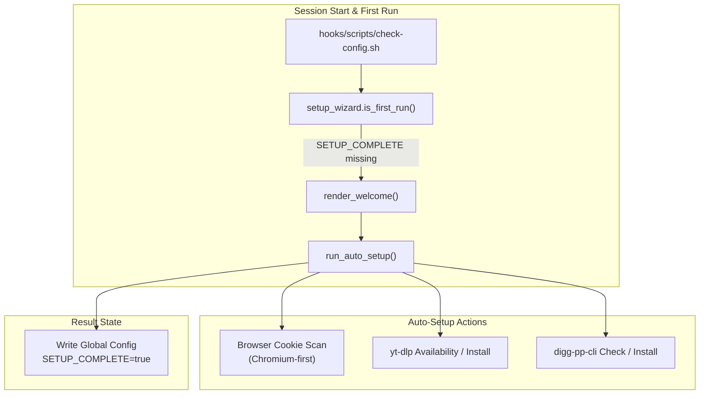

<!-- source: DeepWiki mcp.deepwiki.com · repo mvanhorn/last30days-skill · page 2.3 Configuration and Authentication · fetched 2026-10-26 -->

# Configuration and Authentication

Relevant source files

The following files were used as context for generating this wiki page:

- [AGENTS.md](AGENTS.md)
- [CONFIGURATION.md](CONFIGURATION.md)
- [CONTRIBUTORS.md](CONTRIBUTORS.md)
- [README.md](README.md)
- [changelog.d/+base-url-api-root.fixed.md](changelog.d/+base-url-api-root.fixed.md)
- [changelog.d/882.fixed.md](changelog.d/882.fixed.md)
- [hooks/scripts/check-config.sh](hooks/scripts/check-config.sh)
- [skills/last30days/scripts/lib/backends.py](skills/last30days/scripts/lib/backends.py)
- [skills/last30days/scripts/lib/env.py](skills/last30days/scripts/lib/env.py)
- [skills/last30days/scripts/lib/providers.py](skills/last30days/scripts/lib/providers.py)
- [skills/last30days/scripts/lib/setup_wizard.py](skills/last30days/scripts/lib/setup_wizard.py)
- [tests/test_backend_descriptors.py](tests/test_backend_descriptors.py)
- [tests/test_check_config_env_safety.py](tests/test_check_config_env_safety.py)
- [tests/test_check_config_memory_dir.py](tests/test_check_config_memory_dir.py)
- [tests/test_env_cookies.py](tests/test_env_cookies.py)
- [tests/test_github_device_auth.py](tests/test_github_device_auth.py)
- [tests/test_last_run_state.py](tests/test_last_run_state.py)
- [tests/test_onboarding_contract.py](tests/test_onboarding_contract.py)
- [tests/test_providers_v3.py](tests/test_providers_v3.py)
- [tests/test_setup_openclaw.py](tests/test_setup_openclaw.py)
- [tests/test_setup_wizard.py](tests/test_setup_wizard.py)
- [tests/test_setup_wizard_pp_sources.py](tests/test_setup_wizard_pp_sources.py)
- [tests/test_welcome.py](tests/test_welcome.py)
- [tests/test_x_chain_failover.py](tests/test_x_chain_failover.py)

## Purpose and Scope

This document describes the configuration management and authentication systems in the `/last30days` skill. It covers how API keys and credentials are loaded from multiple sources with priority resolution, how trust signaling and permission checks protect project environments, how provider and backend descriptors handle failover chains (such as `x_backend_chain`), and how the setup wizard and onboarding flows initialize the engine.

For details on secret storage mechanisms (Keychain, pass) and browser cookie extraction (`cookie_extract`, `chrome_cookies`, `safari_cookies`, `chrome_cdp`, `agentcookie`, `box_chrome_login`), see [Credential Stores and Cookie Extraction](#2.3.1).

---

## Configuration Architecture

The configuration system is managed by `skills/last30days/scripts/lib/env.py`, which aggregates settings from multiple sources with a defined priority hierarchy. The primary function `get_config()` returns a unified dictionary containing all API keys, authentication tokens, and resolved auth statuses [skills/last30days/scripts/lib/env.py:1-25].

### Configuration Loading Flow

**Sources:** [skills/last30days/scripts/lib/env.py:16-83](), [hooks/scripts/check-config.sh:5-18](), [hooks/scripts/check-config.sh:103-111]()

### Configuration Priority Resolution

The `get_config()` function resolves values in the following order (highest priority wins):
1. **System Environment Variables**: Set directly in the shell or by the parent process (`os.environ`) [skills/last30days/scripts/lib/env.py:25]().
2. **Project-local `.env`**: Located at `.claude/last30days.env` relative to the current working directory, loaded only when trust is explicitly granted [hooks/scripts/check-config.sh:103-111]().
3. **Global `.env`**: Located at `~/.config/last30days/.env` (overridable via `LAST30DAYS_CONFIG_DIR`) [skills/last30days/scripts/lib/env.py:28-41]().
4. **Secret Managers**: macOS Keychain (via `security` CLI using `last30days-` service prefix) or Linux `pass` store (via `DEFAULT_PASS_PATH_PREFIX`) [skills/last30days/scripts/lib/env.py:43-82]().

---

## Trust Signaling and Permission Checks

To prevent arbitrary code execution via project-scoped configuration files (e.g., malicious `.claude/last30days.env` files in untrusted repositories), project configuration loading is strictly gated by trust signaling [hooks/scripts/check-config.sh:5-9]().

- **Trust Boundary**: Project configuration cannot self-grant trust [hooks/scripts/check-config.sh:103-111](). The `LAST30DAYS_TRUST_PROJECT_CONFIG` variable must be truthy in the process environment or the global configuration file before a project-local environment file is read.
- **Permission Enforcement**: Hook scripts (`hooks/scripts/check-config.sh`) and engine loaders inspect file permissions (`stat -c '%a'` or `stat -f '%Lp'`) and automatically correct insecure permissions (e.g., world-readable files) to `600` on POSIX systems [hooks/scripts/check-config.sh:26-43]().
- **Template Rejection**: The configuration reader inspects unexpanded template strings matching `_UNSUBSTITUTED_TEMPLATE` (such as `${user_config.x}`) to reject literal placeholder strings from host IDE integrations, ensuring valid fallbacks instead of upstream authentication errors [skills/last30days/scripts/lib/env.py:143-155]().

**Sources:** [hooks/scripts/check-config.sh:5-43](), [hooks/scripts/check-config.sh:103-111](), [skills/last30days/scripts/lib/env.py:143-155]()

---

## Provider and Backend Descriptors & Failover Chains

The system interacts with reasoning providers (OpenAI, xAI, Gemini, OpenRouter) and source backends through explicit descriptors and dynamic failover chains.

- **Provider Catalogs**: `skills/last30days/scripts/lib/providers.py` defines abstract reasoning client interfaces (`ReasoningClient`) and concrete implementations (`GeminiClient`, `OpenAIClient`, `XAIClient`, `OpenRouterClient`) with support for endpoint overrides (`*_BASE_URL`) [skills/last30days/scripts/lib/providers.py:36-220]().
- **Backend Descriptors**: Source backends manage transport methods dynamically. For instance, X/Twitter execution uses `x_backend_chain` failover routing between native APIs, cookie-authenticated CLIs (`bird_x`), and proxy fallbacks (`xai_x`, `xurl_x`, `xquik`, `grok_x`) governed by environment policies (`x_policy`) [skills/last30days/scripts/lib/setup_wizard.py:95-108]().

**Sources:** [skills/last30days/scripts/lib/providers.py:36-220](), [skills/last30days/scripts/lib/setup_wizard.py:95-108]()

---

## Setup Wizard and Onboarding Flows

First-run onboarding is managed by `skills/last30days/scripts/lib/setup_wizard.py` and driven by model instructions in `SKILL.md` [skills/last30days/scripts/lib/setup_wizard.py:1-6]().

### Setup Architecture Flow

**Sources:** [skills/last30days/scripts/lib/setup_wizard.py:25-139](), [hooks/scripts/check-config.sh:5-24]()

- **First-Run Detection**: `is_first_run(config)` checks whether `SETUP_COMPLETE` is set in the configuration dictionary [skills/last30days/scripts/lib/setup_wizard.py:25-31]().
- **Auto-Setup Routine**: `run_auto_setup()` performs a warm start by scanning for browser cookies (prioritizing Chromium-first order to avoid Keychain/Full Disk Access hurdles on macOS), verifying or installing `yt-dlp` for YouTube transcripts, and setting up printing press CLIs (`digg-pp-cli`) [skills/last30days/scripts/lib/setup_wizard.py:70-139]().
- **Host-Conditional Routing**: Official-only execution environments (such as `LAST30DAYS_HOST=grok-bot`) bypass browser cookie extraction while allowing safe keyless CLI tools to install and run [skills/last30days/scripts/lib/setup_wizard.py:64-108]().

**Sources:** [skills/last30days/scripts/lib/setup_wizard.py:25-139](), [tests/test_onboarding_contract.py:1-74]()

---

