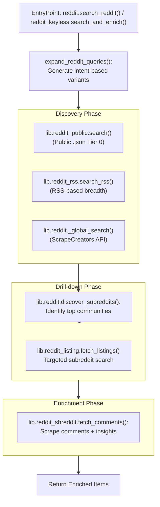
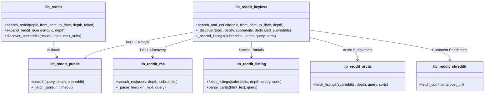

<!-- source: DeepWiki mcp.deepwiki.com · repo mvanhorn/last30days-skill · page 3.1 Reddit Integration · fetched 2026-10-26 -->

# Reddit Integration

Relevant source files

The following files were used as context for generating this wiki page:

- [changelog.d/+reddit-negative-engagement.fixed.md](changelog.d/+reddit-negative-engagement.fixed.md)
- [skills/last30days/scripts/lib/entity_extract.py](skills/last30days/scripts/lib/entity_extract.py)
- [skills/last30days/scripts/lib/reddit.py](skills/last30days/scripts/lib/reddit.py)
- [skills/last30days/scripts/lib/reddit_arctic.py](skills/last30days/scripts/lib/reddit_arctic.py)
- [skills/last30days/scripts/lib/reddit_keyless.py](skills/last30days/scripts/lib/reddit_keyless.py)
- [skills/last30days/scripts/lib/reddit_listing.py](skills/last30days/scripts/lib/reddit_listing.py)
- [skills/last30days/scripts/lib/reddit_public.py](skills/last30days/scripts/lib/reddit_public.py)
- [skills/last30days/scripts/lib/reddit_rss.py](skills/last30days/scripts/lib/reddit_rss.py)
- [skills/last30days/scripts/lib/reddit_shreddit.py](skills/last30days/scripts/lib/reddit_shreddit.py)
- [tests/test_discover_mode.py](tests/test_discover_mode.py)
- [tests/test_reddit.py](tests/test_reddit.py)
- [tests/test_reddit_arctic.py](tests/test_reddit_arctic.py)
- [tests/test_reddit_dedicated.py](tests/test_reddit_dedicated.py)
- [tests/test_reddit_keyless.py](tests/test_reddit_keyless.py)
- [tests/test_reddit_keyless_backoff.py](tests/test_reddit_keyless_backoff.py)
- [tests/test_reddit_listing.py](tests/test_reddit_listing.py)
- [tests/test_reddit_public.py](tests/test_reddit_public.py)
- [tests/test_reddit_relevance_ranking.py](tests/test_reddit_relevance_ranking.py)
- [tests/test_reddit_rss.py](tests/test_reddit_rss.py)
- [tests/test_reddit_shreddit.py](tests/test_reddit_shreddit.py)
- [tests/test_reddit_transport_outcomes.py](tests/test_reddit_transport_outcomes.py)

## Purpose and Scope

This document describes the Reddit data source integration in the `/last30days` skill, which discovers and enriches Reddit discussion threads relevant to a research topic. The integration utilizes a multi-phase discovery strategy involving global search, subreddit-specific drill-downs, entity-home lane handling, and tiered enrichment.

The Reddit transport family consists of:
- **`reddit.py`**: The primary ScrapeCreators REST API transport for keyed Reddit search, global discovery, and comment trees [skills/last30days/scripts/lib/reddit.py:1-8]().
- **`reddit_keyless.py`**: A tiered fallback system using RSS discovery (`reddit_rss.py`), web scraping (`reddit_shreddit.py`), and listing partials (`reddit_listing.py`) when API keys are unavailable or exhausted [skills/last30days/scripts/lib/reddit_keyless.py:1-17]().
- **`reddit_public.py`**: A public `.json` endpoint module demoted to keyless Tier 0 discovery [skills/last30days/scripts/lib/reddit_public.py:1-12]().
- **`reddit_listing.py`**: Keyless Reddit listing scrape via shreddit `/svc` partials for real upvote scores [skills/last30days/scripts/lib/reddit_listing.py:1-14]().
- **`reddit_rss.py`**: Public RSS/Atom feed parser for query search and listing breadth [skills/last30days/scripts/lib/reddit_rss.py:1-15]().
- **`reddit_shreddit.py` & `reddit_arctic.py`**: Enrichment engines for comment trees and shift-shift supplement archives [skills/last30days/scripts/lib/reddit_keyless.py:28-34]().

Sources: [skills/last30days/scripts/lib/reddit.py:1-8](), [skills/last30days/scripts/lib/reddit_keyless.py:1-17](), [skills/last30days/scripts/lib/reddit_public.py:1-12](), [skills/last30days/scripts/lib/reddit_listing.py:1-14](), [skills/last30days/scripts/lib/reddit_rss.py:1-15]()

---

## Search Strategy and Phases

Reddit research follows a structured pipeline across the keyed and keyless transports to maximize recall while maintaining high precision through relevance filtering.

### Search Execution Flow

Sources: [skills/last30days/scripts/lib/reddit_keyless.py:1-17](), [skills/last30days/scripts/lib/reddit.py:38-57](), [skills/last30days/scripts/lib/reddit_keyless.py:75-117]()

---

## Query Expansion and Intent Detection

To avoid missing relevant discussions, the system expands the user's topic into multiple Reddit-optimized variants based on detected query intent.

### Intent-Based Expansion Logic

The `expand_reddit_queries` function [skills/last30days/scripts/lib/reddit.py:100-138]() generates 1-4 query strings based on research depth configuration (`quick`, `default`, `deep`):

| Intent | Detection Pattern | Expanded Query Variant |
| :--- | :--- | :--- |
| **Product** | `product` type | `{core} review OR recommendation OR best` [skills/last30days/scripts/lib/reddit.py:123-124]() |
| **Comparison** | `comparison` type | `{core} worth it OR vs OR compared` [skills/last30days/scripts/lib/reddit.py:127-128]() |
| **Opinion** | `opinion` type | `{core} worth it OR thoughts OR review` [skills/last30days/scripts/lib/reddit.py:131-132]() |
| **How-to / Bug** | `how_to` / `opinion` type | `{core} issues OR problems OR bug OR broken` (Deep depth only) [skills/last30days/scripts/lib/reddit.py:135-136]() |

**Core Subject Extraction**: `_extract_core_subject` [skills/last30days/scripts/lib/reddit.py:92-97]() relies on `NOISE_WORDS` [skills/last30days/scripts/lib/reddit.py:64-75]() to strip meta-terms (e.g. "latest", "trending", "best") and isolate the primary subject.

Sources: [skills/last30days/scripts/lib/reddit.py:64-138]()

---

## Subreddit Discovery, Dedicated Lanes, and Drill-down

After global discovery, the system identifies the most relevant subreddits for targeted searches, incorporating specialized handling for entity-home communities.

### Discovery Algorithm and Dedicated Lane

The `discover_subreddits` function [skills/last30days/scripts/lib/reddit.py:150-188]() computes community weighting using frequency, keyword overlap, utility penalization, and engagement bonuses:
1. **Base Frequency**: Frequency count of post appearances [skills/last30days/scripts/lib/reddit.py:178]().
2. **Topic Match Bonus**: +2.0 bonus if the subreddit name contains core topic words [skills/last30days/scripts/lib/reddit.py:180-183]().
3. **Utility Penalty**: 0.3x multiplier for known meta/utility subs (`UTILITY_SUBS` like `r/tipofmytongue` or `r/findareddit`) [skills/last30days/scripts/lib/reddit.py:143-148](), [skills/last30days/scripts/lib/reddit.py:185-187]().
4. **Engagement Bonus**: +0.5 boost for posts with over 100 upvotes [skills/last30days/scripts/lib/reddit.py:189-191]().

**Dedicated Lane**: In `reddit_keyless.py`, entity-home subreddits (e.g., `r/Kanye` for "Kanye West") are recognized as wholly on-topic. They are pulled in full via `DEDICATED_SORTS = ["top", "hot", "new"]` and marked floor-exempt so that relevant posts lacking explicit keyword repetition are never pruned [skills/last30days/scripts/lib/reddit_keyless.py:39-42](), [skills/last30days/scripts/lib/reddit_keyless.py:129-136]().

Sources: [skills/last30days/scripts/lib/reddit.py:143-191](), [skills/last30days/scripts/lib/reddit_keyless.py:39-42](), [skills/last30days/scripts/lib/reddit_keyless.py:129-136]()

---

## Relevance Ranking and Engagement Floor Safety

Reddit's highest-upvote content (e.g., viral news, relationship subreddits) frequently exhibits zero topic overlap. To preserve research precision, the system applies strict relevance filtering and ranking keys.

### Scoring Mechanisms

*   **Token Overlap**: `token_overlap_relevance` evaluates lexical similarity between research query tokens and post text [skills/last30days/scripts/lib/reddit_listing.py:24]().
*   **Relevance Floor**: Posts scoring below `RELEVANCE_FLOOR` are filtered out when any on-topic candidate is present [skills/last30days/scripts/lib/reddit.py:33-35]().
*   **Ranking Key (`_relevance_rank_key`)**: Both `reddit.py` and `reddit_keyless.py` rank by relevance first, utilizing a log-scaled engagement bonus (bounded at a maximum of `0.25`) as a tiebreaker [skills/last30days/scripts/lib/reddit_keyless.py:45-54](). 
*   **Negative Score Protection**: Downvoted posts with negative engagement scores compute log logarithms safely via clamped totals, preventing `math domain error` exceptions [changelog.d/+reddit-negative-engagement.fixed.md:1](), [tests/test_reddit_relevance_ranking.py:43-50]().

Sources: [skills/last30days/scripts/lib/reddit.py:33-35](), [skills/last30days/scripts/lib/reddit_keyless.py:45-54](), [changelog.d/+reddit-negative-engagement.fixed.md:1](), [tests/test_reddit_relevance_ranking.py:43-50]()

---

## Technical Implementation and Transport Architecture

### Module Component Architecture

Sources: [skills/last30days/scripts/lib/reddit.py:1-16](), [skills/last30days/scripts/lib/reddit_keyless.py:1-34](), [skills/last30days/scripts/lib/reddit_public.py:1-12](), [skills/last30days/scripts/lib/reddit_listing.py:1-14](), [skills/last30days/scripts/lib/reddit_rss.py:1-15]()

### Backoff and Transport Outcomes

When encountering network throttling, anti-bot walls, or HTTP status codes, transports classify failure states to drive failover behavior:
*   **`classify_run_failure`**: Evaluates error message strings for markers like `"interstitial"`, `"blocked by reddit"`, or `"too many requests"` to map them to `health.RATE_LIMITED`, and `"login required"` or `"invalid token"` to `health.AUTH_FAILED` [skills/last30days/scripts/lib/reddit.py:82-90]().
*   **Retry and Rate Limit Management**: Uses `http.retry_delay_from_headers` to inspect `Retry-After` or `x-ratelimit-reset` headers during HTTP 429 exceptions with exponential backoff [skills/last30days/scripts/lib/reddit_public.py:90-103]().

Sources: [skills/last30days/scripts/lib/reddit.py:82-90](), [skills/last30days/scripts/lib/reddit_public.py:90-103]()

### Data Normalization

All raw Reddit payloads across ScrapeCreators, public JSON, RSS, and shreddit partials are mapped to the canonical `SourceItem` schema with normalized fields:

| Canonical Field | Normalization Logic |
| :--- | :--- |
| `date` | Parsed from Unix `created_utc` or ISO `created_at` / `updated` strings into `YYYY-MM-DD` [skills/last30days/scripts/lib/reddit_public.py:147-156](), [skills/last30days/scripts/lib/reddit_rss.py:52-60]() |
| `engagement` | Dict tracking `score`, `num_comments`, and `upvote_ratio` [skills/last30days/scripts/lib/reddit_public.py:169-174]() |
| `relevance` | Calculated via `token_overlap_relevance` or engagement-based heuristics [skills/last30days/scripts/lib/reddit_public.py:182-187]() |
| `author` | Sanitized author handle, mapping `[deleted]` and `[removed]` safely [skills/last30days/scripts/lib/reddit_public.py:165]() |

Sources: [skills/last30days/scripts/lib/reddit_public.py:147-187](), [skills/last30days/scripts/lib/reddit_rss.py:52-60]()

---

