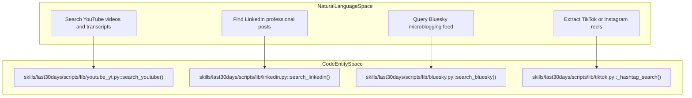
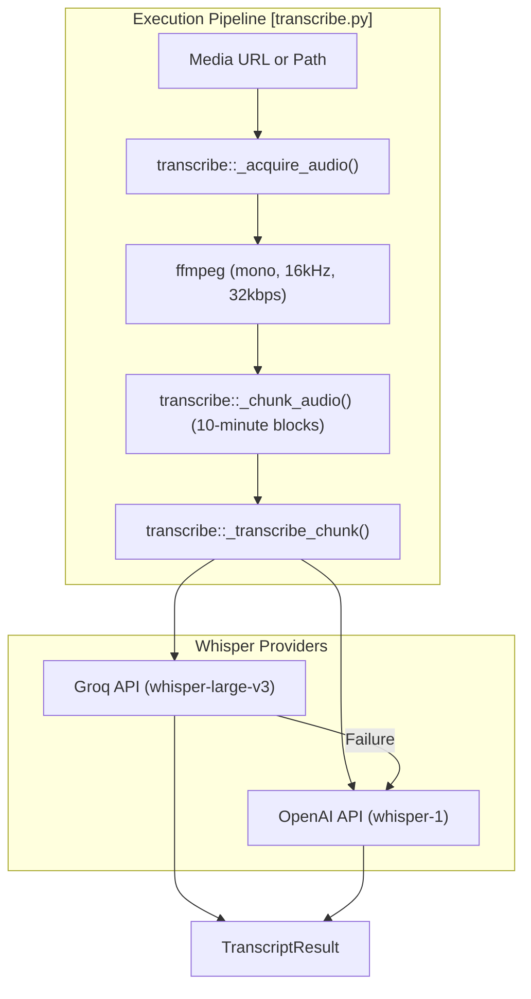

<!-- source: DeepWiki mcp.deepwiki.com · repo mvanhorn/last30days-skill · page 3.3 Social Media Sources · fetched 2026-10-26 -->

# Social Media Sources

Relevant source files

The following files were used as context for generating this wiki page:

- [changelog.d/+groq-transcribe-user-agent.fixed.md](changelog.d/+groq-transcribe-user-agent.fixed.md)
- [changelog.d/939.fixed.md](changelog.d/939.fixed.md)
- [skills/last30days/scripts/lib/arxiv.py](skills/last30days/scripts/lib/arxiv.py)
- [skills/last30days/scripts/lib/bluesky.py](skills/last30days/scripts/lib/bluesky.py)
- [skills/last30days/scripts/lib/instagram.py](skills/last30days/scripts/lib/instagram.py)
- [skills/last30days/scripts/lib/linkedin.py](skills/last30days/scripts/lib/linkedin.py)
- [skills/last30days/scripts/lib/pinterest.py](skills/last30days/scripts/lib/pinterest.py)
- [skills/last30days/scripts/lib/telegram.py](skills/last30days/scripts/lib/telegram.py)
- [skills/last30days/scripts/lib/threads.py](skills/last30days/scripts/lib/threads.py)
- [skills/last30days/scripts/lib/tiktok.py](skills/last30days/scripts/lib/tiktok.py)
- [skills/last30days/scripts/lib/transcribe.py](skills/last30days/scripts/lib/transcribe.py)
- [skills/last30days/scripts/lib/truthsocial.py](skills/last30days/scripts/lib/truthsocial.py)
- [skills/last30days/scripts/lib/youtube_yt.py](skills/last30days/scripts/lib/youtube_yt.py)
- [tests/test_arxiv_source.py](tests/test_arxiv_source.py)
- [tests/test_bluesky.py](tests/test_bluesky.py)
- [tests/test_bluesky_refresh_contract.py](tests/test_bluesky_refresh_contract.py)
- [tests/test_linkedin.py](tests/test_linkedin.py)
- [tests/test_pinterest.py](tests/test_pinterest.py)
- [tests/test_telegram_source.py](tests/test_telegram_source.py)
- [tests/test_threads.py](tests/test_threads.py)
- [tests/test_transcribe.py](tests/test_transcribe.py)
- [tests/test_youtube_comments_ytdlp.py](tests/test_youtube_comments_ytdlp.py)
- [tests/test_youtube_transcript_fallback_spend.py](tests/test_youtube_transcript_fallback_spend.py)
- [tests/test_youtube_yt.py](tests/test_youtube_yt.py)

This page documents the full suite of social media connectors in the `/last30days` engine: YouTube (`yt-dlp` search, comments, transcripts, and backfill), TikTok, Instagram, Threads, Pinterest, Bluesky, Truth Social, Telegram, LinkedIn, and Xiaohongshu, alongside caption-free transcription support via Whisper. These integrations capture video-based trends, microblogging sentiment, visual content, and alternative discussions.

---

## Overview and Connector Matrix

The social media subsystem dispatches concurrent search requests to ten platforms using varying transport layers, ranging from unauthenticated CLI wrappers to REST API services and AT Protocol sessions.

| Source | Code Module | Transport / Backend | Auth Mechanism | Primary Content |
|--------|-------------|---------------------|----------------|-----------------|
| **YouTube** | `skills/last30days/scripts/lib/youtube_yt.py` | `yt-dlp` CLI | None (Public) | Videos, Transcripts, Highlights |
| **TikTok** | `skills/last30days/scripts/lib/tiktok.py` | ScrapeCreators REST API | `SCRAPECREATORS_API_KEY` | Short-form video, Captions |
| **Instagram** | `skills/last30days/scripts/lib/instagram.py` | ScrapeCreators REST API | `SCRAPECREATORS_API_KEY` | Reels, Transcripts, Captions |
| **LinkedIn** | `skills/last30days/scripts/lib/linkedin.py` | ScrapeCreators REST API | `SCRAPECREATORS_API_KEY` | Public Posts, Articles |
| **Pinterest** | `skills/last30days/scripts/lib/pinterest.py` | ScrapeCreators REST API | `SCRAPECREATORS_API_KEY` | Pins, Descriptions, Saves |
| **Threads** | `skills/last30days/scripts/lib/threads.py` | ScrapeCreators REST API | `SCRAPECREATORS_API_KEY` | Short Text, Engagement |
| **Bluesky** | `skills/last30days/scripts/lib/bluesky.py` | AT Protocol AppView | `BSKY_HANDLE`, `BSKY_APP_PASSWORD` | Microblogging posts |
| **Truth Social** | `skills/last30days/scripts/lib/truthsocial.py` | Mastodon API | Bearer Token | Microblogging statuses |
| **Telegram** | `skills/last30days/scripts/lib/telegram.py` | Public channel indexing | None / API Key | Channel messages |
| **Xiaohongshu** | `skills/last30days/scripts/lib/xiaohongshu.py` | ScrapeCreators / Web | `SCRAPECREATORS_API_KEY` | Lifestyle notes, reviews |

Sources: [skills/last30days/scripts/lib/youtube_yt.py:1-7](), [skills/last30days/scripts/lib/tiktok.py:1-8](), [skills/last30days/scripts/lib/instagram.py:1-9](), [skills/last30days/scripts/lib/linkedin.py:1-8](), [skills/last30days/scripts/lib/bluesky.py:1-13]()

---

## Natural Language Space to Code Entity Space

The following diagram bridges the user's natural language queries and platform targets to the underlying Python functions and modules responsible for execution.

Title: "Social Media Intent to Connector Code Entities"

Sources: [skills/last30days/scripts/lib/youtube_yt.py:60-80](), [skills/last30days/scripts/lib/linkedin.py:161-180](), [skills/last30days/scripts/lib/bluesky.py:30-65]()

---

## YouTube Integration (`youtube_yt.py`)

YouTube research uses `yt-dlp` subprocess execution to extract video metadata, comments, and auto-generated transcripts without requiring a YouTube Data API key [skills/last30days/scripts/lib/youtube_yt.py:1-7]().

### Transcript Extraction and Highlights
- **Resilience**: The fetch routine wraps execution in a retry loop addressing transient errors (`429`, rate limits, timeouts) with a staggered backoff base [skills/last30days/scripts/lib/youtube_yt.py:66-74]().
- **Highlights**: `extract_transcript_highlights()` processes raw caption text by filtering common filler phrases (e.g., "subscribe", "welcome back") and scoring sentences based on number density, capitalization, and topic word overlap [skills/last30days/scripts/lib/youtube_yt.py:106-156]().
- **Backfill**: A two-pass mechanism runs transcript retrieval after final candidates are ranked, targeting high-relevance videos that might not lead purely in raw view count [skills/last30days/scripts/lib/youtube_yt.py:39-45]().

### Depth Configuration
- `quick`: Search limit 6, transcript limit 0 [skills/last30days/scripts/lib/youtube_yt.py:27-37]().
- `default`: Search limit 8, transcript limit 2 [skills/last30days/scripts/lib/youtube_yt.py:27-37]().
- `deep`: Search limit 40, transcript limit 8 [skills/last30days/scripts/lib/youtube_yt.py:27-37]().

Sources: [skills/last30days/scripts/lib/youtube_yt.py:26-157]()

---

## ScrapeCreators Connectors (TikTok, Instagram, LinkedIn, Pinterest, Threads)

Five platforms rely on the ScrapeCreators REST API infrastructure, sharing token headers and pagination patterns.

### LinkedIn Integration (`linkedin.py`)
- **Bucketing**: LinkedIn searches map time windows to coarse date buckets (`last-day`, `last-week`, `last-month`, `last-year`) required by the upstream endpoint [skills/last30days/scripts/lib/linkedin.py:28-37]().
- **Deduplication**: `_dedupe_key()` establishes stable item identifiers based on available URL fields or SHA-1 hashes of author bodies [skills/last30days/scripts/lib/linkedin.py:143-159]().

### TikTok & Instagram (`tiktok.py`, `instagram.py`)
- **Query Expansion**: Both modules generate intent-specific queries (e.g., product review vs. breaking news) to optimize multi-token searches [skills/last30days/scripts/lib/tiktok.py:38-78](), [skills/last30days/scripts/lib/instagram.py:87-130]().
- **Instagram Timeouts**: Transcript fetch timeouts can be tuned via `LAST30DAYS_TRANSCRIPT_TIMEOUT` [skills/last30days/scripts/lib/instagram.py:38-68]().

Sources: [skills/last30days/scripts/lib/linkedin.py:20-67](), [skills/last30days/scripts/lib/tiktok.py:38-78](), [skills/last30days/scripts/lib/instagram.py:38-68]()

---

## Microblog and Chat Connectors (Bluesky, Truth Social, Telegram)

### Bluesky (`bluesky.py`)
- **AT Protocol**: Authenticates via `com.atproto.server.createSession` using app passwords and searches via `api.bsky.app` [skills/last30days/scripts/lib/bluesky.py:1-13]().
- **Session Caching**: Access tokens are cached in memory for the duration of the execution run to prevent authentication stampedes [skills/last30days/scripts/lib/bluesky.py:91-137]().

### Telegram and Truth Social
- **Telegram (`telegram.py`)**: Indexes public channel feeds and message updates, extracting engagement telemetry.
- **Truth Social (`truthsocial.py`)**: Interacts with Mastodon-compatible APIs, stripping HTML markup from statuses before scoring relevance.

Sources: [skills/last30days/scripts/lib/bluesky.py:1-95](), [skills/last30days/scripts/lib/truthsocial.py:1-31]()

---

## Caption-Free Transcription Fallback (`transcribe.py`)

When native transcripts or captions are unavailable for audio/video media, the engine uses `transcribe.py` to route audio through Whisper APIs [skills/last30days/scripts/lib/transcribe.py:1-17]().

Title: "Media Transcription and Provider Fallback Flow"

Sources: [skills/last30days/scripts/lib/transcribe.py:59-112](), [skills/last30days/scripts/lib/transcribe.py:122-184]()

---

## Data Normalization and Engagement Mapping

All platform connectors map their native payloads into standard candidate records consumed by downstream fusion and ranking layers.

| Platform | Native Engagement Fields | Normalized Mapping |
|----------|--------------------------|--------------------|
| **YouTube** | `view_count`, `like_count`, `comment_count` | `engagement.views`, `likes`, `comments` [tests/test_youtube_yt.py:36-41]() |
| **TikTok** | `play_count`, `digg_count`, `comment_count`, `share_count` | `engagement.views`, `likes`, `comments`, `shares` [skills/last30days/scripts/lib/tiktok.py:124-127]() |
| **Pinterest** | `save_count`, `comment_count` | `engagement.saves`, `comments` [skills/last30days/scripts/lib/pinterest.py:53-54]() |
| **Threads** | `like_count`, `reply_count`, `repost_count` | `engagement.likes`, `replies`, `reposts` [skills/last30days/scripts/lib/threads.py:89-92]() |

Sources: [tests/test_youtube_yt.py:36-41](), [skills/last30days/scripts/lib/tiktok.py:124-127](), [skills/last30days/scripts/lib/pinterest.py:53-54](), [skills/last30days/scripts/lib/threads.py:89-92]()

---

