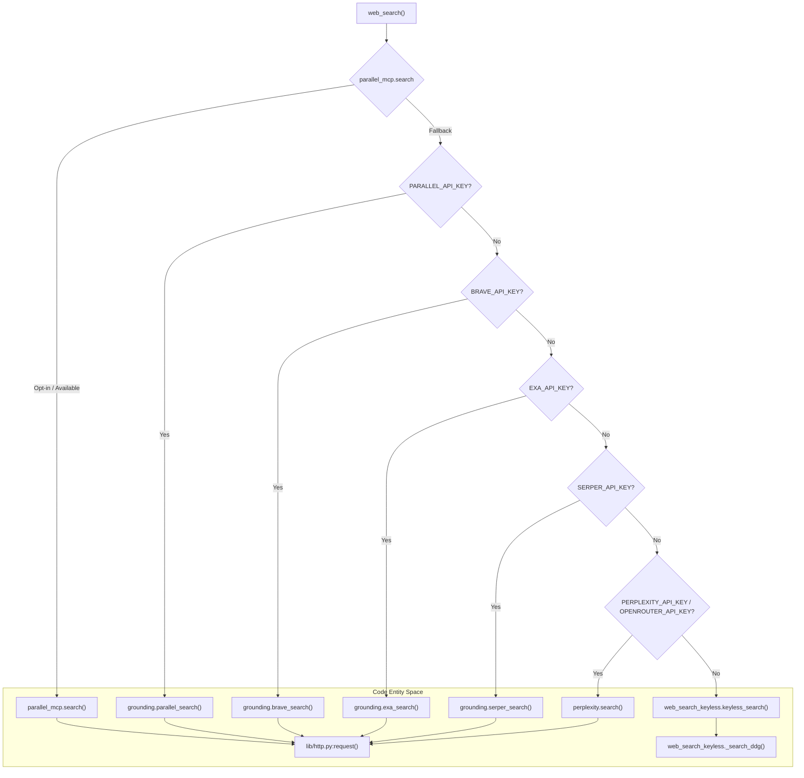
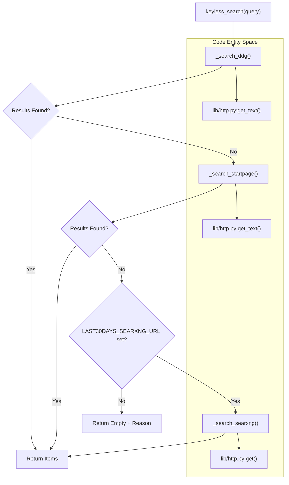
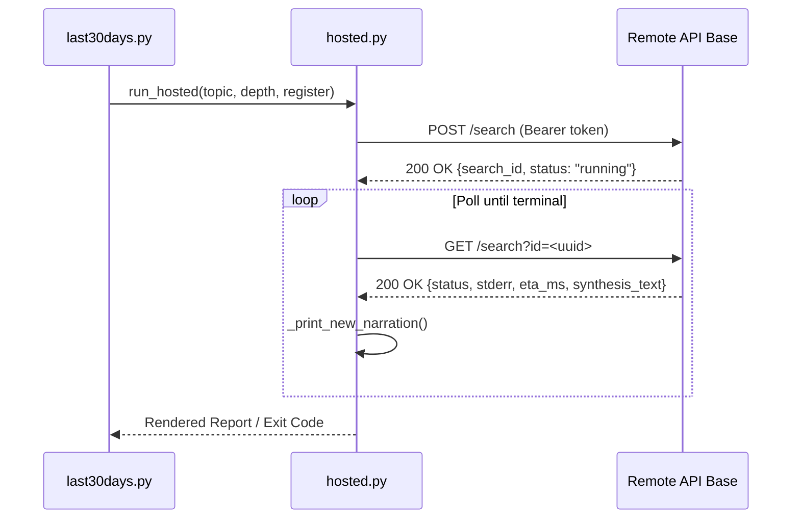

<!-- source: DeepWiki mcp.deepwiki.com · repo mvanhorn/last30days-skill · page 3.5 Web Search · fetched 2026-10-26 -->

# Web Search

Relevant source files

The following files were used as context for generating this wiki page:

- [skills/last30days/scripts/lib/grounding.py](skills/last30days/scripts/lib/grounding.py)
- [skills/last30days/scripts/lib/hosted.py](skills/last30days/scripts/lib/hosted.py)
- [skills/last30days/scripts/lib/parallel_mcp.py](skills/last30days/scripts/lib/parallel_mcp.py)
- [skills/last30days/scripts/lib/perplexity.py](skills/last30days/scripts/lib/perplexity.py)
- [skills/last30days/scripts/lib/registers.py](skills/last30days/scripts/lib/registers.py)
- [skills/last30days/scripts/lib/web_fetch_keyless.py](skills/last30days/scripts/lib/web_fetch_keyless.py)
- [skills/last30days/scripts/lib/web_search_keyless.py](skills/last30days/scripts/lib/web_search_keyless.py)
- [tests/test_env_v3.py](tests/test_env_v3.py)
- [tests/test_grounding_v3.py](tests/test_grounding_v3.py)
- [tests/test_hosted.py](tests/test_hosted.py)
- [tests/test_perplexity.py](tests/test_perplexity.py)
- [tests/test_web_fetch_keyless.py](tests/test_web_fetch_keyless.py)
- [tests/test_web_search_keyless.py](tests/test_web_search_keyless.py)

## Purpose and Scope

The Web Search module provides native integration with general web search backends, a grounding system that complements social media data, keyless scraping fallbacks, and remote hosted routing. It functions as a zero-config fallback and supplementary research source, ensuring the `/last30days` skill remains functional without social media API keys. The system supports multiple commercial backends (Brave, Exa, Serper, Parallel MCP, Perplexity/OpenRouter), keyless search and page-fetch mechanisms (`web_search_keyless.py`, `web_fetch_keyless.py`), and remote API routing via `hosted.py`.

Sources: [skills/last30days/scripts/lib/grounding.py:1-12](), [skills/last30days/scripts/lib/hosted.py:1-26]()

---

## Backend Architecture and Selection

The web search subsystem implements strict priority-based backend selection and normalization in `grounding.py` and associated modules. 

### Search Backends and Priority Chain

| Priority | Backend | Module / Function | Required Credentials | Role |
| :--- | :--- | :--- | :--- | :--- |
| 1 | **Parallel MCP** | `parallel_mcp.search` | `PARALLEL_API_KEY` | Opt-in Parallel Search MCP via Streamable HTTP. |
| 2 | **Parallel REST** | `grounding.parallel_search` | `PARALLEL_API_KEY` | LLM-optimized results with structured output. |
| 3 | **Brave Search** | `grounding.brave_search` | `BRAVE_API_KEY` | High-quality index with native freshness filtering. |
| 4 | **Exa AI** | `grounding.exa_search` | `EXA_API_KEY` | Neural search optimized for LLM retrieval. |
| 5 | **Serper** | `grounding.serper_search` | `SERPER_API_KEY` | Low-latency Google Search API wrapper. |
| 6 | **Perplexity / OpenRouter** | `perplexity.search` | `PERPLEXITY_API_KEY` or `OPENROUTER_API_KEY` | Deep research, Agent API, and Sonar synthesis. |
| 7 | **Keyless Floor** | `web_search_keyless.keyless_search` | None | Scraping-based fallback (DuckDuckGo, Startpage, SearXNG). |

**Diagram: Web Search Provider Resolution (Code Entity Space)**

Sources: [skills/last30days/scripts/lib/grounding.py:49-180](), [skills/last30days/scripts/lib/parallel_mcp.py:125-128](), [skills/last30days/scripts/lib/web_search_keyless.py:97-124]()

---

## Keyless Web Search and Fetch Fallbacks

When no API keys are present, the engine degrades gracefully to keyless floor tiers implemented in `web_search_keyless.py` and `web_fetch_keyless.py`.

### Keyless Search Tiers (`web_search_keyless.py`)
- **DuckDuckGo HTML**: Scrapes `https://html.duckduckgo.com/html/` via `http.get_text()`, unwrapping redirects from `uddg` parameters [skills/last30days/scripts/lib/web_search_keyless.py:85-95]().
- **Startpage Fallback**: If DuckDuckGo yields nothing (e.g., due to a datacenter IP 202 challenge page), it queries Startpage's HTML endpoint [skills/last30days/scripts/lib/web_search_keyless.py:106-110]().
- **SearXNG JSON**: If `LAST30DAYS_SEARXNG_URL` is configured, it falls back to a self-hosted SearXNG instance [skills/last30days/scripts/lib/web_search_keyless.py:112-115]().

### Keyless URL Fetch Floor (`web_fetch_keyless.py`)
- **Jina Reader Integration**: Converts arbitrary URLs into clean markdown via `https://r.jina.ai/{url}` without an API key [skills/last30days/scripts/lib/web_fetch_keyless.py:67-92]().
- **Cached Snapshot Detection**: Scans the leading window of responses to flag cached snapshots via `_detect_cached_snapshot()` [skills/last30days/scripts/lib/web_fetch_keyless.py:56-64]().

**Diagram: Keyless Fallback Architecture**

Sources: [skills/last30days/scripts/lib/web_search_keyless.py:97-124](), [skills/last30days/scripts/lib/web_fetch_keyless.py:67-105]()

---

## Hosted Provider Routing

When both `LAST30DAYS_API_KEY` and `LAST30DAYS_API_BASE` are set, the execution model shifts from local provider resolution to remote API routing via `hosted.py`.

### Remote API Contract
- **Submission**: `hosted.submit()` sends a `POST` request to `{base}/search` with topic, depth, and register parameters [skills/last30days/scripts/lib/hosted.py:82-92]().
- **Polling Loop**: `hosted.poll()` performs idempotent `GET` requests against `{base}/search?id=<uuid>` until reaching terminal statuses (`complete` or `error`) [skills/last30days/scripts/lib/hosted.py:95-102]().
- **Error Handlers**: `_handle_http_error()` parses error bodies for 401 (unauthorized), 402 (insufficient credits with balance and needed counts), and 403/429 limits [skills/last30days/scripts/lib/hosted.py:115-141]().

**Diagram: Hosted Mode Lifecycle**

Sources: [skills/last30days/scripts/lib/hosted.py:1-170]()

---

## Implementation Details & Claim Grounding

The `grounding.py` module normalizes heterogeneous search payloads into `schema.SourceItem` entries and exposes verified claim maps through `claim_source_map()` [skills/last30days/scripts/lib/grounding.py:24-42]().

- **Brave Freshness**: Encodes date intervals into the `freshness` request parameter [skills/last30days/scripts/lib/grounding.py:49-61]().
- **Exa Timestamps**: Sets `startPublishedDate` and `endPublishedDate` formatting [skills/last30days/scripts/lib/grounding.py:87-102]().
- **Serper Wrapper**: Formats Google search `tbs` parameters with custom date ranges [skills/last30days/scripts/lib/grounding.py:132-144]().

Sources: [skills/last30days/scripts/lib/grounding.py:24-163]()

---

