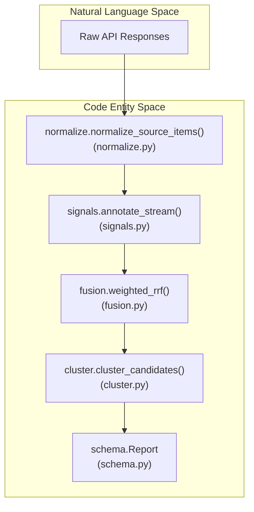
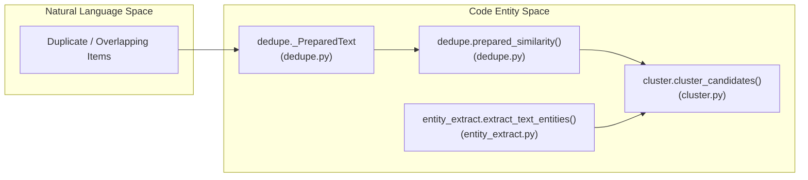

<!-- source: DeepWiki mcp.deepwiki.com · repo mvanhorn/last30days-skill · page 4 Data Processing Pipeline · fetched 2026-10-26 -->

# Data Processing Pipeline

Relevant source files

The following files were used as context for generating this wiki page:

- [changelog.d/1017.fixed.md](changelog.d/1017.fixed.md)
- [changelog.d/946.fixed.md](changelog.d/946.fixed.md)
- [skills/last30days/scripts/lib/cluster.py](skills/last30days/scripts/lib/cluster.py)
- [skills/last30days/scripts/lib/fusion.py](skills/last30days/scripts/lib/fusion.py)
- [skills/last30days/scripts/lib/normalize.py](skills/last30days/scripts/lib/normalize.py)
- [tests/test_cluster_v3.py](tests/test_cluster_v3.py)
- [tests/test_discover_nominate_topics.py](tests/test_discover_nominate_topics.py)
- [tests/test_fusion_v3.py](tests/test_fusion_v3.py)
- [tests/test_instagram.py](tests/test_instagram.py)
- [tests/test_normalize_v3.py](tests/test_normalize_v3.py)
- [tests/test_render_footer.py](tests/test_render_footer.py)
- [tests/test_signals_v3.py](tests/test_signals_v3.py)

## Purpose and Scope

The Data Processing Pipeline transforms heterogeneous raw API responses from multiple data sources into a unified, ranked, and deduplicated research report. This parent page provides a high-level architectural overview of the transformation stages managed by the engine orchestrator.

For deep technical details, refer to the following child pages:
- **Data Normalization**: See [Data Normalization](#4.1) for the canonical schema (`SourceItem`, `Candidate`, `Report`), source-specific normalizers, date/freshness handling in `dates.py`, CJK handling, and retrieval bundle aggregation.
- **Scoring and Ranking**: See [Scoring and Ranking](#4.2) for `signals.py` annotation, `prune_low_relevance`, weighted RRF fusion, LLM rerank with entity grounding, first-party credit, engagement rescue, and best-takes scoring.
- **Deduplication and Cross-Source Linking**: See [Deduplication and Cross-Source Linking](#4.3) for `dedupe.py` similarity heuristics, entity extraction, and `cluster.py` narrative clustering with cross-source overlap tagging.

Sources: [skills/last30days/scripts/lib/normalize.py:1-36](), [skills/last30days/scripts/pipeline.py:1-20]()

## Pipeline Architecture and Flow

The processing pipeline executes sequential phases that convert raw dictionary payloads into typed objects, calculate engagement and relevance signals, fuse subquery streams, and cluster narratives.

Sources: [skills/last30days/scripts/lib/normalize.py:30-85](), [skills/last30days/scripts/pipeline.py:100-220]()

## 4.1 Data Normalization

The normalization phase ingests raw API dictionary structures from various connectors and maps them onto the shared `SourceItem` schema. It enforces date filtering via `filter_by_date_range` while accommodating domain-specific exceptions such as evergreen content handling for YouTube and snapshot preservation for job boards [skills/last30days/scripts/lib/normalize.py:11-121].

For complete details on schema definitions, normalizer mappings, and date parsing utilities, see [Data Normalization](#4.1).

Sources: [skills/last30days/scripts/lib/normalize.py:11-121](), [skills/last30days/scripts/lib/schema.py:72-123]()

## 4.2 Scoring and Ranking

Once normalized, `signals.py` annotates items with lexical relevance scores, engagement log scales, freshness weights, and source quality metrics [skills/last30days/scripts/lib/signals.py:1-50]. Candidates from multiple subqueries are then merged using weighted Reciprocal Rank Fusion (RRF) in `fusion.py`, followed by optional LLM reranking and engagement rescues [skills/last30days/scripts/lib/fusion.py:1-60].

For comprehensive documentation on ranking formulas, RRF weighting, and rerank grounding, see [Scoring and Ranking](#4.2).

Sources: [skills/last30days/scripts/lib/signals.py:1-80](), [skills/last30days/scripts/lib/fusion.py:1-60]()

## 4.3 Deduplication and Cross-Source Linking

To prevent redundancy, `dedupe.py` provides similarity heuristics and prepared text representations [skills/last30days/scripts/lib/dedupe.py:1-50]. Subsequently, `cluster.py` groups related candidates into narrative clusters using greedy matching and entity-based second-pass merging across different sources [skills/last30days/scripts/lib/cluster.py:61-133].

For full details on similarity scoring, entity extraction, and cluster merging rules, see [Deduplication and Cross-Source Linking](#4.3).

Sources: [skills/last30days/scripts/lib/cluster.py:61-133](), [skills/last30days/scripts/lib/dedupe.py:1-50]()

---

