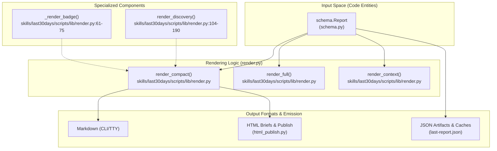

<!-- source: DeepWiki mcp.deepwiki.com · repo mvanhorn/last30days-skill · page 5 Output Layer · fetched 2026-10-26 -->

# Output Layer

Relevant source files

The following files were used as context for generating this wiki page:

- [skills/last30days/references/save-html-brief.md](skills/last30days/references/save-html-brief.md)
- [skills/last30days/scripts/lib/feed.py](skills/last30days/scripts/lib/feed.py)
- [skills/last30days/scripts/lib/html_publish.py](skills/last30days/scripts/lib/html_publish.py)
- [skills/last30days/scripts/lib/render.py](skills/last30days/scripts/lib/render.py)
- [skills/last30days/scripts/lib/rerank.py](skills/last30days/scripts/lib/rerank.py)
- [skills/last30days/scripts/lib/signals.py](skills/last30days/scripts/lib/signals.py)
- [tests/test_doc_flag_contract.py](tests/test_doc_flag_contract.py)
- [tests/test_html_publish.py](tests/test_html_publish.py)
- [tests/test_html_save_contract.py](tests/test_html_save_contract.py)
- [tests/test_render_v3.py](tests/test_render_v3.py)
- [tests/test_rerank_v3.py](tests/test_rerank_v3.py)

The Output Layer transforms processed research data (normalized, scored, and deduplicated) into multiple consumable formats for different use cases. It generates cluster-first markdown for AI synthesis, full reports for archival, JSON for programmatic access, and context snippets for embedding in other tools. The layer handles cross-reference tag rendering, data freshness warnings, source availability status, evidence envelopes, pass-through footers, and multi-format file output.

For detailed documentation on rendering mechanisms, terminal UI, output file artifacts, and HTML brief workflows, refer to the child pages below:
- [Report Generation](#5.1) — Document render.py: render_compact/full/brief/context/for_html, cluster-first layout, source status coverage, evidence-for-synthesis envelopes, synthesis directives, URL sanitization, freshness verification tables, and comparison rendering.
- [Terminal UI and Nudges](#5.2) — Document ui.py progress display and spinners, TTY vs non-TTY output, quality_nudge promos for missing configuration, and prescriptions guidance.
- [Output Formats and Files](#5.3) — Document --emit modes, atomic save_output, memory directory (~/Documents/Last30Days), last-run.json/last-report.json caches, JSON export schema and agent export fixtures.
- [HTML Briefs and Library](#5.4) — Document the save-html-brief reference contract, html_render/html_publish, doc flag contract, and the local library/library_index search and feed fast paths.

## Architecture Overview

The output layer is primarily implemented in `render.py` [skills/last30days/scripts/lib/render.py:1-75]() and consumes `schema.Report` objects produced by the processing pipeline. It provides primary rendering functions optimized for specific use cases and writes outputs to standardized file system locations. A secondary `html_publish.py` module [skills/last30days/scripts/lib/html_publish.py:1-107]() and reference contracts handle the conversion of these reports into shareable, styled HTML documents and hosted endpoints.

Diagram: Output Layer Architecture Flow

Sources: [skills/last30days/scripts/lib/render.py:1-190](), [skills/last30days/scripts/lib/html_publish.py:1-107]()

## Rendering Pipeline and Formats

The rendering pipeline formats `schema.Report` instances into targeted views depending on user intent and emit flags:

- **Compact Output (`render_compact`)**: The default chat delivery format, emphasizing narrative clusters, top community voices, and data freshness metrics [skills/last30days/scripts/lib/render.py:109-269]().
- **Full Output (`render_full`)**: Archival and debugging format containing complete raw items, source error summaries, and query metadata [skills/last30days/scripts/lib/render.py:307-436]().
- **Context Output (`render_context`)**: High-density cluster snippet extraction tailored for downstream prompt injection and RAG pipelines [skills/last30days/scripts/lib/render.py:272-304]().
- **HTML & Briefs**: Styled HTML conversion managed via reference contracts (`save-html-brief.md`), supporting optional hosted publishing through `html_publish.py` [skills/last30days/references/save-html-brief.md:1-108](), [skills/last30days/scripts/lib/html_publish.py:27-72]().

Sources: [skills/last30days/scripts/lib/render.py:109-436](), [skills/last30days/references/save-html-brief.md:1-108](), [skills/last30days/scripts/lib/html_publish.py:27-72]()

## Child Pages Summary

- **[Report Generation](#5.1)**: Covers `render.py` functions like `render_compact`, `render_full`, `render_brief`, `render_context`, and `render_for_html`. Details cluster-first layout, source status coverage, evidence-for-synthesis envelopes, URL sanitization, and comparison rendering.
- **[Terminal UI and Nudges](#5.2)**: Details `ui.py` progress display, spinners, TTY vs non-TTY execution, quality nudges for missing configuration, and guidance prescriptions.
- **[Output Formats and Files](#5.3)**: Documents `--emit` execution modes, atomic file saving via `save_output`, memory directory management under `~/Documents/Last30Days`, cache integration (`last-run.json`, `last-report.json`), and JSON export schemas.
- **[HTML Briefs and Library](#5.4)**: Explains the `save-html-brief` reference contract, `html_render` / `html_publish` modules, documentation flag contracts, and local library search and feed fast paths.

Sources: [skills/last30days/scripts/lib/render.py:1-75](), [skills/last30days/references/save-html-brief.md:1-108](), [skills/last30days/scripts/lib/html_publish.py:1-107]()

***

### Child Pages
- [Report Generation](#5.1) — Document render.py: render_compact/full/brief/context/for_html, cluster-first layout, source status coverage, evidence-for-synthesis envelopes, synthesis directives, URL sanitization, freshness verification tables, and comparison rendering.
- [Terminal UI and Nudges](#5.2) — Document ui.py progress display and spinners, TTY vs non-TTY output, quality_nudge promos for missing configuration, and prescriptions guidance.
- [Output Formats and Files](#5.3) — Document --emit modes, atomic save_output, memory directory (~/Documents/Last30Days), last-run.json/last-report.json caches, JSON export schema and agent export fixtures.
- [HTML Briefs and Library](#5.4) — Document the save-html-brief reference contract, html_render/html_publish, doc flag contract, and the local library/library_index search and feed fast paths.

---

