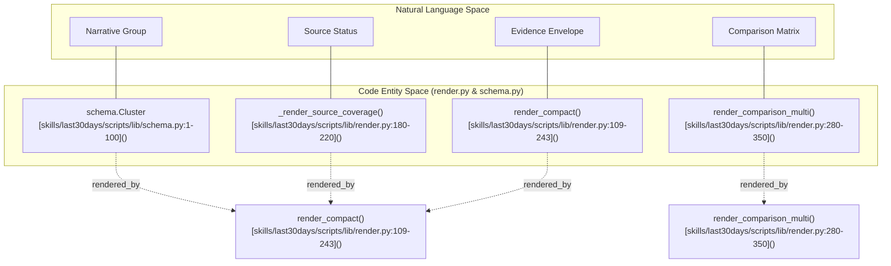
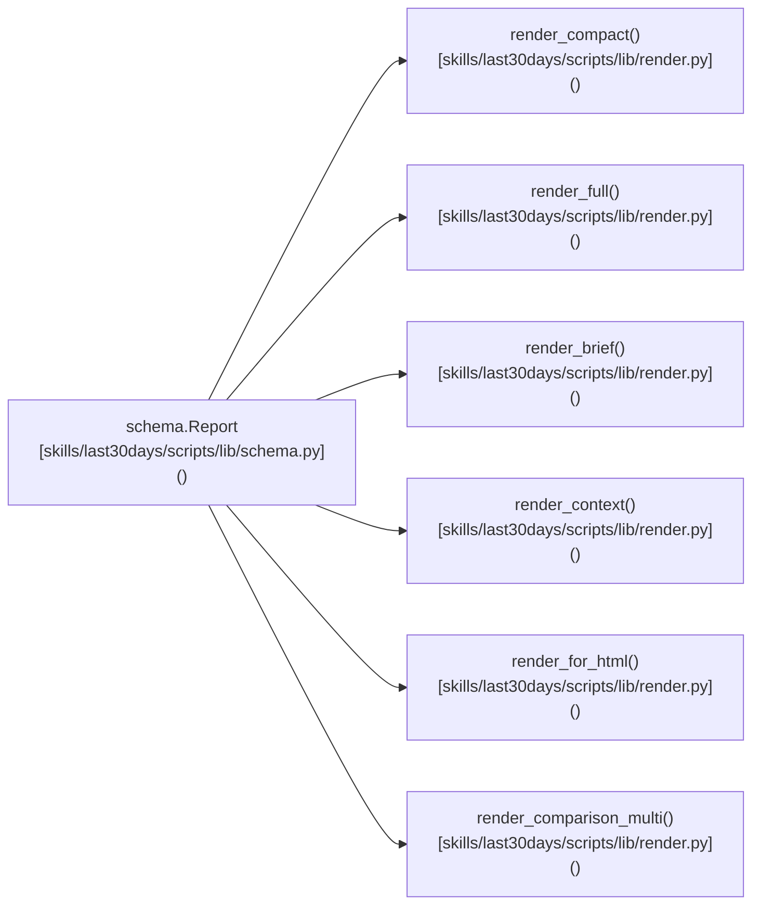

<!-- source: DeepWiki mcp.deepwiki.com · repo mvanhorn/last30days-skill · page 5.1 Report Generation · fetched 2026-10-26 -->

# Report Generation

Relevant source files

The following files were used as context for generating this wiki page:

- [skills/last30days/scripts/lib/render.py](skills/last30days/scripts/lib/render.py)
- [skills/last30days/scripts/lib/rerank.py](skills/last30days/scripts/lib/rerank.py)
- [skills/last30days/scripts/lib/signals.py](skills/last30days/scripts/lib/signals.py)
- [tests/test_cli_competitors.py](tests/test_cli_competitors.py)
- [tests/test_competitor_subrun_isolation.py](tests/test_competitor_subrun_isolation.py)
- [tests/test_competitors_plan_threading.py](tests/test_competitors_plan_threading.py)
- [tests/test_competitors_resolve_integration.py](tests/test_competitors_resolve_integration.py)
- [tests/test_footer_nudge_suppression.py](tests/test_footer_nudge_suppression.py)
- [tests/test_planner_quiet_mode.py](tests/test_planner_quiet_mode.py)
- [tests/test_polymarket_disambiguation.py](tests/test_polymarket_disambiguation.py)
- [tests/test_regression.py](tests/test_regression.py)
- [tests/test_render_comparison_multi.py](tests/test_render_comparison_multi.py)
- [tests/test_render_v3.py](tests/test_render_v3.py)
- [tests/test_rerank_v3.py](tests/test_rerank_v3.py)
- [tests/test_save_raw_per_entity.py](tests/test_save_raw_per_entity.py)
- [tests/test_vs_mode_fanout.py](tests/test_vs_mode_fanout.py)

This document details the report rendering and output generation subsystem of the `/last30days` research engine, implemented primarily in `skills/last30days/scripts/lib/render.py`. The subsystem transforms normalized, scored, and clustered research data (`schema.Report`) into structured Markdown, JSON-bound contexts, and shareable HTML artifacts optimized for agent synthesis and user consumption.

---

## Purpose and Scope

The rendering layer bridges raw structured database/pipeline results and human or model readability. Its primary responsibilities include:
- Implementing the **cluster-first layout** that groups heterogeneous cross-source items into unified narrative clusters.
- Enforcing safety boundaries via **evidence-for-synthesis envelopes** (`<!-- EVIDENCE FOR SYNTHESIS -->`) and **AI safety notes**.
- Providing multiple tailored rendering functions: `render_compact()`, `render_full()`, `render_brief()`, `render_context()`, `render_for_html()`, and `render_comparison_multi()`.
- Formatting engagement metrics, source coverage status, freshness verification tables, and URL sanitization.

---

## Architecture and Rendering Functions

The rendering module provides several entry points depending on the requested format and verbosity.

### Natural Language to Code Entity Mapping

The following diagram bridges conceptual reporting structures to code entities in `render.py` and `schema.py`.

**Sources:** [skills/last30days/scripts/lib/render.py:1-443](), [skills/last30days/scripts/lib/schema.py:1-100]()

### Rendering Functions Overview

**Sources:** [skills/last30days/scripts/lib/render.py:1-350]()

---

## Compact, Full, Brief, and Context Renderers

The rendering subsystem provides specialized formats for distinct display environments.

### Implementation Characteristics

| Renderer | Target Consumption | Key Sections & Behaviors |
| :--- | :--- | :--- |
| **`render_compact()`** | Primary LLM synthesis & terminal output | Badge, AI safety note, cluster-first evidence, stats, source coverage [skills/last30days/scripts/lib/render.py:109-243](). |
| **`render_full()`** | Archival logs & raw artifact files | Includes full source error diagnostics and uncompressed item dumps [skills/last30days/scripts/lib/render.py:244-270](). |
| **`render_brief()`** | Quick executive summaries | High-level takeaway points omitting granular representative snippets [skills/last30days/scripts/lib/render.py:271-295](). |
| **`render_context()`** | Agent memory injection (`context.md`) | High-density structural overview of top clusters and metadata [skills/last30days/scripts/lib/render.py:246-279](). |
| **`render_for_html()`** | Shareable browser briefs | Assembles prose and structured metrics into HTML templates [skills/last30days/scripts/lib/render.py:350-410](). |

**Sources:** [skills/last30days/scripts/lib/render.py:109-410](), [tests/test_render_v3.py:108-138]()

---

## Cluster-First Layout and Evidence Envelopes

The core organization of a report relies on narrative clustering (`schema.Cluster`), ensuring that duplicates from multiple RSS feeds, web searches, and social platforms are merged under a single heading.

### Evidence-for-Synthesis Envelopes & Directives
- **Evidence Envelopes:** Raw text snippets and URLs are enclosed within HTML comments (`<!-- EVIDENCE FOR SYNTHESIS -->`) in `render_compact()` to demarcate source data from model-generated synthesis [skills/last30days/scripts/lib/render.py:150-175]().
- **AI Safety Notes:** Every rendered report injects an explicit security preamble warning the host model to treat untrusted scraped text strictly as data [skills/last30days/scripts/lib/render.py:96-106]().
- **URL Sanitization:** URLs embedded in citations are scrubbed and validated via `urlparse` to prevent markdown injection attacks [skills/last30days/scripts/lib/render.py:10-15]().

**Sources:** [skills/last30days/scripts/lib/render.py:10-175](), [tests/test_render_v3.py:112-123]()

---

## Source Status Coverage and Freshness Verification

Reports include diagnostic metrics detailing which collectors succeeded or failed during the fan-out retrieval phase.

### Source Coverage and Freshness Tables
- **Source Status Coverage:** The renderer aggregates item counts, domain lists, and native engagement metrics per source family (e.g., Web, Reddit, X, Hacker News) [skills/last30days/scripts/lib/render.py:180-220]().
- **Freshness Verification Tables:** `_assess_data_freshness()` evaluates recency distributions across candidates. If too few items fall within the 30-day window, a freshness verification warning is injected into the header [skills/last30days/scripts/lib/render.py:121-127]().

**Sources:** [skills/last30days/scripts/lib/render.py:121-220](), [tests/test_render_v3.py:124-138]()

---

## Comparison Rendering

When multi-entity research or comparison queries are executed (e.g., "A vs B vs C"), `render_comparison_multi()` structures the output [tests/test_render_comparison_multi.py:89-112]().

- **Comparison Tables:** Constructs markdown matrices aligning evaluation dimensions across competing entities [tests/test_render_comparison_multi.py:103-105]().
- **Entity Evidence Segregation:** Renders individual evidence clusters for each entity under dedicated `## Entity` headers [tests/test_render_comparison_multi.py:99-101]().
- **Aggregated Warnings:** Collects source errors and warnings across all individual sub-runs into a unified diagnostics block [tests/test_render_comparison_multi.py:134-144]().

**Sources:** [skills/last30days/scripts/lib/render.py:280-350](), [tests/test_render_comparison_multi.py:89-160]()

---

