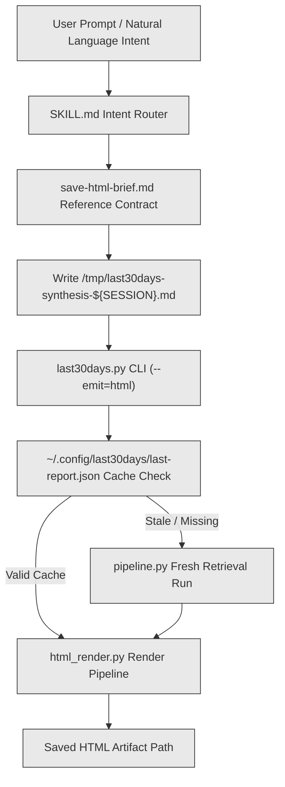
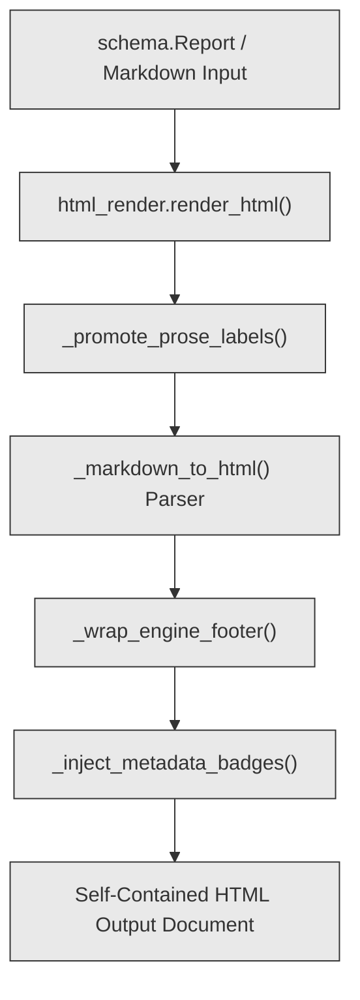
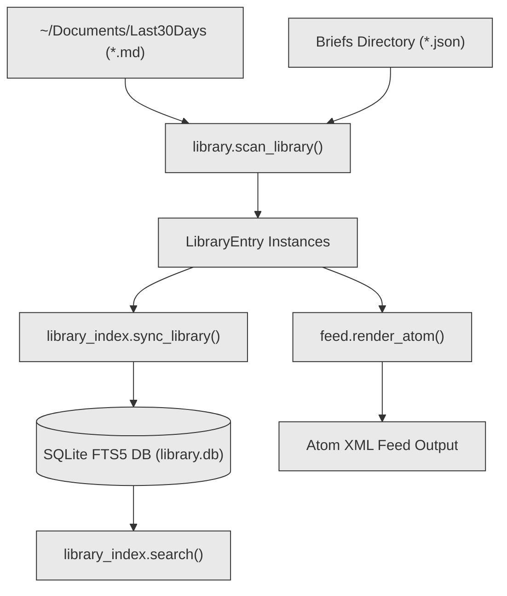

<!-- source: DeepWiki mcp.deepwiki.com · repo mvanhorn/last30days-skill · page 5.4 HTML Briefs and Library · fetched 2026-10-26 -->

# HTML Briefs and Library

<details>
<summary>Relevant source files</summary>

The following files were used as context for generating this wiki page:

- [skills/last30days/references/save-html-brief.md](skills/last30days/references/save-html-brief.md)
- [skills/last30days/scripts/lib/corpus.py](skills/last30days/scripts/lib/corpus.py)
- [skills/last30days/scripts/lib/feed.py](skills/last30days/scripts/lib/feed.py)
- [skills/last30days/scripts/lib/html_publish.py](skills/last30days/scripts/lib/html_publish.py)
- [skills/last30days/scripts/lib/html_render.py](skills/last30days/scripts/lib/html_render.py)
- [skills/last30days/scripts/lib/library.py](skills/last30days/scripts/lib/library.py)
- [skills/last30days/scripts/lib/library_index.py](skills/last30days/scripts/lib/library_index.py)
- [tests/test_doc_flag_contract.py](tests/test_doc_flag_contract.py)
- [tests/test_html_publish.py](tests/test_html_publish.py)
- [tests/test_html_render.py](tests/test_html_render.py)
- [tests/test_html_save_contract.py](tests/test_html_save_contract.py)

</details>


## Purpose and Scope
This document covers the implementation of shareable HTML report generation, the `save-html-brief` agent reference contract, hosted publishing integration (`html_publish.py`), documentation flag enforcement (`test_doc_flag_contract.py`), and the local offline library subsystem (`library.py`, `library_index.py`, `feed.py`, `corpus.py`). 

---

## 1. The `save-html-brief` Reference Contract

When users request an HTML brief—either via CLI flags like `--emit=html` or through natural language prose (e.g., "give me a shareable HTML brief", "export as HTML", "for Slack")—the skill instruction set (`SKILL.md`) delegates execution to the reference specification at `skills/last30days/references/save-html-brief.md` [skills/last30days/references/save-html-brief.md:1-3]().

### Dual-Mode Execution Contract
The contract operates in two distinct modes:
1. **HTML as the requested deliverable** (`--emit=html` or natural language intent): The HTML artifact is the primary output. The agent writes the synthesis to a temporary file, invokes the engine renderer, and provides a concise artifact handoff in chat without repeating the full Markdown report text [skills/last30days/references/save-html-brief.md:5-7]().
2. **Normal report plus HTML copy**: The standard chat response is emitted first (badge, bold lead-ins, key patterns, engine footer), and an HTML copy is saved concurrently to disk for sharing [skills/last30days/references/save-html-brief.md:8-9]().

### Temporary File and Slug Resolution
Synthesis prose is written verbatim to a session-isolated temporary file before invocation:
```bash
SYNTHESIS_FILE="/tmp/last30days-synthesis-${CLAUDE_SESSION_ID}.md"
```
[skills/last30days/references/save-html-brief.md:31-31]()

The engine derives a clean file slug from the topic string, applies a collision guard (`>|` noclobber write), and reuses cached structured data (`~/.config/last30days/last-report.json`) if within the TTL window (`LAST30DAYS_REPORT_CACHE_TTL_SECONDS`, defaulting to 3600 seconds) [skills/last30days/references/save-html-brief.md:50-73]().


*Figure 5.4.1: Natural Language Space to Code Entity Space mapping for HTML brief generation.*

Sources: `skills/last30days/references/save-html-brief.md`, `tests/test_doc_flag_contract.py`

---

## 2. HTML Rendering Engine (`html_render.py`)

The `html_render.py` module transforms markdown synthesis documents and structured `schema.Report` instances into self-contained, responsive HTML artifacts complete with embedded dark/light theme CSS [skills/last30days/scripts/lib/html_render.py:1-55]().

### Key Transformation and Sanitization Functions
* `_promote_prose_labels(markdown: str) -> str`: Converts prose headings such as `What I learned:` into styled HTML `<h2>` elements [skills/last30days/scripts/lib/html_render.py:15-18]().
* `_strip_invitation(markdown: str) -> str`: Removes trailing agent chat prompts before rendering static artifacts [skills/last30days/scripts/lib/html_render.py:20-20]().
* `_strip_evidence_block(markdown: str) -> str`: Strips internal `<!-- EVIDENCE FOR SYNTHESIS -->` debug blocks [skills/last30days/scripts/lib/html_render.py:21-21]().
* `_wrap_engine_footer(html: str) -> str`: Encapsulates pass-through footer notes into styled `.engine-footer` containers [skills/last30days/scripts/lib/html_render.py:22-22]().


*Figure 5.4.2: Data flow within `html_render.py`.*

Sources: `skills/last30days/scripts/lib/html_render.py`, `tests/test_html_render.py`

---

## 3. Hosted Publishing and Flag Contracts

### Hosted Publishing (`html_publish.py`)
Rendered HTML documents can be optionally published to a remote endpoint (defaulting to `https://api.ht-ml.app/v1/sites`) via `html_publish.py` [skills/last30days/scripts/lib/html_publish.py:1-12]().

* `publish_html(html_content, *, password, endpoint, opener, timeout)`: Posts a JSON payload containing `html_content` and an optional `password` field. Returns the provider response dictionary containing the public URL and `update_key` [skills/last30days/scripts/lib/html_publish.py:27-71]().
* `publish_html_documents(documents, ...)`: Batch publishes a mapping of named documents, short-circuiting on `HtmlPublishError` [skills/last30days/scripts/lib/html_publish.py:74-96]().

### Documentation and Flag Contracts (`test_doc_flag_contract.py`)
The test suite enforces strict alignment between the CLI parser, configuration guides, and skill documentation. Flags such as `--no-browser-cookies`, `--preflight`, `--save-dir`, `--output`, `--publish-html`, `--publish-password`, and environment variables like `LAST30DAYS_REPORT_CACHE_TTL_SECONDS` are verified against `CONFIGURATION.md` and `SKILL.md` [tests/test_doc_flag_contract.py:15-108]().

Sources: `skills/last30days/scripts/lib/html_publish.py`, `tests/test_doc_flag_contract.py`, `tests/test_html_publish.py`

---

## 4. Local Library Indexing, Search, and Feeds

The engine maintains an offline, queryable search index over saved research artifacts and local corpora using SQLite FTS5.

### Subsystem Components
* `library.py`: Scans `~/Documents/Last30Days` and brief directories, extracting metadata, dates, and headlines into deterministic `LibraryEntry` dataclass instances [skills/last30days/scripts/lib/library.py:1-68]().
* `library_index.py`: Manages the SQLite FTS5 database (`library.db`). Provides incremental synchronization (`sync_library`), single-artifact indexing (`index_brief`), and BM25-ranked full-text search (`search`, `sync_and_search`) over briefs and stored research findings [skills/last30days/scripts/lib/library_index.py:1-204]().
* `feed.py`: Renders deterministic Atom XML feeds (`render_atom`) for the research library [skills/last30days/scripts/lib/feed.py:1-53]().
* `corpus.py`: Implements a zero-network local file corpus search engine that scans registered directories for `.md`, `.txt`, and `.pdf` files (using local `pdftotext` when available) and converts matches into normalized `schema.SourceItem` objects [skills/last30days/scripts/lib/corpus.py:1-186]().


*Figure 5.4.3: Library ingestion, indexing, and feed generation workflow.*

Sources: `skills/last30days/scripts/lib/library.py`, `skills/last30days/scripts/lib/library_index.py`, `skills/last30days/scripts/lib/feed.py`, `skills/last30days/scripts/lib/corpus.py`

---

