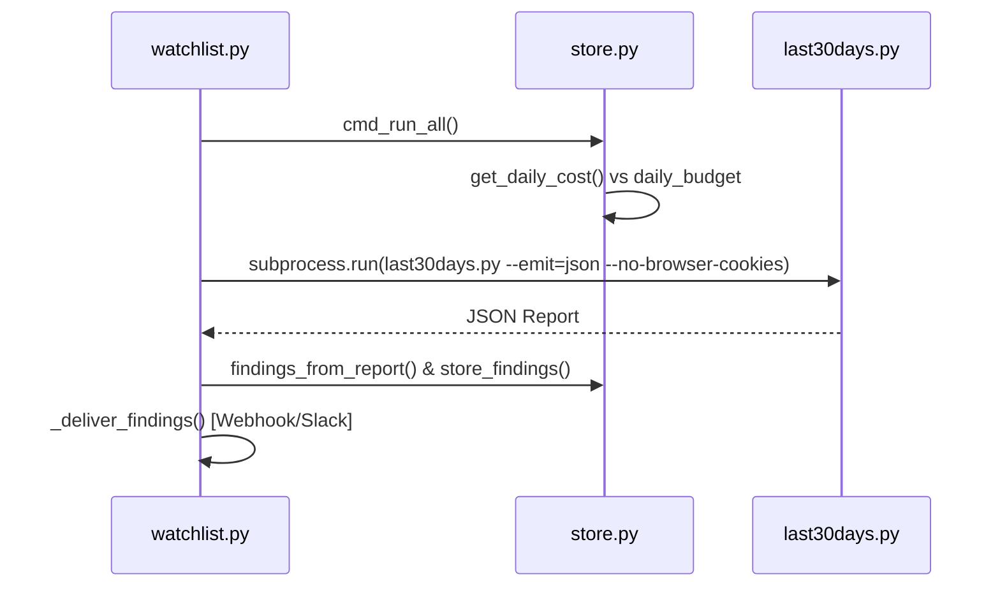
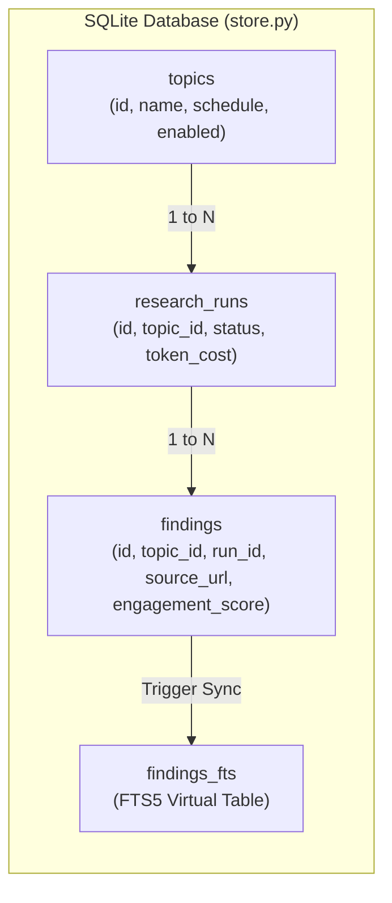

<!-- source: DeepWiki mcp.deepwiki.com · repo mvanhorn/last30days-skill · page 6 Persistence: Store, Watchlist and Briefings · fetched 2026-10-26 -->

# Persistence: Store, Watchlist and Briefings

<details>
<summary>Relevant source files</summary>

The following files were used as context for generating this wiki page:

- [skills/last30days/scripts/briefing.py](skills/last30days/scripts/briefing.py)
- [skills/last30days/scripts/lib/hackernews.py](skills/last30days/scripts/lib/hackernews.py)
- [skills/last30days/scripts/store.py](skills/last30days/scripts/store.py)
- [skills/last30days/scripts/watchlist.py](skills/last30days/scripts/watchlist.py)
- [tests/test_hackernews.py](tests/test_hackernews.py)
- [tests/test_hackernews_comment_floor.py](tests/test_hackernews_comment_floor.py)
- [tests/test_project_config_trust.py](tests/test_project_config_trust.py)
- [tests/test_security_boundaries.py](tests/test_security_boundaries.py)
- [tests/test_store.py](tests/test_store.py)
- [tests/test_tiktok.py](tests/test_tiktok.py)
- [tests/test_watchlist_commands.py](tests/test_watchlist_commands.py)
- [tests/test_watchlist_delivery.py](tests/test_watchlist_delivery.py)

</details>


The persistence layer transforms `/last30days` from a one-shot research engine into a persistent intelligence platform. By combining SQLite storage, scheduled watchlist runs, FTS5 full-text search, and automated morning briefings, the system enables continuous monitoring and historical analysis of research topics.

**Scope and Child Pages:**
This is a high-level overview page. For granular implementation details, command syntax, and configuration options, refer to the child pages:
- [Watchlist Management](#6.1) — Document `watchlist.py` CLI commands, topic scheduling, budget controls, and webhook delivery mechanisms.
- [Storage and Persistence](#6.2) — Document `store.py` schema (`topics`, `research_runs`, `findings`, `discovery_topics`), WAL mode, FTS5 search, URL deduplication, and engagement updates.
- [History and Briefings](#6.3) — Document full-text history search over stored findings and `briefing.py` daily/weekly briefing generation.

---

## 1. System Architecture and Flow

The persistence layer acts as a managed wrapper around the core research engine (`last30days.py`), capturing normalized findings into a local SQLite database (`research.db`) [skills/last30days/scripts/store.py:2-11]().

### Diagram: Natural Language to Code Entity Mapping
```mermaid
graph TB
    subgraph "Natural Language Concepts"
        TopicScheduling[""Scheduled Topic Monitoring""]
        ResearchStorage[""SQLite Research Accumulator""]
        BriefingGen[""Daily and Weekly Briefings""]
    end

    subgraph "Code Entity Space"
        WatchlistScript[""watchlist.py:cmd_run_all()""]
        StoreModule[""store.py:scoped_db() / store_findings()""]
        BriefingModule[""briefing.py:generate_daily()""]
        CorePipeline[""last30days.py:main()""]
    end

    TopicScheduling --> WatchlistScript
    ResearchStorage --> StoreModule
    BriefingGen --> BriefingModule
    WatchlistScript --> CorePipeline
    CorePipeline --> StoreModule
    StoreModule --> BriefingModule
```
**Sources:** [skills/last30days/scripts/store.py:2-11](), [skills/last30days/scripts/watchlist.py:135-168](), [skills/last30days/scripts/briefing.py:32-140]()

---

## 2. Watchlist Management

The `watchlist.py` module manages the lifecycle of watched research topics, allowing users to schedule recurring searches, check daily cost budgets, and dispatch notifications [skills/last30days/scripts/watchlist.py:1-125]().

### Watchlist Lifecycle and Execution Flow


Key features managed by `watchlist.py`:
- **Topic Lifecycle:** Add, remove, list, and run individual or batch topics [skills/last30days/scripts/watchlist.py:88-168]().
- **Budget Guards:** Verifies cumulative daily execution costs against `daily_budget` settings before spawning sub-runs [skills/last30days/scripts/watchlist.py:150-167]().
- **Webhook Delivery:** Dispatches update notifications to Slack (`hooks.slack.com`) or generic HTTPS webhooks [skills/last30days/scripts/watchlist.py:23-83]().

For detailed command usage, cron integration, and delivery settings, see [Watchlist Management](#6.1).

**Sources:** [skills/last30days/scripts/watchlist.py:23-168](), [tests/test_watchlist_commands.py:41-176]()

---

## 3. Storage and Persistence

All research findings, run metadata, and topic definitions are persisted in a local SQLite database (`~/.local/share/last30days/research.db`) [skills/last30days/scripts/store.py:10-131]().

### Database Schema Entity Relationship


Key architectural aspects of `store.py`:
- **WAL Mode:** Write-Ahead Logging is enabled (`journal_mode=WAL`) to allow safe concurrent access between cron jobs and manual CLI queries [skills/last30days/scripts/store.py:5-8]().
- **URL Deduplication:** Enforces a `UNIQUE` constraint on `source_url`. Re-sighted URLs update engagement scores and sighting counts rather than duplicating rows [skills/last30days/scripts/store.py:7-8, 120]().
- **FTS5 Full-Text Search:** Virtual table `findings_fts` with `porter unicode61` tokenization indexes content, summaries, titles, and authors [skills/last30days/scripts/store.py:6, 137-142]().

For a complete schema breakdown, migration strategies, and persistence flows, see [Storage and Persistence](#6.2).

**Sources:** [skills/last30days/scripts/store.py:5-142](), [tests/test_store.py:185-195]()

---

## 4. History and Briefings

The briefing layer (`briefing.py`) consumes accumulated findings from SQLite to generate structured daily briefings and weekly trend digests [skills/last30days/scripts/briefing.py:1-196]().

- **Daily Briefing Data (`generate_daily`):** Aggregates new findings per enabled topic since the previous day, tracks run freshness and staleness (threshold > 36 hours), and surfaces top-engagement items [skills/last30days/scripts/briefing.py:32-139]().
- **Weekly Digests (`generate_weekly`):** Compares week-over-week engagement changes and finding counts across topics to highlight emerging trends [skills/last30days/scripts/briefing.py:142-196]().
- **History Queries:** Leverages FTS5 indices to perform full-text historical lookups across stored research findings.

For further details on historical search syntax and briefing structures, see [History and Briefings](#6.3).

**Sources:** [skills/last30days/scripts/briefing.py:32-196]()

---

