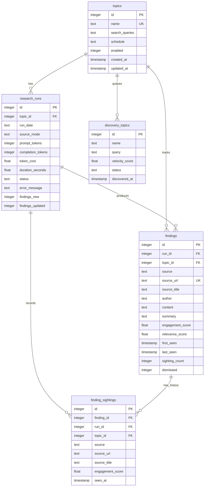
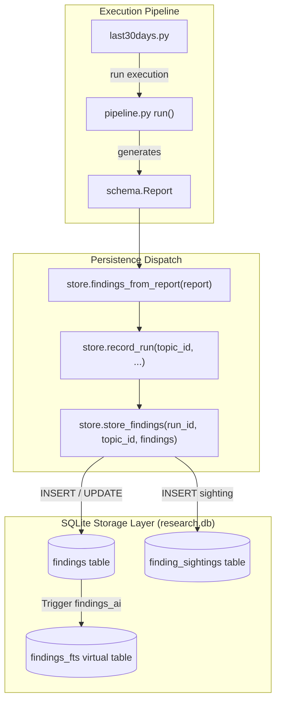

<!-- source: DeepWiki mcp.deepwiki.com · repo mvanhorn/last30days-skill · page 6.2 Storage and Persistence · fetched 2026-10-26 -->

# Storage and Persistence

Relevant source files

The following files were used as context for generating this wiki page:

- [CONCEPTS.md](CONCEPTS.md)
- [docs/solutions/architecture-patterns/discovery-checkpoint-protocol-design-conventions.md](docs/solutions/architecture-patterns/discovery-checkpoint-protocol-design-conventions.md)
- [docs/solutions/architecture-patterns/discovery-topic-queue-design-conventions.md](docs/solutions/architecture-patterns/discovery-topic-queue-design-conventions.md)
- [docs/solutions/conventions/argparse-optional-value-flag-dispatch-truthiness.md](docs/solutions/conventions/argparse-optional-value-flag-dispatch-truthiness.md)
- [docs/solutions/design-patterns/ranked-output-confidence-floor-honest-empty-state.md](docs/solutions/design-patterns/ranked-output-confidence-floor-honest-empty-state.md)
- [docs/solutions/logic-errors/fusion-source-item-dedupe-by-stream-local-id-drops-enrichment.md](docs/solutions/logic-errors/fusion-source-item-dedupe-by-stream-local-id-drops-enrichment.md)
- [docs/solutions/logic-errors/non-daemon-executor-threads-defeat-wall-clock-budget.md](docs/solutions/logic-errors/non-daemon-executor-threads-defeat-wall-clock-budget.md)
- [skills/last30days/scripts/store.py](skills/last30days/scripts/store.py)
- [skills/last30days/scripts/watchlist.py](skills/last30days/scripts/watchlist.py)
- [tests/test_project_config_trust.py](tests/test_project_config_trust.py)
- [tests/test_security_boundaries.py](tests/test_security_boundaries.py)
- [tests/test_store.py](tests/test_store.py)
- [tests/test_tiktok.py](tests/test_tiktok.py)
- [tests/test_watchlist_commands.py](tests/test_watchlist_commands.py)
- [tests/test_watchlist_delivery.py](tests/test_watchlist_delivery.py)

**Purpose and Scope:** This page documents the SQLite-based persistence layer implemented in `skills/last30days/scripts/store.py`, which acts as the research accumulator for the engine [skills/last30days/scripts/store.py:1-12](). It covers the underlying database schema (`topics`, `research_runs`, `findings`, `discovery_topics`, `finding_sightings`), Write-Ahead Logging (WAL) mode for concurrency, FTS5 full-text search indexing, URL-based deduplication with engagement metric updates, lightweight schema migrations, and the `--store persist_report` execution flow.

---

## Database Schema

The persistence layer relies on a SQLite database located at `~/.local/share/last30days/research.db` [skills/last30days/scripts/store.py:10-30](). The database is initialized and hardened to owner-only permissions (`0o600`) via `ensure_private_db_files()` [skills/last30days/scripts/store.py:60-76]().

### Entity Relationship Diagram (Code Entity Space)

**Sources:** [skills/last30days/scripts/store.py:89-213]()

---

## Implementation Details

### Concurrency and WAL Mode
To support concurrent access between automated cron tasks (such as `watchlist.py`) and user-facing interactive queries, the database enforces Write-Ahead Logging (WAL) mode [skills/last30days/scripts/store.py:4-11](). 
* Pragmas applied at connection time include `PRAGMA journal_mode=WAL`, `PRAGMA synchronous=NORMAL`, and `PRAGMA cache_size=-64000` [skills/last30days/scripts/store.py:80-82]().

### Full-Text Search (FTS5)
The system creates a virtual FTS5 table `findings_fts` tokenized with `porter unicode61` indexing `content`, `summary`, `source_title`, and `author` [skills/last30days/scripts/store.py:137-142](). SQLite triggers (`findings_ai`, `findings_ad`, `findings_au`) automatically maintain synchronization between the primary `findings` table and the `findings_fts` search index across `INSERT`, `DELETE`, and `UPDATE` events [skills/last30days/scripts/store.py:144-159]().

### Key Functions and Modules

| Function / Symbol | Code Path | Role |
| :--- | :--- | :--- |
| `scoped_db()` | [skills/last30days/scripts/store.py:41-58]() | Context manager redirecting store access to a custom path (e.g., `--save-dir`) to prevent bleeding records into the shared `research.db`. |
| `ensure_private_db_files()` | [skills/last30days/scripts/store.py:60-76]() | Provisions database directories and enforces `0o600` file permissions on `.db`, `-wal`, and `-shm` sidecars. |
| `init_db()` | [skills/last30days/scripts/store.py:199-235]() | Establishes the database, applies `SCHEMA_V1`, seeds default settings, and executes pending migrations. |
| `store_findings()` | [skills/last30days/scripts/store.py:440-520]() | Bulk writes findings from a research run, enforcing URL deduplication and updating sighting counters. |
| `findings_from_report()` | [skills/last30days/scripts/store.py:401-438]() | Transforms a canonical `schema.Report` object into dictionary records ready for persistence. |

**Sources:** [skills/last30days/scripts/store.py:41-235](), [skills/last30days/scripts/store.py:401-520]()

---

## Data Flow: Persistence and `--store persist_report` Flow

When research completes, findings and execution telemetry are recorded. If the `--store` or equivalent persistence flag is passed during the execution flow, `store_findings()` and `record_run()` commit the output into SQLite.

**Sources:** [skills/last30days/scripts/store.py:311-326](), [skills/last30days/scripts/store.py:401-520](), [skills/last30days/scripts/watchlist.py:170-203]()

---

## Deduplication and Engagement Updates

Findings are deduplicated across research runs using a `UNIQUE` constraint on the `source_url` field within the `findings` table [skills/last30days/scripts/store.py:120]().

### Re-sighting Lifecycle
1. **URL Collision Check:** When `store_findings()` encounters an incoming item matching an existing `source_url` for the topic, it skips creating a new finding entity [skills/last30days/scripts/store.py:476-482]().
2. **Engagement & Counter Refresh:** The existing record increments its `sighting_count`, updates `last_seen` to the current timestamp, and absorbs the latest `engagement_score` [skills/last30days/scripts/store.py:483-488]().
3. **Sighting Audit Trail:** Every individual encounter is logged in the `finding_sightings` historical table, enabling calculation of topic deltas and trend tracking via `compute_topic_delta()` [skills/last30days/scripts/store.py:206-213](), [skills/last30days/scripts/store.py:504-516]().

**Sources:** [skills/last30days/scripts/store.py:120-131](), [skills/last30days/scripts/store.py:440-516]()

---

## Schema Migrations

To support updates without external dependencies, `store.py` includes an embedded migration system governed by the `schema_version` table [skills/last30days/scripts/store.py:8-87]().

* **Version Tracking:** The database queries `schema_version` to determine the highest applied version integer [skills/last30days/scripts/store.py:216-225]().
* **Migration Dispatch:** Unapplied migration scripts defined in the `MIGRATIONS` dictionary are executed sequentially [skills/last30days/scripts/store.py:204-234]().
* **Historical Schema Updates:** For instance, Migration 2 introduced the `finding_sightings` table to decouple historical sighting records from the primary deduplicated `findings` table [skills/last30days/scripts/store.py:205-213]().

**Sources:** [skills/last30days/scripts/store.py:8-11](), [skills/last30days/scripts/store.py:204-234]()

---

