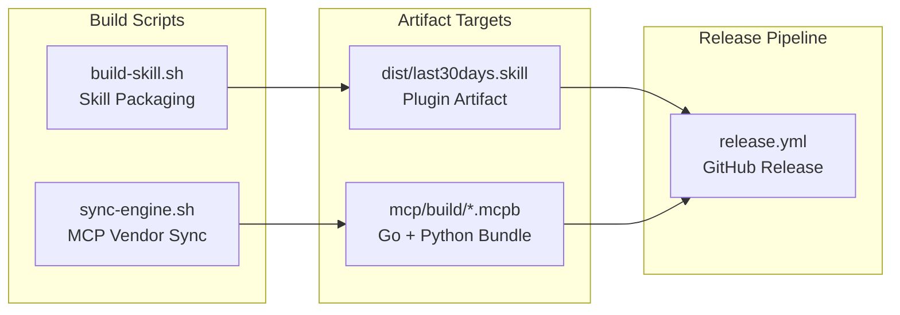
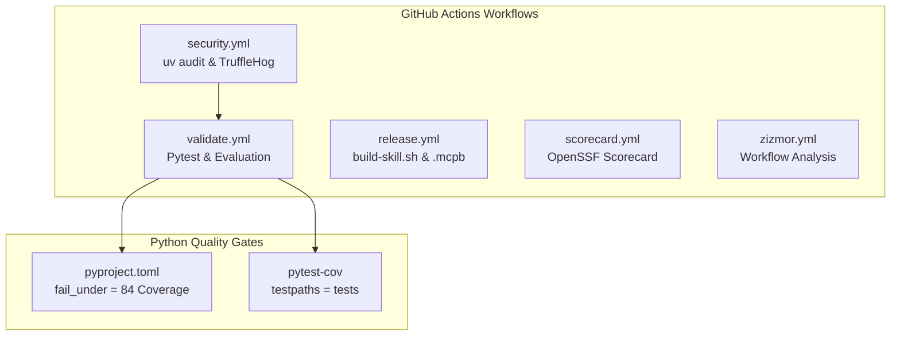

<!-- source: DeepWiki mcp.deepwiki.com · repo mvanhorn/last30days-skill · page 7 Development and Deployment · fetched 2026-10-26 -->

# Development and Deployment

Relevant source files

The following files were used as context for generating this wiki page:

- [.github/ISSUE_TEMPLATE/bug_report.yml](.github/ISSUE_TEMPLATE/bug_report.yml)
- [.github/ISSUE_TEMPLATE/feature_request.yml](.github/ISSUE_TEMPLATE/feature_request.yml)
- [.github/PULL_REQUEST_TEMPLATE.md](.github/PULL_REQUEST_TEMPLATE.md)
- [.github/copilot-instructions.md](.github/copilot-instructions.md)
- [.github/dependabot.yml](.github/dependabot.yml)
- [.github/workflows/release.yml](.github/workflows/release.yml)
- [.github/workflows/scorecard.yml](.github/workflows/scorecard.yml)
- [.github/workflows/security.yml](.github/workflows/security.yml)
- [.github/workflows/validate.yml](.github/workflows/validate.yml)
- [.github/workflows/zizmor.yml](.github/workflows/zizmor.yml)
- [CONTRIBUTING.md](CONTRIBUTING.md)
- [pyproject.toml](pyproject.toml)
- [tests/test_scorecard_workflow.py](tests/test_scorecard_workflow.py)
- [tests/test_security_workflow.py](tests/test_security_workflow.py)
- [uv.lock](uv.lock)

This page provides an overview of the development, packaging, testing, CI/CD, and diagnostics infrastructure for contributors and maintainers of the `/last30days` research skill. The project requires **Python 3.12+** [pyproject.toml:6-6]() and relies on `uv` for dependency and environment management [uv.lock:1-48]().

As a PARENT page, this document outlines high-level workflows and links to specialized child pages for deep technical details.

## Installation and Setup

The development environment setup covers multi-host plugin installation (Claude Code, Codex, Grok, Gemini CLI, manual git clones, and Hermes/OpenClaw), API key and token configuration, first-run setup wizards, and GitHub device authentication flows. 

For comprehensive instructions on setting up your local workspace, configuring environmental variables, and handling session hooks, see [Installation and Setup](#7.1).

Sources: [pyproject.toml:1-8](), [.github/ISSUE_TEMPLATE/bug_report.yml:37-48]()

## Packaging: Plugin Manifests and MCP Server

The project packages its research capabilities into distribution artifacts for various AI coding assistants and desktop applications. This includes marketplace manifests (`.claude-plugin`, `.codex-plugin`, `.grok-plugin`, `.agents`, `gemini-extension.json`), engine packaging via `build-skill.sh` producing `dist/last30days.skill`, `skillignore` exclusion rules, and the Go-based Model Context Protocol (MCP) server located in `mcp/` which bundles the Python engine into a distributable `.mcpb` archive.

Title: Packaging Artifact Flow and Execution Targets

Sources: [.github/workflows/release.yml:26-142]()

For full details on manifest schemas, archive construction, and binary cross-compilation, see [Packaging: Plugin Manifests and MCP Server](#7.2).

## Testing and Quality Evaluation

The testing framework utilizes `pytest` with a defined test layout, conftest fixtures, and a mandatory test coverage gate (`fail_under = 84`) configured in `pyproject.toml` [pyproject.toml:56-83](). In addition to unit tests, the suite contains contract tests (plugin, documentation, security, and version consistency) and the `evaluate_search_quality.py` evaluation harness with dedicated fixtures under `tests/eval`.

For details on running evaluation harnesses, verification scripts, and test suite structures, see [Testing and Quality Evaluation](#7.3).

Sources: [pyproject.toml:56-83](), [.github/workflows/validate.yml:1-49]()

## CI/CD and Security Workflows

Continuous Integration and deployment are orchestrated through GitHub Actions workflows. These workflows enforce validation checks, security auditing (`uv audit --locked`), credential scanning (TruffleHog OSS), static analysis (Semgrep), supply-chain scoring (OpenSSF Scorecard), workflow inspection (`zizmor`), and vulnerability scanning (`osv-scanner`). Release automation handles version tagging, changelog generation via Towncrier fragments (`changelog.d/`), and cryptographic provenance attestation for `.skill` and `.mcpb` deliverables.

Title: CI/CD Pipeline and Code Entity Mapping

Sources: [pyproject.toml:56-83](), [.github/workflows/validate.yml:1-30](), [.github/workflows/security.yml:1-89](), [.github/workflows/scorecard.yml:1-69](), [.github/workflows/zizmor.yml:1-23]()

For details on workflow triggers, security scanning jobs, and release mechanics, see [CI/CD and Security Workflows](#7.4).

## Diagnostics and Health Checks

The codebase includes self-diagnostic routines (`doctor.py`) featuring tier rollups, four-state configuration audits, permission preflight checks (`permission_preflight`), operational probes (`health.py`), source outcome taxonomies, and run evidence overlays. 

For instructions on executing diagnostic probes and interpreting health reports, see [Diagnostics and Health Checks](#7.5).

Sources: [pyproject.toml:1-8]()

---

### Child Pages
- [Installation and Setup](#7.1)
- [Packaging: Plugin Manifests and MCP Server](#7.2)
- [Testing and Quality Evaluation](#7.3)
- [CI/CD and Security Workflows](#7.4)
- [Diagnostics and Health Checks](#7.5)

---

