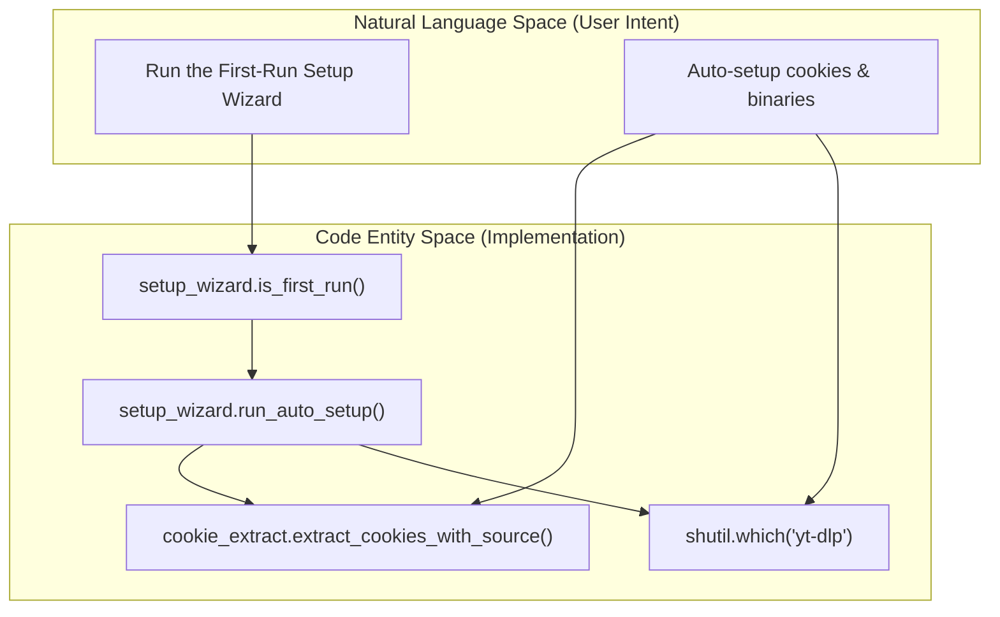
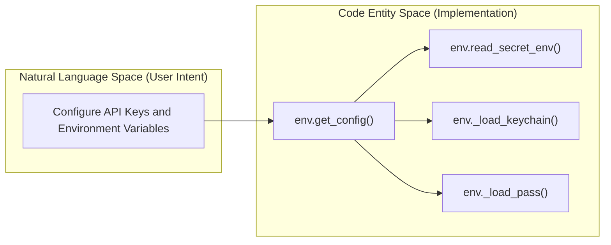

<!-- source: DeepWiki mcp.deepwiki.com · repo mvanhorn/last30days-skill · page 7.1 Installation and Setup · fetched 2026-10-26 -->

# Installation and Setup

<details>
<summary>Relevant source files</summary>

The following files were used as context for generating this wiki page:

- [AGENTS.md](AGENTS.md)
- [CONFIGURATION.md](CONFIGURATION.md)
- [HERMES_SETUP.md](HERMES_SETUP.md)
- [README.de.md](README.de.md)
- [README.es.md](README.es.md)
- [README.fr.md](README.fr.md)
- [README.ja.md](README.ja.md)
- [README.md](README.md)
- [README.pt-BR.md](README.pt-BR.md)
- [README.zh-CN.md](README.zh-CN.md)
- [changelog.d/+hermes-setup-install-path.fixed.md](changelog.d/+hermes-setup-install-path.fixed.md)
- [changelog.d/882.fixed.md](changelog.d/882.fixed.md)
- [changelog.d/953.fixed.md](changelog.d/953.fixed.md)
- [docs/solutions/integration-issues/digg-cli-agent-path-setup-wizard.md](docs/solutions/integration-issues/digg-cli-agent-path-setup-wizard.md)
- [hooks/hooks.json](hooks/hooks.json)
- [skills/last30days/scripts/lib/env.py](skills/last30days/scripts/lib/env.py)
- [skills/last30days/scripts/lib/setup_wizard.py](skills/last30days/scripts/lib/setup_wizard.py)
- [tests/test_github_device_auth.py](tests/test_github_device_auth.py)
- [tests/test_github_qualifier_only.py](tests/test_github_qualifier_only.py)
- [tests/test_onboarding_contract.py](tests/test_onboarding_contract.py)
- [tests/test_setup_openclaw.py](tests/test_setup_openclaw.py)
- [tests/test_setup_wizard.py](tests/test_setup_wizard.py)
- [tests/test_setup_wizard_pp_sources.py](tests/test_setup_wizard_pp_sources.py)
- [tests/test_version_consistency.py](tests/test_version_consistency.py)
- [tests/test_welcome.py](tests/test_welcome.py)

</details>


This page covers the technical installation paths, prerequisite requirements, the first-run setup wizard and onboarding flows, configuration precedence, credential storage integration (Keychain and `pass`), and session-start hooks for the `/last30days` skill.

Sources: `[README.md:27-41]`, `[AGENTS.md:44-45]`, `[skills/last30days/scripts/lib/setup_wizard.py:1-6]`, `[skills/last30days/scripts/lib/env.py:1-89]()`

---

## Prerequisites and Python Requirement

The `/last30days` engine relies on Python 3.12+ for modern typing, pattern matching, and standard library features. 

| Component | Minimum Version / Requirement | Role |
|-----------|-------------------------------|------|
| **Python** | `3.12+` | Core execution environment for `scripts/last30days.py` and modules under `scripts/lib/` |
| **Node.js / npm** | `22+` | Required for `npx skills` installation workflows and client wrappers |
| **yt-dlp** | Latest stable via `brew` or `pip` | YouTube search, metadata fetching, and audio transcript extraction |
| **Digg CLI / Printing Press** | `digg-pp-cli` via PATH | Zero-config social feeds and AI 1000 cluster extraction |

Sources: `[AGENTS.md:44-45]`, `[skills/last30days/scripts/lib/setup_wizard.py:38-45]()`

---

## Installation Paths

The skill supports multiple host integrations depending on the environment and agent harness in use.

### Claude Code Plugin
Claude Code uses the marketplace plugin system for automatic updates and dependency resolution:
```bash
/plugin marketplace add mvanhorn/last30days-skill
/plugin install last30days
```

### Agent Skills Host (Codex, Cursor, Copilot, Gemini CLI)
Universal agent hosts running the Agent Skills protocol use `npx`:
```bash
npx skills add mvanhorn/last30days-skill -g
```
*(The `-g` flag installs the skill globally for your user across all projects; omit it for local scoping).*

### Hermes / OpenClaw
Hermes and OpenClaw environments install via command-line flags or package links:
```bash
hermes skills install mvanhorn/last30days-skill --force
```

### Manual Clone and Developer Mode
For local engine modifications and live-edit propagation, clone the repository and establish a symbolic link into your global agent skill directory:
```bash
git clone https://github.com/mvanhorn/last30days-skill.git
ln -sfn "$PWD/skills/last30days" ~/.agents/skills/last30days
```

Sources: `[README.md:27-41]`, `[AGENTS.md:56-58]`

---

## Setup Wizard and Onboarding Flows

When the skill is invoked for the first time, the runtime checks configuration completeness via `is_first_run(config)` in `setup_wizard.py`. If configuration is incomplete, the setup wizard triggers.

### Diagram: Setup Wizard Execution

Sources: `[skills/last30days/scripts/lib/setup_wizard.py:25-31]`, `[skills/last30days/scripts/lib/setup_wizard.py:70-136]()`

### First-Run Branches in SKILL.md
The runtime prompt contract defines three distinct onboarding branches depending on host capabilities:
1. **Claude Code Modal Flow:** Uses interactive modal prompts (`AskUserQuestion`) to guide the user through credential choices, browser cookie extraction consent, and optional tool installs.
2. **Non-Modal Prose Flow:** Used by hosts lacking modal support (Codex, Cursor, Gemini CLI, OpenClaw). Presents text prompts and instructs the user on command-line setup.
3. **Grok Bot Prose Flow:** Streamlined flow for xAI Grok Bot environments, leading with X connector lanes and key-based setup without reading local browser cookies.

Sources: `[tests/test_onboarding_contract.py:1-12]`, `[skills/last30days/scripts/lib/setup_wizard.py:70-108]()`

---

## Configuration and API Key Priority Resolution

Configuration loading and environment variables are handled by `env.py`. The function `get_config()` merges values according to a strict precedence order.

### Diagram: Credential and Configuration Data Flow

Sources: `[skills/last30days/scripts/lib/env.py:16-25]`, `[skills/last30days/scripts/lib/env.py:65-82]()`

### Configuration Search Paths and Precedence
Configuration files are resolved from two primary locations:
1. **Project-scoped `.env`:** Located at `.claude/last30days.env` when permitted by policy.
2. **Global `.env`:** Located at `~/.config/last30days/.env`.

Secret keys are resolved in order:
1. **Process Environment Variables:** Direct lookup via `os.environ`.
2. **Environment File:** Variables loaded from `.env`.
3. **Secret Store Integration:** macOS Keychain (`last30days-<KEY>`) on Darwin systems, or `pass(1)` (`last30days/<KEY>`) on Unix/Linux systems.

Sources: `[skills/last30days/scripts/lib/env.py:32-82]`, `[CONFIGURATION.md:30-40]()`

---

## Session-Start Hook and Diagnostics

Before executing research pipelines, hooks ensure directories and permissions are correctly initialized.

### Memory Directory Setup
The memory directory defaults to `~/Documents/Last30Days/` and can be overridden via `LAST30DAYS_MEMORY_DIR`. Session-start hooks guarantee the directory exists:
```bash
mkdir -p "${LAST30DAYS_MEMORY_DIR:-$HOME/Documents/Last30Days}" 2>/dev/null || true
```

### Diagnostic Checks
To verify the complete installation, environment variables, tool binary paths (`yt-dlp`, `digg-pp-cli`), and active source handlers, invoke the health check:
```bash
python3 skills/last30days/scripts/last30days.py --diagnose
```

Sources: `[CONFIGURATION.md:22-40]`, `[hooks/hooks.json]()`

---

