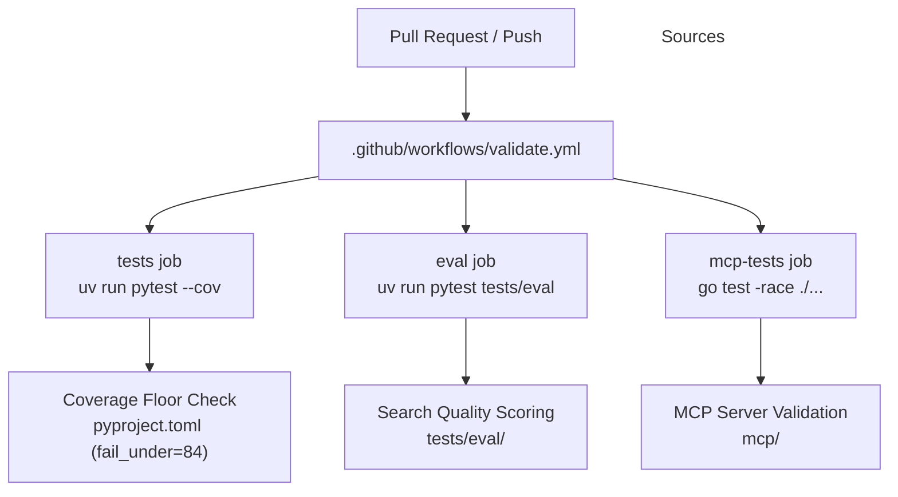
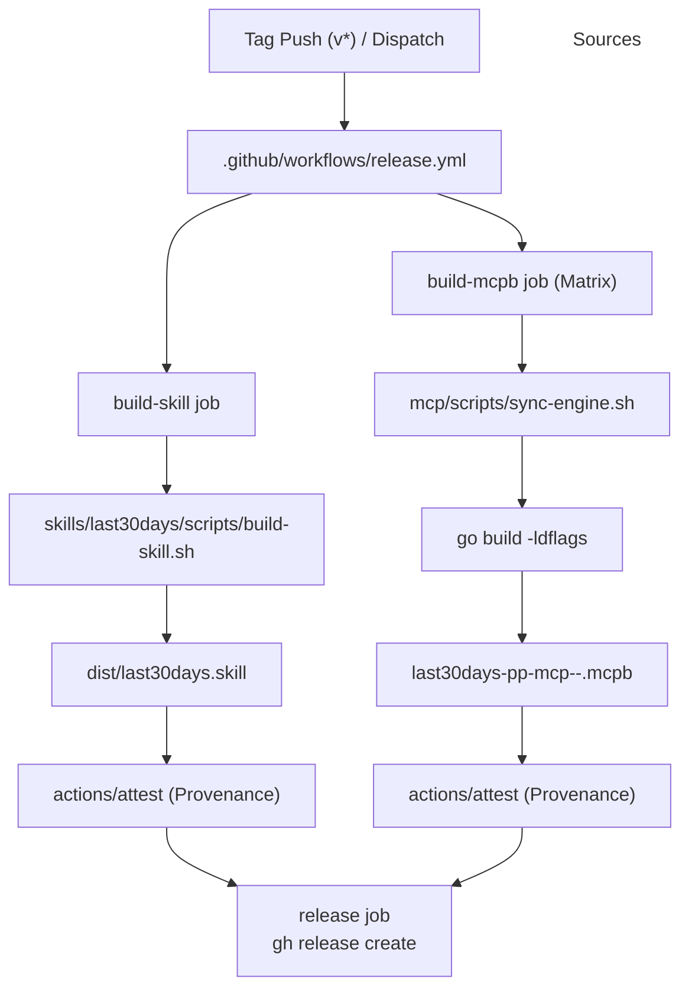
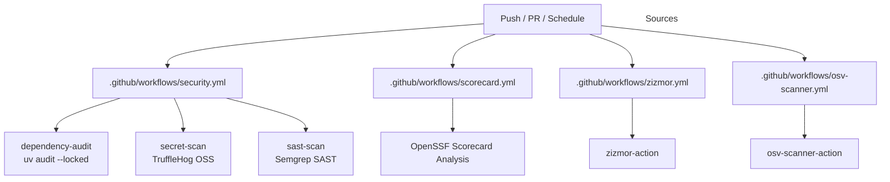
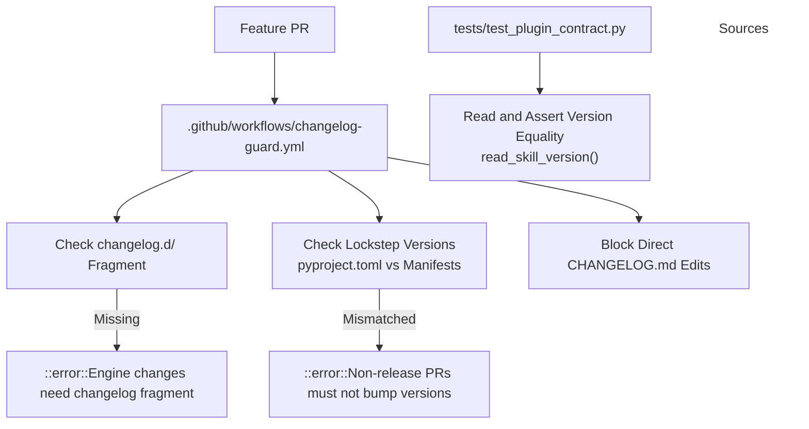

<!-- source: DeepWiki mcp.deepwiki.com · repo mvanhorn/last30days-skill · page 7.4 CI/CD and Security Workflows · fetched 2026-10-26 -->

# CI/CD and Security Workflows

Relevant source files

The following files were used as context for generating this wiki page:

- [.github/ISSUE_TEMPLATE/bug_report.yml](.github/ISSUE_TEMPLATE/bug_report.yml)
- [.github/ISSUE_TEMPLATE/feature_request.yml](.github/ISSUE_TEMPLATE/feature_request.yml)
- [.github/PULL_REQUEST_TEMPLATE.md](.github/PULL_REQUEST_TEMPLATE.md)
- [.github/copilot-instructions.md](.github/copilot-instructions.md)
- [.github/dependabot.yml](.github/dependabot.yml)
- [.github/scripts/prepare_release.py](.github/scripts/prepare_release.py)
- [.github/scripts/read_manifest_version.py](.github/scripts/read_manifest_version.py)
- [.github/workflows/changelog-guard.yml](.github/workflows/changelog-guard.yml)
- [.github/workflows/osv-scanner.yml](.github/workflows/osv-scanner.yml)
- [.github/workflows/prepare-release.yml](.github/workflows/prepare-release.yml)
- [.github/workflows/release.yml](.github/workflows/release.yml)
- [.github/workflows/scorecard.yml](.github/workflows/scorecard.yml)
- [.github/workflows/security.yml](.github/workflows/security.yml)
- [.github/workflows/tag-release.yml](.github/workflows/tag-release.yml)
- [.github/workflows/validate.yml](.github/workflows/validate.yml)
- [.github/workflows/zizmor.yml](.github/workflows/zizmor.yml)
- [CONTRIBUTING.md](CONTRIBUTING.md)
- [changelog.d/+mcp-manifest-version-lockstep.fixed.md](changelog.d/+mcp-manifest-version-lockstep.fixed.md)
- [pyproject.toml](pyproject.toml)
- [tests/test_changelog_workflow.py](tests/test_changelog_workflow.py)
- [tests/test_plugin_contract.py](tests/test_plugin_contract.py)
- [tests/test_scorecard_workflow.py](tests/test_scorecard_workflow.py)
- [tests/test_security_workflow.py](tests/test_security_workflow.py)
- [uv.lock](uv.lock)

## Purpose and Scope

This document details the continuous integration, continuous delivery (CI/CD), supply chain security, and change management workflows implemented via GitHub Actions for the `last30days-skill` repository. The infrastructure enforces strict quality gates, automated test suites, software bill of materials (SBOM) provenance attestations, vulnerability scanning, static application security testing (SAST), and lockstep version control across Python and Go runtimes.

Sources: [.github/workflows/validate.yml:1-68](), [.github/workflows/release.yml:1-176](), [.github/workflows/security.yml:1-89]()

---

## Continuous Integration and Validation

Validation workflows execute on every pull request and push to the `main` branch to guarantee codebase integrity before changes merge [.github/workflows/validate.yml:1-8](). The primary validation pipeline defined in `validate.yml` is split into three parallel jobs:

1. **Tests Job**: Sets up Python 3.12 via `uv`, runs the full `pytest` suite with branch coverage tracking, and enforces the coverage threshold [.github/workflows/validate.yml:12-30](). Coverage is configured in `pyproject.toml` with a pinned minimum floor (`fail_under = 84`) [pyproject.toml:64-79]().
2. **Eval Job**: Executes domain-specific search quality evaluations under `tests/eval` using `pytest` to score multi-source retrieval relevance [.github/workflows/validate.yml:31-49]().
3. **MCP-Tests Job**: Configures Go and executes race-enabled tests (`go test -race ./...`) for the Go-based Model Context Protocol (MCP) server located in `mcp/` [.github/workflows/validate.yml:50-68]().

Sources: [.github/workflows/validate.yml:1-68](), [pyproject.toml:56-83]()

---

## Release Automation and Supply Chain Provenance

Releasing new versions is triggered either by pushing a `v*` tag or via manual workflow dispatch in `.github/workflows/release.yml` [.github/workflows/release.yml:1-15](). The release architecture builds two distribution artifacts simultaneously, generates cryptographic provenance attestations, and publishes them to GitHub Releases.

### Artifact Construction
* **`build-skill` Job**: Checks out the release tag, executes `skills/last30days/scripts/build-skill.sh` to package the canonical `.skill` archive for Claude Code, Codex, and Cursor integration, and creates a cryptographic artifact attestation using `actions/attest` [.github/workflows/release.yml:22-55]().
* **`build-mcpb` Job**: Runs a matrix across target platforms (`darwin/arm64`, `darwin/amd64`, `linux/amd64`) [.github/workflows/release.yml:59-76](). It sets up Go, synchronizes the Python engine using `mcp/scripts/sync-engine.sh`, compiles the Go MCP binary with injected version metadata (`-ldflags "-X main.Version=${RELEASE_VERSION}"`), bundles a valid `.mcpb` ZIP archive containing `manifest.json` and `bin/last30days-pp-mcp`, and signs the output with `actions/attest` [.github/workflows/release.yml:78-142]().
* **`release` Job**: Downloads all verified artifacts and invokes `gh release create` to publish the GitHub release with auto-generated notes [.github/workflows/release.yml:143-176]().

Sources: [.github/workflows/release.yml:1-176]()

---

## Security Scanning and Vulnerability Management

Security enforcement relies on dedicated GitHub Actions workflows that continuously audit dependencies, check for exposed secrets, perform static analysis, and monitor security health metrics.

### Dependency Audit and Review
Defined in `security.yml`, the `dependency-audit` job runs `uv audit --locked` against `uv.lock` to block known vulnerabilities in locked Python dependencies [.github/workflows/security.yml:13-30](). On pull requests, `dependency-review` inspects incoming dependency modifications [.github/workflows/security.yml:31-45]().

### Secret Scanning
The `secret-scan` job checks out full repository history (`fetch-depth: 0`) and runs TruffleHog OSS (`trufflesecurity/trufflehog`) restricted to verified findings (`--results=verified`) to prevent API key and credential leakage [.github/workflows/security.yml:46-66]().

### Static Application Security Testing (SAST)
The `sast-scan` job runs Semgrep within an isolated container image (`semgrep/semgrep`) utilizing the `auto` rule set across Python, shell, YAML, JavaScript, and Go codebases [.github/workflows/security.yml:67-89](). It operates in an advisory-first capacity (`continue-on-error: true`) with metrics disabled (`SEMGREP_SEND_METRICS: off`) [.github/workflows/security.yml:85-89]().

### OpenSSF Scorecard and Zizmor
* **Scorecard**: `.github/workflows/scorecard.yml` runs weekly on Mondays at 07:00 UTC and on `main` branch pushes to track repository security-health drift (branch protection, pinned actions, token permissions), uploading results as SARIF [.github/workflows/scorecard.yml:1-69]().
* **Zizmor**: `.github/workflows/zizmor.yml` analyzes GitHub Actions workflow security configurations for misconfigurations and injection vulnerabilities [.github/workflows/zizmor.yml:1-23]().
* **OSV-Scanner**: `.github/workflows/osv-scanner.yml` runs weekly on Mondays at 12:30 UTC to scan `uv.lock` and `mcp/go.sum` for newly disclosed CVEs [.github/workflows/osv-scanner.yml:1-32]().

Sources: [.github/workflows/security.yml:1-89](), [.github/workflows/scorecard.yml:1-69](), [.github/workflows/zizmor.yml:1-23](), [.github/workflows/osv-scanner.yml:1-32]()

---

## Changelog and Version Lockstep Enforcement

Repository hygiene and release notes generation are strictly governed by Towncrier changelog fragments and automated guard workflows.

### Towncrier Configuration
Changelog management is configured in `pyproject.toml` under `[tool.towncrier]` [pyproject.toml:17-55](). Fragments are stored in `changelog.d/` across six categories: `security`, `removed`, `deprecated`, `added`, `changed`, and `fixed` [pyproject.toml:26-55](). `CHANGELOG.md` is anchored by the start marker `<!-- towncrier release notes start -->` [pyproject.toml:21]().

### Changelog Guard
`.github/workflows/changelog-guard.yml` prevents non-release pull requests from manually editing `CHANGELOG.md` or altering lockstep version strings across manifest files [.github/workflows/changelog.yml:1-155](). It enforces that any engine modification (`skills/last30days/scripts/*`, `skills/last30days/SKILL.md`, `mcp/*`) includes a corresponding `changelog.d/*.md` fragment unless the PR carries the `skip-changelog` or `release` label [.github/workflows/changelog-guard.yml:1-154]().

### Lockstep Version Validation
`tests/test_plugin_contract.py` validates that version numbers remain perfectly synchronized across `pyproject.toml`, `skills/last30days/SKILL.md`, plugin manifests (`.claude-plugin/plugin.json`, `.codex-plugin/plugin.json`, `.grok-plugin/plugin.json`, `.grok-plugin/marketplace.json`, `gemini-extension.json`), and MCP metadata (`mcp/manifest.json`) [tests/test_plugin_contract.py:70-106]().

Sources: [pyproject.toml:17-55](), [.github/workflows/changelog-guard.yml:1-154](), [tests/test_plugin_contract.py:70-106]()

---

## Dependency Management

Automated dependency updates are managed via `.github/dependabot.yml`, which monitors GitHub Actions workflow actions and ecosystem package manifests on a scheduled cadence to surface outdated or vulnerable dependencies.

Sources: [.github/dependabot.yml:1-1]()

---

