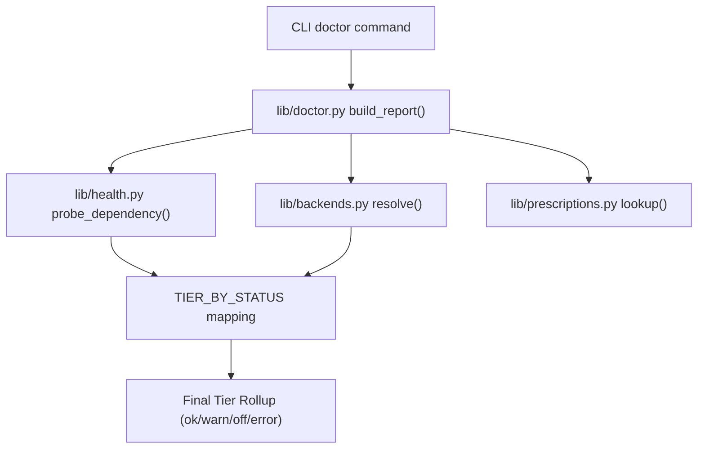
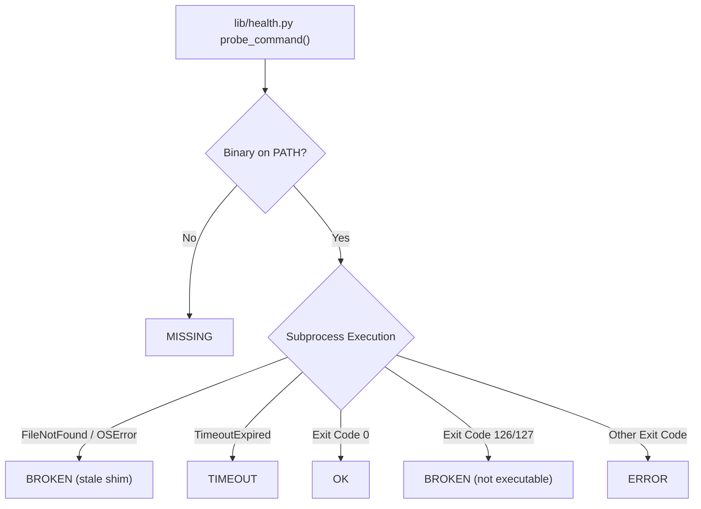

<!-- source: DeepWiki mcp.deepwiki.com · repo mvanhorn/last30days-skill · page 7.5 Diagnostics and Health Checks · fetched 2026-10-26 -->

# Diagnostics and Health Checks

<details>
<summary>Relevant source files</summary>

The following files were used as context for generating this wiki page:

- [CLAUDE.md](CLAUDE.md)
- [changelog.d/+doctor-transient-probe.fixed.md](changelog.d/+doctor-transient-probe.fixed.md)
- [changelog.d/1081.fixed.md](changelog.d/1081.fixed.md)
- [skills/last30days/scripts/lib/backends.py](skills/last30days/scripts/lib/backends.py)
- [skills/last30days/scripts/lib/doctor.py](skills/last30days/scripts/lib/doctor.py)
- [skills/last30days/scripts/lib/health.py](skills/last30days/scripts/lib/health.py)
- [skills/last30days/scripts/lib/permission_preflight.py](skills/last30days/scripts/lib/permission_preflight.py)
- [tests/test_backend_descriptors.py](tests/test_backend_descriptors.py)
- [tests/test_doctor.py](tests/test_doctor.py)
- [tests/test_env_unsubstituted_template.py](tests/test_env_unsubstituted_template.py)
- [tests/test_health.py](tests/test_health.py)
- [tests/test_permission_preflight.py](tests/test_permission_preflight.py)
- [tests/test_source_outcomes.py](tests/test_source_outcomes.py)
- [tests/test_x_chain_failover.py](tests/test_x_chain_failover.py)

</details>


This page documents the diagnostic and health surface of the `last30days` engine, implemented primarily across `skills/last30days/scripts/lib/doctor.py`, `skills/last30days/scripts/lib/health.py`, `skills/last30days/scripts/lib/backends.py`, and `skills/last30days/scripts/lib/permission_preflight.py` [skills/last30days/scripts/lib/doctor.py:1-11](). The diagnostic subsystem answers what is broken, what is serving, and what remediation commands to execute without side effects or secret leakage.

---

## Unified Doctor and Tier Rollups (`doctor.py`)

The unified `doctor` surface composes existing health layers into a single inspection pipeline [skills/last30days/scripts/lib/doctor.py:1-10]`:
1. `lib/health.py` for dependency probes (`ok`, `missing`, `broken`, `timeout`).
2. `lib/backends.py` for chain descriptors and predicted selection (`will use`).
3. `lib/prescriptions.py` for centralized remediation text and CLI commands.
4. Engine-level availability and permission summaries.

### Tier Rollup (The R1 Machine Contract)
Every data source is mapped to a standard four-value rollup tier (`tier`) while preserving its specific underlying status (`status`) [skills/last30days/scripts/lib/doctor.py:16-25]:

| Condition | Status | Tier |
| :--- | :--- | :--- |
| Probes pass, credentials present | `ok` | `ok` |
| Usable but degraded (fallback serving, partial) | `degraded` | `warn` |
| Opt-in not enabled / key-gated unconfigured | `opt-in` or `unconfigured` | `off` |
| Configured but missing, broken, timeout, or error | specific status (`missing`/`broken`/`timeout`/`error`) | `error` |

The rollup tiers are defined in `lib/doctor.py` and mapped from `lib/health.py` constants [skills/last30days/scripts/lib/doctor.py:57-74]:
```python
TIER_BY_STATUS: Dict[str, str] = {
    health.OK: TIER_OK,
    health.DEGRADED: TIER_WARN,
    "opt-in": TIER_OFF,
    "unconfigured": TIER_OFF,
    health.MISSING: TIER_ERROR,
    health.BROKEN: TIER_ERROR,
    health.TIMEOUT: TIER_ERROR,
    health.ERROR: TIER_ERROR,
}
```


*Sources: [skills/last30days/scripts/lib/doctor.py:1-74](), [skills/last30days/scripts/lib/health.py:23-41](), [skills/last30days/scripts/lib/backends.py:58-62]()*

---

## Four-State Audits and Run Evidence Overlays

In addition to static tier rollups, `lib/doctor.py` computes a **four-state audit** (`audit_state`) that combines tier rollups, fresh run evidence from previous executions, and optional live probes [skills/last30days/scripts/lib/doctor.py:80-120]:

* **`working`**: Source is active, verified, or keyless-always-on.
* **`unverified`**: Source is turned on but has no fresh run evidence or encountered a transient refusal.
* **`not-working`**: Source is in an error or degraded/broken state.
* **`could-be-on`**: Source is currently unconfigured or opt-in (`off`).

```python
def audit_state(
    name: str,
    record: Dict[str, Any],
    run_outcome: Optional[Dict[str, Any]] = None,
    probe_result: Optional[Dict[str, Any]] = None,
) -> str:
    ...
```
*Sources: [skills/last30days/scripts/lib/doctor.py:115-120]()*

### Keyless Sources and Transient Refusals
Certain sources (`reddit`, `hackernews`, `polymarket`, `github`, `library`) are defined as `KEYLESS_ALWAYS_ON` and default to `working` when unconfigured [skills/last30days/scripts/lib/doctor.py:104-106]. Furthermore, transient refusals during live probing (such as an HTTP `429` rate limit) are isolated: they do not trigger a `not-working` outage state, but are instead marked as `unverified` since research lanes retry with backoff [skills/last30days/scripts/lib/doctor.py:145-150, changelog.d/+doctor-transient-probe.fixed.md:1-1]().

---

## Typed Source Health and Outcome Taxonomy (`health.py`)

The `lib/health.py` module classifies tool executions and source retrievals into strict typed states to prevent collapsing distinct failure modes (e.g., missing binaries vs. stale venv shims) [skills/last30days/scripts/lib/health.py:1-12]:

### Health and Run States
* **Tool / Binary Health States**: `OK`, `DEGRADED`, `MISSING`, `BROKEN`, `TIMEOUT`, `ERROR` [skills/last30days/scripts/lib/health.py:23-30].
* **Run Outcome States**: `NO_RESULTS`, `PARTIAL`, `RATE_LIMITED`, `AUTH_FAILED`, `PAYMENT_REQUIRED`, `UNREACHABLE`, `SCHEMA_DRIFT`, `SKIPPED_UNCONFIGURED` [skills/last30days/scripts/lib/health.py:33-40].

### Command and Dependency Probing
`probe_command()` evaluates external binaries against a strict timeout, detecting non-executable shims via exit codes `126` or `127` (`BROKEN`) vs. absent executables (`MISSING`) [skills/last30days/scripts/lib/health.py:75-117]:
```python
def probe_command(
    command: list[str],
    timeout: float = 5.0,
) -> SourceHealth:
    ...
```
*Sources: [skills/last30days/scripts/lib/health.py:75-117]()*


*Sources: [skills/last30days/scripts/lib/health.py:94-116]()*

---

## Backend-Chain Descriptors and Predicted Selection (`backends.py`)

Chained sources delegate routing declarations to `lib/backends.py` and `lib/env.py` [skills/last30days/scripts/lib/backends.py:1-6]. Resolution occurs via two distinct strategies:

1. **`MODE_ALTERNATIVE`** (X, YouTube, web search): Uses a **collect-then-pick** strategy. All candidate backends are probed first. The first fully usable backend (`ok` or `degraded`) wins the prediction (`active_backend`), preventing an installed-but-unauthenticated preferred backend from shadowing a working fallback [skills/last30days/scripts/lib/backends.py:10-18].
2. **`MODE_CONDITIONAL`** (Reddit): Outcome-dependent routing. Public keyless composites run by default, with ScrapeCreators backfills triggered dynamically upon thinness thresholds. Conditional sources never compute a single winner; instead, they render honest conditional wording [skills/last30days/scripts/lib/backends.py:19-25].

Data structures underpinning chain resolution include `BackendFinding`, `BackendSpec`, `ChainDescriptor`, and `BackendResolution` [skills/last30days/scripts/lib/backends.py:96-164].

*Sources: [skills/last30days/scripts/lib/backends.py:1-164]()*

---

## Permission Preflight (`permission_preflight.py`)

The `lib/permission_preflight.py` module compiles a secure, secret-free summary of local file reads, writes, environment sources, and provider credentials before execution [skills/last30days/scripts/lib/permission_preflight.py:1-67]:

```python
def build(
    config: dict[str, Any],
    diagnose: dict[str, Any],
    *,
    planned_save_dir: str | None = None,
    report_on_save_dir: str | None = None,
) -> dict[str, Any]:
    ...
```
*Sources: [skills/last30days/scripts/lib/permission_preflight.py:60-66]()*

### Key Security Invariants
* **No Secret Values**: Credential presence is evaluated purely as booleans (`present: true/false`). Actual tokens, keys, and cookies are never included in preflight output [skills/last30days/scripts/lib/permission_preflight.py:98-113].
* **Browser Cookie Safety**: Browser cookie extraction operates under plan-only or restricted read policies, explicitly reporting `reads_values: false` unless explicitly unlocked [tests/test_permission_preflight.py:51-79]().
* **Template Sanitization**: Unsubstituted configuration templates (`${user_config.*}`) are intercepted and marked as unset, preventing downstream auth errors [changelog.d/1081.fixed.md:1]().

*Sources: [skills/last30days/scripts/lib/permission_preflight.py:1-167](), [tests/test_permission_preflight.py:51-165](), [changelog.d/1081.fixed.md:1]()*

---

## CLI Doctor Command

Invoked via the command line, the `doctor` command formats tier rollups, audit states, and remediation prescriptions for terminal output [skills/last30days/scripts/lib/doctor.py:1-14]:
* **Per-Source Exception Isolation**: A failing probe or exception in one source record is isolated and rendered as an `error` status without blanking or crashing the broader report [skills/last30days/scripts/lib/doctor.py:37-39].
* **Zero Exit Code Guarantee**: Reporting infrastructure problems or unconfigured optional sources is treated as a successful diagnostic execution; the CLI exit code remains `0` [skills/last30days/scripts/lib/doctor.py:38-39].

*Sources: [skills/last30days/scripts/lib/doctor.py:1-40](), [tests/test_doctor.py:1-16]*

---

