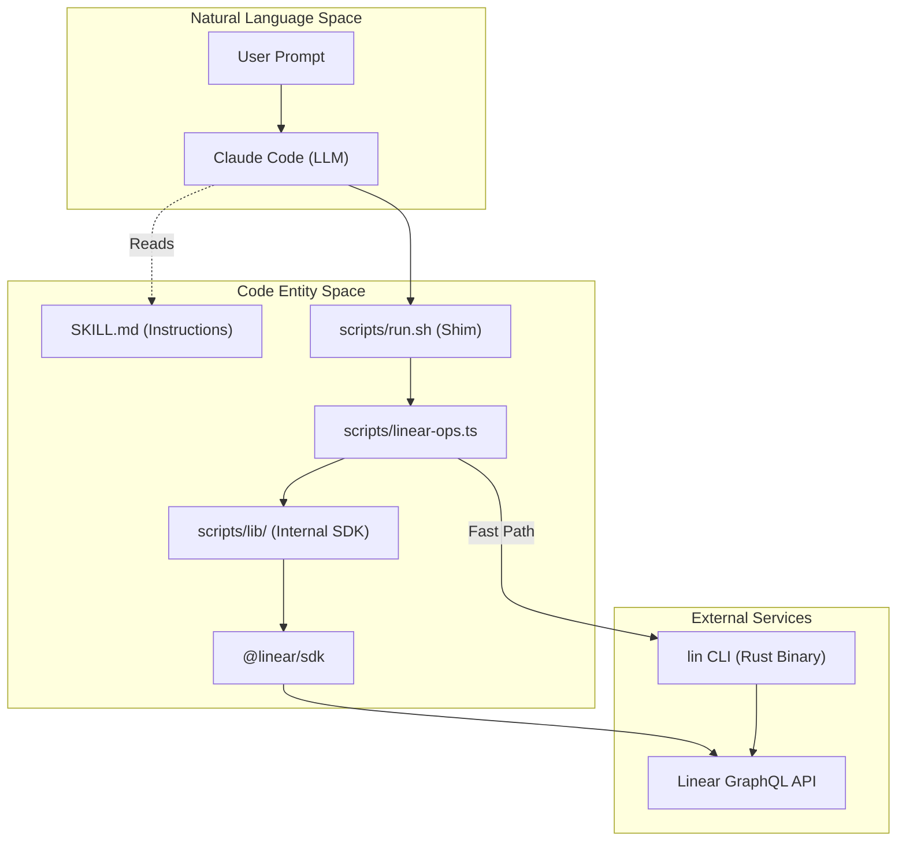
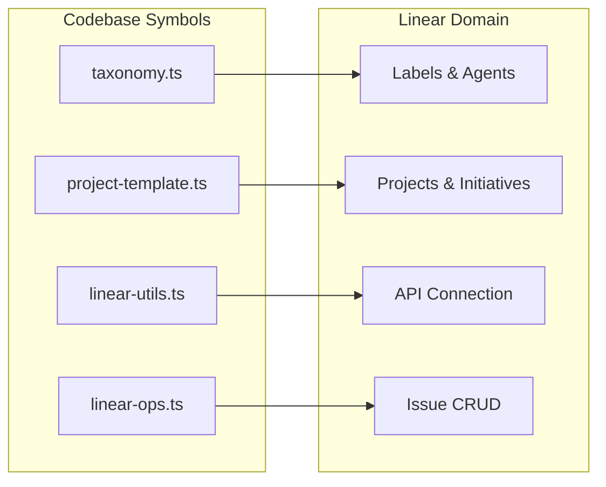

<!-- source: DeepWiki mcp.deepwiki.com · repo wrsmith108/linear-claude-skill · page 1 Overview · fetched 2026-10-26 -->

# Overview

Relevant source files

The following files were used as context for generating this wiki page:

- [.claude-plugin/plugin.json](.claude-plugin/plugin.json)
- [CHANGELOG.md](CHANGELOG.md)
- [README.md](README.md)
- [package.json](package.json)

The `linear-claude-skill` is a comprehensive integration for [Claude Code](https://claude.ai/code) designed to manage Linear issues, projects, and teams. It bridges the gap between natural language development workflows and Linear's structured project management by providing a multi-tiered execution model that includes Model Context Protocol (MCP) tools, a dedicated TypeScript SDK, and direct GraphQL access [package.json:2-5]().

This skill exists to automate repetitive project management tasks, enforce organizational standards (like label taxonomies), and ensure that the state of the codebase remains synchronized with Linear's tracking [README.md:1-21]().

## System Integration

The skill fits into the Claude Code ecosystem as a discovered skill [package.json:55-61](). When installed, it provides Claude with a suite of operational scripts and automation hooks.

### High-Level Workflow
1.  **Discovery**: Claude uses the skill to check for existing issues or projects before creation to prevent duplicates [README.md:156-168]().
2.  **Execution**: Operations are performed via the `linear-ops` CLI or direct SDK scripts [package.json:43-45]().
3.  **Synchronization**: A `post-edit` hook can automatically suggest syncing code changes back to Linear issues [README.md:150-151]().

The following diagram illustrates how Claude Code interacts with the various layers of the skill to perform a Linear operation.

**Claude Code to Linear Execution Path**

Sources: [package.json:43-45](), [scripts/run.sh:1-20](), [README.md:127-152](), [SKILL.md:1-50]()

## Key Components

The codebase is organized into three primary functional areas:

| Component | Description | Primary Entities |
| :--- | :--- | :--- |
| **CLI & Scripts** | Entry points for Claude to execute commands. | `linear-ops.ts`, `sync.ts`, `query.ts` |
| **Shared Library** | Internal SDK providing business logic and validation. | `linear-utils.ts`, `taxonomy.ts`, `project-template.ts` |
| **Automation Hooks** | Background processes for environment sync. | `post-edit.sh` |

### Technical Foundation
The skill is built on Node.js (>=20.11.0) and uses `esbuild` for pre-compilation to ensure fast CLI startup times (~50ms) [package.json:62-73](). It leverages a dual-path execution strategy where it attempts to use a pre-compiled JavaScript bundle in `dist/` but falls back to `tsx` for direct TypeScript execution if the bundle is missing [README.md:7-19]().

**Entity Mapping: Code to Linear Domain**

Sources: [scripts/lib/taxonomy.ts:1-20](), [scripts/lib/project-template.ts:1-30](), [scripts/lib/linear-utils.ts:1-15](), [scripts/linear-ops.ts:1-50]()

## Documentation Map

### [Getting Started](#1.1)
The installation guide for setting up the skill in `~/.claude/skills/linear`, configuring the mandatory `LINEAR_API_KEY`, and running the `setup` diagnostic script to verify connectivity.
*   **See also**: [Environment & Authentication](#7.2)

### [Architecture Overview](#1.2)
A deep dive into the five-tier tool selection model. This section explains how the skill decides between using the `lin` Rust CLI (for speed), the `@linear/sdk` (for complex logic), or raw GraphQL (for advanced queries).

### [Core Scripts & CLI](#2)
Documentation for the `scripts/` directory, focusing on the `linear-ops` command suite which handles issue creation, status updates, and project management.
*   **Key Files**: `scripts/linear-ops.ts`, `scripts/run.sh`, `scripts/build.mjs`.

### [Shared Library (scripts/lib)](#3)
Details on the internal logic that powers the scripts, including the Label Taxonomy system for consistent categorization and the Project Template engine for standardized project setup.
*   **Key Files**: `scripts/lib/taxonomy.ts`, `scripts/lib/linear-utils.ts`, `scripts/lib/agent-selection.ts`.

### [Issue & Project Management Workflows](#5)
Operational protocols that Claude must follow, such as "Discovery Before Creation" and the distinction between `content` and `description` fields in Linear.

### [Automation & Integration](#6)
Information on the `post-edit` hook and how the skill integrates with the official Linear MCP server.

### [Troubleshooting](#7)
Solutions for common issues like SSE connection timeouts, API key validation errors, and MCP server selection.

### [Glossary](#8)
Definitions of codebase-specific terms like "Initiative," "Domain Label," and "AgentId."

---

