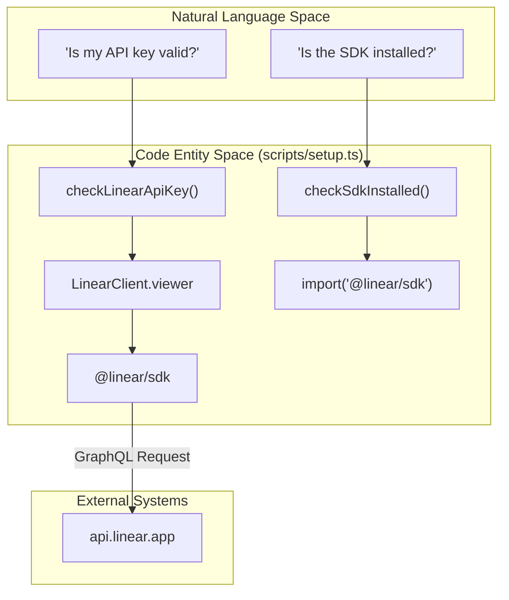
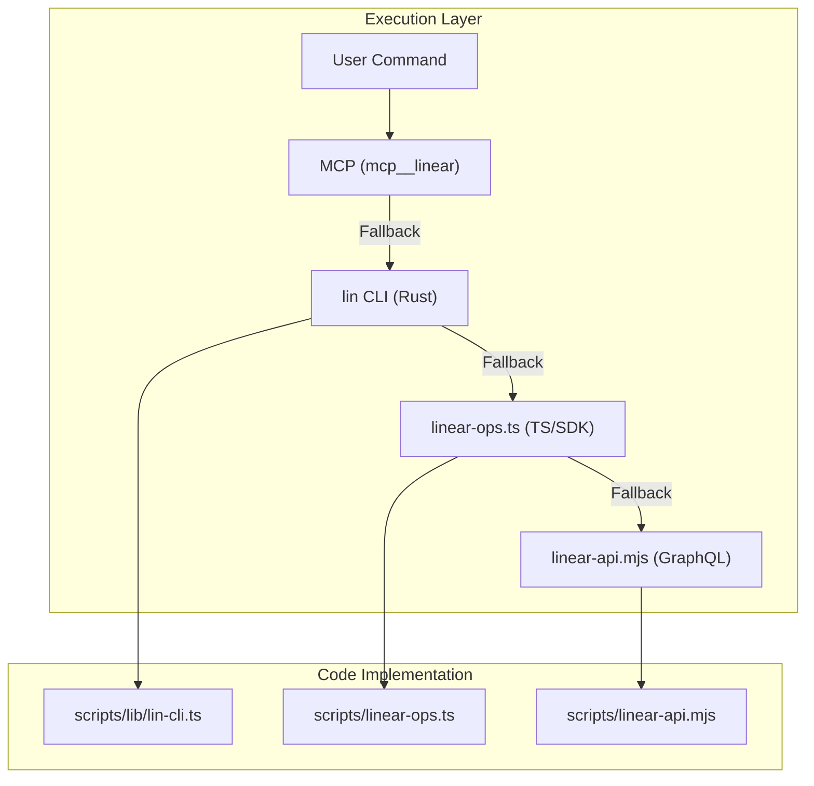

<!-- source: DeepWiki mcp.deepwiki.com · repo wrsmith108/linear-claude-skill · page 1.1 Getting Started · fetched 2026-10-26 -->

# Getting Started

<details>
<summary>Relevant source files</summary>

The following files were used as context for generating this wiki page:

- [.env.schema](.env.schema)
- [README.md](README.md)
- [SKILL.md](SKILL.md)
- [scripts/setup.ts](scripts/setup.ts)

</details>


This page provides a technical guide for installing, configuring, and verifying the Linear skill for Claude Code. The skill is designed to provide a high-performance interface between Claude and the Linear API, supporting multiple execution paths including MCP, a dedicated TypeScript CLI, and direct GraphQL access.

## Installation

The skill should be installed directly into the Claude Code skills directory to allow for automatic discovery.

```bash
# 1. Clone the repository into the Claude skills directory
git clone https://github.com/wrsmith108/linear-claude-skill ~/.claude/skills/linear

# 2. Navigate to the directory and install dependencies
cd ~/.claude/skills/linear && npm install

# 3. (Optional) Pre-compile for 18x faster startup
npm run build
```

The build process uses `esbuild` to transform TypeScript into optimized JavaScript in the `dist/` directory [README.md:139-149](). If the `dist/` files are missing, the shared runner (`scripts/run.sh`) automatically falls back to `tsx` for execution [README.md:7-7]().

**Sources:** [README.md:24-30](), [README.md:60-66](), [README.md:138-149]()

## Environment Configuration

The skill requires specific environment variables to authenticate with Linear and manage project hierarchies.

### Required Variables

| Variable | Requirement | Description |
| :--- | :--- | :--- |
| `LINEAR_API_KEY` | **Mandatory** | Personal API key starting with `lin_api_`. |
| `LINEAR_DEFAULT_INITIATIVE_ID` | Optional | UUID for the default initiative used in automated project creation. |

### Configuration Methods

Variables can be set in three locations, prioritized by the shell's standard resolution:
1.  **Shell Profile**: Add `export LINEAR_API_KEY="lin_api_..."` to `~/.zshrc` or `~/.bashrc` [SKILL.md:126-128]().
2.  **Claude Env**: Add to `~/.claude/.env` for Claude-specific persistence [SKILL.md:129-131]().
3.  **Project .env**: A `.env` file within the skill directory (useful for development).

### Security & Varlock
The skill implements a "Varlock" pattern to prevent accidental exposure of secrets. The `.env.schema` file marks `LINEAR_API_KEY` as `@sensitive` [.env.schema:5-6](). Developers should use `varlock load` to verify keys are set without printing their values to the console [SKILL.md:52-63]().

**Sources:** [SKILL.md:116-133](), [SKILL.md:48-81](), [.env.schema:1-11]()

## Connectivity & Setup Verification

The skill includes a diagnostic script, `scripts/setup.ts`, which performs a multi-stage validation of the environment.

### Setup Logic Flow
The `runSetupCheck()` function coordinates the following validations:
1.  **SDK Presence**: Checks if `@linear/sdk` is importable [scripts/setup.ts:97-111]().
2.  **API Authentication**: Attempts a `viewer` query to verify the key and network connectivity [scripts/setup.ts:68-78]().
3.  **CLI Availability**: Detects if the optional Rust-based `lin` CLI or the official Linear Desktop CLI are installed [scripts/setup.ts:113-129]().
4.  **MCP Configuration**: Scans for `.mcp.json` to ensure the Linear MCP server is registered [scripts/setup.ts:131-152]().

### Connectivity Data Flow
The following diagram illustrates how the `setup.ts` script bridges Natural Language requirements to Code Entities.

**Setup Verification Data Flow**


**Sources:** [scripts/setup.ts:154-216](), [scripts/setup.ts:68-78]()

## Verifying the Installation

Once configured, verify the full execution chain using the `whoami` command. This tests the TypeScript execution environment, the `linear-ops.ts` dispatcher, and the Linear API connection.

```bash
npm run ops -- whoami
```

### Execution Hierarchy
The skill utilizes a tiered execution model. If a high-performance tool is missing, it falls back to a more compatible one.

**Tool Selection Hierarchy**


**Sources:** [SKILL.md:17-44](), [README.md:137-148](), [README.md:207-220]()

## Troubleshooting Common Issues

1.  **Unauthorized (401)**: Usually indicates an expired `LINEAR_API_KEY`. The `setup.ts` script specifically catches 401 errors and suggests regeneration [scripts/setup.ts:80-88]().
2.  **Missing SDK**: Occurs if `npm install` was not run in the skill directory. Run `npm install` inside `~/.claude/skills/linear` [scripts/setup.ts:101-110]().
3.  **Slow Startup**: If commands take >1s, the pre-compiled `dist/` directory may be missing. Run `npm run build` [README.md:60-66]().

**Sources:** [scripts/setup.ts:79-94](), [README.md:60-66]()

---

