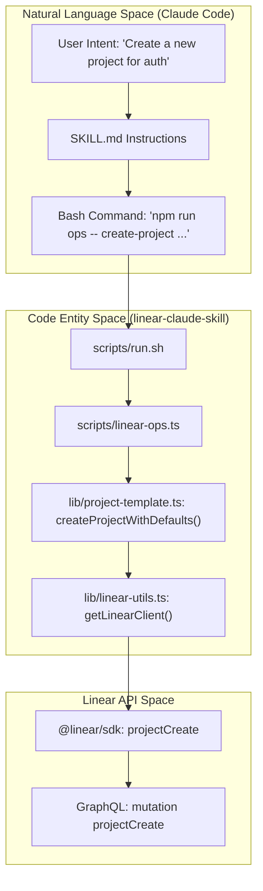
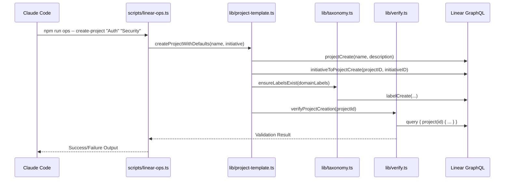

<!-- source: DeepWiki mcp.deepwiki.com · repo wrsmith108/linear-claude-skill · page 1.2 Architecture Overview · fetched 2026-10-26 -->

# Architecture Overview

Relevant source files

The following files were used as context for generating this wiki page:

- [CHANGELOG.md](CHANGELOG.md)
- [CLAUDE.md](CLAUDE.md)
- [README.md](README.md)
- [SKILL.md](SKILL.md)

This page details the technical architecture of the `linear-claude-skill`, focusing on the multi-tiered execution model, the integration with Claude Code, and the data flow between the local environment and the Linear API.

## Five-Tier Tool Selection Model

The skill employs a hierarchical selection model to balance execution speed, reliability, and capability. Claude Code is instructed via `SKILL.md` to attempt operations in a specific order of precedence [SKILL.md:17-24]().

| Tier | Component | Technology | Primary Use Case |
| :--- | :--- | :--- | :--- |
| **1** | **MCP Tools** | SSE / JSON-RPC | Lightweight, built-in operations (viewing issues, simple updates) [SKILL.md:21-21](). |
| **2** | **lin CLI** | Rust Binary | High-performance "fast-path" for listings and searches (~50ms) [README.md:20-20](). |
| **3** | **Helper Scripts** | TypeScript / Node.js | Complex workflows (project creation, sub-issue trees, label validation) [SKILL.md:23-23](). |
| **4** | **Linear SDK** | `@linear/sdk` | Typed automation and multi-step mutations [CLAUDE.md:127-127](). |
| **5** | **GraphQL API** | Raw HTTP POST | Low-level operations or features missing from the SDK [CLAUDE.md:128-128](). |

### Tier 2: `lin` CLI Fast-Path
The skill integrates with the [aaronkwhite/linear-cli](https://github.com/aaronkwhite/linear-cli) Rust binary. The `lib/lin-cli.ts` module provides a `tryLin()` abstraction that attempts to use the binary for supported commands (like `status`, `search`, or `list`) and silently falls back to the SDK if the binary is missing or fails three consecutive times (circuit-breaker pattern) [CLAUDE.md:77-80]().

### Tier 3: High-Level Operations (`linear-ops.ts`)
The primary entry point for Claude is `scripts/linear-ops.ts`. This CLI dispatches natural language-like commands to specific TypeScript handlers [CLAUDE.md:63-67]().

**Sources:** [SKILL.md:17-46](), [README.md:1-21](), [CLAUDE.md:63-80]()

---

## Dual-Path Execution Strategy

To optimize for performance without sacrificing development flexibility, the skill uses a dual-path execution strategy via a shared runner.

### Pre-compiled vs. JIT Execution
1.  **Production Path (Bundled):** Entry points in `scripts/` are pre-compiled using `esbuild` into `dist/`. This eliminates the ~1s overhead of TypeScript JIT compilation, resulting in ~50ms startup times [README.md:7-7]().
2.  **Development Path (Fallback):** If `dist/` is missing, the system falls back to `tsx` (TypeScript Execute) to run scripts directly from source [README.md:7-7]().

### The `run.sh` Shim
All `npm run` commands delegate to `scripts/run.sh`. This script checks for the existence of a bundled `.js` file in `dist/` before deciding whether to use `node` or `npx tsx` [CLAUDE.md:98-101]().

**Sources:** [README.md:7-7](), [CLAUDE.md:90-101]()

---

## Technical Data Flow: Natural Language to Linear Entity

The following diagram bridges the gap between Claude's natural language intent and the specific code entities that handle the request.

### Intent Resolution Diagram

**Sources:** [SKILL.md:197-200](), [CLAUDE.md:63-69](), [CLAUDE.md:82-88]()

---

## Skill Discovery & Integration

Claude Code discovers the skill by reading `SKILL.md` at the root of the repository. This file acts as the "manifest" for the LLM.

### Discovery Mechanism
1.  **Metadata:** The frontmatter in `SKILL.md` defines the skill name, version, and allowed tools (e.g., `mcp__linear`, `Bash`) [SKILL.md:1-9]().
2.  **Tooling Context:** It explicitly instructs Claude to use `npm run ops` for complex operations when the standard MCP tools are insufficient or unavailable [SKILL.md:25-44]().
3.  **Post-Edit Hook:** The skill integrates with Claude's `PostToolUse` hook via `hooks/post-edit.sh`. After Claude edits a file, this hook scans for Linear issue keys (e.g., `ENG-123`) and suggests a `sync` operation if changes are detected [README.md:150-151](), [CLAUDE.md:42-43]().

### Project Creation Workflow
The skill enforces a 6-step workflow for project creation to ensure data integrity, implemented in `lib/project-template.ts`:
1.  **Create:** Initialize project with metadata.
2.  **Link:** Attach to a parent Initiative (mandatory) [CLAUDE.md:84-84]().
3.  **Content:** Set the long-form `content` field via `projectUpdate` (distinct from the 255-char `description`) [CLAUDE.md:85-85]().
4.  **Labels:** Ensure required taxonomy labels exist in the workspace [CLAUDE.md:86-86]().
5.  **Issues:** Batch-create initial issues.
6.  **Verify:** Execute `lib/verify.ts` to confirm entity relationships [CLAUDE.md:88-88]().

**Sources:** [SKILL.md:1-9](), [CLAUDE.md:82-89](), [README.md:150-151]()

---

## Detailed Execution Flow (Project Creation)

This diagram tracks a complex project creation request through the internal library modules.

**Sources:** [CLAUDE.md:82-89](), [scripts/linear-ops.ts:1-10](), [scripts/lib/project-template.ts:1-10]()

---

