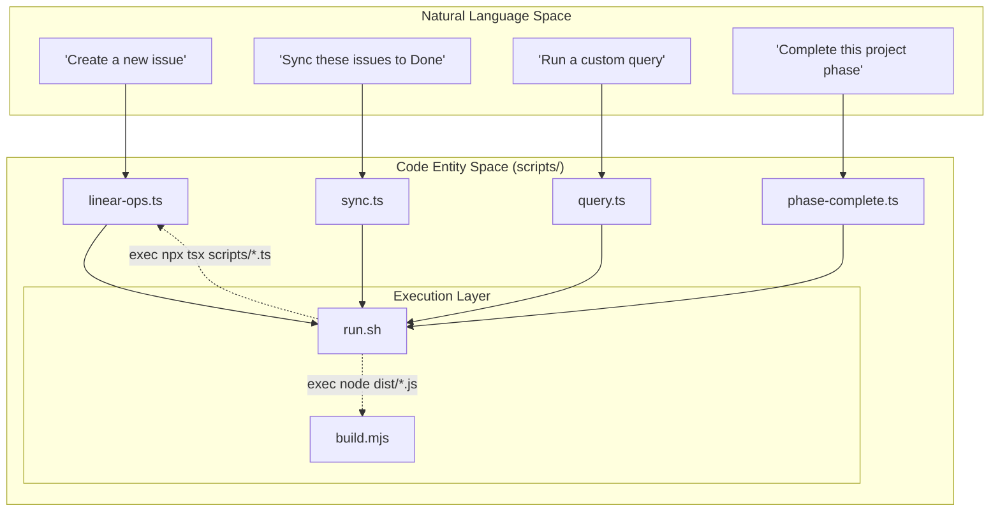
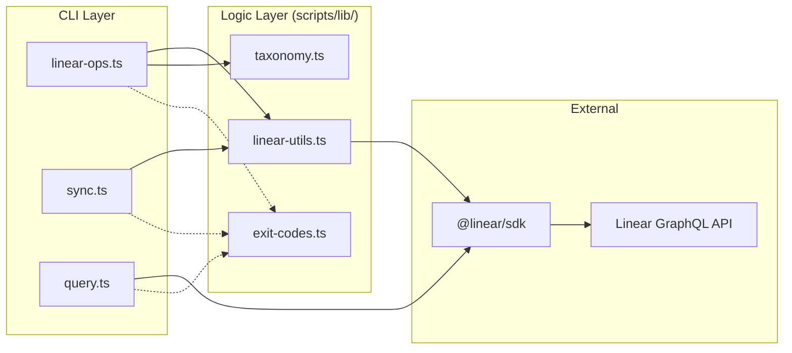

<!-- source: DeepWiki mcp.deepwiki.com · repo wrsmith108/linear-claude-skill · page 2 Core Scripts & CLI · fetched 2026-10-26 -->

# Core Scripts & CLI

Relevant source files

The following files were used as context for generating this wiki page:

- [scripts/__tests__/smoke.test.ts](scripts/__tests__/smoke.test.ts)
- [scripts/linear-ops.ts](scripts/linear-ops.ts)
- [scripts/phase-complete.ts](scripts/phase-complete.ts)
- [scripts/query.ts](scripts/query.ts)
- [scripts/run.sh](scripts/run.sh)
- [scripts/sync.ts](scripts/sync.ts)

This section provides an overview of the `scripts/` directory, which contains the operational heart of the `linear-claude-skill`. The system is designed around a primary CLI entry point, a robust build system, and specialized utility scripts for complex Linear workflows.

## Overview

The codebase uses a tiered execution strategy. While most operations are accessible via the high-level `linear-ops.ts` CLI, the system also includes specialized scripts for bulk synchronization, GraphQL experimentation, and image processing. All scripts leverage a shared runner that prioritizes performance by using pre-compiled JavaScript when available, falling back to `tsx` for development flexibility.

### System Entry Points and Flow

The following diagram illustrates how natural language intent from Claude Code maps to specific code entities and execution paths within the script architecture.

**Intent to Entity Mapping**

**Sources:** [scripts/run.sh:1-8](), [scripts/linear-ops.ts:10-27](), [scripts/sync.ts:3-16](), [scripts/phase-complete.ts:3-18]()

---

## [linear-ops CLI](#2.1)

The `scripts/linear-ops.ts` file is the primary interface for issue and project management. It abstracts the complexity of the Linear SDK into human-readable commands.

*   **Issue Management:** Commands like `create-issue`, `create-sub-issue`, and `set-parent` handle the creation and nesting of tasks.
*   **Project & Initiatives:** High-level commands such as `create-initiative` and `create-project` allow for structural organization of work.
*   **Status Control:** The `status` command provides a unified way to transition issues through workflow states (e.g., `Done`, `In Progress`).
*   **Discovery:** Commands like `whoami`, `search`, and `list-projects` help agents orient themselves within a Linear workspace.

For a deep dive into command syntax and implementation details, see **[linear-ops CLI](#2.1)**.

**Sources:** [scripts/linear-ops.ts:10-27](), [scripts/linear-ops.ts:86-170]()

---

## [Shared Runner & Build System](#2.2)

To ensure high performance within Claude Code sessions, the skill employs an `esbuild`-based build pipeline and a dual-path execution shim.

| Component | File | Role |
| :--- | :--- | :--- |
| **Execution Shim** | `scripts/run.sh` | Checks for `dist/` files; runs with `node` if present, otherwise uses `tsx`. |
| **Build Pipeline** | `scripts/build.mjs` | Compiles TypeScript to JS, handles the `__BUNDLED__` define, and manages external SDK imports. |
| **Smoke Tests** | `scripts/__tests__/smoke.test.ts` | Validates that the build output correctly excludes external dependencies and replaces build-time constants. |

For details on the compilation strategy and the `dist/` fallback logic, see **[Shared Runner & Build System](#2.2)**.

**Sources:** [scripts/run.sh:1-8](), [scripts/__tests__/smoke.test.ts:1-12](), [scripts/__tests__/smoke.test.ts:96-102]()

---

## [Utility Scripts](#2.3)

Beyond the main CLI, several specialized scripts handle advanced automation and maintenance tasks:

*   **`query.ts`**: A raw GraphQL runner used for ad-hoc data retrieval and testing mutations that aren't yet wrapped in the SDK.
*   **`sync.ts`**: A bulk update engine for transitioning multiple issues to a specific state simultaneously, including rate-limit handling.
*   **`phase-complete.ts`**: An automated workflow that verifies all project issues are closed before marking a project as "Completed" and optionally archiving it.
*   **`setup.ts`**: Validates the environment, ensuring `LINEAR_API_KEY` is present and the connection is active.

For documentation on these specialized tools, see **[Utility Scripts](#2.3)**.

**Sources:** [scripts/query.ts:3-9](), [scripts/sync.ts:3-16](), [scripts/phase-complete.ts:3-12]()

---

## [Image Pipeline](#2.4)

The skill includes a dedicated pipeline for handling visual context within Linear. This is a two-stage process:

1.  **Extraction**: `extract-image.ts` parses base64 image data from Claude Code session logs.
2.  **Upload**: `upload-image.ts` manages the multipart upload to Linear's S3 storage and attaches the resulting URL to issue comments.

For details on the image processing workflow, see **[Image Pipeline](#2.4)**.

---

## Script Interaction Architecture

The following diagram demonstrates how the CLI scripts interact with the underlying library and the Linear API.

**Internal Component Interaction**

**Sources:** [scripts/linear-ops.ts:32-47](), [scripts/sync.ts:18-25](), [scripts/phase-complete.ts:20-22]()

---

