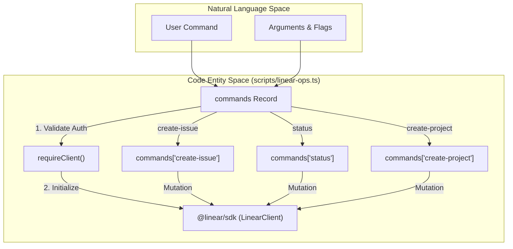
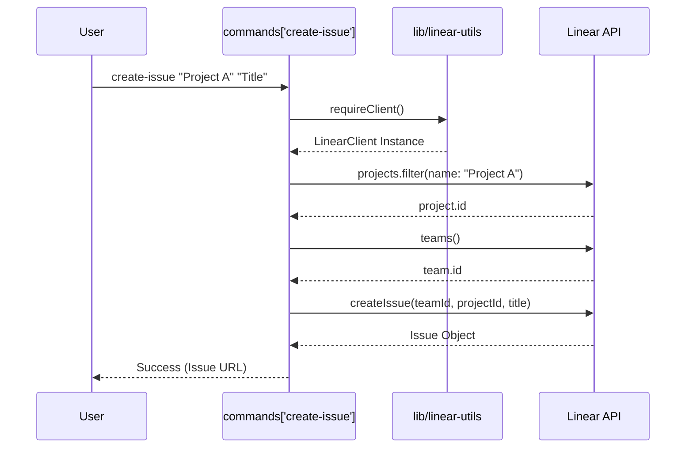

<!-- source: DeepWiki mcp.deepwiki.com · repo wrsmith108/linear-claude-skill · page 2.1 linear-ops CLI · fetched 2026-10-26 -->

# linear-ops CLI

Relevant source files

The following files were used as context for generating this wiki page:

- [scripts/__tests__/smoke.test.ts](scripts/__tests__/smoke.test.ts)
- [scripts/linear-ops.ts](scripts/linear-ops.ts)
- [scripts/run.sh](scripts/run.sh)

The `linear-ops.ts` script serves as the primary Command Line Interface (CLI) entry point for the Linear skill. It abstracts complex GraphQL mutations and SDK interactions into high-level, human-readable commands. It is designed to be used both by developers and as a target for Claude Code's tool execution.

## Purpose and Scope

The `linear-ops` CLI provides a unified interface for:
*   **Issue Lifecycle**: Creation, sub-issue nesting, and status transitions.
*   **Project & Initiative Management**: Structural organization of work.
*   **Label Management**: Integration with the internal taxonomy system for domain and agent mapping.
*   **Utility & Diagnostics**: Workspace discovery and environment validation.

The script utilizes a "dist-first" execution strategy via `scripts/run.sh`, attempting to run the bundled JavaScript in `dist/` before falling back to `tsx` for the source TypeScript files [scripts/run.sh:1-8]().

## Implementation Architecture

The CLI is structured as a command-dispatch record where each key corresponds to a CLI subcommand [scripts/linear-ops.ts:84]().

### Data Flow: Natural Language to Code Entity

The following diagram illustrates how a user-provided command (Natural Language Space) is processed by the CLI and mapped to specific SDK entities (Code Entity Space).

**CLI Command Mapping**

**Sources:** [scripts/linear-ops.ts:84-86](), [scripts/linear-ops.ts:67-81]().

### Authentication & Initialization
The CLI implements "lazy" API key validation. Commands that do not require network access (e.g., viewing label taxonomy) can run without a key, while operational commands call `requireClient()` to ensure `LINEAR_API_KEY` is present [scripts/linear-ops.ts:49-65]().

## Command Deep Dive

### Issue Management
The CLI handles the complexities of finding team IDs and project IDs by name, allowing users to interact with identifiers they recognize.

| Command | Key Logic | File Reference |
| :--- | :--- | :--- |
| `create-issue` | Performs fuzzy name matching for projects; defaults to Team 0. | [scripts/linear-ops.ts:86-170]() |
| `create-sub-issue` | Fetches parent issue by identifier (e.g., ENG-123) to link children. | [scripts/linear-ops.ts:213-261]() |
| `status` | Updates issue state; utilizes `tryLin` for fast-path Rust CLI execution. | [scripts/linear-ops.ts:394-440]() |
| `set-parent` | Updates multiple child issues to point to a single parent ID. | [scripts/linear-ops.ts:263-305]() |

**Issue Creation Flow**

**Sources:** [scripts/linear-ops.ts:86-156](), [scripts/lib/linear-utils.ts:1-50]().

### Project & Initiative Management
These commands facilitate the high-level organization of work, including linking projects to initiatives and providing status updates.

*   **`create-initiative`**: Creates a top-level initiative and returns its URL [scripts/linear-ops.ts:172-205]().
*   **`create-project`**: Creates a project and can optionally link it to an initiative immediately [scripts/linear-ops.ts:207-211]().
*   **`create-project-update`**: Submits health reports (On Track, At Risk, Off Track) to a project [scripts/linear-ops.ts:342-368]().

### Label & Utility Commands
The CLI integrates with the `lib/taxonomy.ts` system to provide intelligence about how issues should be categorized.

*   **`labels taxonomy`**: Displays the defined domain and type labels without requiring an API key [scripts/linear-ops.ts:457-463]().
*   **`whoami`**: Returns the current authenticated user and organization context [scripts/linear-ops.ts:513-529]().
*   **`search`**: Performs a workspace-wide search across issues [scripts/linear-ops.ts:531-555]().

## Performance: The Lin CLI Fast-Path

For the `status` command, the script attempts to use `tryLin()`. This checks for the presence of the `lin` Rust binary. If available and not currently failing (via a circuit-breaker mechanism), it executes the update through the binary for sub-second latency, bypassing the heavier TypeScript/SDK overhead [scripts/linear-ops.ts:422-431](), [scripts/lib/lin-cli.ts:1-30]().

## Build and Smoke Testing
The CLI is verified via smoke tests in `scripts/__tests__/smoke.test.ts`. These tests ensure:
1.  `__BUNDLED__` constants are correctly replaced by `esbuild` [scripts/__tests__/smoke.test.ts:43-53]().
2.  Commands exit with code `0` for help/taxonomy and non-zero when authentication is missing for protected operations [scripts/__tests__/smoke.test.ts:55-86]().
3.  External dependencies like `@linear/sdk` remain external and are not inlined into the bundle [scripts/__tests__/smoke.test.ts:96-102]().

**Sources:**
*   `scripts/linear-ops.ts`
*   `scripts/run.sh`
*   `scripts/__tests__/smoke.test.ts`
*   `scripts/lib/index.ts`

---

