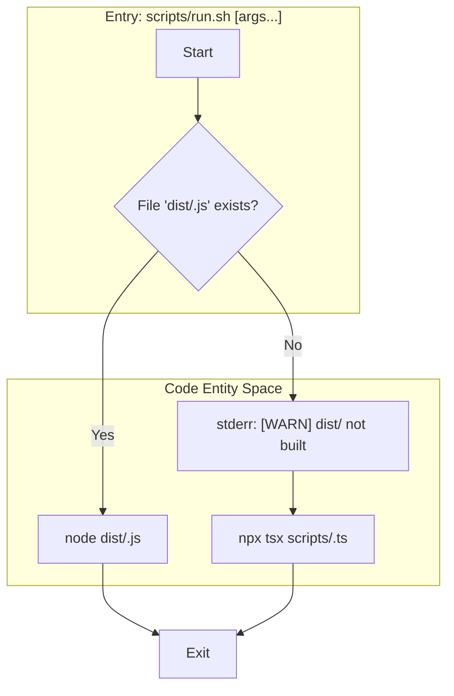
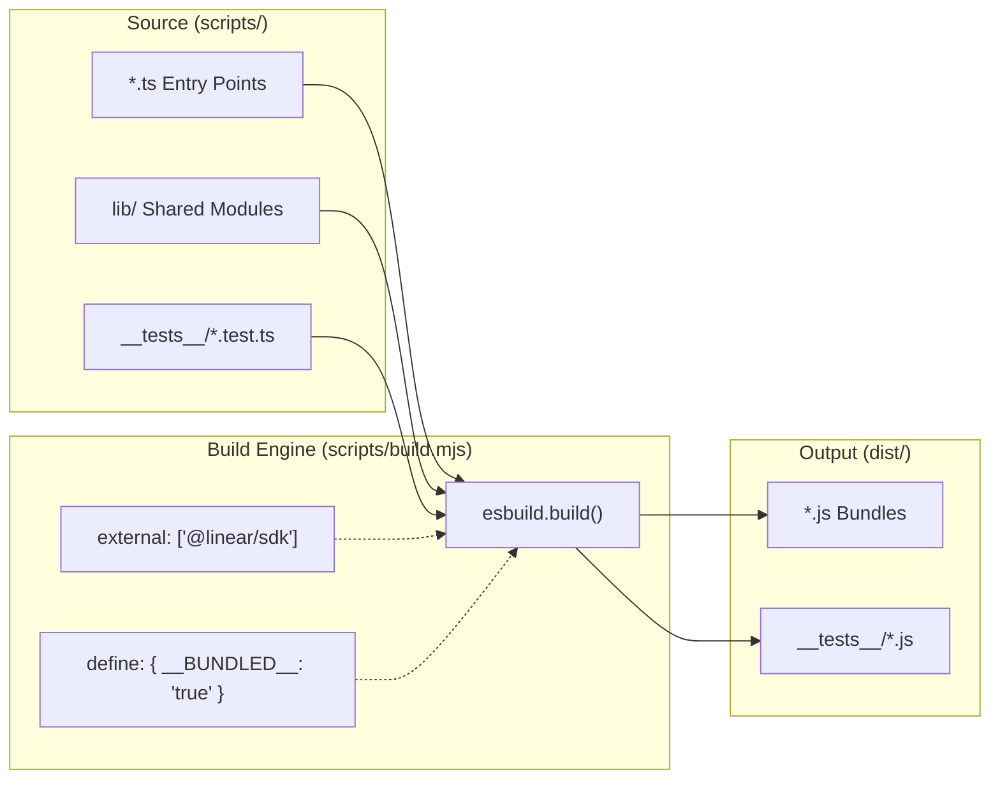

<!-- source: DeepWiki mcp.deepwiki.com · repo wrsmith108/linear-claude-skill · page 2.2 Shared Runner & Build System · fetched 2026-10-26 -->

# Shared Runner & Build System

Relevant source files

The following files were used as context for generating this wiki page:

- [.gitignore](.gitignore)
- [package-lock.json](package-lock.json)
- [scripts/__tests__/smoke.test.ts](scripts/__tests__/smoke.test.ts)
- [scripts/build.mjs](scripts/build.mjs)
- [scripts/run.sh](scripts/run.sh)
- [tsconfig.json](tsconfig.json)

The `linear-claude-skill` uses a dual-path execution strategy designed to balance developer productivity with runtime performance. It employs an `esbuild`-based pipeline to pre-compile TypeScript into optimized JavaScript, paired with a shell-based shim that ensures the system remains functional even if the build artifacts are missing.

## Execution Strategy: scripts/run.sh

The primary entry point for executing any script in the toolkit is `scripts/run.sh`. This shim acts as a dispatcher that prioritizes pre-compiled assets in the `dist/` directory to minimize startup latency, which is critical for maintaining the responsiveness of the Claude Code MCP interface.

### Execution Flow

The shim follows a fallback logic:
1. **Fast Path**: If a corresponding `.js` file exists in `dist/`, it executes it directly using `node` [scripts/run.sh:5-5]().
2. **Slow Path**: If the build artifact is missing, it issues a warning and executes the source `.ts` file using `npx tsx` [scripts/run.sh:6-7]().

| Feature | Fast Path (`dist/`) | Slow Path (`tsx`) |
| :--- | :--- | :--- |
| **Startup Time** | ~50ms | ~500ms - 1.5s |
| **Requirements** | `npm run build` | `node_modules` |
| **Primary Use** | Production / Claude MCP | Development / Debugging |

### Runner Implementation
Title: Shared Runner Dispatch Logic

Sources: [scripts/run.sh:1-8]()

## Build Pipeline: scripts/build.mjs

The build system is powered by `esbuild` and is responsible for transforming the TypeScript source in `scripts/` into standalone ESM modules in `dist/`.

### Key Pipeline Stages

1.  **Entry Point Discovery**: The script scans the `scripts/` directory for all `.ts` files, treating each as an independent entry point [scripts/build.mjs:15-17]().
2.  **Compilation & Bundling**:
    *   **Target**: `es2022` with `esm` format [scripts/build.mjs:23-24]().
    *   **External Dependencies**: The `@linear/sdk` is explicitly marked as `external` [scripts/build.mjs:26-26](). This prevents the SDK from being inlined, ensuring that the version installed in `node_modules` is used and reducing bundle size [scripts/__tests__/smoke.test.ts:96-102]().
    *   **Define Injection**: It injects a global constant `__BUNDLED__` set to `'true'` [scripts/build.mjs:29-29](). This allows scripts to detect at runtime whether they are running as a compiled artifact or via `tsx` [scripts/__tests__/smoke.test.ts:43-53]().
3.  **Test Suite Compilation**: Test files located in `scripts/__tests__/` are compiled into `dist/__tests__/` using the same configuration, though without the `__BUNDLED__` define [scripts/build.mjs:35-54]().

### Build System Data Flow
Title: esbuild Pipeline Architecture

Sources: [scripts/build.mjs:11-57](), [scripts/__tests__/smoke.test.ts:5-9]()

## TypeScript Configuration

The project uses a permissive TypeScript configuration tailored for script-heavy environments where `tsx` and `esbuild` handle the heavy lifting of module resolution.

### TSConfig Strategy
*   **No Emit**: `tsconfig.json` sets `"noEmit": true` [tsconfig.json:7-7](). The `tsc` compiler is used solely for type checking, while `esbuild` handles the actual transpilation.
*   **Module Resolution**: Uses `"moduleResolution": "Bundler"` to support modern import patterns [tsconfig.json:5-5]().
*   **Strictness**: Strict mode is disabled (`"strict": false`) and `noImplicitAny` is off to allow for rapid prototyping of API-consuming scripts [tsconfig.json:6-11]().
*   **Compatibility**: `esModuleInterop` and `resolveJsonModule` are enabled to facilitate importing CommonJS packages and JSON metadata [tsconfig.json:9-10]().

Sources: [tsconfig.json:1-19]()

## Build Validation (Smoke Tests)

The integrity of the build system is verified by `scripts/__tests__/smoke.test.ts`. These tests ensure:
*   **Mapping**: Every `.ts` file in the source has a corresponding `.js` file in `dist/` [scripts/__tests__/smoke.test.ts:31-41]().
*   **Inlining**: Confirms that `@linear/sdk` remains an external reference and is not bundled [scripts/__tests__/smoke.test.ts:96-102]().
*   **Environment**: Validates that the `__BUNDLED__` placeholder is correctly replaced during the build [scripts/__tests__/smoke.test.ts:43-53]().
*   **Execution**: Verifies that the compiled CLI can execute basic commands (like `help`) with a 0 exit code [scripts/__tests__/smoke.test.ts:55-61]().

Sources: [scripts/__tests__/smoke.test.ts:1-103]()

---

