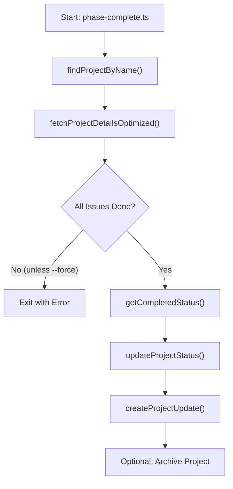
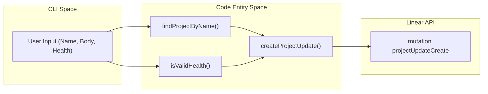

<!-- source: DeepWiki mcp.deepwiki.com · repo wrsmith108/linear-claude-skill · page 2.3 Utility Scripts · fetched 2026-10-26 -->

# Utility Scripts

Relevant source files

The following files were used as context for generating this wiki page:

- [LICENSE](LICENSE)
- [scripts/create-initiative-update.ts](scripts/create-initiative-update.ts)
- [scripts/create-issue-with-project.ts](scripts/create-issue-with-project.ts)
- [scripts/create-project-update.ts](scripts/create-project-update.ts)
- [scripts/phase-complete.ts](scripts/phase-complete.ts)
- [scripts/query.sh](scripts/query.sh)
- [scripts/query.ts](scripts/query.ts)
- [scripts/setup.ts](scripts/setup.ts)
- [scripts/sync.ts](scripts/sync.ts)
- [sdk.md](sdk.md)

Utility scripts provide a set of specialized tools for administrative tasks, bulk operations, and diagnostic checks that extend beyond the standard issue management CLI. These scripts utilize the `@linear/sdk` for complex logic and raw GraphQL for operations not yet exposed by the SDK.

## Overview of Utilities

The utility suite is designed to handle three primary areas:
1.  **Diagnostics & Setup**: Validating the environment and API connectivity.
2.  **Bulk & Workflow Automation**: Syncing states across multiple issues or automating project completion phases.
3.  **Direct API Access**: Executing raw GraphQL queries or targeted mutations for projects and initiatives.

### Data Flow and Script Execution

Most scripts follow a standard execution pattern:
1.  **Environment Check**: Verify `LINEAR_API_KEY` exists via `getLinearClient()` [scripts/lib/linear-utils.ts:133-145]().
2.  **Argument Parsing**: Extract flags and identifiers from `process.argv`.
3.  **Entity Resolution**: Convert human-readable names (projects/initiatives) into UUIDs using fuzzy matching utilities [scripts/lib/linear-utils.ts:167-195]().
4.  **API Execution**: Perform mutations via the SDK or `client.rawRequest`.

## Diagnostic & Environment Tools

### setup.ts
The `setup.ts` script is the primary validator for the skill's environment. It performs a multi-step check of dependencies and credentials.

**Key Functions:**
*   `checkLinearApiKey()`: Validates the presence and format of the API key, then attempts a `client.viewer` call to verify organization access [scripts/setup.ts:34-95]().
*   `checkSdkInstalled()`: Verifies `@linear/sdk` is available in the `node_modules` [scripts/setup.ts:97-111]().
*   `checkMcpConfig()`: Searches for `.mcp.json` in common locations to verify the Linear MCP server is registered [scripts/setup.ts:131-152]().

**Natural Language to Code Entity Mapping: Setup**

| User Intent | Code Entity | File |
| :--- | :--- | :--- |
*   "Is my key valid?" | `checkLinearApiKey` | [scripts/setup.ts:34]() |
*   "Where is my config?" | `checkMcpConfig` | [scripts/setup.ts:131]() |
*   "Check lin CLI" | `checkLinCli` | [scripts/setup.ts:122]() |

Sources: [scripts/setup.ts:34-152]()

## Workflow & Bulk Automation

### sync.ts
Used for bulk state transitions across multiple issues. It is particularly useful when an agent completes a milestone and needs to move several issues to "Done" simultaneously.

**Implementation Details:**
*   **Team Extraction**: It extracts the team key from the first issue identifier (e.g., "ENG" from "ENG-123") to look up the correct workflow states [scripts/sync.ts:104-109]().
*   **State Lookup**: Resolves the target state name to a `stateId` via `team.states()` [scripts/sync.ts:112-127]().
*   **Sequential Updates**: Iterates through issues, applying the `stateId` and optional comments with a 150ms delay to avoid rate limiting [scripts/sync.ts:132-177]().

### phase-complete.ts
Automates the end-of-project checklist. It ensures that no loose ends remain before marking a project as completed.

**Logic Flow:**
1.  **Fuzzy Match**: Finds the project ID from a partial name [scripts/phase-complete.ts:109-122]().
2.  **Integrity Check**: Fetches all issues for the project and verifies their states [scripts/phase-complete.ts:124-174]().
3.  **Status Update**: Transitions the project to the "completed" status type [scripts/phase-complete.ts:206-251]().
4.  **Reporting**: Creates a final project update with a summary of completed work [scripts/phase-complete.ts:253-280]().

**Phase Completion Workflow**

Sources: [scripts/sync.ts:104-177](), [scripts/phase-complete.ts:109-280]()

## Direct API Helpers

### query.ts
A wrapper for executing ad-hoc GraphQL. It provides better error formatting than `curl` by catching `GraphQLErrorResponse` and pretty-printing the error path and locations [scripts/query.ts:13-27]().

### create-project-update.ts & create-initiative-update.ts
These scripts provide a CLI interface for the `projectUpdateCreate` and `initiativeUpdateCreate` mutations. They accept a `health` parameter (`onTrack`, `atRisk`, `offTrack`) which is validated against the `HealthStatus` type [scripts/create-project-update.ts:24-30]().

**Data Flow: Project Update**

### create-issue-with-project.ts
A specialized issue creator that ensures an issue is linked to a project at the moment of creation. It performs a multi-step lookup for `teamId`, `projectId`, `stateId`, and `labelIds` before executing the `issueCreate` mutation [scripts/create-issue-with-project.ts:194-260]().

Sources: [scripts/query.ts:13-27](), [scripts/create-project-update.ts:24-85](), [scripts/create-issue-with-project.ts:194-260]()

## Utility Script Summary Table

| Script | Purpose | Key Dependency |
| :--- | :--- | :--- |
| `setup.ts` | Env validation | `@linear/sdk` |
| `query.ts` | Raw GraphQL runner | `client.rawRequest` |
| `sync.ts` | Bulk state updates | `issue.update` |
| `phase-complete.ts` | Project lifecycle | `findProjectByName` |
| `create-project-update.ts` | Status reporting | `HealthStatus` |
| `create-issue-with-project.ts` | Atomic issue/project creation | `lookupLabelIds` |

Sources: [scripts/setup.ts:1-10](), [scripts/query.ts:1-9](), [scripts/sync.ts:1-16](), [scripts/phase-complete.ts:1-18](), [scripts/create-project-update.ts:1-19](), [scripts/create-issue-with-project.ts:1-24]()

---

