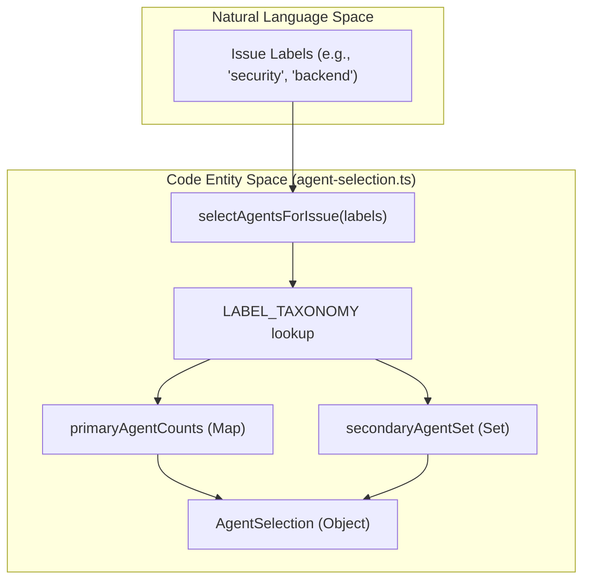
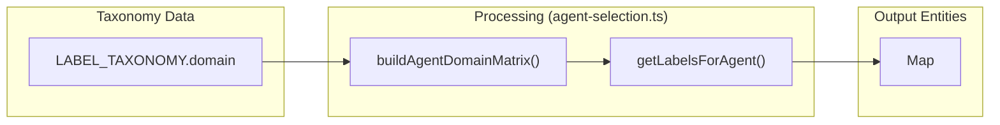

<!-- source: DeepWiki mcp.deepwiki.com · repo wrsmith108/linear-claude-skill · page 3.3 Agent Selection · fetched 2026-10-26 -->

# Agent Selection

Relevant source files

The following files were used as context for generating this wiki page:

- [scripts/lib/agent-selection.ts](scripts/lib/agent-selection.ts)
- [scripts/lib/index.ts](scripts/lib/index.ts)
- [scripts/lib/taxonomy-validation.ts](scripts/lib/taxonomy-validation.ts)

The Agent Selection system provides the routing logic required to map Linear issues to specific AI agents based on their defined expertise. By utilizing the `DomainLabel` taxonomy, the system ensures that issues are handled by the most qualified "primary" agents while maintaining a pool of "secondary" fallback agents for broader coverage.

## Agent Metadata and Capabilities

The system maintains a registry of `AgentId` values associated with specific technical domains. These are defined in the `AGENT_DESCRIPTIONS` constant, which serves as the source of truth for agent roles.

### Agent Registry (Partial List)

| AgentId | Capability Description |
| :--- | :--- |
| `security-manager` | Security analysis, vulnerability assessment, access control |
| `performance-benchmarker` | Performance benchmarking, load testing |
| `frontend-dev` | Frontend development, React, UI components |
| `backend-dev` | Backend development, APIs, databases |
| `mcp-developer` | MCP tool development, protocol implementation |
| `sparc-coder` | SPARC methodology coding |

**Sources:** [scripts/lib/agent-selection.ts:23-66]()

## Routing Logic

The core routing function is `selectAgentsForIssue`. It transforms a list of natural language labels into a structured `AgentSelection` object.

### Selection Rules
1.  **Primary Match:** Agents explicitly listed as primary for a `DomainLabel` are prioritized [scripts/lib/agent-selection.ts:72]().
2.  **Broadest Match:** For issues with multiple domain labels, the system calculates which agent appears most frequently across those domains [scripts/lib/agent-selection.ts:73]().
3.  **Fallback:** If no domain labels are present, the issue is routed to a general pool consisting of `coder` and `sparc-coder` [scripts/lib/agent-selection.ts:86-93]().

### Natural Language to Agent Routing Flow

This diagram illustrates how the system bridges the gap between a Linear Issue's text/labels and the internal code entities responsible for handling them.

Title: "Issue to Agent Entity Mapping"

**Sources:** [scripts/lib/agent-selection.ts:77-145](), [scripts/lib/taxonomy-validation.ts:106-137]()

## Implementation Details

### Key Functions

| Function | Purpose |
| :--- | :--- |
| `selectAgentsForIssue(labels)` | The primary entry point for determining agent routing [scripts/lib/agent-selection.ts:77](). |
| `canAgentHandle(agentId, labels)` | Checks if a specific agent is qualified for a set of labels, returning `canHandle` and `asPrimary` flags [scripts/lib/agent-selection.ts:168-207](). |
| `getLabelsForAgent(agentId)` | Reverse lookup to find all `DomainLabel` values associated with an agent [scripts/lib/agent-selection.ts:150-163](). |
| `buildAgentDomainMatrix()` | Generates a complete mapping of all agents to their primary and secondary domains [scripts/lib/agent-selection.ts:213-217](). |

### Agent-Domain Matrix Construction

The `buildAgentDomainMatrix` function iterates through the `LABEL_TAXONOMY.domain` definitions to construct a comprehensive capability map. This is used for system-wide reporting and validation.

Title: "Capability Matrix Data Flow"

**Sources:** [scripts/lib/agent-selection.ts:150-163](), [scripts/lib/agent-selection.ts:213-230]()

## Label-Based Filtering

The selection process relies on `DOMAIN_LABEL_NAMES` to filter incoming strings. This ensures that only recognized taxonomy labels influence routing logic, while `TypeLabel` (e.g., `bug`, `feature`) and `ScopeLabel` (e.g., `tech-debt`) are ignored for agent selection purposes.

*   **Filter Logic:** `normalizedLabels.filter(l => DOMAIN_LABEL_NAMES.includes(l))` [scripts/lib/agent-selection.ts:81-83]().
*   **Reasoning String:** The system generates a human-readable `reasoning` field explaining why specific agents were chosen, which is helpful for debugging routing conflicts [scripts/lib/agent-selection.ts:126-137]().

**Sources:** [scripts/lib/agent-selection.ts:77-145](), [scripts/lib/taxonomy-data.ts:17-18]()

---

