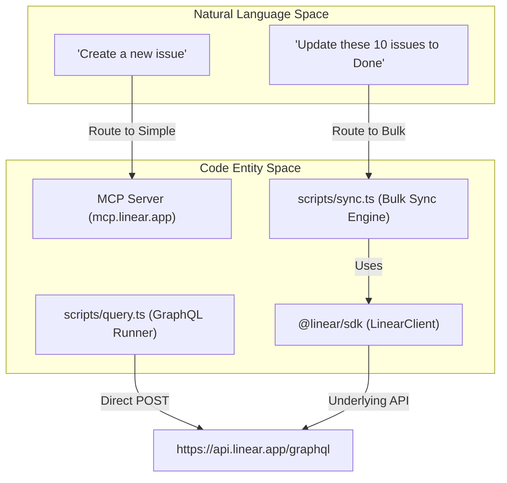
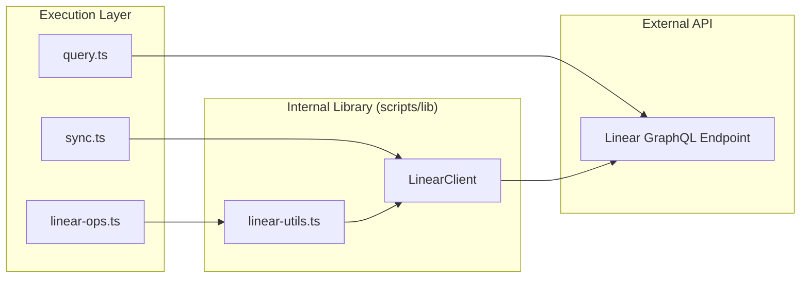

<!-- source: DeepWiki mcp.deepwiki.com · repo wrsmith108/linear-claude-skill · page 4 Linear API Reference · fetched 2026-10-26 -->

# Linear API Reference

Relevant source files

The following files were used as context for generating this wiki page:

- [LICENSE](LICENSE)
- [api.md](api.md)
- [scripts/query.sh](scripts/query.sh)
- [sdk.md](sdk.md)
- [sync.md](sync.md)

This page provides a high-level overview of how the `linear-claude-skill` interacts with the Linear platform. The skill employs a multi-tiered communication strategy to ensure reliability, performance, and access to the full breadth of Linear's features.

## Interaction Strategy

The skill does not rely on a single method for API interaction. Instead, it selects the most appropriate interface based on the complexity of the task and the limitations of the environment (such as MCP timeouts).

### Tool Selection Hierarchy

When executing operations, the system follows a specific priority order to balance ease of use with technical capability:

1.  **MCP Tools (First Choice)**: Used for simple, single-entity operations like creating an issue or fetching basic details [sdk.md:9-9]().
2.  **SDK Scripts (Complex Operations)**: Used for loops, bulk updates, and logic-heavy transformations that require type safety [sdk.md:10-10]().
3.  **GraphQL API (Fallback)**: Used when specific fields or mutations are unsupported by the SDK or MCP, or to bypass MCP-specific timeouts [sdk.md:11-11]().

### Natural Language to Code Entity Mapping

The following diagram illustrates how natural language requests from a user are routed through the various code entities that interface with the Linear API.

**Entity Routing Diagram**

Sources: [sdk.md:5-12](), [api.md:7-12](), [sync.md:15-25]()

---

## Core API Interfaces

### GraphQL API Patterns
The skill frequently utilizes raw GraphQL queries and mutations to handle edge cases where the standard tools fail. This includes specific handling for authentication headers and complex filters (e.g., `containsIgnoreCase`) [api.md:11-11](), [api.md:136-136]().

*   **Key Pitfalls**: Shell-based execution requires avoiding optional chaining (`?.`) and nullish coalescing (`??`) as they conflict with shell globbing and parsing [api.md:253-260]().
*   **For details, see [GraphQL API Patterns](#4.1)**.

### SDK Automation Patterns
The `@linear/sdk` is the primary driver for the skill's custom TypeScript logic. It provides full type safety for Linear entities like `Issue`, `Project`, and `Team` [sdk.md:15-20](). The skill includes templates for creating robust automation scripts that handle pagination and conditional logic [sdk.md:199-235]().

*   **Usage**: Typically invoked via `npx tsx` within the `scripts/` directory [sdk.md:22-22]().
*   **For details, see [SDK Automation Patterns](#4.2)**.

### Bulk Sync Engine
The `sync.ts` utility is a specialized implementation designed to bridge the gap between local code changes and Linear state. it supports multiple "modes" including CLI-driven bulk updates and autonomous agent-spawned synchronization [sync.md:13-50]().

*   **Parallelism**: Uses a "Swarm Sync" pattern where multiple sub-agents handle batches of issues independently to avoid timeouts [sync.md:121-142]().
*   **For details, see [Bulk Sync Engine](#4.3)**.

---

## System Integration Flow

The diagram below shows how the different API components relate to each other within the skill's architecture.

**API Component Architecture**

Sources: [api.md:157-161](), [sdk.md:209-209](), [sync.md:262-262](), [scripts/query.sh:21-21]()

## Key API Concepts

| Concept | Implementation Detail | Source |
| :--- | :--- | :--- |
| **Authentication** | `LINEAR_API_KEY` passed via `Authorization` header | [api.md:9-14]() |
| **Rate Limiting** | 100ms delay between mutations in bulk operations | [sync.md:188-188]() |
| **Timeout Recovery** | Automatic retries for failed operations in sync engine | [sync.md:189-189]() |
| **Pagination** | `pageInfo` with `endCursor` and `hasNextPage` | [sdk.md:168-169]() |

---
**Child Pages:**
*   [GraphQL API Patterns](#4.1)
*   [SDK Automation Patterns](#4.2)
*   [Bulk Sync Engine](#4.3)

---

