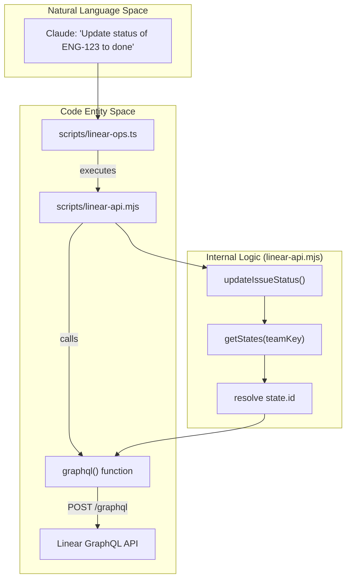
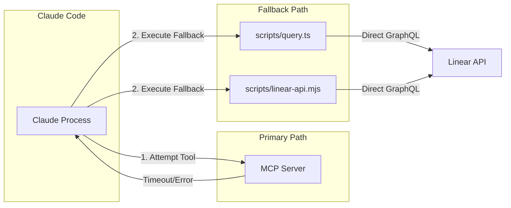

<!-- source: DeepWiki mcp.deepwiki.com · repo wrsmith108/linear-claude-skill · page 4.1 GraphQL API Patterns · fetched 2026-10-26 -->

# GraphQL API Patterns

<details>
<summary>Relevant source files</summary>

The following files were used as context for generating this wiki page:

- [api.md](api.md)
- [scripts/linear-api.mjs](scripts/linear-api.mjs)

</details>


The `linear-claude-skill` uses the Linear GraphQL API as the foundation for all operations. While the high-level tools utilize the `@linear/sdk`, direct GraphQL usage is employed for performance-critical operations, custom mutations not yet supported by the SDK, and as a reliable fallback when Model Context Protocol (MCP) tools encounter timeouts or schema mismatches.

## Authentication and Endpoint

All GraphQL requests are directed to a single endpoint using a Personal API Key for authentication [api.md:7-12]().

*   **Endpoint**: `https://api.linear.app/graphql`
*   **Header**: `Authorization: <LINEAR_API_KEY>`

The skill requires the `LINEAR_API_KEY` environment variable to be set for any direct GraphQL execution via scripts like `scripts/query.ts` [api.md:22-28]().

## Core Query Patterns

### Viewer and Identity
To verify connectivity and identify the authenticated user, the `viewer` query is used [api.md:32-41]().

```graphql
query Me {
  viewer {
    id
    name
    email
  }
}
```

### Resource Discovery
Common patterns for retrieving issues and projects involve filtering by team or assignee. Team-based queries require a `teamId` [api.md:147-147]().

**Assigned Issues Query** [api.md:59-73]():
```graphql
query MyIssues {
  viewer {
    assignedIssues {
      nodes {
        id
        title
        state { name }
        team { key }
      }
    }
  }
}
```

**Project Lookup by Name** [api.md:118-130]():
Uses a `ProjectFilter` with `containsIgnoreCase` to find projects without knowing the UUID.

### Workflow State Resolution
Because status updates require a `stateId` rather than a string name, the skill resolves state names to IDs by querying the team's workflow states [scripts/linear-api.mjs:85-108]().

**Sources**: [api.md:32-73](), [api.md:118-130](), [scripts/linear-api.mjs:85-108]()

## Mutation Patterns

Mutations follow a standard input pattern. Most mutations return a `success` boolean and the created/updated object [api.md:79-89]().

### Issue Management
Creating and updating issues are the most frequent mutations.

| Mutation | Key Inputs | Returns |
| :--- | :--- | :--- |
| `issueCreate` | `teamId`, `title`, `description`, `stateId`, `projectId` | `id`, `identifier`, `url` |
| `issueUpdate` | `id`, `input` (Partial) | `success`, `issue` |
| `commentCreate` | `issueId`, `body` | `id`, `body` |

### Project and Initiative Linking
Advanced workflows require linking entities across the Linear hierarchy.

*   **Project Updates**: Uses `projectUpdateCreate` with a `health` enum (`onTrack`, `atRisk`, `offTrack`) [scripts/linear-api.mjs:252-271]().
*   **Initiative Linking**: Projects are linked to initiatives via `initiativeToProjectCreate`.
*   **External Links**: `entityExternalLinkCreate` is used to attach documentation or PR links to issues/projects.

### GraphQL Execution Flow

The following diagram illustrates how a natural language request is transformed into a GraphQL mutation through the `linear-api.mjs` wrapper.

**Mutation Execution Path**


**Sources**: [api.md:77-115](), [scripts/linear-api.mjs:113-271]()

## Shell Compatibility Pitfalls

When executing GraphQL queries via inline Node.js scripts or heredocs in a shell environment (like Claude Code's terminal), specific JavaScript features must be avoided to prevent shell parsing errors [api.md:251-260]().

| Feature | Problem | Recommended Pattern |
| :--- | :--- | :--- |
| **Optional Chaining** (`?.`) | Shell interprets `?` as a glob character. | `const x = obj.p ? obj.p.v : null;` |
| **Nullish Coalescing** (`??`) | Double `?` confuses shell parsers. | Use ternary operators. |
| **Template Literals** (`` `${}` ``) | Shell attempts variable interpolation. | Use quoted heredocs: `<< 'EOF'`. |

**Anti-Pattern Example** [api.md:262-265]():
```javascript
// ❌ Fails in bash
const name = project.status?.name;
```

**Correct Pattern Example** [api.md:274-279]():
```bash
# ✅ Quoted EOF prevents shell interpolation
node --input-type=module << 'ENDSCRIPT'
  const value = obj.prop ? obj.prop.nested : 'default';
ENDSCRIPT
```

**Sources**: [api.md:251-280]()

## MCP Timeout Workarounds

MCP operations through the official Linear server can time out during bulk operations or complex searches. The skill implements a "Fallback on Timeout" pattern [api.md:214-228]().

### Strategy: Direct GraphQL Fallback
When a tool call like `mcp__linear__linear_search_issues` fails with `ETIMEDOUT`, the system falls back to a direct `fetch` call to the GraphQL endpoint [api.md:219-228]().

### Strategy: Chunked Batching
To avoid hitting API limits or timing out the connection during bulk updates, the `scripts/sync.ts` and `scripts/linear-api.mjs` tools use chunked batching [api.md:197-212]().

1.  **Batch Size**: 10 issues per request.
2.  **Delay**: 150ms between batches to respect rate limits.
3.  **Progress**: `console.log` updates to keep the parent process active.

**Fallback Architecture**


**Sources**: [api.md:179-243](), [scripts/linear-api.mjs:25-55]()

---

