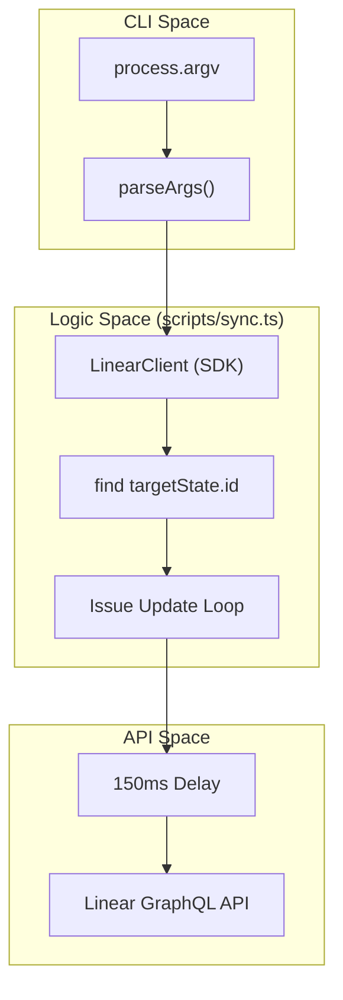
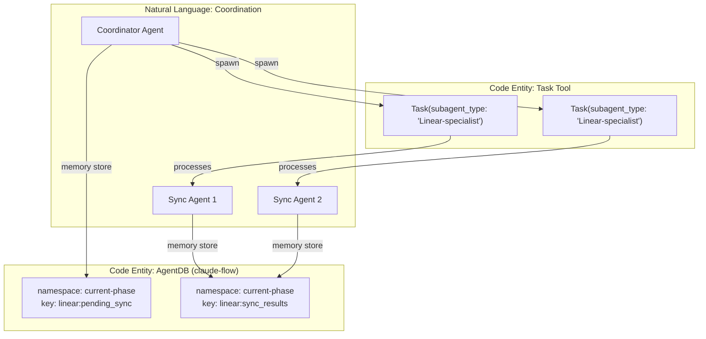

<!-- source: DeepWiki mcp.deepwiki.com · repo wrsmith108/linear-claude-skill · page 4.3 Bulk Sync Engine · fetched 2026-10-26 -->

# Bulk Sync Engine

Relevant source files

The following files were used as context for generating this wiki page:

- [scripts/phase-complete.ts](scripts/phase-complete.ts)
- [scripts/query.ts](scripts/query.ts)
- [scripts/sync.ts](scripts/sync.ts)
- [sync.md](sync.md)

The Bulk Sync Engine provides a robust mechanism for synchronizing local implementation progress with Linear entities. It supports mass updates to issue states, project statuses, and automated coordination between multiple autonomous agents.

## Overview and Sync Modes

The system operates in three distinct modes depending on the integration point and required level of autonomy.

| Mode | Trigger | Mechanism | Use Case |
| :--- | :--- | :--- | :--- |
| **CLI Bulk Sync** | Manual/Scripted | `sync.ts` | Updating large batches of issues (e.g., ENG-101,102,103) to a target state. |
| **Agent-Spawned** | Autonomous | `Task` tool | A specialist agent performs sync via GraphQL to avoid MCP timeouts. |
| **Hook-Triggered** | Event-based | `post-edit.sh` | Suggesting sync actions after detecting issue IDs in modified files. |

**Sources:** [sync.md:13-68](), [scripts/sync.ts:4-16]()

## CLI Implementation (`sync.ts`)

The `sync.ts` script is the primary entry point for bulk operations. It utilizes the `@linear/sdk` to resolve workflow states and apply updates sequentially with rate-limiting protection.

### Key Logic Flow
1. **Argument Parsing**: Extracts `--issues`, `--state`, and optional `--comment` or `--dry-run` flags [scripts/sync.ts:27-54]().
2. **State Resolution**: Fetches the team's workflow states to find a case-insensitive match for the target state name [scripts/sync.ts:112-127]().
3. **Sequential Update**: Iterates through issue identifiers, fetches their UUIDs, and applies the state transition [scripts/sync.ts:132-168]().
4. **Rate Limiting**: Implements a 150ms delay between operations to prevent API throttling [scripts/sync.ts:171-171]().

### Sync Engine Data Flow
The following diagram illustrates how the `sync.ts` script bridges CLI inputs to the Linear API.

**Sources:** [scripts/sync.ts:27-171](), [sync.md:185-192]()

## Parallel Agent Patterns & Swarm Coordination

For high-volume updates (30+ issues), the system encourages spawning parallel "Linear-specialist" agents. This bypasses the execution timeouts often encountered in standard MCP tool calls.

### AgentDB Integration
To coordinate between a "Coordinator" agent and multiple "Sync-agents," the system uses `AgentDB` (via `claude-flow memory`) to track pending work and aggregate results.

1. **Store Pending**: `npx claude-flow memory store "linear:pending_sync" '["ENG-432",...]'` [sync.md:112-112]()
2. **Parallel Tasks**: The coordinator spawns multiple `Task` calls, each handling a subset of the issues [sync.md:150-167]().
3. **Aggregate Results**: Agents store completion status back to the `linear:sync_results` namespace [sync.md:118-118]().

### Swarm Coordination Architecture
This diagram maps the natural language concept of "Swarm Coordination" to the specific CLI tools and memory namespaces used in the code.

**Sources:** [sync.md:106-167]()

## Phase Completion Workflow (`phase-complete.ts`)

Beyond simple state syncing, `phase-complete.ts` automates the transition of entire projects. It utilizes an optimized GraphQL query to fetch project metadata, status, and all associated issues in a single round-trip.

### Optimized Fetching
The script uses `client.client.rawRequest` to execute a custom GraphQL query `GetProjectDetails`, which includes:
- Project ID, Name, and Slug [scripts/phase-complete.ts:147-149]()
- Current Project Status [scripts/phase-complete.ts:150-154]()
- All issues with their respective state types [scripts/phase-complete.ts:155-165]()

### Workflow Steps
1. **Validation**: Checks if all issues are in a `completed` or `canceled` state unless the `--force` flag is used [scripts/phase-complete.ts:63-71]().
2. **Status Update**: Moves the project to a "Completed" status [scripts/phase-complete.ts:228-251]().
3. **Documentation**: Creates a project update with a health status of `onTrack` to summarize the completion [scripts/phase-complete.ts:253-281]().

**Sources:** [scripts/phase-complete.ts:4-18](), [scripts/phase-complete.ts:124-169]()

## Error Handling and Recovery

The engine is designed for resilience against common API failures:

| Failure Type | Recovery Mechanism | Implementation |
| :--- | :--- | :--- |
| **Rate Limiting** | Throttling | `setTimeout(resolve, 150)` between updates [scripts/sync.ts:171](). |
| **Auth Failure** | Key Validation | Checks for `lin_api_` prefix before execution [scripts/query.ts:54-58](). |
| **Partial Failure** | Reporting | Tracks `results` array and exits with code 1 if any items fail [scripts/sync.ts:180-192](). |
| **GraphQL Errors** | Detailed Parsing | `hasGraphQLErrors` helper extracts location and path from API responses [scripts/query.ts:21-27](). |

**Sources:** [scripts/sync.ts:171-192](), [scripts/query.ts:21-27]()

---

