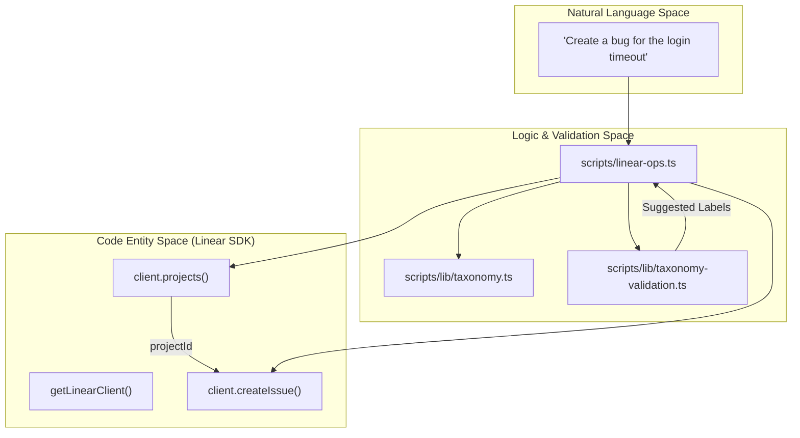
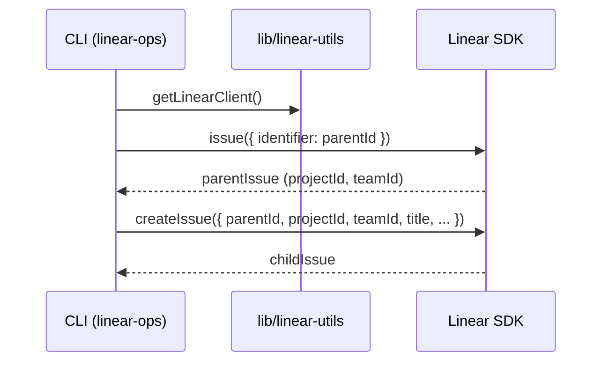

<!-- source: DeepWiki mcp.deepwiki.com · repo wrsmith108/linear-claude-skill · page 5.1 Issue Lifecycle · fetched 2026-10-26 -->

# Issue Lifecycle

Relevant source files

The following files were used as context for generating this wiki page:

- [SKILL.md](SKILL.md)
- [projects.md](projects.md)
- [scripts/linear-ops.ts](scripts/linear-ops.ts)

The issue lifecycle in the `linear-claude-skill` defines the standardized process for discovering, creating, organizing, and progressing work items within Linear. This lifecycle ensures that all issues are traceable, correctly categorized via the taxonomy system, and synchronized with the actual state of the codebase.

## Lifecycle Overview

The lifecycle transitions through four primary phases: **Discovery**, **Creation**, **Execution**, and **Completion**.

### Discovery Before Creation (MANDATORY)

Before any issue is created, a discovery phase is required to prevent duplication and verify the actual state of the codebase.

1.  **Linear Search**: Check if a similar issue or project already exists using `linear-ops search` or the `mcp__linear__linear_search_issues` tool [projects.md:93-104]().
2.  **Codebase Verification**: Verify if the "missing" feature or bug described in a prompt is already implemented or fixed in the code. Issue descriptions in Linear are often speculative or outdated [projects.md:118-128]().

### Workflow Data Flow

The following diagram illustrates the data flow from a Natural Language intent to the execution of Linear operations.

**Intent to Entity Mapping**

Sources: [scripts/linear-ops.ts:86-170](), [scripts/lib/taxonomy-validation.ts:1-20](), [scripts/lib/linear-utils.ts:43-65]()

---

## Mandatory Creation Checklist

Every issue created via the skill must satisfy a three-step checklist, regardless of whether the user explicitly provided the details [SKILL.md:168-185]().

| Requirement | Implementation Detail | Code Reference |
| :--- | :--- | :--- |
| **Title Inference** | If only a vague title is provided, the agent must infer a professional title. | [SKILL.md:172-173]() |
| **Detailed Description** | Must include "What", "Why", and "Acceptance Criteria". | [SKILL.md:172-173]() |
| **Label Taxonomy** | Exactly ONE Type label, 1-2 Domain labels, and optional Scope labels. | [SKILL.md:174-178]() |
| **Project Assignment** | Issues must be assigned to an active project/initiative. | [SKILL.md:179-181]() |

### Implementation: `create-issue`
The `create-issue` command in `scripts/linear-ops.ts` handles the resolution of project names to UUIDs and the mapping of label names to Linear Label IDs before calling the SDK [scripts/linear-ops.ts:86-170]().

Sources: [SKILL.md:168-185](), [scripts/linear-ops.ts:108-156]()

---

## Sub-Issue Management

The skill utilizes Linear's parent-child relationship model to organize complex tasks. Sub-issues inherit the **Team** and **Project** of their parent automatically [projects.md:207-209]().

### Parent-Child Logic
The `create-sub-issue` command first fetches the parent issue to extract its `teamId` and `projectId`, ensuring the child remains within the same organizational context [scripts/linear-ops.ts:199-245]().

**Sub-Issue Creation Flow**

Sources: [scripts/linear-ops.ts:199-245](), [projects.md:191-203]()

---

## Status Transitions

Issue statuses are updated using the `status` command. This command is optimized to support both the Rust-based `lin` CLI fast-path and the standard SDK fallback [scripts/linear-ops.ts:446-485]().

### Transition Protocol
1.  **Discovery**: The system identifies the `stateId` for the target status (e.g., "Done", "In Progress") [scripts/linear-ops.ts:462-475]().
2.  **Execution**: `linUpdateIssueState` is called, which attempts to use the `lin` binary for performance before falling back to the SDK `issueUpdate` mutation [scripts/lib/lin-cli.ts:150-180]().
3.  **Verification**: For project-level status changes, a mandatory `projectUpdateCreate` mutation is triggered to document progress metrics [projects.md:32-65]().

Sources: [scripts/linear-ops.ts:446-485](), [scripts/lib/lin-cli.ts:150-180](), [projects.md:20-29]()

---

## Codebase Verification Protocol

Before work begins on a "Started" issue, the agent must perform **Codebase Verification**. This prevents "phantom work" where an issue requests a feature that has already been partially implemented in a different branch or by another agent.

### Verification Steps
*   **Grep Search**: Search for existing implementation keywords (e.g., `grep -r "apiEndpoint"`) [projects.md:132-133]().
*   **File Existence**: Check for relevant files (e.g., `ls src/pages/api/...`) [projects.md:135-136]().
*   **Test Audit**: Run existing tests to identify actual failure points vs. assumed gaps [projects.md:141-143]().

If a discrepancy is found, the agent must use `scripts/linear-ops.ts` to add a comment to the issue updating the scope before proceeding [projects.md:175-185]().

Sources: [projects.md:118-188](), [scripts/linear-ops.ts:25-27]()

---

