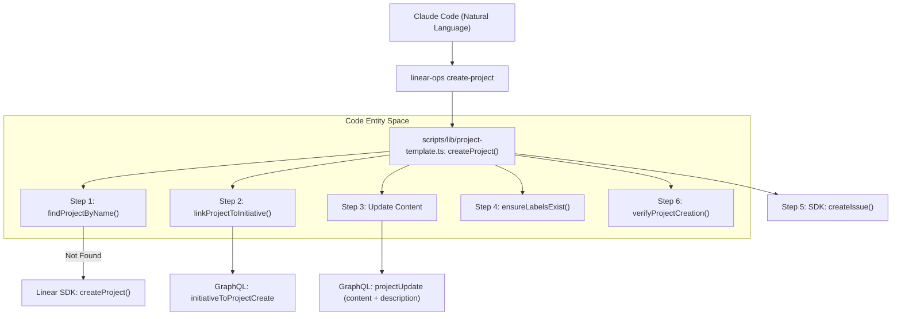
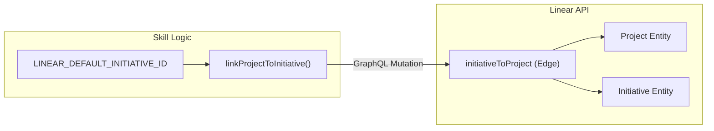

<!-- source: DeepWiki mcp.deepwiki.com · repo wrsmith108/linear-claude-skill · page 5.2 Project & Initiative Management · fetched 2026-10-26 -->

# Project & Initiative Management

<details>
<summary>Relevant source files</summary>

The following files were used as context for generating this wiki page:

- [projects.md](projects.md)
- [scripts/create-initiative-update.ts](scripts/create-initiative-update.ts)
- [scripts/create-issue-with-project.ts](scripts/create-issue-with-project.ts)
- [scripts/create-project-update.ts](scripts/create-project-update.ts)
- [scripts/lib/initiative.ts](scripts/lib/initiative.ts)
- [scripts/lib/project-template.ts](scripts/lib/project-template.ts)

</details>


This page documents the technical implementation and mandatory protocols for managing Linear Projects and Initiatives. It covers the 10-step creation checklist, the distinction between `content` and `description` fields, status management, and health reporting.

## Overview

The `linear-claude-skill` implements a structured approach to project management that goes beyond simple entity creation. It enforces a "Discovery Before Creation" protocol to prevent duplicates and uses a multi-step template to ensure all projects are linked to initiatives and contain rich documentation.

### Data Flow: Project Creation
The following diagram illustrates the flow from a Natural Language request to the execution of the `createProject` template.

**Project Creation Logic Flow**

Sources: `[scripts/lib/project-template.ts:68-234]()`, `[scripts/lib/initiative.ts:25-70]()`, `[scripts/lib/linear-utils.ts:245-265]()`

---

## Mandatory Project Creation Checklist

To maintain consistency, all project operations must follow these 10 steps (abstracted into the `ProjectConfig` interface).

| Step | Action | Implementation |
|:---|:---|:---|
| 1 | **Discovery** | Search for existing projects via `findProjectByName` |
| 2 | **Creation** | Initialize with `name` and `teamIds` |
| 3 | **Summary** | Set `description` (max 255 chars) for list views |
| 4 | **Documentation** | Set `content` (markdown) for the main panel |
| 5 | **Linking** | Connect to parent Initiative via `initiativeToProjectCreate` |
| 6 | **Resources** | Add external links (GitHub, Docs) |
| 7 | **Labels** | Verify/Create required taxonomy labels |
| 8 | **Scoping** | Create initial batch of issues assigned to the project |
| 9 | **Health** | Create the first `projectUpdate` with `onTrack` status |
| 10 | **Verification** | Run `verifyProjectCreation` to audit the state |

Sources: `[projects.md:13-18]()`, `[scripts/lib/project-template.ts:1-11]()`

---

## Content vs. Description

A critical distinction in the Linear API is the difference between the `description` and `content` fields. Using the wrong field results in empty project pages.

*   **`description`**: A plain-text string limited to 255 characters. It appears in list views, tooltips, and search results.
*   **`content`**: A full Markdown string with no length limit. This populates the "Project Overview" or "Main Panel" in the Linear UI.

The `createProject` function in `scripts/lib/project-template.ts` ensures both are set by calling a `projectUpdate` mutation immediately after creation.

```typescript
// scripts/lib/project-template.ts:140-164
const mutation = `
  mutation UpdateProjectContent($id: String!, $input: ProjectUpdateInput!) {
    projectUpdate(id: $id, input: $input) {
      success
    }
  }
`;
// Variables include both content and description
```
Sources: `[projects.md:70-89]()`, `[scripts/lib/project-template.ts:137-175]()`

---

## Initiative Linking

Projects **must** be linked to an initiative. Linear uses an edge-based model (`initiativeToProject`) rather than a direct field on the project entity.

### Key Functions
*   `linkProjectToInitiative`: Uses the `initiativeToProjectCreate` mutation. It includes logic to handle "already exists" errors gracefully. `[scripts/lib/initiative.ts:25-70]()`
*   `isProjectLinkedToInitiative`: Queries the initiative's project nodes to verify the link. `[scripts/lib/initiative.ts:78-118]()`
*   `DEFAULT_INITIATIVE_ID`: Controlled via the `LINEAR_DEFAULT_INITIATIVE_ID` environment variable. `[scripts/lib/initiative.ts:11-16]()`

**Initiative Linking Architecture**

Sources: `[scripts/lib/initiative.ts:19-24]()`, `[scripts/lib/initiative.ts:75-77]()`

---

## Project Status & Health Reports

Project health is tracked through `ProjectUpdate` entities. These provide a snapshot of progress and a health indicator (`onTrack`, `atRisk`, `offTrack`).

### Status Types and Lookup
The skill uses `isValidHealth` and the `HealthStatus` type to validate updates before submission.
*   **onTrack**: Work is progressing as planned.
*   **atRisk**: Potential blockers identified.
*   **offTrack**: Major delays or blockers.

### Implementation: `create-project-update.ts`
This script automates the creation of status reports. It looks up the project UUID by name and submits a `projectUpdateCreate` mutation.

```typescript
// scripts/create-project-update.ts:61-76
const mutation = `
  mutation CreateProjectUpdate($projectId: String!, $body: String!, $health: ProjectUpdateHealthType!) {
    projectUpdateCreate(input: {
      projectId: $projectId,
      body: $body,
      health: $health
    }) {
      success
      projectUpdate { id url createdAt }
    }
  }
`;
```
Sources: `[scripts/create-project-update.ts:54-85]()`, `[scripts/lib/linear-utils.ts:18-22]()`, `[projects.md:32-66]()`

---

## Project Milestones (Definition of Done)

The skill enforces a verification step after project creation to ensure the "Definition of Done" for the setup phase is met.

The `verifyProjectCreation` function in `scripts/lib/verify.ts` performs the following checks:
1.  **Entity Existence**: Confirms the Project UUID is valid.
2.  **Initiative Link**: Verifies the project appears in the parent initiative's list.
3.  **Issue Count**: Ensures the requested number of issues were successfully attached to the project.
4.  **Label Coverage**: Checks that issues have the appropriate taxonomy labels applied.

Sources: `[scripts/lib/project-template.ts:234-244]()`, `[scripts/lib/verify.ts:1-15]()` (inferred from usage in template).

---

