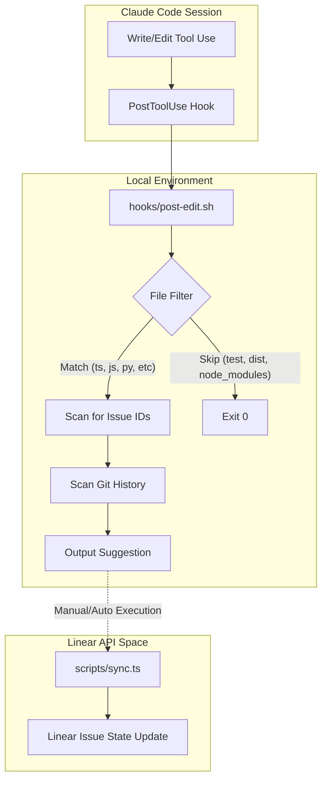
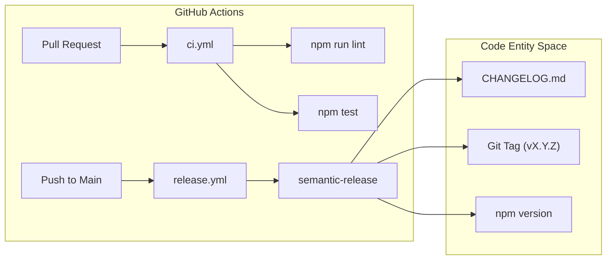

<!-- source: DeepWiki mcp.deepwiki.com · repo wrsmith108/linear-claude-skill · page 6 Automation & Integration · fetched 2026-10-26 -->

# Automation & Integration

Relevant source files

The following files were used as context for generating this wiki page:

- [SKILL.md](SKILL.md)
- [hooks/post-edit.sh](hooks/post-edit.sh)

The `linear-claude-skill` provides a robust automation layer designed to keep Linear project data in sync with local development activity. This is achieved through a combination of lifecycle hooks, a standardized MCP server configuration, and a GitHub Actions-based CI/CD pipeline.

## System Integration Overview

The automation architecture bridges the gap between the "Natural Language Space" (Claude's reasoning) and the "Code Entity Space" (Linear issues, projects, and local files).

### Logic Flow: Local Edit to Linear Sync

The following diagram illustrates how a file edit triggers a series of checks that ultimately suggest a Linear state update.

**Automation Trigger Flow**

**Sources:** [hooks/post-edit.sh:1-85](), [SKILL.md:145-162]()

## MCP Server Configuration

The skill integrates with Claude Code via the Model Context Protocol (MCP). This allows Claude to interact with Linear using high-level tools rather than raw shell commands when the MCP server is active.

| Component | Configuration Path | Purpose |
| :--- | :--- | :--- |
| **Server Name** | `mcp__linear` | Primary identifier for Linear tools [SKILL.md:6]() |
| **Auth Env** | `LINEAR_API_KEY` | Injected from `.env` or shell [SKILL.md:85-94]() |
| **Fallback** | `linear` CLI | Used when MCP is unavailable [SKILL.md:17-44]() |

**Sources:** [SKILL.md:5-94]()

## Post-Edit Automation

The `hooks/post-edit.sh` script is the primary mechanism for real-time integration. It is configured as a `PostToolUse` hook in `.claude/settings.json`.

- **Issue Detection**: Scans the edited file for patterns matching `[A-Z]{2,5}-[0-9]+` (e.g., `ENG-123`) [hooks/post-edit.sh:62-67]().
- **Git Context**: Cross-references the last 5 git commits to identify relevant issue IDs [hooks/post-edit.sh:69-73]().
- **Filtering**: Automatically ignores noise from `node_modules`, `dist`, `build`, and test directories to ensure relevant suggestions [hooks/post-edit.sh:37-57]().

For implementation details and configuration snippets, see **[Post-Edit Hook](#6.1)**.

**Sources:** [hooks/post-edit.sh:1-85]()

## CI/CD & Release Pipeline

The project maintains a professional release lifecycle using GitHub Actions. This ensures that the skill and its underlying `scripts/lib` remain stable and versioned.

**CI/CD Pipeline Mapping**

The pipeline uses `semantic-release` to automate versioning based on commit messages, preventing "release loops" in the CI environment.

For details on the release plugin chain and versioning strategy, see **[CI/CD & Release Pipeline](#6.2)**.

**Sources:** [SKILL.md:4]()

---

