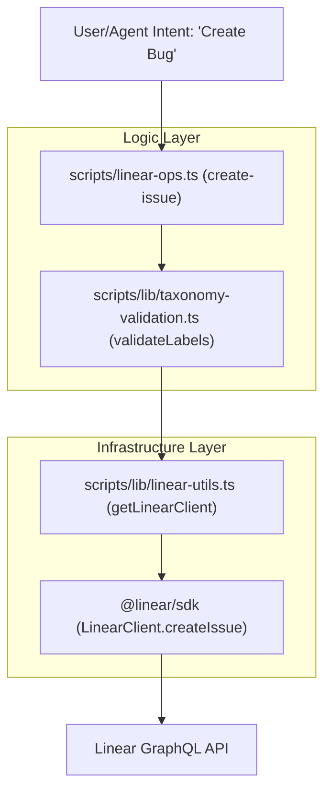
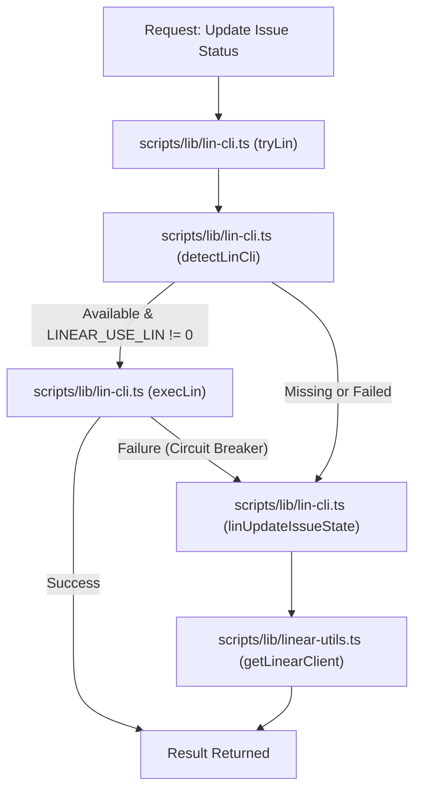

<!-- source: DeepWiki mcp.deepwiki.com · repo wrsmith108/linear-claude-skill · page 8 Glossary · fetched 2026-10-26 -->

# Glossary

Relevant source files

The following files were used as context for generating this wiki page:

- [.gitignore](.gitignore)
- [CHANGELOG.md](CHANGELOG.md)
- [README.md](README.md)
- [SKILL.md](SKILL.md)
- [scripts/build.mjs](scripts/build.mjs)
- [scripts/lib/index.ts](scripts/lib/index.ts)
- [scripts/lib/taxonomy.ts](scripts/lib/taxonomy.ts)
- [scripts/linear-ops.ts](scripts/linear-ops.ts)

This page provides definitions for codebase-specific terms, jargon, and domain concepts used within the `linear-claude-skill`. It serves as a technical reference for onboarding engineers to understand the implementation details and data flow of the system.

## Core Concepts

### Discovery Before Creation
A mandatory protocol requiring engineers (and AI agents) to search for existing entities in Linear before creating new ones to prevent duplication [README.md:156-168](). This is implemented via search commands in the CLI [scripts/linear-ops.ts:25]().

### Dual-Path Execution
The strategy of providing a high-performance path via the `lin` Rust CLI with a transparent fallback to the TypeScript SDK [README.md:7-20](). This is managed by the `tryLin` utility [scripts/lib/lin-cli.ts:113]().

### Label Taxonomy
A structured system for categorizing issues using three specific categories: **Domain**, **Type**, and **Scope** [scripts/lib/taxonomy.ts:8-47](). This system facilitates automated agent routing and consistent reporting [README.md:8]().

---

## Technical Terms & Jargon

| Term | Definition | Code Pointer |
| :--- | :--- | :--- |
| **AgentId** | A unique identifier for specialized AI agents (e.g., `security-manager`, `coder`) used for task routing. | [scripts/lib/taxonomy.ts:56-91]() |
| **Content vs Description** | Linear's distinction between a short 255-char `description` and the unlimited Markdown `content` field. | [README.md:186-195]() |
| **Health Status** | A project/initiative metric indicating progress state: `onTrack`, `atRisk`, or `offTrack`. | [scripts/lib/linear-utils.ts:100-102]() |
| **Initiative** | A high-level organizational entity in Linear that groups multiple projects together. | [scripts/linear-ops.ts:172-188]() |
| **Lin CLI** | An optional Rust-based binary (`lincli`) used as a "fast-path" for read operations. | [scripts/lib/lin-cli.ts:108-123]() |
| **MCP** | Model Context Protocol; the interface Claude uses to communicate with the Linear API. | [SKILL.md:17-21]() |
| **TaxonomyLabel** | A union type encompassing all valid labels defined in the skill's internal registry. | [scripts/lib/taxonomy.ts:49-51]() |
| **Varlock** | A security integration used to inject sensitive environment variables (like `LINEAR_API_KEY`) safely. | [SKILL.md:48-63]() |

---

## System Architecture & Data Flow

The following diagrams illustrate how natural language intent from a user or agent is translated into concrete code entities and API calls.

### Natural Language to Code Entity Mapping: Issue Management
This diagram shows how a request like "Create a bug report" flows through the system components.

**Sources:** [scripts/linear-ops.ts:86-170](), [scripts/lib/taxonomy-validation.ts:64-72](), [scripts/lib/linear-utils.ts:93-106]()

### Tool Selection & Fallback Logic
This diagram demonstrates the "Dual-Path" execution strategy where the system decides between the Rust `lin` CLI and the TypeScript SDK.

**Sources:** [scripts/lib/lin-cli.ts:108-123](), [README.md:20](), [scripts/linear-ops.ts:43-46]()

---

## Implementation Details

### Label Taxonomy Structure
The taxonomy is defined in `scripts/lib/taxonomy.ts` and populated in `scripts/lib/taxonomy-data.ts`. It maps labels to specific colors and agents.

*   **Domain Labels**: Represent technical areas (e.g., `frontend`, `security`) [scripts/lib/taxonomy.ts:16-30]().
*   **Type Labels**: Define work classification (e.g., `feature`, `bug`). Exactly one is required [scripts/lib/taxonomy.ts:32-35]().
*   **Scope Labels**: Flags for impact (e.g., `breaking-change`, `tech-debt`) [scripts/lib/taxonomy.ts:37-47]().

### Build System & Execution
To minimize cold-start latency for the CLI, the project uses `esbuild` to pre-compile TypeScript.

*   **`scripts/build.mjs`**: The build pipeline that bundles entry points into the `dist/` directory [scripts/build.mjs:11-30]().
*   **`scripts/run.sh`**: A shim that attempts to run the pre-compiled version in `dist/` but falls back to `tsx` (TypeScript Execute) if the build is missing or outdated [README.md:7]().
*   **`__BUNDLED__`**: A global constant injected by esbuild to let scripts know if they are running as a bundle or raw source [scripts/linear-ops.ts:29-30]().

**Sources:** [scripts/build.mjs:1-58](), [scripts/linear-ops.ts:1-30](), [README.md:1-20]()