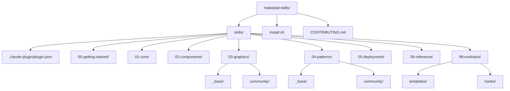
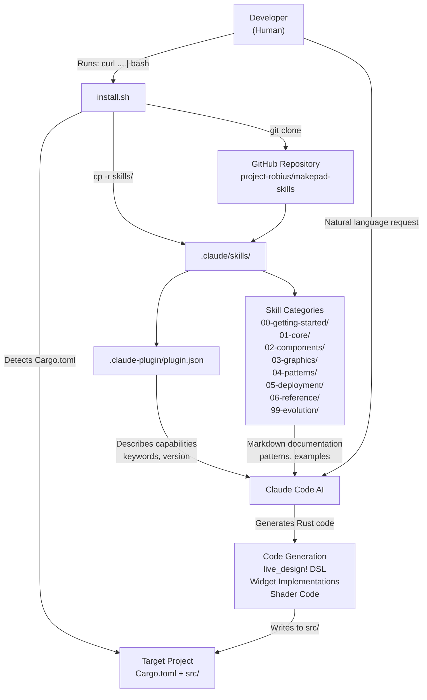
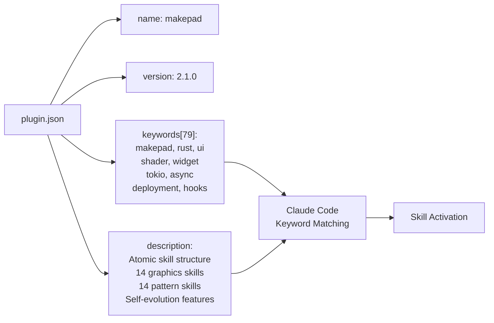
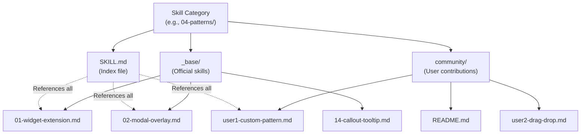
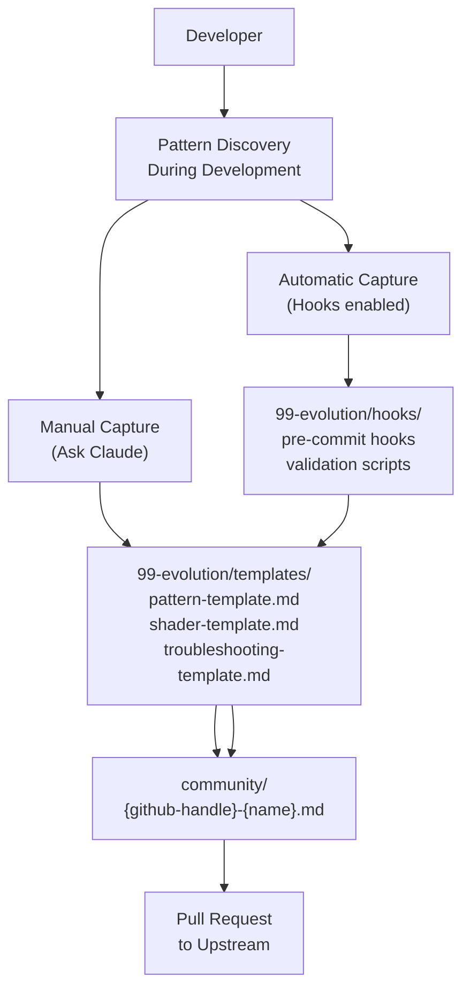
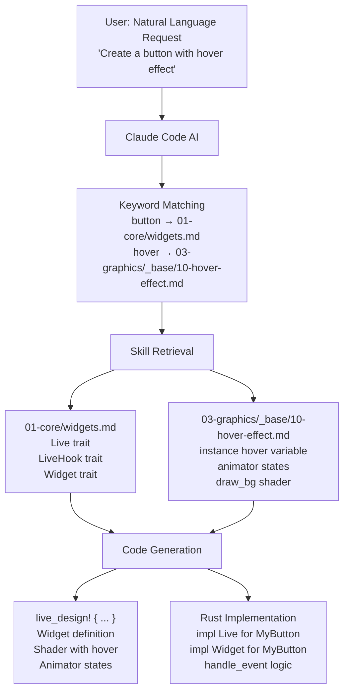

<!-- source: DeepWiki mcp.deepwiki.com · repo ZhangHanDong/makepad-skills · page 1 Overview · fetched 2026-10-26 -->

# Overview

Relevant source files

The following files were used as context for generating this wiki page:

- [README.ja.md](README.ja.md)
- [README.md](README.md)
- [README.zh-CN.md](README.zh-CN.md)
- [skills/.claude-plugin/plugin.json](skills/.claude-plugin/plugin.json)

The **makepad-skills** repository is a structured knowledge base designed to enable Claude Code AI to assist developers in building cross-platform UI applications using the [Makepad](https://github.com/makepad/makepad) framework in Rust. This system provides atomic, modular documentation organized into skill categories that cover project initialization, core development concepts, component usage, graphics programming, production patterns, deployment, and troubleshooting.

The skills are installed into a developer's project at [.claude/skills/]() and are automatically discovered by Claude Code through the plugin metadata at [.claude-plugin/plugin.json](). This overview describes the high-level architecture of the skill system, its installation mechanism, and how it integrates with Claude Code for intelligent code generation and assistance.

For details on the atomic skill structure that enables collaborative development, see [Atomic Skill Structure](#1.1). For information on capturing patterns during development, see [Self-Evolution System](#1.2). For installation instructions, see [Installation](#1.3).

## Repository Structure and File Organization

The makepad-skills repository is organized as a hierarchical skill system with the following directory structure:

**Sources:** [README.md:71-95](), [skills/.claude-plugin/plugin.json:1-81]()

### Directory Naming Convention

Skill categories use a two-digit prefix for ordering:

| Prefix | Category | Purpose |
|--------|----------|---------|
| `00-` | Getting Started | Project scaffolding and structure |
| `01-` | Core | Fundamental Makepad concepts (layout, widgets, events) |
| `02-` | Components | Built-in widget gallery reference |
| `03-` | Graphics | Shader programming, SDF drawing, animation |
| `04-` | Patterns | Production-ready application patterns |
| `05-` | Deployment | Platform-specific build and packaging |
| `06-` | Reference | Troubleshooting and code quality guidance |
| `99-` | Evolution | Self-improvement templates and hooks |

**Sources:** [README.md:230-293](), [README.md:99-123]()

## Installation and Integration Flow

The skills are installed into a target Makepad project using either the automated [install.sh]() script or manual file copying. The following diagram shows the complete installation and integration process:

**Sources:** [install.sh]() (referenced in [README.md:32-60]()), [README.md:71-95]()

### Install Script Detection Logic

The [install.sh]() script performs automatic project detection before installation:

| Check | Purpose |
|-------|---------|
| `Cargo.toml` exists | Validates Rust project |
| `--target DIR` option | Allows custom installation directory |
| Existing `.claude/skills/` | Creates backup before overwriting |
| `--with-hooks` flag | Copies self-evolution hooks from [99-evolution/hooks/]() |

**Sources:** [README.md:45-51](), [README.md:141-151]()

## Plugin Metadata and Skill Discovery

Claude Code discovers the skills through the metadata file at [skills/.claude-plugin/plugin.json](). This file defines:

**Sources:** [skills/.claude-plugin/plugin.json:1-81]()

### Key Metadata Fields

| Field | Content | Purpose |
|-------|---------|---------|
| `name` | `"makepad"` | Plugin identifier |
| `version` | `"2.1.0"` | Tracks atomic structure version |
| `description` | Atomic skill structure description | High-level capability summary |
| `keywords[79]` | makepad, rust, ui, shader, widget, tokio, async, deployment, hooks, etc. | Enables Claude to match user queries to relevant skills |

**Sources:** [skills/.claude-plugin/plugin.json:2-80]()

## Atomic Skill Architecture

Version 2.1 introduced an **atomic skill structure** that separates official skills from community contributions to enable parallel development without merge conflicts:

**Sources:** [README.md:99-123](), [README.md:106-116]()

### Atomic Structure Benefits

| Benefit | Implementation |
|---------|----------------|
| **No merge conflicts** | Community files at [community/{github-handle}-{name}.md]() never conflict with official files at [_base/{number}-{name}.md]() |
| **Parallel development** | Multiple contributors can add files simultaneously without coordination |
| **Clear attribution** | GitHub username in filename provides automatic credit |
| **Progressive disclosure** | [SKILL.md]() index provides overview, individual files provide details |

**Sources:** [README.md:118-122]()

## Skill Category Details

### Core Categories (00-06)

The following table describes each skill category and its key files:

| Category | Key Files | Primary Use Cases |
|----------|-----------|-------------------|
| **00-getting-started** | [init.md](), [project-structure.md]() | "Create new Makepad app", "How to organize project?" |
| **01-core** | [layout.md](), [widgets.md](), [events.md](), [styling.md]() | "Arrange UI elements", "Handle click events", "Add icons" |
| **02-components** | [SKILL.md]() (widget gallery reference) | "Use Button", "Add ScrollView", "Implement PortalList" |
| **03-graphics** | [_base/01-shader-structure.md]() through [_base/14-toggle-checkbox.md]() | "Write custom shader", "Draw SDF shapes", "Animate elements" |
| **04-patterns** | [_base/01-widget-extension.md]() through [_base/14-callout-tooltip.md]() | "Extend existing widget", "Show modal dialog", "Integrate tokio async" |
| **05-deployment** | Build and packaging guides | "Build for Android", "Package for macOS", "Deploy to web" |
| **06-reference** | [troubleshooting.md](), [code-quality.md](), [adaptive-layout.md]() | "Fix compilation error", "Refactor code", "Support desktop and mobile" |

**Sources:** [README.md:230-286]()

### Atomic Skills in 03-graphics

The [03-graphics/]() category contains 14 atomic skills in [_base/]():

| Skill File | Focus Area |
|------------|------------|
| `01-shader-structure.md` | Shader anatomy, instance/uniform/varying variables |
| `02-shader-math.md` | Color operations, transformations, vec4 math |
| `03-sdf-shapes.md` | Sdf2d primitives (circle, box, hexagon, rect) |
| `04-sdf-drawing.md` | fill, stroke, path operations |
| `05-progress-track.md` | Circular/linear progress indicators |
| `06-animator-basics.md` | Animation state machine, play/cut/snap |
| `07-easing-functions.md` | OutQuad, InQuad, ExpDecay easing |
| `08-keyframe-animation.md` | Multi-value keyframe sequences |
| `09-loading-spinner.md` | Rotating loading indicators |
| `10-hover-effect.md` | Interactive hover states |
| `11-gradient-effects.md` | Linear/radial gradients |
| `12-shadow-glow.md` | Drop shadows and glow effects |
| `13-disabled-state.md` | Disabled widget appearance |
| `14-toggle-checkbox.md` | Checkbox/toggle animations |

**Sources:** [README.md:250-260]()

### Atomic Patterns in 04-patterns

The [04-patterns/]() category contains 14 atomic patterns in [_base/]():

| Pattern File | Application Scenario |
|--------------|---------------------|
| `01-widget-extension.md` | Extending built-in widgets with custom behavior |
| `02-modal-overlay.md` | Overlay dialogs with backdrop |
| `03-collapsible.md` | Expandable/collapsible sections |
| `04-list-template.md` | Dynamic list rendering patterns |
| `05-lru-view-cache.md` | Caching rendered views for performance |
| `06-global-registry.md` | Singleton pattern for app-wide state |
| `07-radio-navigation.md` | Mutually exclusive navigation states |
| `08-async-loading.md` | Loading data asynchronously with state management |
| `09-streaming-results.md` | Handling streaming/chunked data |
| `10-state-machine.md` | Explicit state machine implementation |
| `11-theme-switching.md` | Runtime theme/appearance changes |
| `12-local-persistence.md` | Saving application state to disk |
| `13-tokio-integration.md` | Integrating tokio runtime with Makepad |
| `14-callout-tooltip.md` | Contextual tooltips with positioning |

**Sources:** [README.md:263-272]()

## Self-Evolution System (99-evolution)

The [99-evolution/]() category enables continuous improvement by capturing patterns discovered during development:

**Sources:** [README.md:124-165](), [README.md:287-292]()

### Evolution Components

| Component | Location | Purpose |
|-----------|----------|---------|
| **Templates** | [99-evolution/templates/]() | Standardized formats for pattern, shader, and troubleshooting contributions |
| **Hooks** | [99-evolution/hooks/]() | Optional automation scripts for error detection and pattern capture |
| **Settings Example** | [99-evolution/hooks/settings.example.json]() | Configuration template for enabling hooks |

**Sources:** [README.md:141-151](), [README.md:289-292]()

## Claude Code Integration Pattern

The following diagram illustrates how Claude Code consumes skills to generate Makepad code:

**Sources:** [skills/.claude-plugin/plugin.json:11-80](), [README.md:294-318]()

### Integration Points

| Integration Point | Mechanism | Code Location |
|-------------------|-----------|---------------|
| **Skill Discovery** | Claude reads [.claude-plugin/plugin.json]() on project load | `.claude/skills/.claude-plugin/plugin.json` |
| **Keyword Matching** | User query keywords matched against `keywords[]` array | [plugin.json:11-80]() |
| **Skill Loading** | Markdown files parsed from skill category directories | `.claude/skills/00-getting-started/`, `.claude/skills/01-core/`, etc. |
| **Code Generation** | Claude synthesizes examples from multiple skill files into user's `src/` directory | User project `src/` directory |

**Sources:** [README.md:71-95](), [skills/.claude-plugin/plugin.json:1-81]()

## Community Contribution Workflow

Users can contribute new patterns and skills back to the repository:

```mermaid
graph LR
    LocalDev["Local Development<br/>Discover useful pattern"]
    
    CreateFile["Create File<br/>04-patterns/community/<br/>{github-handle}-pattern.md"]
    
    FillTemplate["Use Template<br/>99-evolution/templates/<br/>pattern-template.md"]
    
    Frontmatter["Add Frontmatter<br/>name, author, source<br/>date, tags, level"]
    
    Fork["Fork Repository<br/>On GitHub"]
    
    Commit["Commit to Fork"]
    
    PullRequest["Submit Pull Request<br/>To project-robius/makepad-skills"]
    
    Review["Maintainer Review"]
    
    Promotion["Optional Promotion<br/>community/ → _base/<br/>With attribution"]
    
    LocalDev --> CreateFile
    CreateFile --> FillTemplate
    FillTemplate --> Frontmatter
    Frontmatter --> Fork
    Fork --> Commit
    Commit --> PullRequest
    PullRequest --> Review
    Review --> Promotion
```

**Sources:** [README.md:166-227]()

### Contribution File Naming

| Category | Naming Pattern | Example |
|----------|----------------|---------|
| Pattern | `{github-handle}-{pattern-name}.md` | `johndoe-infinite-scroll.md` |
| Shader/Effect | `{github-handle}-{effect-name}.md` | `johndoe-custom-blur.md` |
| Troubleshooting | `{error-name}.md` | `no-matching-field-font.md` |

All community contributions are placed in [community/]() subdirectories within their respective skill categories.

**Sources:** [README.md:169-207]()

## System Version and Maintenance

| Attribute | Current Value | Notes |
|-----------|---------------|-------|
| **Version** | `2.1.0` | Atomic skill structure introduced in v2.1 |
| **License** | MIT | Permissive open source license |
| **Repository** | `project-robius/makepad-skills` | Main upstream repository |
| **Branch** | `main` | Default installation branch (customizable via `--branch` flag) |

The [install.sh:1-end]() script supports installing from specific branches using the `--branch` option.

**Sources:** [skills/.claude-plugin/plugin.json:1-11](), [README.md:58]()

---

