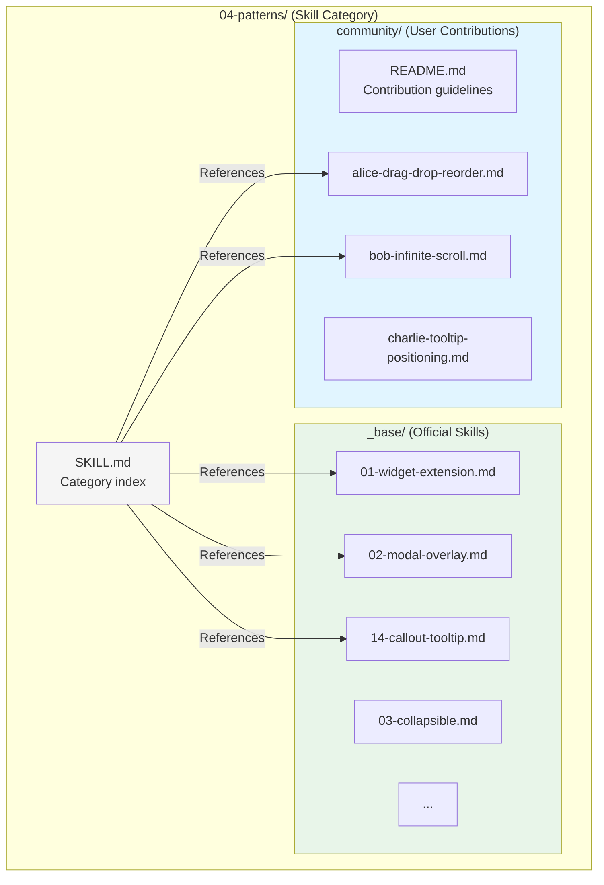
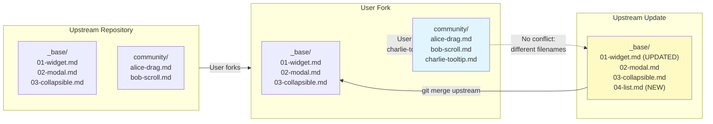
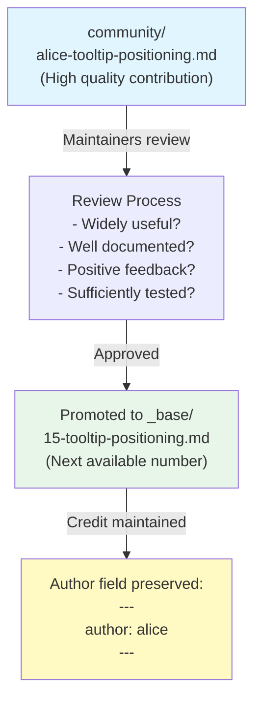
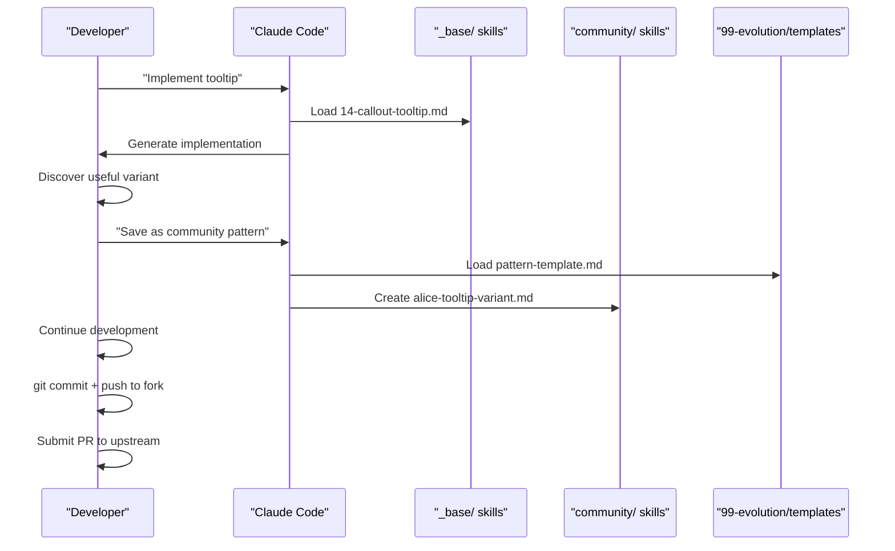

<!-- source: DeepWiki mcp.deepwiki.com · repo ZhangHanDong/makepad-skills · page 1.1 Atomic Skill Structure · fetched 2026-10-26 -->

# Atomic Skill Structure

<details>
<summary>Relevant source files</summary>

The following files were used as context for generating this wiki page:

- [README.ja.md](README.ja.md)
- [README.md](README.md)
- [README.zh-CN.md](README.zh-CN.md)

</details>


This document describes the atomic skill architecture used in makepad-skills v2.1+, which organizes skills into `_base/` (official) and `community/` (user contributions) directories to enable parallel development without merge conflicts. For information about how patterns are captured during development, see [Self-Evolution System](#1.2). For installation procedures, see [Installation](#1.3).

## Purpose and Scope

The atomic skill structure is a file organization pattern that separates official skills from community contributions within skill categories. This architecture enables multiple developers to contribute simultaneously to the skills repository without coordination overhead or merge conflicts. The structure applies to categories `03-graphics` and `04-patterns`, which contain domain-specific knowledge organized as independent, atomic units.

## Directory Organization



**Sources:** [README.md:99-123](), [README.zh-CN.md:99-123](), [README.ja.md:99-123]()

### Base Directory (`_base/`)

The `_base/` directory contains official, curated skills that are numbered sequentially. Each skill file represents an atomic unit of knowledge that can be consumed independently by Claude Code.

**Characteristics:**
- Sequential numbering: `01-`, `02-`, ..., `14-`
- Maintained by repository owners
- Tested and documented patterns
- Stable API surface

**Example structure for `03-graphics/_base/`:**
```
03-graphics/_base/
├── 01-shader-structure.md
├── 02-shader-math.md
├── 03-sdf-shapes.md
├── 04-sdf-drawing.md
├── 05-progress-track.md
├── 06-animator-basics.md
├── 07-easing-functions.md
├── 08-keyframe-animation.md
├── 09-loading-spinner.md
├── 10-hover-effect.md
├── 11-gradient-effects.md
├── 12-shadow-glow.md
├── 13-disabled-state.md
└── 14-toggle-checkbox.md
```

**Sources:** [README.md:250-260](), [README.zh-CN.md:250-260](), [README.ja.md:250-260]()

### Community Directory (`community/`)

The `community/` directory contains user-contributed skills using a collision-resistant naming scheme. Files follow the pattern `{github-handle}-{skill-name}.md`.

**Characteristics:**
- User-prefixed filenames prevent naming collisions
- Independent from `_base/` updates
- Attribution via filename
- Quality varies (not curated)

**Example structure for `04-patterns/community/`:**
```
04-patterns/community/
├── README.md
├── alice-drag-drop-reorder.md
├── bob-infinite-scroll.md
└── charlie-tooltip-positioning.md
```

**Sources:** [README.md:105-116](), [README.zh-CN.md:105-116](), [README.ja.md:105-116]()

## File Naming Conventions

| Location | Pattern | Example | Purpose |
|----------|---------|---------|---------|
| `_base/` | `{number}-{skill-name}.md` | `01-widget-extension.md` | Sequential official skills |
| `community/` | `{github-handle}-{skill-name}.md` | `alice-drag-drop-reorder.md` | User contributions |
| Category root | `SKILL.md` | `04-patterns/SKILL.md` | Category index |

### Frontmatter Requirements

Community contributions must include structured frontmatter for metadata:

```yaml
---
name: my-pattern-name
author: your-github-handle
source: project-where-you-discovered-this
date: 2024-01-15
tags: [tag1, tag2, tag3]
level: beginner|intermediate|advanced
---
```

**Sources:** [README.md:169-189](), [README.zh-CN.md:169-189](), [README.ja.md:169-189]()

## Merge Conflict Prevention Mechanism



The atomic structure prevents merge conflicts through namespace separation:

1. **Official updates** modify only `_base/` files
2. **User contributions** create only `community/{handle}-*.md` files
3. **No filename overlap** between upstream `_base/` changes and user `community/` additions

This allows users to sync with upstream while preserving local contributions:

```bash
git fetch upstream
git merge upstream/main --no-edit
# community/ files won't conflict with _base/ changes
```

**Sources:** [README.md:209-218](), [README.zh-CN.md:209-218](), [README.ja.md:209-218]()

## Index File Integration (`SKILL.md`)

Each skill category contains a `SKILL.md` index file at the category root that references both `_base/` and `community/` skills. This provides progressive disclosure: users browse the index first, then drill into individual skills.

**Example `04-patterns/SKILL.md` structure:**

```markdown
# Production Patterns

## Official Patterns (_base/)
- [01-widget-extension.md](_base/01-widget-extension.md)
- [02-modal-overlay.md](_base/02-modal-overlay.md)
...

## Community Patterns (community/)
- [alice-drag-drop-reorder.md](community/alice-drag-drop-reorder.md)
- [bob-infinite-scroll.md](community/bob-infinite-scroll.md)
```

**Benefits:**
- Single entry point per category
- Equal visibility for official and community skills
- Claude Code can scan index or load individual skills as needed

**Sources:** [README.md:105-123](), [README.zh-CN.md:105-123](), [README.ja.md:105-123]()

## Promotion Path



High-quality community contributions may be promoted to `_base/` through this process:

1. **Candidate identification**: Maintainers or community identify valuable patterns
2. **Quality assessment**: 
   - Pattern is broadly applicable (not project-specific)
   - Documentation is complete with examples
   - Community feedback is positive
   - Code has been tested in production
3. **Promotion**: File is moved to `_base/` with next sequential number
4. **Attribution preservation**: Original `author` field remains in frontmatter

**Example promotion:**
- Before: `community/alice-tooltip-positioning.md`
- After: `_base/15-tooltip-positioning.md` (with `author: alice` in frontmatter)

**Sources:** [README.md:220-227](), [README.zh-CN.md:220-227](), [README.ja.md:220-227]()

## Practical Usage Workflow



### Discovery and Consumption

When Claude Code searches for patterns, it scans both directories:

1. **Index scan**: Claude reads `SKILL.md` to discover available skills
2. **Skill loading**: Claude loads individual `.md` files as needed
3. **Pattern matching**: Claude identifies relevant skills based on user query

### Contribution Workflow

Developers contribute new patterns through these steps:

1. **Create file**: `04-patterns/community/{your-handle}-{pattern-name}.md`
2. **Use template**: Copy from `99-evolution/templates/pattern-template.md`
3. **Fill content**: Add frontmatter, description, code examples
4. **Local testing**: Verify Claude Code can consume the skill
5. **Submit PR**: Push to fork and create pull request

**Sources:** [README.md:152-165](), [README.zh-CN.md:152-165](), [README.ja.md:152-165]()

## Applicable Categories

The atomic structure currently applies to these categories:

| Category | `_base/` Count | Purpose |
|----------|----------------|---------|
| `03-graphics` | 14 skills | Shader structure, SDF drawing, animations, visual effects |
| `04-patterns` | 14 patterns | Widget patterns, data patterns, advanced patterns |

Other categories (`00-getting-started`, `01-core`, `02-components`, `05-deployment`, `06-reference`) use simpler flat structures because they contain foundational or reference material that requires central curation.

**Sources:** [README.md:250-273](), [README.zh-CN.md:250-273](), [README.ja.md:250-273]()

## Implementation in Repository

The physical file structure in the repository:

```
skills/
├── 03-graphics/
│   ├── SKILL.md                    # Category index
│   ├── _base/                      # 14 official skills
│   │   ├── 01-shader-structure.md
│   │   └── ...
│   └── community/                  # User contributions
│       ├── README.md
│       └── {handle}-{name}.md
├── 04-patterns/
│   ├── SKILL.md                    # Category index
│   ├── _base/                      # 14 official patterns
│   │   ├── 01-widget-extension.md
│   │   └── ...
│   └── community/                  # User contributions
│       ├── README.md
│       └── {handle}-{name}.md
└── 99-evolution/
    └── templates/                   # Templates for contributions
        ├── pattern-template.md
        ├── shader-template.md
        └── troubleshooting-template.md
```

**Sources:** [README.md:71-95](), [README.zh-CN.md:71-95](), [README.ja.md:71-95]()

---

