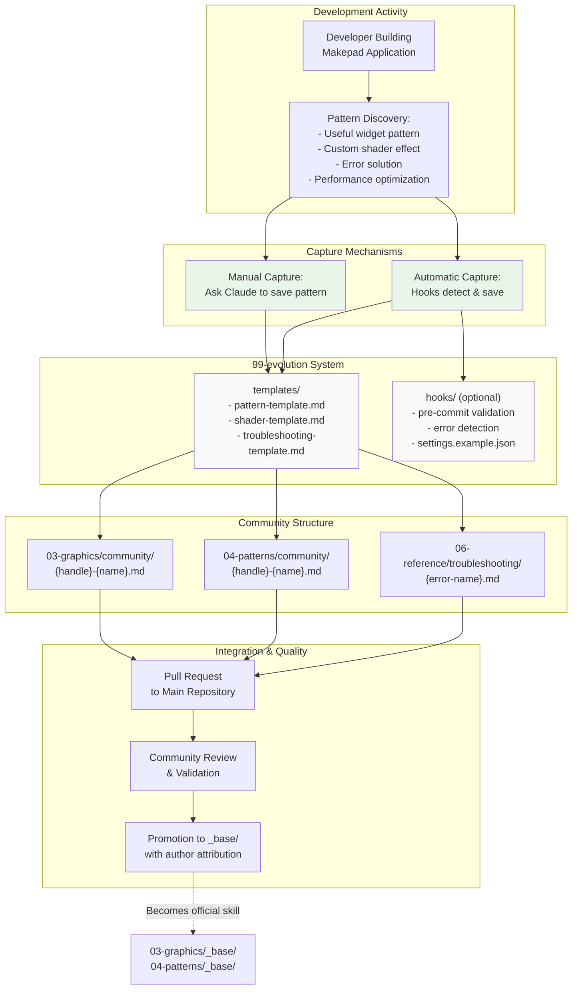
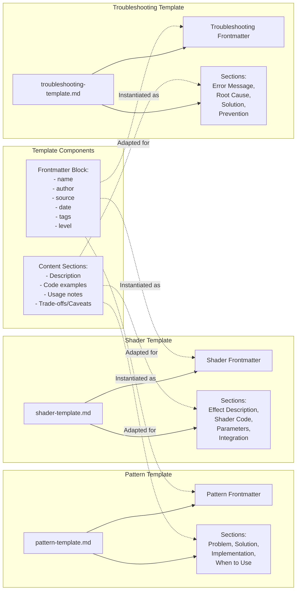
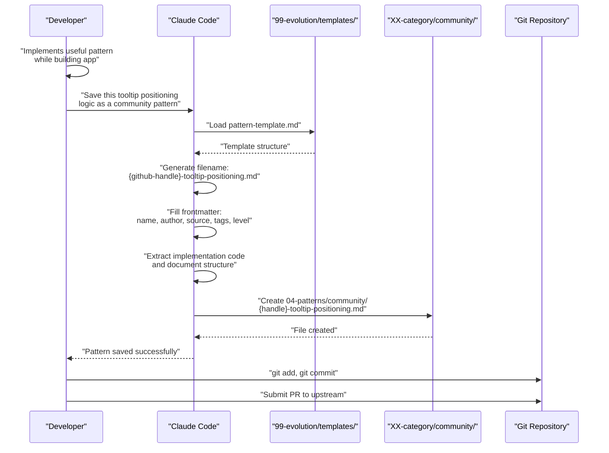
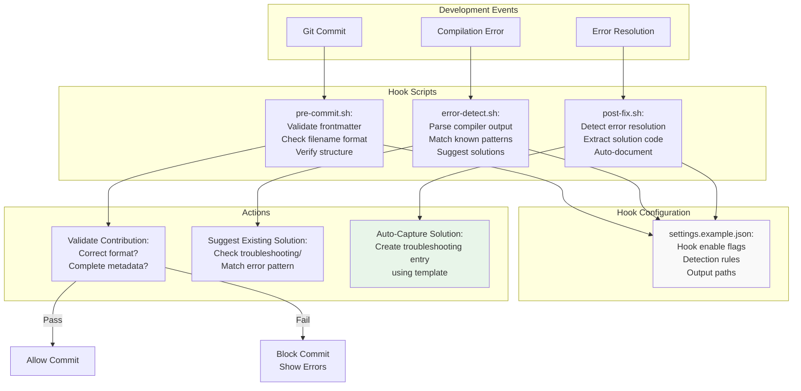
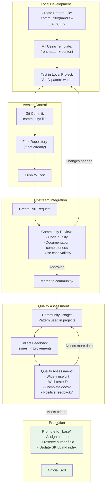
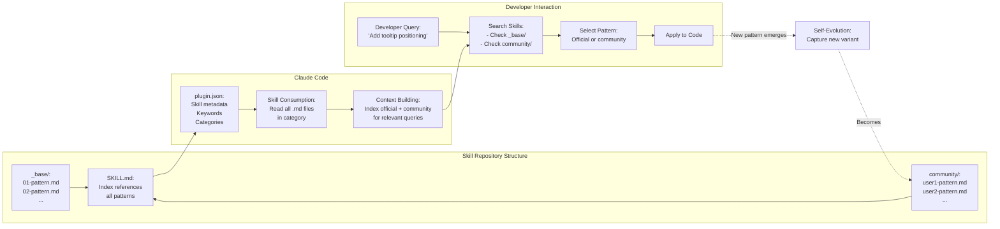

<!-- source: DeepWiki mcp.deepwiki.com · repo ZhangHanDong/makepad-skills · page 1.2 Self-Evolution System · fetched 2026-10-26 -->

# Self-Evolution System

<details>
<summary>Relevant source files</summary>

The following files were used as context for generating this wiki page:

- [README.ja.md](README.ja.md)
- [README.md](README.md)
- [README.zh-CN.md](README.zh-CN.md)

</details>


The self-evolution system enables capturing useful patterns, shaders, and error solutions discovered during Makepad development and converting them into reusable skills. This creates a feedback loop where development experience enriches the skills repository, making Claude Code progressively more effective at helping with Makepad applications.

This document covers the self-evolution mechanism, including templates, hooks, and the workflow for creating community contributions. For information about the atomic skill structure that enables conflict-free collaboration, see [Atomic Skill Structure](#1.1). For details about initial project setup, see [Installation](#1.3).

## System Architecture

The self-evolution system consists of three main components: templates for standardized pattern documentation, optional hooks for automatic detection, and a community contribution structure that prevents merge conflicts.



**Sources:** [README.md:99-293](), [README.zh-CN.md:99-293](), [README.ja.md:99-293]()

## Template System

The self-evolution system provides three standardized templates located in the `99-evolution/templates/` directory. These templates ensure consistent structure and metadata across all community contributions.

### Template File Structure

| Template File | Purpose | Target Location | Key Sections |
|--------------|---------|-----------------|--------------|
| `pattern-template.md` | Document reusable UI/application patterns | `04-patterns/community/` | Problem, Solution, Implementation, Trade-offs |
| `shader-template.md` | Document custom visual effects and shaders | `03-graphics/community/` | Effect description, Shader code, Parameters, Usage |
| `troubleshooting-template.md` | Document error solutions and workarounds | `06-reference/troubleshooting/` | Error symptoms, Root cause, Solution, Prevention |



**Sources:** [README.md:152-165](), [README.md:192-208](), [README.zh-CN.md:152-165]()

### Frontmatter Requirements

All community contributions must include YAML frontmatter with specific metadata fields:

```yaml
---
name: my-pattern-name
author: your-github-handle
source: project-where-you-discovered-this
date: 2024-01-15
tags: [tag1, tag2, tag3]
level: beginner|intermediate|advanced
---
```

| Field | Required | Description | Example |
|-------|----------|-------------|---------|
| `name` | Yes | Kebab-case identifier for the pattern | `drag-drop-reorder` |
| `author` | Yes | GitHub username for attribution | `yourhandle` |
| `source` | Yes | Project or context where pattern was discovered | `robrix`, `my-chat-app` |
| `date` | Yes | Creation date in ISO format | `2024-01-15` |
| `tags` | Yes | Array of relevant keywords | `[widget, interaction, state]` |
| `level` | Yes | Complexity indicator | `beginner`, `intermediate`, `advanced` |

**Sources:** [README.md:177-187](), [README.zh-CN.md:177-187](), [README.ja.md:177-187]()

## Manual Pattern Capture Workflow

Manual pattern capture is the primary mechanism for saving discoveries. Developers explicitly ask Claude Code to document useful patterns using the appropriate template.



**Sources:** [README.md:153-165](), [README.zh-CN.md:153-165](), [README.ja.md:153-165]()

### Manual Capture Examples

**Capturing a Pattern:**
```
User: Save this infinite scroll implementation as a community pattern
Claude: [Creates 04-patterns/community/yourhandle-infinite-scroll.md using pattern-template.md]
```

**Capturing a Shader Effect:**
```
User: Document this ripple hover effect as a community shader
Claude: [Creates 03-graphics/community/yourhandle-ripple-hover.md using shader-template.md]
```

**Capturing an Error Solution:**
```
User: I just fixed the "Apply error: no matching field" issue. Save the solution.
Claude: [Creates or updates 06-reference/troubleshooting/apply-error-no-field.md]
```

**Sources:** [README.md:294-318](), [README.zh-CN.md:294-318](), [README.ja.md:294-318]()

## Hooks System (Optional)

The hooks system provides automatic pattern detection and validation. Hooks are shell scripts that integrate with development workflow to capture patterns without explicit user requests.

### Enabling Hooks

Hooks are optional and must be manually enabled:

```bash
# Copy hooks from 99-evolution to project
cp -r your-project/.claude/skills/99-evolution/hooks your-project/.claude/skills/hooks

# Make hooks executable
chmod +x your-project/.claude/skills/hooks/*.sh

# Configure hooks in .claude/settings.json
# Reference: skills/99-evolution/hooks/settings.example.json
```

**Sources:** [README.md:140-151](), [README.zh-CN.md:140-151](), [README.ja.md:140-151]()

### Hook Execution Flow



**Sources:** [README.md:138-151](), [install.sh:1-200]() (inferred from --with-hooks flag)

## File Organization and Naming Conventions

Community contributions follow strict naming conventions to prevent merge conflicts during upstream synchronization.

### Directory Structure

```
.claude/skills/
├── 03-graphics/
│   ├── _base/                    # Official skills (numbered)
│   │   ├── 01-shader-structure.md
│   │   ├── 02-shader-math.md
│   │   └── ...
│   └── community/                # Community contributions
│       ├── README.md
│       ├── {handle1}-custom-blur.md
│       ├── {handle2}-neon-glow.md
│       └── {handle3}-particle-system.md
├── 04-patterns/
│   ├── _base/                    # Official patterns (numbered)
│   │   ├── 01-widget-extension.md
│   │   ├── 02-modal-overlay.md
│   │   └── ...
│   └── community/                # Community contributions
│       ├── README.md
│       ├── {handle1}-drag-drop.md
│       ├── {handle2}-virtual-scroll.md
│       └── {handle3}-data-grid.md
├── 06-reference/
│   └── troubleshooting/          # Mixed official and community
│       ├── apply-error.md
│       ├── shader-compile-error.md
│       └── {error-name}.md
└── 99-evolution/
    ├── templates/
    │   ├── pattern-template.md
    │   ├── shader-template.md
    │   └── troubleshooting-template.md
    └── hooks/
        ├── pre-commit.sh
        ├── error-detect.sh
        └── settings.example.json
```

**Sources:** [README.md:73-95](), [README.md:99-123](), [README.zh-CN.md:73-95]()

### Naming Convention Rules

| Category | File Location | Naming Pattern | Example |
|----------|--------------|----------------|---------|
| Pattern | `04-patterns/community/` | `{github-handle}-{pattern-name}.md` | `johndoe-infinite-scroll.md` |
| Shader/Effect | `03-graphics/community/` | `{github-handle}-{effect-name}.md` | `janedoe-ripple-effect.md` |
| Troubleshooting | `06-reference/troubleshooting/` | `{error-name}.md` | `apply-error-no-field.md` |

**Key Rules:**
- GitHub handle in filename provides automatic attribution
- Kebab-case for all names (lowercase, hyphens between words)
- Community files never conflict with numbered `_base/` files
- Troubleshooting files use error name, not author name (shared resource)

**Sources:** [README.md:169-208](), [README.zh-CN.md:169-208](), [README.ja.md:169-208]()

## Contribution and Promotion Workflow

Community contributions follow a standard Git workflow with potential promotion to official skills.



**Sources:** [README.md:220-227](), [README.zh-CN.md:220-227](), [README.ja.md:220-227]()

### Promotion Criteria

High-quality community contributions may be promoted to `_base/` directories when they meet these criteria:

| Criterion | Description | Validation Method |
|-----------|-------------|-------------------|
| **Wide Utility** | Pattern solves common problems across multiple projects | Usage in 3+ different projects |
| **Well-Tested** | Pattern proven stable in production environments | No critical issues reported |
| **Complete Documentation** | All sections filled, examples provided, trade-offs documented | Documentation review |
| **Positive Feedback** | Community finds pattern valuable and correct | GitHub reactions, comments |
| **Code Quality** | Follows Makepad best practices, idiomatic Rust | Code review |

**Promotion Process:**
1. Maintainers identify high-quality community contribution
2. Assign next available number in `_base/` sequence
3. Move file from `community/` to `_base/` with new number prefix
4. Preserve `author` field in frontmatter for attribution
5. Update category `SKILL.md` index file
6. Add reference in parent README

**Sources:** [README.md:220-227](), [README.zh-CN.md:220-227](), [README.ja.md:220-227]()

### Syncing with Upstream

Developers can sync their local skills with upstream updates while preserving their community contributions:

```bash
# Fork workflow: sync without conflicts
git fetch upstream
git merge upstream/main --no-edit
# Community files in community/ never conflict with _base/ updates
```

The atomic structure ensures:
- Official `_base/` files are numbered (e.g., `01-widget-extension.md`)
- Community files use author handles (e.g., `johndoe-custom-pattern.md`)
- No filename overlaps = no merge conflicts
- Upstream can add new `_base/` files without affecting community contributions

**Sources:** [README.md:209-218](), [README.zh-CN.md:209-218](), [README.ja.md:209-218]()

## Integration with Claude Code

The self-evolution system integrates seamlessly with Claude Code's skill consumption mechanism.



**Sources:** [README.md:99-123](), [skills/.claude-plugin/plugin.json:1-50]() (inferred)

The self-evolution system ensures that knowledge captured during development becomes immediately available to Claude Code for future assistance, creating a virtuous cycle of continuous improvement.

---

