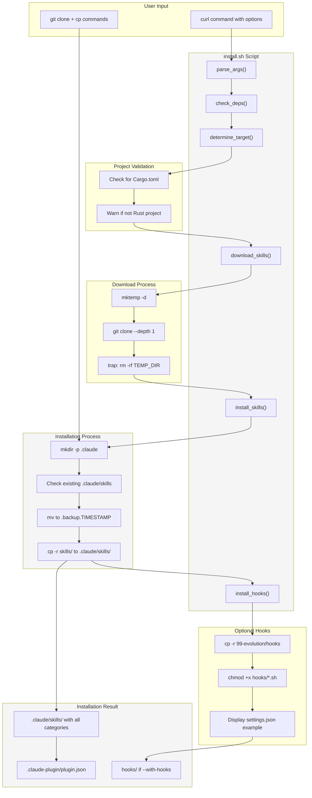
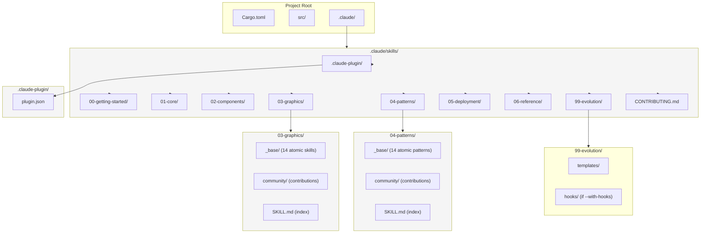
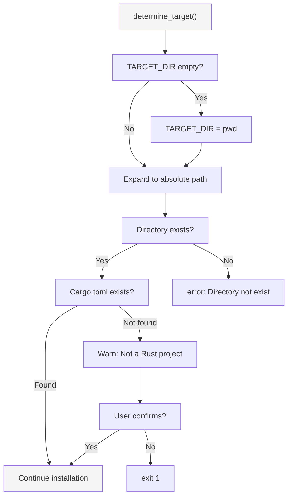

<!-- source: DeepWiki mcp.deepwiki.com · repo ZhangHanDong/makepad-skills · page 1.3 Installation · fetched 2026-10-26 -->

# Installation

<details>
<summary>Relevant source files</summary>

The following files were used as context for generating this wiki page:

- [README.md](README.md)
- [install.sh](install.sh)

</details>


This document explains how to install the makepad-skills repository into a Makepad project using either the automated install script or manual methods. The installation places skill files into the `.claude/skills/` directory where Claude Code can discover and use them.

For information about the atomic skill structure and community contributions, see [Atomic Skill Structure](#1.1). For details on the self-evolution system and hooks, see [Self-Evolution System](#1.2).

---

## Installation Overview

The makepad-skills system provides two installation methods:

1. **Quick Install** (recommended): Automated via `install.sh` script with project detection and backup
2. **Manual Install**: Git clone and manual file copying

Both methods install skills to `.claude/skills/` in the target project directory. The installation includes the `.claude-plugin/plugin.json` metadata file that describes the skills to Claude Code.

**Sources:** [README.md:28-98](), [install.sh:1-243]()

---

## Installation Flow



**Installation Flow Diagram**: Shows the complete installation process from user input through script execution to final result. The script validates the project, downloads skills to a temporary directory, backs up existing installations, and copies files to `.claude/skills/`.

**Sources:** [install.sh:66-91](), [install.sh:94-102](), [install.sh:105-124](), [install.sh:127-137](), [install.sh:140-159](), [install.sh:162-186]()

---

## Quick Install Method

### Basic Installation

The recommended installation method uses the `install.sh` script via curl:

```bash
# Install to current directory
curl -fsSL https://raw.githubusercontent.com/project-robius/makepad-skills/main/install.sh | bash
```

The script performs the following operations:

1. **Dependency Check**: Verifies git is installed via `check_deps()` [install.sh:94-102]()
2. **Project Detection**: Runs `determine_target()` to validate the directory contains `Cargo.toml` [install.sh:105-124]()
3. **Download**: Clones repository to temporary directory via `download_skills()` [install.sh:127-137]()
4. **Backup**: Creates timestamped backup of existing `.claude/skills/` if present [install.sh:149-153]()
5. **Installation**: Copies skills to `.claude/skills/` via `install_skills()` [install.sh:140-159]()

**Sources:** [README.md:30-50](), [install.sh:94-159]()

### Script Options

The install script accepts the following command-line options:

| Option | Description | Default | Example |
|--------|-------------|---------|---------|
| `--target DIR` | Install to specific directory | Current directory | `--target /path/to/project` |
| `--with-hooks` | Install self-evolution hooks | Not enabled | `--with-hooks` |
| `--branch NAME` | Use specific git branch | `main` | `--branch develop` |
| `--help` | Display usage information | N/A | `--help` |

**Sources:** [README.md:52-59](), [install.sh:45-64](), [install.sh:66-91]()

### Installation with Hooks

To enable the self-evolution system, install with hooks:

```bash
curl -fsSL https://raw.githubusercontent.com/project-robius/makepad-skills/main/install.sh | bash -s -- --with-hooks
```

This executes `install_hooks()` which:
1. Copies `99-evolution/hooks/` to `.claude/skills/hooks/`
2. Runs `chmod +x` on all `.sh` files in hooks directory
3. Displays example `settings.json` configuration from `hooks/settings.example.json`

The hooks require manual configuration in `.claude/settings.json` after installation.

**Sources:** [README.md:38-39](), [install.sh:162-186]()

### Install to Specific Project

To install to a project in a different directory:

```bash
curl -fsSL https://raw.githubusercontent.com/project-robius/makepad-skills/main/install.sh | bash -s -- --target /path/to/project
```

The script resolves the target to an absolute path and validates it exists before proceeding [install.sh:110-111]().

**Sources:** [README.md:41-43](), [install.sh:105-124]()

---

## Manual Installation Method

For users who prefer manual control or cannot use the install script:

### Step 1: Clone Repository

```bash
git clone https://github.com/project-robius/makepad-skills.git
```

This clones the entire repository including all skill categories, templates, and metadata.

### Step 2: Copy Skills Directory

```bash
cp -r makepad-skills/skills your-project/.claude/skills
```

This copies the complete `skills/` directory structure to `.claude/skills/` in the target project.

**Sources:** [README.md:61-69]()

---

## Post-Installation Directory Structure

After installation, the project contains the following structure:



**Post-Installation Structure Diagram**: Shows the complete directory hierarchy after installation. The `.claude/skills/` directory contains skill categories (00-99), metadata in `.claude-plugin/`, and the atomic structure with `_base/` and `community/` directories in categories 03 and 04.

**Sources:** [README.md:71-97](), [install.sh:189-211]()

### Directory Hierarchy Table

| Path | Description | Contents |
|------|-------------|----------|
| `.claude/skills/.claude-plugin/` | Plugin metadata | `plugin.json` with skill descriptions and keywords |
| `.claude/skills/00-getting-started/` | Project setup | `init.md`, `project-structure.md` |
| `.claude/skills/01-core/` | Core concepts | `layout.md`, `widgets.md`, `events.md`, `styling.md` |
| `.claude/skills/02-components/` | Widget gallery | Built-in component references |
| `.claude/skills/03-graphics/` | Graphics skills | `_base/` (14 atomic skills), `community/`, `SKILL.md` |
| `.claude/skills/04-patterns/` | Production patterns | `_base/` (14 atomic patterns), `community/`, `SKILL.md` |
| `.claude/skills/05-deployment/` | Build & package | Platform-specific build instructions |
| `.claude/skills/06-reference/` | Reference materials | `troubleshooting.md`, `code-quality.md`, `adaptive-layout.md` |
| `.claude/skills/99-evolution/` | Self-improvement | `templates/`, `hooks/` (optional) |
| `.claude/skills/CONTRIBUTING.md` | Contribution guide | Community contribution instructions |

**Sources:** [README.md:73-95](), [install.sh:199-211]()

---

## Project Detection and Validation

The install script validates the target directory using `determine_target()`:



**Project Detection Flow**: The `determine_target()` function validates the installation directory, checks for `Cargo.toml`, and prompts for confirmation if not found.

The validation logic:
1. Uses current directory if `--target` not specified [install.sh:106-108]()
2. Expands to absolute path [install.sh:111]()
3. Checks for `Cargo.toml` file [install.sh:116]()
4. Prompts user for confirmation if not a Rust project [install.sh:117-123]()

**Sources:** [install.sh:105-124]()

---

## Backup Mechanism

When an existing `.claude/skills/` directory is detected, the script creates a timestamped backup:

```bash
# Backup logic from install_skills()
if [[ -d "$SKILLS_DIR" ]]; then
    local BACKUP_DIR="$SKILLS_DIR.backup.$(date +%Y%m%d%H%M%S)"
    mv "$SKILLS_DIR" "$BACKUP_DIR"
fi
```

The backup directory follows the naming pattern `.claude/skills.backup.YYYYMMDDHHMMSS`, where the timestamp ensures unique backup names for multiple installations.

**Sources:** [install.sh:149-153]()

---

## Hooks Configuration

When installed with `--with-hooks`, the hooks require manual configuration in `.claude/settings.json`. The script displays an example configuration from `hooks/settings.example.json` [install.sh:179-182]().

The hooks system:
1. **Location**: Copied from `99-evolution/hooks/` to `.claude/skills/hooks/`
2. **Permissions**: All `.sh` files made executable with `chmod +x`
3. **Activation**: Requires adding hook configuration to `.claude/settings.json`

See [Self-Evolution System](#1.2) for detailed hook configuration and usage.

**Sources:** [install.sh:162-186](), [README.md:140-151]()

---

## Verification

After installation completes, verify the installation by checking:

1. **Skills directory exists**: `.claude/skills/` contains skill categories
2. **Plugin metadata present**: `.claude-plugin/plugin.json` exists
3. **Directory permissions**: All files readable by Claude Code
4. **Hooks executable** (if installed): `.claude/skills/hooks/*.sh` have execute permission

The script's `print_summary()` function displays the complete directory structure and next steps [install.sh:189-228]().

**Sources:** [install.sh:189-228]()

---

## Troubleshooting Installation

### Common Issues

| Issue | Cause | Solution |
|-------|-------|----------|
| `git is required but not installed` | Missing git dependency | Install git via system package manager |
| `Failed to clone repository` | Network connectivity | Check internet connection and firewall |
| `Target directory does not exist` | Invalid `--target` path | Verify path exists or omit for current directory |
| `No Cargo.toml found` | Not a Rust project | Confirm target directory or use manual installation |

### Repository Access

The script clones from `https://github.com/project-robius/makepad-skills` using shallow clone (`--depth 1`) to minimize download size [install.sh:133]().

If the repository URL changes, update the `REPO_URL` variable [install.sh:22]() or use a forked repository with the same structure.

**Sources:** [install.sh:22](), [install.sh:94-137]()

---

## Script Configuration

The install script defines configuration at the top of the file:

| Variable | Default | Purpose |
|----------|---------|---------|
| `REPO_URL` | `https://github.com/project-robius/makepad-skills` | Repository to clone |
| `BRANCH` | `main` | Git branch to use |
| `TARGET_DIR` | Current directory | Installation target |
| `WITH_HOOKS` | `false` | Enable hooks installation |

These can be modified by editing `install.sh` or using command-line options (`--branch`, `--target`, `--with-hooks`).

**Sources:** [install.sh:21-26](), [install.sh:66-91]()

---

