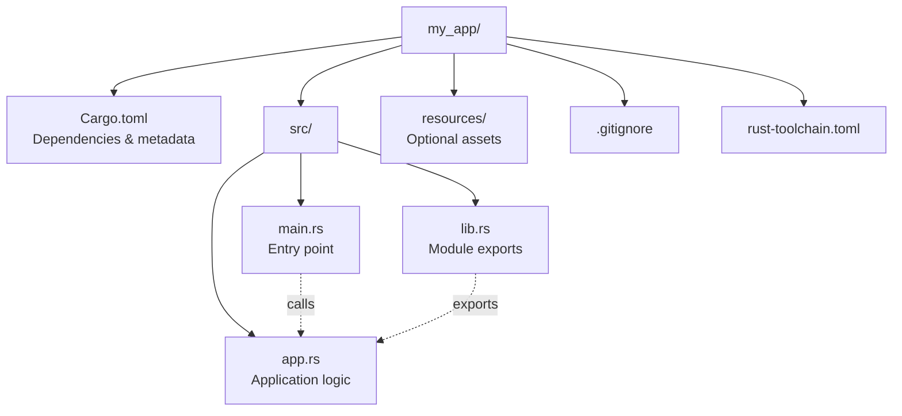
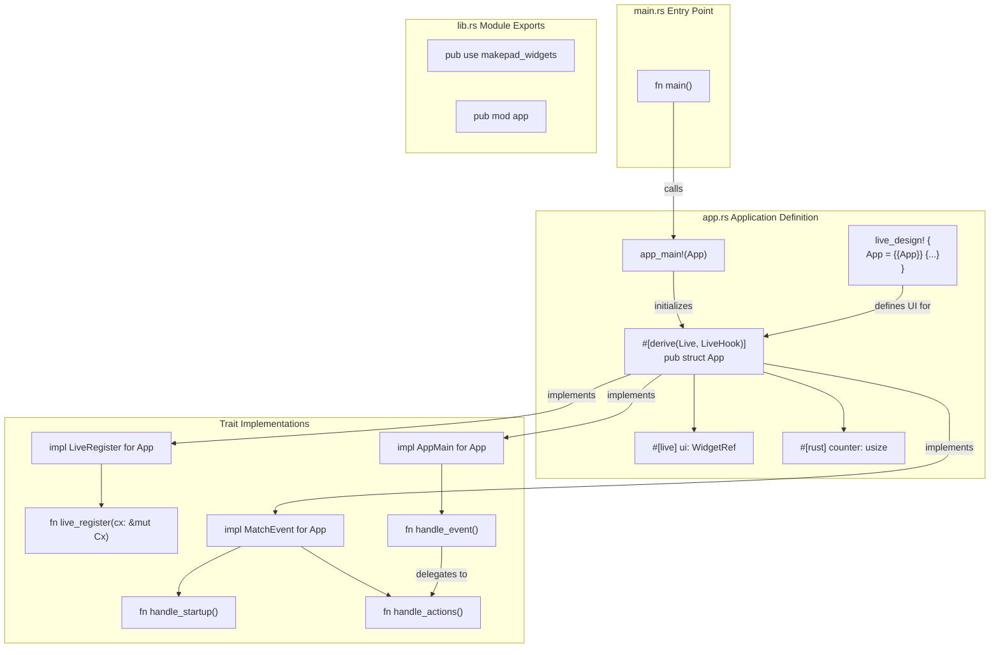
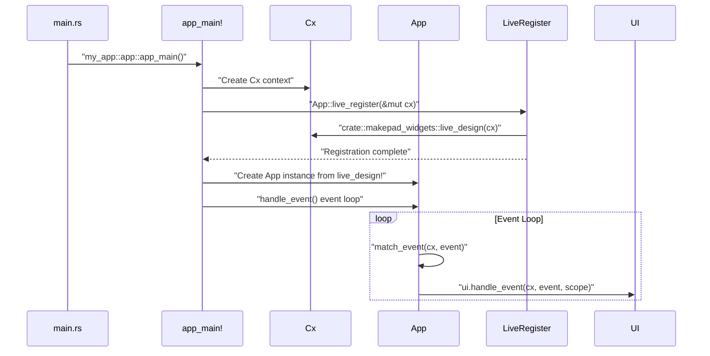
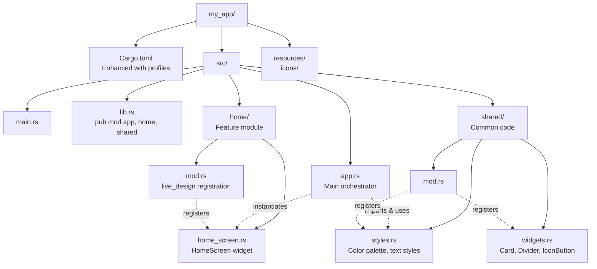
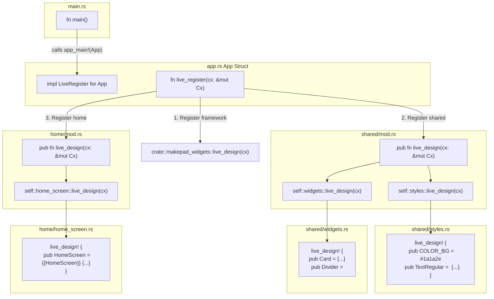

<!-- source: DeepWiki mcp.deepwiki.com · repo ZhangHanDong/makepad-skills · page 2.1 Project Initialization · fetched 2026-10-26 -->

# Project Initialization

<details>
<summary>Relevant source files</summary>

The following files were used as context for generating this wiki page:

- [skills/00-getting-started/init.md](skills/00-getting-started/init.md)

</details>


This document details the process of creating new Makepad projects from templates. It covers the two primary initialization approaches (simple and production), the file structure, key code entities (`live_design!`, `app_main!`, `App` struct, trait implementations), and the registration system that connects all modules.

For information about organizing code within an existing project, see [Project Structure](#2.2). For details about the `live_design!` DSL syntax used in widgets and styling, see [Widget System](#3.2) and [Styling: Fonts and Icons](#3.4).

## Initialization Approaches

Makepad projects can be initialized using two template structures based on project complexity:

| Template Type | Use Case | File Count | Module Organization |
|--------------|----------|------------|---------------------|
| **Simple App** | Learning, prototyping, single-file applications | 5 core files | Flat structure with `app.rs` only |
| **Production App** | Multi-screen applications, team projects, cross-platform apps | 10+ files | Modular structure with `shared/`, `home/`, feature modules |

Both templates produce runnable applications with identical core functionality but differ in their extensibility and organization patterns.

**Sources**: [skills/00-getting-started/init.md:10-15]()

## Simple App Template Structure

### File Organization

The simple template creates a minimal project structure focused on rapid prototyping:



**Sources**: [skills/00-getting-started/init.md:18-30]()

### Core Code Entities

The simple template demonstrates the minimum required code entities for a Makepad application:



**Sources**: [skills/00-getting-started/init.md:46-134]()

### Dependency Configuration

The `Cargo.toml` declares the `makepad-widgets` dependency from the upstream repository:

[skills/00-getting-started/init.md:34-44]()

Key configuration points:
- **Package metadata**: Name, version, edition, description, license
- **Dependency**: `makepad-widgets` from GitHub on the `rik` branch
- No additional dependencies in the simple template

### Application Entry Flow



**Sources**: [skills/00-getting-started/init.md:46-134]()

### Key Code Patterns

The simple template establishes fundamental patterns used throughout Makepad development:

**live_design! macro usage** [skills/00-getting-started/init.md:66-98]():
- Imports framework components via `use link::theme::*`, `use link::shaders::*`, `use link::widgets::*`
- Defines the `App` struct template with `App = {{App}}`
- Nests widgets in a hierarchy: `Root > Window > View > Label, Button`
- Uses identifiers like `button1`, `counter_label` for widget references

**app_main! macro** [skills/00-getting-started/init.md:100]():
- Generates the application entry point and event loop
- Takes the `App` struct as its argument
- Creates platform-specific window and rendering contexts

**App struct definition** [skills/00-getting-started/init.md:102-106]():
- `#[derive(Live, LiveHook)]`: Enables live reloading and DSL integration
- `#[live] ui: WidgetRef`: Widget tree root, populated from `live_design!`
- `#[rust] counter: usize`: Rust-only state not exposed to DSL

**LiveRegister trait** [skills/00-getting-started/init.md:108-112]():
- Registers all `live_design!` blocks with the `Cx` context
- Must call `crate::makepad_widgets::live_design(cx)` to register framework widgets
- Called once during application initialization

**MatchEvent trait** [skills/00-getting-started/init.md:114-126]():
- `handle_startup()`: Initialization logic after UI is created
- `handle_actions()`: Responds to widget actions (button clicks, input changes)
- Uses `self.ui.button(ids!(button1)).clicked(&actions)` to detect specific widget events

**AppMain trait** [skills/00-getting-started/init.md:128-133]():
- `handle_event()`: Main event dispatch method
- Delegates to `match_event()` for application logic
- Forwards events to UI tree via `self.ui.handle_event()`

## Production App Template Structure

### Directory Organization

The production template introduces a modular structure for scalable applications:



**Sources**: [skills/00-getting-started/init.md:156-177]()

### Enhanced Cargo Configuration

The production `Cargo.toml` adds several features:

[skills/00-getting-started/init.md:179-215]()

| Section | Purpose | Key Additions |
|---------|---------|---------------|
| `[package]` | Enhanced metadata | `authors`, `repository` fields |
| `[dependencies]` | Common utilities | `anyhow`, `serde`, `serde_json` (commented `robius-*` options) |
| `[features]` | Feature flags | Placeholder for conditional compilation |
| `[profile.release]` | Standard release | `opt-level = 3` |
| `[profile.release-lto]` | LTO optimization | `lto = "thin"` for smaller binaries |
| `[lints.clippy]` | Lint configuration | `too_many_arguments = "allow"` for Makepad patterns |

### Module Registration Flow

The production template demonstrates hierarchical module registration:



**Sources**: [skills/00-getting-started/init.md:217-290](), [skills/00-getting-started/init.md:292-304](), [skills/00-getting-started/init.md:404-414]()

### Shared Module Architecture

The `shared/` module provides reusable design tokens and components:

**shared/styles.rs** [skills/00-getting-started/init.md:307-363]():
- **Color palette**: Constants like `COLOR_BG`, `COLOR_PRIMARY`, `COLOR_ACCENT` defined with hex values
- **Spacing constants**: `SPACING_SM`, `SPACING_MD`, `SPACING_LG` for consistent layout
- **Border radius constants**: `RADIUS_SM`, `RADIUS_MD`, `RADIUS_LG`
- **Text style templates**: `TextRegular`, `TextTitle`, `TextSubtitle` with pre-configured fonts and colors
- **Button templates**: `PrimaryButton` with accent color and styling

**shared/widgets.rs** [skills/00-getting-started/init.md:366-402]():
- **Card**: `<RoundedView>` with padding, background color, and rounded corners
- **Divider**: Horizontal line widget with `height: 1` and dimmed color
- **IconButton**: Square button with transparent background and circular radius

Both files use `pub` declarations to export components for use in other modules via `use crate::shared::styles::*` and `use crate::shared::widgets::*`.

### Feature Module Pattern

The `home/` directory demonstrates the feature module pattern:

**home/mod.rs** [skills/00-getting-started/init.md:404-414]():
- Declares submodules: `pub mod home_screen;`
- Provides aggregated `live_design()` function that calls all submodule registrations
- Follows the same pattern used in `shared/mod.rs`

**home/home_screen.rs** [skills/00-getting-started/init.md:416-484]():

Widget definition structure:
1. `live_design!` block with `pub HomeScreen = {{HomeScreen}}` template
2. Struct definition: `#[derive(Live, LiveHook, Widget)] pub struct HomeScreen`
3. `#[deref] view: View` field for view delegation
4. `impl Widget` with `handle_event()` and `draw_walk()` methods
5. `impl WidgetMatchEvent` with `handle_actions()` for event handling

This pattern allows the `HomeScreen` widget to be used in `app.rs` like any built-in widget: `<HomeScreen> {}`.

### App Orchestrator Role

The production `app.rs` serves as the main orchestrator:

[skills/00-getting-started/init.md:228-290]()

Key differences from simple template:
- **Imports shared styles**: `use crate::shared::styles::*;` in both Rust and `live_design!`
- **Imports feature widgets**: `use crate::home::home_screen::HomeScreen;` in `live_design!`
- **Minimal state**: Only `#[live] ui: WidgetRef`, no application-specific state
- **Delegates to widgets**: `handle_actions()` is empty; widgets handle their own actions
- **Comprehensive registration**: Calls `shared::live_design()` and `home::live_design()` in `LiveRegister`

This design allows the `App` struct to remain simple while feature complexity grows in dedicated modules.

## Template Comparison

| Aspect | Simple Template | Production Template |
|--------|----------------|---------------------|
| **File count** | 5 files | 10+ files |
| **App state** | Stored in `App` struct | Distributed across feature widgets |
| **Event handling** | Centralized in `App::handle_actions()` | Delegated to widget modules |
| **Styling** | Inline in widgets | Centralized in `shared/styles.rs` |
| **Module structure** | Flat (`app.rs` only) | Hierarchical (`home/`, `shared/`) |
| **Registration** | Single `live_design(cx)` call | Cascading calls through `mod.rs` files |
| **Extensibility** | Add code to `app.rs` | Add new directories under `src/` |
| **Widget reuse** | Copy-paste within `app.rs` | Import from `shared/widgets.rs` |
| **Team collaboration** | Limited (single file conflicts) | High (separate feature directories) |

**Sources**: [skills/00-getting-started/init.md:10-493]()

## Running and Building

### Desktop Execution

Both templates use standard Cargo commands:

[skills/00-getting-started/init.md:496-500]()

```bash
cargo run --release
```

The `--release` flag is recommended for performance, as debug builds can be slow for graphics-intensive applications.

### Mobile Platforms

Mobile builds require the `cargo-makepad` CLI tool:

[skills/00-getting-started/init.md:502-513]()

Installation:
```bash
cargo install --force --git https://github.com/makepad/makepad.git --branch rik cargo-makepad
```

Platform-specific commands:
- **Android**: `cargo makepad android run -p my-app --release`
- **iOS Simulator**: `cargo makepad apple ios run-sim -p my-app --release`

The `-p` flag specifies the package name from `Cargo.toml`.

## Extension Patterns

### Adding Screens

Process for adding a new feature screen:

[skills/00-getting-started/init.md:517-523]()

1. Create `src/screens/new_screen.rs` with widget definition
2. Add `pub mod new_screen;` to `src/screens/mod.rs`
3. Register in `mod.rs`: `self::new_screen::live_design(cx);`
4. Import in parent: `use crate::screens::new_screen::NewScreen;`
5. Instantiate in `live_design!`: `<NewScreen> {}`

### Resource Integration

**Images** [skills/00-getting-started/init.md:525-537]():
```rust
live_design! {
    IMG_LOGO = dep("crate://self/resources/logo.png")
    
    <Image> {
        source: (IMG_LOGO)
        width: 100, height: 100
    }
}
```

**Custom fonts** [skills/00-getting-started/init.md:539-554]():
```rust
live_design! {
    FONT_CUSTOM = dep("crate://self/resources/fonts/CustomFont.ttf")
    
    <Label> {
        draw_text: {
            text_style: {
                font: { path: (FONT_CUSTOM) }
                font_size: 16.0
            }
        }
    }
}
```

The `dep("crate://self/...")` syntax references files relative to the crate root during compilation.

## Initialization Checklist

When setting up a new project, verify these requirements:

[skills/00-getting-started/init.md:556-567]()

| Item | Requirement | Location |
|------|-------------|----------|
| Package metadata | Name, version, edition, description, license | `Cargo.toml` |
| Makepad dependency | Correct branch (`rik` or `dev`) | `Cargo.toml` `[dependencies]` |
| Widget re-export | `pub use makepad_widgets` | `lib.rs` |
| Entry point | `my_app::app::app_main()` call | `main.rs` |
| Module registration | All `live_design(cx)` calls in `LiveRegister` | `app.rs` |
| Git ignore | `/target` and IDE files | `.gitignore` |
| Rust version | Stable channel specified | `rust-toolchain.toml` |

Missing any of these can cause compilation errors or runtime panics during initialization.

## Reference Projects

Production applications using these patterns:

[skills/00-getting-started/init.md:569-573]()

- **Robrix**: Matrix client demonstrating multi-screen navigation, async networking, and cross-platform deployment
- **Moly**: AI application showing complex state management and GPU-accelerated rendering
- **Makepad Examples**: Official examples in the framework repository

These projects serve as reference implementations for production-grade architecture and advanced features.

**Sources**: [skills/00-getting-started/init.md:1-573]()

---

